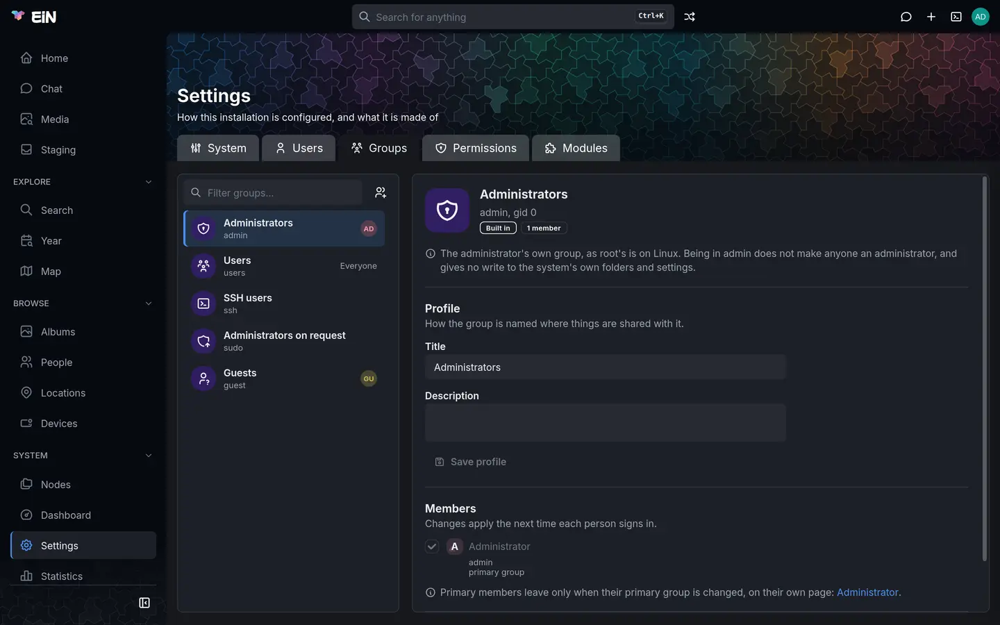

# Accounts and groups

This page is for the administrator who gives people accounts in EiN and puts them in groups. It
covers the **Users**, **Groups** and **Permissions** tabs of **Settings**, the built-in accounts
and groups, how to let a second person administer, and the same work in the terminal.

What a group may see and change is decided by the sharing of each folder, and with the Archive of each album, not here.
[Sharing](../guide/sharing.md) shows how to share with a group, and
[Permissions in depth](permissions.md) explains owners, groups and modes.

## Where accounts are managed

Choose **Settings** under **System** in the sidebar. The **Users**, **Groups** and **Permissions**
tabs are there only while you act as the administrator; anyone else sees **Modules** alone.

On **Users** and **Groups**, nothing opens over the page. The list is on the left; pick an entry
and its panel opens beside it, where each change is made as you make it. The button beside the
list's filter makes a new entry: **New user** on Users, **New group** on Groups. On a wide screen
the list and the panel fill the window side by side and each scrolls on its own. On a phone or in a
narrow window they take turns: the panel has **All users** or **All groups** above it, and the
browser's Back button returns to the list too.

The open entry is part of the address, such as `/settings?tab=users&user=helen`, so you can
bookmark an account or send the link to another administrator.

## The accounts and groups EiN starts with

EiN makes these at its first start, and none can be deleted. The two accounts are marked
**Administrator** and **Guest** in their panels, and each of the groups **Built in**.

| Account | Title         | What it is                                                                                                                                                                                                                                                                                           |
| ------- | ------------- | ---------------------------------------------------------------------------------------------------------------------------------------------------------------------------------------------------------------------------------------------------------------------------------------------------- |
| `admin` | Administrator | The administrator. It cannot be disabled or deleted. Its first password is `INITIAL_ADMIN_PASSWORD` in `~/ein/.env`, which `setup.sh` prints at the end of each run until you delete that line; [First steps](../start/first-steps.md#sign-in-and-change-the-admin-password) shows how to change it. |
| `guest` | Guest         | Who a visitor browses as when **Visitors may browse** is on. It has no password, cannot be given one, and its groups give it nothing.                                                                                                                                                                |

| Group   | Title                     | What it is for                                                                                                                                                            |
| ------- | ------------------------- | ------------------------------------------------------------------------------------------------------------------------------------------------------------------------- |
| `admin` | Administrators            | The `admin` account's own group, as `root`'s is on Linux. Being in it does not make anyone an administrator and gives no write to the system's own folders and settings.  |
| `users` | Users                     | Every account that signs in belongs to it, without being added. Sharing with `users` shares with everyone who has an account.                                             |
| `ssh`   | SSH users                 | Its members may use `ssh`, `scp` and `ssh-copy-id` to reach other machines from EiN. See [Reaching other machines](../shell/remote.md).                                   |
| `sudo`  | Administrators on request | Its members may act as the administrator for one sign-in, after entering their own password again. See [Let a second person administer](#let-a-second-person-administer). |
| `guest` | Guests                    | The `guest` account's own group. What this group may see, visitors may see.                                                                                               |

Besides these, every account made on the Users tab or with `user-create` gets a group of its own,
named like the account: Helen Okafor's account `helen` has the group `helen`. These are its
personal group.

## Create an account

1. Open **Settings → Users** and choose the **New user** button beside the filter.
2. Type the person's **Name**, such as Helen Okafor.
3. **E-mail** is optional. With one, the person can sign in with it instead of the username. No
   two accounts can have the same address, and EiN sends no e-mail to it.
4. Check **Username**. It is suggested from the name (`helen`) until you type one. It is lower
   case, holds only letters, digits and `.` `_` `-`, starts with a letter or `_`, and cannot be
   changed later. It cannot be the name of an existing account or group.
5. Type a **Password** and **Repeat** it, or leave both empty to set the password later. An
   account without a password cannot sign in.
6. Under **Groups**, **Users** is ticked and greyed: everyone who signs in is in it. The groups
   set as the default for new users are ticked already (see
   [What new accounts start with](#what-new-accounts-start-with)). Tick or untick the others.
7. Choose **Create user**.

EiN says "Created helen." and opens the new account. The account has a home folder,
`/home/helen`, which holds the person's own things, such as their preferences and, with the Archive installed, what
they upload to staging, and a personal group `helen`.

While something is missing, **Create user** says why under it: "Choose a username", "Already
taken", "Repeat the password" or "The passwords do not match". If the account was made but its
password could not be set, the account opens with the reason in its **Password** section; set the
password there.


## Change an account

Pick the account in the list. Its panel shows its picture, display name, username and uid, and
badges for its state: **Administrator**, **Guest**, **Disabled**, **Needs a password** or
**Signed in now**. Below are four sections, each saved on its own.

### Profile

**Display name**, **E-mail** and **Description**, saved with **Save profile**. The display name is
how the account is named to others; the person can change their own name and description too, on
their profile (see [Your profile](../guide/profile.md#change-your-name-and-description)). Only an
administrator sets the e-mail address. Empty the field and save to remove it. **Save profile** stays
greyed out while **Display name** is empty: every account has a name.

The account's picture is not set here: with the [Archive](../archive/index.md) installed, it is the
cover photo of the person in the archive that the account is linked to. [Your picture and the person you are](../guide/profile.md#your-picture-and-the-person-you-are)
shows how to make that link in the terminal.

### Groups

A box per group: tick to put the person in, untick to take them out. Each box saves as you click
it. Some boxes are ticked and greyed, with the reason beside them:

- **everyone who signs in**: the `users` group.
- **primary group**, or **their own group, primary**: the account's primary group, which it
  leaves only when its primary group is changed.

Other people's personal groups are listed only while this account is in one.

**Primary group** is the group that files the person creates belong to, unless they are created as
shared. It starts as the personal group. You can pick any shared group instead.

> [!NOTE]
> Group changes apply the next time the person signs in. Until then they keep the groups they
> signed in with, and the section says so when they are signed in now. To make a change apply at
> once, sign them out everywhere with **Disable sign-in** and then **Enable sign-in**.

### Password

Type a **New password**, **Repeat** it, and choose **Set password**. **Password set** appears
beside it. Their current password stops working at once, in the browser and over SSH and SFTP,
but browsers and terminals where they are signed in stay signed in.

EiN has no rules for passwords: it takes any password that is not empty. It has no "forgot
password" by e-mail and cannot make someone choose a new password at their next sign-in. When
someone has forgotten theirs, set a new one here and ask them to change it on their profile's
**Security** tab (see [Change your password](../guide/profile.md#change-your-password)).

An account marked `mustResetPassword` has no usable password. It shows **Needs a password**, and
cannot sign in by any means, an SSH key included, until you set one here; setting it clears the
mark.

### Sign-in and removal

**Signed in now** lists where the person is signed in: **In the browser**, **Over SSH** or **In a
terminal**, each with the address it comes from and since when.

**Disable sign-in** signs them out everywhere at once, ends what they have running, and keeps them
out of the browser, SSH and SFTP alike. Nothing they own is changed. The button then reads
**Enable sign-in**, which lets them sign in again with their password. A disabled account is
hidden from the Users list until you switch on **Show disabled users** at the foot of the list,
which is there only while some account is disabled.

The `admin` account has neither button: "The administrator can't be disabled or deleted." The
`guest` account's panel shows only what it is for.

## Delete an account

1. Open the account and choose **Delete account…** under **Sign-in and removal**.
2. Read what will happen. Deleting the account removes its home folder and everything in it: the
   person's preferences, their staging with the Archive, and anything else they kept there.
3. Pick who takes over everything they own elsewhere, such as folders and files, and with the Archive
   albums and pictures.
   The administrator is picked to start with.
4. Choose **Delete** followed by the username, such as **Delete helen**.

EiN ends the person's sessions, says how many items passed to whom, and returns to the list. Their
personal group goes too, unless someone else is in it; then it stays, and EiN says so.

> [!WARNING]
> There is no undo, and deleted home folders do not go to the trash. If you only want to keep
> someone out, use **Disable sign-in** instead. EiN has no backup command; see
> [Your data](data.md) before you delete an account whose home folder holds anything you want to
> keep, such as pictures still unsorted in the Archive's staging.

## Create and change groups

A group is a set of accounts to share with. If everyone with an account is family, the built-in
`users` group covers them and you need no other. Make a group when only some accounts should see
something, such as a `family` group when friends also have accounts.

1. Open **Settings → Groups** and choose the **New group** button beside the filter.
2. Type a **Name**, such as `family`. It is how commands and settings name the group, follows the
   same rules as a username, and cannot be changed later.
3. Type a **Title**, such as Family, and a **Description** if you like. The title is what people
   see where things are shared with the group.
4. Tick the **Members**. This is optional; you can add anyone later, here or on their own page.
5. Choose **Create group**. EiN says "Created family." and opens it.

The Groups list shows each group's title and name, and up to four of its members' faces with a
count of the rest. `users` reads **Everyone**. Personal groups are hidden until you switch on
**Show personal groups** at the foot of the list, which is there only when there are some.

In a group's panel:

- **Profile** changes its **Title** and **Description**, saved with **Save profile**.
- **Members** has a box per account: tick to add, untick to remove. Someone whose primary group it
  is stays ticked and greyed; the panel links to their page, where their primary group is changed.
  An account that no longer exists but is still linked shows as **no longer an account**, ready to
  untick. `users` has no list, since everyone who signs in is in it.
- Built-in groups say what they are for at the top, and "Built-in groups can't be deleted."



### Delete a group

1. Open the group and choose **Delete group…** under **Delete**.
2. Pick the group that takes over what this one owns. **Administrators** is picked to start with.
3. Choose **Delete** followed by the group's name, such as **Delete family**.

Nobody loses their account. Accounts whose primary group it was go back to their own groups, and
grants that named the group on folders, or on albums with the Archive, are dropped, so its members lose what they could
see only through it.

## What new accounts start with

The **Permissions** tab has four cards. Each says in a sentence what its saved values come to, and
each setting on it is saved on its own with **Save change**, as on the **System** tab. A value
changed here is marked **Set here**, and **Restore inherited value** clears it again.

| Card                 | Setting                                                                                             | What it decides                                                                                                                                                           | Default                  |
| -------------------- | --------------------------------------------------------------------------------------------------- | ------------------------------------------------------------------------------------------------------------------------------------------------------------------------- | ------------------------ |
| **New users**        | **Groups** ([`CFG_DEFAULT_USER_GROUPS`](../reference/settings.md#cfg_default_user_groups))          | The groups ticked on the New user form, besides the account's own. Empty means none.                                                                                      | `users`                  |
| **Visitors**         | **Visitors may browse** ([`CFG_GUEST_BROWSING`](../reference/settings.md#cfg_guest_browsing))       | Whether someone who has not signed in browses as `guest`, seeing what is shared with visitors, instead of being asked to sign in.                                         | off                      |
| **Sharing**          | **Owner**, **Group**, **Permissions**                                                               | Who owns anything created as shared, such as a new album with the Archive, which group it is shared with, and what the owner, the group and everyone else may do with it. | creator, `users`, `0750` |
| **Sign-in sessions** | **Browser sign-in** ([`CFG_SESSION_MAX_AGE_SEC`](../reference/settings.md#cfg_session_max_age_sec)) | How long a browser stays signed in after its last visit.                                                                                                                  | 1 day                    |
| **Sign-in sessions** | **Idle session** ([`CFG_SESSION_EXPIRES_SEC`](../reference/settings.md#cfg_session_expires_sec))    | How long a session lasts unused. A change applies to new sign-ins.                                                                                                        | 12 hours                 |

Leave **Visitors may browse** off for a family's own archive. With it off, someone who is not
signed in can only sign in or open a share link. [Sharing](../guide/sharing.md#visitors-who-are-not-signed-in)
explains what visitors see when it is on.

The **Sharing** card's settings are
[`CFG_DEFAULT_SHARE_OWNER`](../reference/settings.md#cfg_default_share_owner),
[`CFG_DEFAULT_SHARE_GROUP`](../reference/settings.md#cfg_default_share_group) and
[`CFG_DEFAULT_SHARE_MODE`](../reference/settings.md#cfg_default_share_mode). They apply to what is
created after you change them; [First steps](../start/first-steps.md#decide-who-sees-what) suggests
values for common households, and [How new albums start out](../guide/sharing.md#how-new-albums-start-out)
shows how each person can narrow them.


## Let a second person administer

Being in the `admin` group does not make anyone an administrator. To let someone you trust act as
the administrator, or to keep an everyday account for yourself, put that account in **Administrators
on request** (`sudo`):

1. Open their account in **Settings → Users**.
2. Under **Groups**, tick **Administrators on request**.
3. Ask them to reload the page. Membership of `sudo` counts at once, without signing in again.

They then have **Administer…** in the account menu under their picture. It asks for their own
password again: "Enter your password again to act as the administrator until you sign out or leave
admin mode." After **Administer**, the page reloads with the administrator's tabs and pages, an
orange ring and a shield on their picture, and **Leave admin mode** in the account menu in place of
**Administer…**. A wrong password answers "That is not your password."

In a terminal, `admin` does the same for that terminal alone, and `admin --off` ends it.
`user-elevate --session` acts for the whole sign-in, every page and terminal of it.

Taking someone out of `sudo` ends their admin mode at once, in every page and terminal. Such a
person can also set a new password for `admin` if it is lost, so keep at least one account you
trust in `sudo`.

## Signing in and why it fails

People sign in with their username or their e-mail address, in the browser under **Username or
e-mail**, and over SSH and SFTP (see [SSH and SFTP](../shell/ssh-sftp.md)). Their groups are read
at that moment.

A wrong password, an unknown username and an account without a password all fail the same way, so
the answer does not tell anyone which accounts exist. Only with the right password does EiN say
that an account is disabled.

After five failed attempts from one address, that address is held back for a while that doubles
with each further failure, up to 15 minutes, and the answer says how many seconds to wait. Failed
attempts at one account only slow it down; they never lock its owner out. Failures are forgotten
an hour after the last one.

## From the terminal

Every change on these tabs is a command, and the tabs run the same commands. They are for the
administrator, apart from reading lists and changing your own name and password.

```bash
# in EiN's terminal, as the administrator
user-create helen --title='Helen Okafor' --email=helen@example.com --groups=users,family
user-passwd helen                    # asks for the new password after Password:
user-update helen --name='Helen Okafor' --description='Scans the family letters'
user-set-primary-group helen family
user-disable helen                   # signs her out everywhere and keeps her out
user-enable helen
user-delete helen --to=peggy         # what she owned passes to peggy

group-create family --title=Family
group-add-member family helen
group-remove-member family helen
group-update family --description='The Wrenfield household'
group-delete family --to=users       # --force when it is someone's primary group
```

To see who there is and who is signed in:

```bash
# in EiN's terminal
user-list                # every account, with uid and title; --inactive for the disabled ones
user-info helen
user-groups helen
group-list --members     # every group, and who is linked into it
who                      # who is signed in, from where, and what they run
```

`user-create` without `--groups` uses [`CFG_DEFAULT_USER_GROUPS`](../reference/settings.md#cfg_default_user_groups);
`--groups=` with nothing after it adds the account to no group but its own. `user-delete` and
`group-delete` without `--to` hand what was owned to `admin`.
[Commands by task](../shell/commands.md) and the [core command reference](../reference/commands-core.md#user-create)
list every option.

## When something goes differently

| What you see                                                                    | What it means                                                                        | What to do                                                                         |
| ------------------------------------------------------------------------------- | ------------------------------------------------------------------------------------ | ---------------------------------------------------------------------------------- |
| **Needs a password** on an account                                              | It has no password, or is marked `mustResetPassword` until it is given one.          | Set one under **Password**.                                                        |
| Someone does not see a folder or album shared with a group you just put them in | Group changes apply at the next sign-in.                                             | Ask them to sign out and in, or choose **Disable sign-in** and **Enable sign-in**. |
| **Create user** says "Already taken"                                            | An account or a group has that name. Each account's personal group is named like it. | Choose another username.                                                           |
| "Another account has this address" under **E-mail**                             | Two accounts cannot share an address.                                                | Use another address, or remove it from the other account.                          |
| `user create: '<name>' is the name of a built-in group`                         | The names `users`, `ssh` and `sudo` belong to built-in groups.                       | Choose another username.                                                           |
| `user update: a display name cannot be empty`                                   | Every account has a name.                                                            | Give `--name` a name, or leave it out to keep the one it has.                      |
| `group delete: cannot delete the built-in group '<name>'`                       | Built-in groups stay.                                                                | Nothing to do.                                                                     |
| `user passwd: the guest account cannot have a password`                         | `guest` never signs in.                                                              | Turn **Visitors may browse** on or off instead.                                    |
| `<name>: permission denied: only an administrator may run it`                   | The command is the administrator's.                                                  | Choose **Administer…**, or type `admin` in that terminal, if you are in `sudo`.    |
| The `admin` password is lost                                                    | Nothing else keeps it.                                                               | A member of `sudo` sets a new one with `user-passwd admin`.                        |

## Related pages

- [First steps](../start/first-steps.md): accounts for a family, in order
- [Sharing](../guide/sharing.md): sharing albums with groups, people and links
- [Permissions in depth](permissions.md): owners, groups, modes and grants
- [Your profile, favourites and trash](../guide/profile.md): what each person changes themselves
- [SSH and SFTP](../shell/ssh-sftp.md): signing in from other machines with a password or key
- [Configuration](configuration.md): every other system setting
