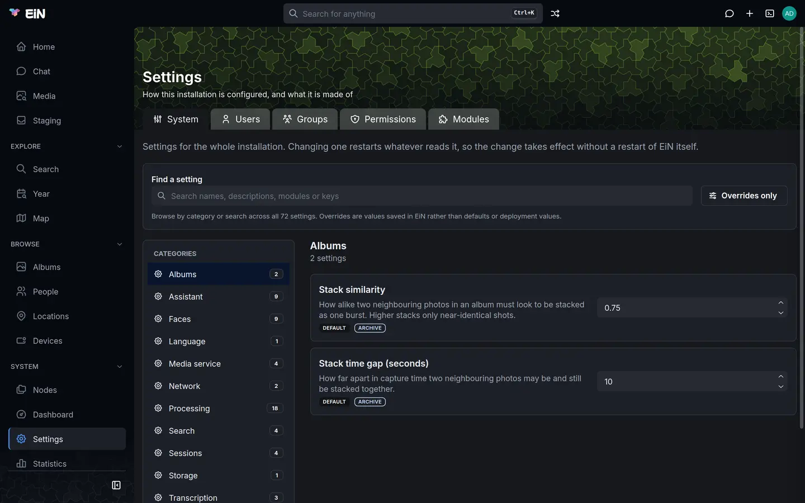

# Configuration

This page is for the administrator who runs EiN: where its settings live, how to change them on the Settings page, in the terminal or in the installation's `.env`, which value wins when several are set, and what a change restarts. Every setting itself, with its default, is listed on [Settings](../reference/settings.md).

## Two kinds of settings

EiN has a single table of settings. Each one is an environment variable, such as `CFG_TRASH_RETENTION_DAYS`, with a plain name, a description, a kind of value and a default. Core declares some, and each module declares its own when it is installed, so the table grows and shrinks with the modules.

Each setting belongs to one of two scopes:

| Scope    | Who changes it                 | Where                                      | Named                        |
| -------- | ------------------------------ | ------------------------------------------ | ---------------------------- |
| System   | An administrator, for everyone | **Settings → System**, or `config set`     | `CFG_…`                      |
| Personal | Each person, for themselves    | **Profile → Preferences**, or `config set` | `CFG_USER_…`, and `HISTSIZE` |

This page is about the system settings. Personal ones, such as **Shell history length**, or **Seconds per slide** with the Archive installed, are described in [Your profile, favourites and trash](../guide/profile.md).

Apart from the settings, the installation has its own environment in `.env`, in the folder EiN was installed in (`~/ein` with the installer). It holds what is fixed before EiN starts: where your files are, which ports the machine publishes, the database password. It can also give a setting its starting value. [Set a value in the deployment](#set-a-value-in-the-deployment) explains how the two meet.

## Change a setting on the Settings page

1. Sign in as an administrator. [Accounts and groups](accounts.md) explains who that is.
2. Choose **Settings** in the sidebar, under **System**. The page opens on the **System** tab.
3. Pick a category in the **Categories** list on the left, or type in **Find a setting** to search names, descriptions, modules and keys across every category.
4. Change the value in the setting's field. **Save change** and **Cancel** appear under it.
5. Choose **Save change**. A line under the setting says what was restarted, for example "Restarted trash-purger.", or why nothing could be.



Each setting is saved on its own; there is no button that saves the page. The other tabs of Settings hold accounts, groups and modules: [Accounts and groups](accounts.md) covers **Users**, **Groups** and **Permissions**, and [Modules](modules.md) covers **Modules**. The **Permissions** tab shows some of the same settings as **System**, such as the default sharing, and a change made on either shows on both.

The control depends on the kind of value: a switch shows **On** or **Off**, a choice is a list, a number has arrows, a person or a group is picked by name, and a permission mode is a choice of None, View or Edit for the owner, the group and everyone else. On a narrow screen the categories are a **Category** list above the settings instead.

### Read where a value comes from

Under each setting's description, a badge says where the value in force comes from. A second badge names the module the setting belongs to, and settings that restart a service say which, as in "Restarts trash-purger".

| Badge                                       | What it means                                                                      |
| ------------------------------------------- | ---------------------------------------------------------------------------------- |
| **Default**                                 | Nobody has set it: the setting's own default is in force.                          |
| **From deployment**                         | The installation's environment sets it, usually `.env`.                            |
| **From** _module_, such as **From archive** | An installed module chose the value, such as the Archive naming its search parser. |
| **Set here**                                | An administrator saved it on this page or with `config set`.                       |
| **Not set**                                 | A key to another service that nobody has given.                                    |

**Default**, **From deployment** and **From** _module_ can all be overridden: save a value and the badge becomes **Set here**. A setting that is set here shows **Restore inherited value** instead of **Save change**. Choose it to remove your value, and the setting falls back to what it would be without it: the module's choice, the deployment's value or the default, in that order.

**Overrides only** limits the page to the settings set here, with their number on the button. It is the quickest way to see what has been changed on this installation. When nothing matches a search, **Clear filters** empties the search and turns **Overrides only** off.

Some settings mean something when they are empty. For those, the description ends with what an empty value does, such as "Currently: the person who creates it.", and an empty text field says what it means, such as "Empty means no model".

### Give a key to another service

A few settings are keys that EiN sends to another service: the access tokens for private module sources, and, with the modules that bring them, the media service's key and a hosted language model's key. Their names end in `_KEY`, and they are kept apart from every other setting:

- Nobody can read a key back, administrators included. The field is empty, with "Not set" or "Set — type a new one to replace it" in it, and the badge says whether the key comes from the deployment or was set here.
- To replace a key, type the new one and choose **Save change**. The field empties again once it is saved.
- A key is in no shell's environment, and EiN sends it only to the address set for its service. If a shell gives that address another value for one command, the request goes without the key.

> [!WARNING]
> With the `ems` module installed, the media service's key, `CFG_EMS_KEY`, must be one the media service accepts. The installer gives both sides the same key from `.env`. A different key saved here leaves EiN unable to reach the media service; **Restore inherited value** brings back the deployment's. [The media service](../ems/index.md) explains the keys.

## What a change restarts

A setting that names the services that read it when they start restarts them when you save it, so the change takes effect without restarting EiN. The setting's card lists those services before you save, and the line under it confirms what was restarted afterwards. A setting that names no service restarts nothing. Work already running is not lost: it is picked up again when the service is back.

- Only services that are running are restarted. A service you stopped stays stopped, and reads the new value when you start it. [Services and logs](services-logs.md) shows how.
- If a restart fails, the value is still saved, and a red message says "Could not restart" with the service's name and the reason. The service keeps running on the old value until it starts again.
- **Worker backlog rotation (ms)** is read by each pipeline worker as it starts, so the services that run one must be restarted by hand.
- Settings that are policy, such as the default sharing or **Visitors may browse**, are read each time they are applied, so they take effect at once and restart nothing.
- Some settings that name no service are read by the commands a pipeline runs, in the environment of the service that runs them, such as the Archive's **Face match threshold**. Nothing restarts for them: the service's shell reads the settings again before its next command, so they take effect from the next step it runs, such as the next picture it looks for faces in. A step already running finishes with the value it started with.

A terminal that is open when a setting changes reads the settings again before its next command, so `echo` shows the new value. A command already running keeps the value it started with.

## Change settings from the terminal

The `config` command does everything the Settings page does. Everyone signed in can list and read settings, and change their own; only an administrator can change a system setting.

```bash
# in EiN's terminal
config list                          # every setting, with where its value comes from
config list --scope system           # the system settings only; --scope user for your own
config get CFG_TRASH_RETENTION_DAYS  # the value in force
config set CFG_TRASH_RETENTION_DAYS 14
config unset CFG_TRASH_RETENTION_DAYS
```

`config list` prints a setting per line: its name, a tab, its value, and in brackets where the value comes from. A default has no mark. A key shows `(set)` in place of its value, or nothing when it is not set. On an EiN with the Archive, the Assistant and the `ems` module installed, it starts like this:

```text
CFG_EMS_KEY	(set) (environment)
CFG_COMMAND_FINDER	assistant-commands (module assistant)
CFG_LANGUAGE_MODEL	llm-chat (module assistant)
CFG_SEARCH_PARSER	archive-parse (module archive)
CFG_TEXT_EMBEDDER	ems-text-embed (module ems)
CFG_SESSION_REAP_INTERVAL	3600
CFG_TRASH_RETENTION_DAYS	14 (system)
```

The marks match the badges on the Settings page: `(system)` is **Set here**, `(environment)` is **From deployment**, `(module archive)` is **From archive**, and `(user)` is a person's own value.

`config set` answers with the new value and what it restarted, and `config unset` with the value it falls back to and where that comes from:

```text
$ config set CFG_TRASH_RETENTION_DAYS 14
CFG_TRASH_RETENTION_DAYS = 14
Restarted: trash-purger
$ config unset CFG_TRASH_RETENTION_DAYS
CFG_TRASH_RETENTION_DAYS reset to 30 (default)
Restarted: trash-purger
```

For a port, the answer ends with the note that it takes effect the next time the server starts. For a key, `config set` answers only `CFG_MODULE_SOURCES_KEY set`, without the value. The command line you typed is kept in your shell history like any other; start it with a space to leave it out.

A value of the wrong kind is refused before anything is written:

| Kind            | What `config set` accepts                   | Refused, for example                                                  |
| --------------- | ------------------------------------------- | --------------------------------------------------------------------- |
| number          | digits, with an optional minus and decimals | `config set: CFG_TRASH_RETENTION_DAYS: expected a number, got 'four'` |
| on or off       | `true` or `false`                           | `expected 'true' or 'false', got 'yes'`                               |
| choice          | one of the setting's choices                | `expected one of en, sv, got 'english'`                               |
| permission mode | an octal mode such as `0750`                | `expected an octal mode such as 0750, got 'rwxr-x---'`                |
| person or group | a name of letters, digits, `.`, `_` and `-` | `'Anna Andersson' is not a valid user name`                           |
| text or key     | anything                                    |                                                                       |

An empty value is refused too, with `value must not be empty`, except for the settings where empty means something. To return a setting to its inherited value, use `config unset`, not an empty `config set`.

Other refusals:

- `config set: unknown setting 'CFG_TRASH_DAYS'`: no installed part of EiN declares that name. `config list` shows the names there are; a module's settings exist only while the module is installed.
- `config set: 'CFG_TRASH_RETENTION_DAYS' is a system setting and needs administrator rights`: you are signed in as someone else. [Accounts and groups](accounts.md) explains how a member of the `sudo` group becomes the administrator in a terminal with `admin`.

A value with spaces, such as two module sources, is best quoted: `config set CFG_MODULE_SOURCES 'https://github.com/einhq https://forge.example:3000/family'`. With `JSON_OUTPUT=1` in front, `config list`, `config get`, `config set` and `config unset` answer in JSON: `config list` and `config get` with each setting's label, description, value and source, `config set` and `config unset` with the value and what was restarted. [Core commands](../reference/commands-core.md#config-set) has the full entries.

## Set a value in the deployment

`.env` is EiN's environment. Every `CFG_…` line in it reaches EiN when its container starts, and appears on the Settings page as **From deployment**. Use it for a value that belongs with the installation rather than with the running system, such as a hosted language model's address and key.

1. On the machine EiN runs on, open `.env` in the folder EiN was installed in.
2. Add or change the line:

   ```ini
   # ~/ein/.env, on the machine EiN runs on
   CFG_TRASH_RETENTION_DAYS=14
   ```

3. Apply it. This makes EiN's container again with the new environment:

   ```bash
   # on the machine EiN runs on, in ~/ein
   podman compose up -d    # or: docker compose up -d
   ```

   Under podman-compose, a container made again this way has no swap limit, which `setup.sh`
   gives each one; `./setup.sh` makes the containers again with it.

4. Reload the Settings page. The setting shows the value with **From deployment**.

Running `./setup.sh` applies `.env` too, but it also downloads the newest images: it is an update. [Updating](updating.md) explains it.

A value in `.env` does not always win:

- **A value set here wins over it.** If the setting shows **Set here**, the line in `.env` has no visible effect. Choose **Restore inherited value**, or run `config unset`, to let it through.
- **A module's choice wins over it.** An installed module may name commands for the **Search** settings: the Archive names `CFG_SEARCH_PARSER`, the Assistant `CFG_LANGUAGE_MODEL` and `CFG_COMMAND_FINDER`, and the `ems` module `CFG_TEXT_EMBEDDER`. To use another one, set it on the Settings page.
- **Some variables are fixed by the installation's `compose.yaml`**, which wins over `.env`: `CFG_HTTP_PORT` and `CFG_SSH_PORT`, the ports EiN listens on inside its container, which are not settings, and the `ems` module's settings `CFG_EMS_URL` and `CFG_EMS_KEY`. A line for them in `.env` changes nothing. The published ports are `EIN_HTTP_PORT` and `EIN_SSH_PORT` instead, and the media service's key is `EMS_KEY`, which goes to both sides. The Assistant's `CFG_LLM_URL` is read from `.env` and defaults to the language model the installer adds.
- **An empty line sets nothing.** `CFG_LANGUAGE_MODEL=` in `.env` is the same as leaving the line out.

The rest of `.env` is not settings but the installation's own variables: `EIN_DATA`, `EIN_BIND`, `EIN_HTTP_PORT`, `EIN_SSH_PORT`, `EIN_MODULES`, `EIN_EMS`, `EIN_LLM`, `EIN_GPU`, `EIN_SOURCE`, `EIN_SOURCE_KEY`, `EIN_DB_DIR`, `EIN_ENGINE`, `COMPOSE_PROJECT_NAME`, `TZ` and the passwords. [Installing in detail](install.md) explains each, and [Environment variables](../reference/environment.md) lists every variable EiN reads besides its settings. With the media service installed, its settings are `EMS_…` lines in the same file; [The media service](../ems/index.md) describes them.

> [!NOTE]
> `.env` holds the database password and the media service's key, and nothing else keeps them. Keep a copy of it with your backups; [Your data: backup, moving and removing](data.md) says what else to keep.

## How the layers combine

A setting can be given a value in up to four places. The narrowest wins:

| Order   | Layer                                       | File in EiN's tree       | Badge               |
| ------- | ------------------------------------------- | ------------------------ | ------------------- |
| 1, wins | A person's own value, for personal settings | `~/.config`              | **Your setting**    |
| 2       | The administrator's value                   | `/etc/config`            | **Set here**        |
| 3       | A module's choice                           | `/etc/config.d/<module>` | **From** _module_   |
| 4       | The deployment's environment                | `/etc/environment`       | **From deployment** |
| 5       | The setting's default                       | none                     | **Default**         |

A personal setting comes from `~/.config`, the deployment or its default: neither a module nor `/etc/config` sets it. A system setting is never read from anyone's `~/.config`.

![Five layers stacked, the higher one winning: Your setting in ~/.config, from Profile → Preferences or config set; Set here in /etc/config, from Settings → System or config set, which restarts the services the setting names; From archive in /etc/config.d/archive, a module's own etc/config; From deployment in /etc/environment, the CFG_ lines of .env written again at each start; and Default, declared with the setting; beside them, a system setting reads every layer but Your setting and a personal one only Your setting, From deployment and Default; below, a key, CFG_…_KEY, comes from /etc/keys over the deployment's and is in no shell's environment, and a .env change applies when the container is made again](../diagrams/settings-layers.svg "The highest layer that sets a value wins, and each scope skips the layers that are not its own.")

Every shell in EiN, the services' shells included, sources these files at its start, `/etc/environment` first and `~/.config` last, so each is exported over the one before. That is why every setting is an ordinary environment variable in the terminal:

```bash
# in EiN's terminal
echo $CFG_TRASH_RETENTION_DAYS
cat /etc/config
```

The files are ordinary shell files in EiN's tree, kept in the database, so they survive a restart. Each line is an assignment such as `export CFG_TRASH_RETENTION_DAYS='14'`:

- `/etc/environment` is written again at every start, from the `CFG_…` variables EiN's container was started with. A value the deployment stops passing is gone from it. It never holds a key.
- `/etc/config.d/<module>` is a module's `etc/config`, linked there when the module is set up and gone when it is removed.
- `/etc/config` is what **Save change** and `config set` write for a system setting. Everyone can read it.
- `/etc/keys` holds the keys saved here. Only the administrator can read it, and no shell sources it. A key from the deployment stays in EiN's own process and is never written to a file.

[Configuration files](../reference/config-files.md) lists these and EiN's other files.

## Edit the settings file by hand

An administrator can open `/etc/config` in the editor, `edit /etc/config`, and add, change or remove `export` lines. Two things differ from the Settings page:

- Nothing checks the values. A number written as `four` reaches the service that reads it as it is.
- Nothing is restarted. Policy settings apply at once, and settings read by the commands a pipeline runs from the next step; a setting a service reads at its start applies when that service restarts, from [Services and logs](services-logs.md) or the next time EiN starts.

A line for a name no part of EiN declares is exported into every shell but shows nowhere. Prefer the Settings page or `config set` for anything listed there.

## When a change does not take effect

- **The value in `.env` does not show.** The setting is **Set here** or chosen by a module, both of which win; or it is one of the values `compose.yaml` fixes; or EiN's container was not made again. See [Set a value in the deployment](#set-a-value-in-the-deployment).
- **The page says the value is saved, but the service behaves as before.** Look for a red "Could not restart" message under the setting, or check the service on [Services and logs](services-logs.md). A stopped service reads the value when it starts.
- **The terminal shows the old value.** A command that was already running when you saved keeps the value it started with; the next command reads the new one.
- **A port change did nothing.** Ports take effect when EiN starts again, and with the installer's setup they should be changed in `.env`, not here. See [Ports, HTTPS and remote access](network.md).
- **A module's settings are missing.** They exist only while the module is installed and working; check it on **Settings → Modules**, as [Modules](modules.md) describes.
- **Something else is wrong.** [Troubleshooting](troubleshooting.md) goes through the common problems.

## Related pages

- [Settings](../reference/settings.md): every setting, with its default, kind and what it restarts.
- [Environment variables](../reference/environment.md): the variables EiN reads that are not settings.
- [Your profile, favourites and trash](../guide/profile.md): personal preferences.
- [Accounts and groups](accounts.md): the **Users**, **Groups** and **Permissions** tabs, and the default sharing.
- [Modules](modules.md): the **Modules** tab, module sources and their tokens.
- [Processing and pipelines](processing.md) and [Performance and sizing](performance.md): what the **Processing** settings do in practice.
- [The media service](../ems/index.md) and [The language model](../assistant/language-model.md): their addresses and keys.
