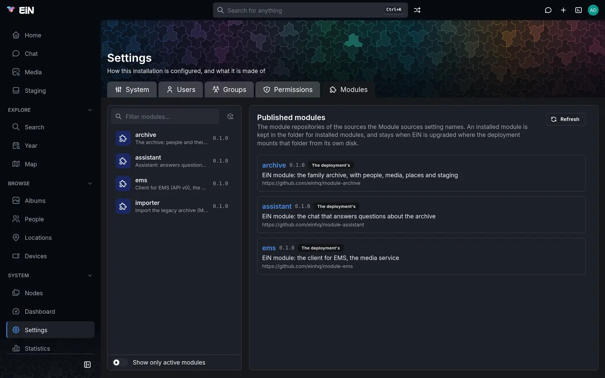

# Modules

Modules decide what your EiN is for: the Archive, the assistant and the client for the media
service are each a module. This page is for the administrator: which modules there are and what
they need, how to install, update and remove them on **Settings → Modules** or in the terminal, how
to see whether each one works, and what to do when one does not.

## The modules there are

EiN without modules is the tree, the shell, accounts and the frame of the web interface. Every
page for photos, people and places, the chat, and the work done on what you upload comes from a
module. [How EiN works](../start/how-ein-works.md#modules-decide-what-ein-is-for) explains what a
module is made of.

The published modules are the repositories named `module-<name>` in the einhq organisation on
GitHub:

| Module      | What it gives you                                                                                                                            | What it needs                                                                                       |
| ----------- | -------------------------------------------------------------------------------------------------------------------------------------------- | --------------------------------------------------------------------------------------------------- |
| `archive`   | The Archive: albums, media, people and the family tree, locations, devices and tracks, staging, and the search that finds things among them  | The `ems` module, installed along with it, and the [media service](media-service.md) to do its work |
| `assistant` | **Chat**: the assistant that answers questions by running EiN's commands for you                                                             | A [language model](language-model.md), either the installer's `--llm` or a hosted one               |
| `ems`       | EiN's side of the media service: the client the Archive reaches it through, its health and the graphics card's readings on the **Dashboard** | The [media service](media-service.md)                                                               |

A module needs only what its manifest names as dependencies; EiN installs those with it. A service
that runs beside EiN, such as the media service or the language model, is no module: the installer
adds it (see [Installing in detail](install.md)). Installing `archive` without the media service
gives no error, only a reminder from the installer and `setup.sh` when `EIN_MODULES` names it, but
nothing you upload gets thumbnails, dates, faces or searchable text until the media service is
there.

A fourth module, `importer`, moves one particular older archive into EiN. It is not published.

## See what is installed

Open **Settings** in the sidebar and choose the **Modules** tab. Everyone who is signed in has this
tab; for anyone but an administrator it is the only one, and it shows the modules without the
buttons that change them.


The list at the left holds every installed module with its description. A module that works shows
its version at the right; one that does not shows a badge instead and is listed first:

| Badge            | What it means                                                                                                   |
| ---------------- | --------------------------------------------------------------------------------------------------------------- |
| **Active**       | Set up since EiN started: its commands are on the path, its services are registered and its pages are built.    |
| **Setup failed** | EiN tried to set it up and refused or failed; the module's panel says why.                                      |
| **Not set up**   | Installed, but not set up since EiN started: its commands are not on the path and its services are not running. |

Type in the filter box to narrow the list by name or description. **Show only active modules**, at
the foot of the list, leaves out the ones that do not work; your browser remembers the switch.

Choose a module to open its panel. At the top it shows the module's name, its version and the core
API it is written for (`version 0.1.0 · core API ^0.5.0`), where it is installed
(`/usr/modules/archive`), when it was set up, and its state. **Reference and guide** opens the
module's own page in **Documentation**, with its guide and every command, setting and node type it
brings. Below are tabs, each with a count; **About** and **Dependencies** are always there, and
another tab the module has nothing for is left out:

| Tab              | What it shows                                                                                                                                                                 |
| ---------------- | ----------------------------------------------------------------------------------------------------------------------------------------------------------------------------- |
| **About**        | The introduction from the module's guide, or "It has no guide."                                                                                                               |
| **Dependencies** | The modules it needs (**It needs**) and the modules that need it (**Needs it**), with the versions accepted, the version installed and each one's state, or **Not installed** |
| **Services**     | Its background services, their state now and how long they have been up. They are started and stopped on the **Dashboard**'s services tab.                                    |
| **Pages**        | The addresses of the pages it adds; one without a parameter is a link to the page                                                                                             |
| **Commands**     | Its commands; each opens to its help                                                                                                                                          |
| **Settings**     | Its settings with their values, each marked **personal** or **system**; a row opens to the setting's description and, if you may change it, its control                       |
| **Node types**   | The kinds of node it defines, with how many of each exist                                                                                                                     |

A module's system settings are the same ones the **System** tab lists, and its personal ones are
those on **Profile → Preferences**; they save the same way:
[Configuration](configuration.md) explains where a value comes from and what a change restarts.

The **About EiN** dialog, in the menu under your picture, also lists the installed modules, with a
**setup failed** badge on any that did not set up.

In the terminal, `mod list` gives the same list:

```bash
# in EiN's terminal
mod list
```

```text
archive (0.1.0)
assistant (0.1.0)
ems (0.1.0)
```

A module that does not work has `[setup failed]` or `[not set up]` after its version.
`mod list --long` adds each one's description, the problems its setup ran into, its path, the
repository and commit it was installed from, and its commands and services. `mod info archive`
shows one module's manifest: its version, core API, the modules it requires and whether they are
installed, what it exports, and the modules that use it.

## Install a module

You need to be an administrator: signed in as `admin`, or in
[admin mode](../guide/interface.md#admin-mode). EiN needs to reach GitHub, or whichever forge holds
the module.

1. Open **Settings → Modules**.
2. Choose the **Published modules** button beside the filter box, the box with an arrow. The panel
   at the right lists the published modules, each with its version, its description and its
   repository.
3. Choose **Install** on the module you want.



EiN fetches the module, checks it, installs any module it needs that is missing, sets them all up
and starts their services. Under the module it then says "Installed", or, when it brought
dependencies along, for example "Installed, with ems". Its entries in the sidebar and its pages
appear without reloading the page.

Each published module carries a badge for what is installed of it:

| Badge                        | What it means                                                                                                                                          |
| ---------------------------- | ------------------------------------------------------------------------------------------------------------------------------------------------------ |
| none                         | Not installed; the button reads **Install**.                                                                                                           |
| **Installed**                | Installed from this repository, at the commit its default branch has now.                                                                              |
| **Update available**         | Installed from this repository, and its default branch has moved on; the button reads **Update**. Hold the pointer over the badge to see both commits. |
| **Installed from elsewhere** | A module of this name is installed from another repository.                                                                                            |
| **The deployment's**         | The module comes with the deployment itself (see [Modules the deployment provides](#modules-the-deployment-provides)) and cannot be installed over.    |

A module written for a different core API says "Needs core API ^0.6.0, which this EiN does not
provide." (with its own range), and its button is greyed out. **Refresh** asks the sources again.

In the terminal, `mod search` lists the same, and `mod install` installs:

```bash
# in EiN's terminal
mod search
```

```text
archive 0.1.0
  EiN module: the family archive, with people, media, places and staging
  https://github.com/einhq/module-archive
assistant 0.1.0 [installed]
  EiN module: the chat that answers questions about the archive
  https://github.com/einhq/module-assistant
ems 0.1.0
  EiN module: the client for EMS, the media service
  https://github.com/einhq/module-ems
```

Words after `mod search` narrow the list to modules whose name or description holds them all.

```bash
# in EiN's terminal, as the administrator
mod install archive
```

```text
Fetching https://github.com/einhq/module-archive at main (5e1c07a42)...
archive needs ems ^0.1.0, which is not installed
Fetching https://github.com/einhq/module-ems at main (b83d2f610)...
Installed ems 0.1.0 from https://github.com/einhq/module-ems at b83d2f610
Installed archive 0.1.0 from https://github.com/einhq/module-archive at 5e1c07a42
Setting up module 'ems'...
```

A line follows for each step of each setup, ending in `Module 'archive' setup complete` and the
services it started. `mod install` takes several modules at once, and each can be named in three
ways:

| You write                                     | What is installed                                                                                               |
| --------------------------------------------- | --------------------------------------------------------------------------------------------------------------- |
| `archive`                                     | `module-archive` from the first module source that has it, at its default branch                                |
| `https://github.com/einhq/module-archive`     | That repository, at its default branch                                                                          |
| `archive@v0.1.0`, `…/module-archive@<commit>` | That branch or tag, or a commit by its id, whole or its first seven characters or more, which EiN records whole |

The [reference](../reference/commands-core.md#mod-install) lists its options.

### Install modules with the installer

The installer's `--module` option names a module for EiN to install at its start, with the
modules it needs:

```bash
# on the machine EiN runs on
~/ein/setup.sh --module assistant
```

`setup.sh` adds the name to `EIN_MODULES` in `~/ein/.env` and, as on every run, fetches the newest
sources, builds and starts EiN again, which installs every module named there that is missing. One installed already is left as it is, at whatever version,
without asking GitHub, so a restart never updates a module. If EiN cannot download one at its
start, its log says `some of INSTALL_MODULES could not be installed; continuing boot` and EiN
starts without it; install it from **Settings → Modules** once EiN is up.
[Installing in detail](install.md) has the other options.

## Update a module

Updating EiN with `setup.sh` does not update its modules. Update them here instead.

- On **Settings → Modules**, open **Published modules** and choose **Update** on a module marked
  **Update available**.
- Or open the module's panel. A module installed from its repository has a section **Installed
  from its repository**, saying which repository and commit it came from and when, with **Update**
  and **Remove**. **Update** there fetches the newest commit of the branch it was installed from,
  or the same tag again for one installed at a tag. One installed at a commit stays there, and its
  panel offers no **Update**. It answers **Updated**, or **Up to date** when there was nothing
  newer.
- In the terminal, `mod install archive` updates an installed module. The same commit again is
  left alone: `archive is installed at 5e1c07a42 (main) already`.

An update installs what the new version needs and is missing. It is refused when an installed
module depends on this one and does not accept the new version; the message names them, for
example `importer needs archive ^0.1.0, and this is archive 0.2.0: --force installs it all the
same`. `mod install --force` updates anyway, and also fetches again a commit that is installed
already.

After the update EiN sets the module up again and restarts its services. Every module that depends
on it, directly or through another, is set up again too, and its running services restarted, so
nothing keeps running the code that was replaced. The new version takes the old one's place in a
single step: the module's folder always holds one whole version.

To pin a module to a version, install it at a tag, such as `mod install archive@v0.1.0` where its
repository has that tag, or at a commit, such as `mod install archive@463a92f`. Its panel's
**Update** then keeps it at the tag, and a module installed at a commit has no **Update** there.
The published modules always compare with the default branch, so they may offer **Update** for
it, which installs the default branch, as `mod install archive` without a ref does.

## Remove a module

1. Open **Settings → Modules** and choose the module.
2. In **Installed from its repository**, choose **Remove**.
3. EiN says what goes: "Removing assistant stops its services and takes its commands, pages and
   files away. What it made in the archive stays." When other modules need it, it adds which ones
   and that they will not work without it. Choose **Remove assistant** to go ahead, or **Cancel**.

In the terminal, `mod remove` asks first, and `--force` skips the question:

```bash
# in EiN's terminal, as the administrator
mod remove assistant
```

```text
Remove module 'assistant' (0.1.0)? (y/N) y
```

Removing stops and unregisters the module's services, takes its commands off the path, retires its
pipelines, its sidebar entries and its documentation, rebuilds the pages and deletes its folder.
Some things stay, so that installing it again finds them as they were:

- What it made in the tree: albums, people, labels and the folders under `/archive` that hold them.
- Values set for its settings. They no longer appear on the **System** tab, but come back with the
  module.
- The database indexes it asked for.

EiN does not stop you removing a module that others need. Those modules then fail to set up at the
next start, with `requires module 'ems' (^0.1.0), which is not installed`; install it again to
bring them back.

> [!WARNING]
> A module named in `EIN_MODULES` in `~/ein/.env` comes back at EiN's next start, because EiN
> installs every module named there that is missing. To keep it removed, delete its name from that
> line as well.

## Modules from other places

**Module sources**, `CFG_MODULE_SOURCES`, lists where published modules are looked for:
organisations on GitHub, Forgejo or Gitea, as their addresses separated by spaces. It is
`https://github.com/einhq` by default. Each repository named `module-<name>` in a source is a
module; `mod install <name>` takes the first source that has it, and a module's dependencies come
from its own organisation first. Change it on **Settings → System**, in its **Modules** group, or
in the terminal:

```bash
# in EiN's terminal, as the administrator
config set CFG_MODULE_SOURCES "https://github.com/einhq https://forge.example:3000/wrenfield"
```

A source that is not public needs an access token. **Tokens for module sources**,
`CFG_MODULE_SOURCES_KEY`, takes one per host, as `host=token` separated by spaces, such as
`forge.example:3000=…`. Like every key, nobody can read it back once set, and EiN sends each token
only to its own host. [The settings reference](../reference/settings.md#cfg_module_sources) has
both.

A source that does not answer is named above the published modules, as "https://forge.example:3000/wrenfield
did not answer" with the reason, and the other sources are still listed.

A module that is in no source can still be installed from its repository's address:
`mod install https://forge.example:3000/wrenfield/module-recipes`. EiN fetches modules over plain
HTTPS, so the forge must answer git's HTTP protocol and serve an archive of a commit, as GitHub,
Forgejo and Gitea do. [Writing a module](../develop/modules.md) is for making one of your own.

## Where modules are kept

A module installed from its repository is kept in a folder of its own outside EiN's container, so
it stays when EiN is updated or its container is made again. With the standard installation that
folder is `modules/` in the data folder, `~/ein/data/modules` unless you chose another `EIN_DATA`.
Inside EiN it is `/var/lib/modules`, and each module is linked as `/usr/modules/<name>`. Each
module's `.install.json` records the repository, the branch or tag, the commit and when it was
installed.

At every start EiN links each module in the folder and sets them all up, in the order of their
dependencies. A module whose setup fails is logged and the others carry on.

### Modules the deployment provides

A deployment can also mount a folder of module checkouts of its own, named by `DEV_MODULES_PATH`
(see [Environment variables](../reference/environment.md#set-by-the-deployment)). The standard
installation does not; it is for running EiN from its source. A module the deployment provides
runs from there: the published modules mark it **The deployment's**, `mod install` refuses it with
`'archive' is one of the deployment's modules (…), which runs instead`, and it has no **Update** or
**Remove** in its panel. `mod remove` takes away only its link, which the next start puts back. It
is updated with the deployment.

## When a module does not work

Open **Settings → Modules**: a module that does not work is at the top of the list with its badge.

**Setup failed.** Its panel shows "Its setup failed" with each problem, as `mod list --long`
does. The usual ones:

| Problem                                                           | What to do                                                                                                                                            |
| ----------------------------------------------------------------- | ----------------------------------------------------------------------------------------------------------------------------------------------------- |
| `archive: requires module 'ems' (^0.1.0), which is not installed` | Install the missing module: `mod install ems`, or **Install** in **Published modules**.                                                               |
| `archive: requires 'ems' ^0.2.0, but 0.1.0 is installed`          | Update the module it needs.                                                                                                                           |
| `archive: needs @ein/client ^0.6.0, this core provides 0.5.0`     | The module is written for another version of EiN, often after EiN was updated. Update the module; if no published version fits yet, it waits for one. |

After fixing the cause, set the module up again with `mod setup archive`, or every module with
`mod setup --all`, which is what EiN runs at each start. Restarting EiN does the same.

**Not set up.** EiN has not set the module up since it started, for example because it was put in
place without setup. `mod setup <name>` sets it up.

**Active, but something is missing.** Check its **Services** tab: a service that shows
`failed` or `disabled` can be started again on the **Dashboard**'s services tab, and
[Services and logs](services-logs.md) explains how to read its log. A module installed from the
terminal shows its pages in a browser tab that was already open once that page is reloaded.

**Install or update refused.** The message says why, in words like these:

| Message                                                                                            | What it means                                                                          |
| -------------------------------------------------------------------------------------------------- | -------------------------------------------------------------------------------------- |
| `no module source has 'recipes': …`                                                                | None of the module sources has `module-recipes`, or none answered; the reasons follow. |
| `https://github.com/einhq/module-archive has no branch, tag or commit 'v9'`                        | The ref after `@` does not exist.                                                      |
| `… has no mod.json at its top: not a module`                                                       | The repository is not a module.                                                        |
| `/usr/modules/archive is a module mod install did not put there; mod remove archive first`         | Something else holds the name.                                                         |
| `no module sources to find 'archive' in: CFG_MODULE_SOURCES is empty; name its repository instead` | **Module sources** is empty.                                                           |

[Troubleshooting](troubleshooting.md) covers problems beyond modules.

## Commands

Every command here runs in EiN's [terminal](../shell/terminal.md) or over SSH. Those that change
something are for administrators only.

| Command                               | What it does                                                               |
| ------------------------------------- | -------------------------------------------------------------------------- |
| `mod list [--long]`                   | The installed modules and whether each works                               |
| `mod info <name>`                     | One module's manifest, what it requires and what uses it                   |
| `mod search [words]`                  | The published modules of the module sources, and what is installed of them |
| `mod install <module>...`             | Install or update modules with what they need, and set them up             |
| `mod remove [--force] <name>`         | Stop and remove a module                                                   |
| `mod setup <name>`, `mod setup --all` | Set up one module, or every module in the order of their dependencies      |

[The core commands reference](../reference/commands-core.md#mod) has each one's options, and
[Updating](updating.md) covers updating EiN itself.
