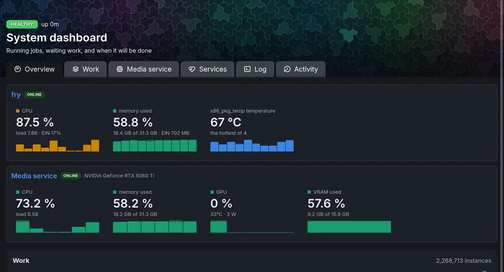
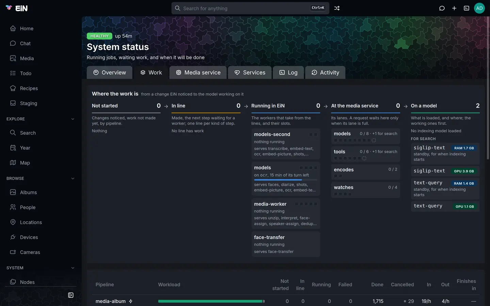
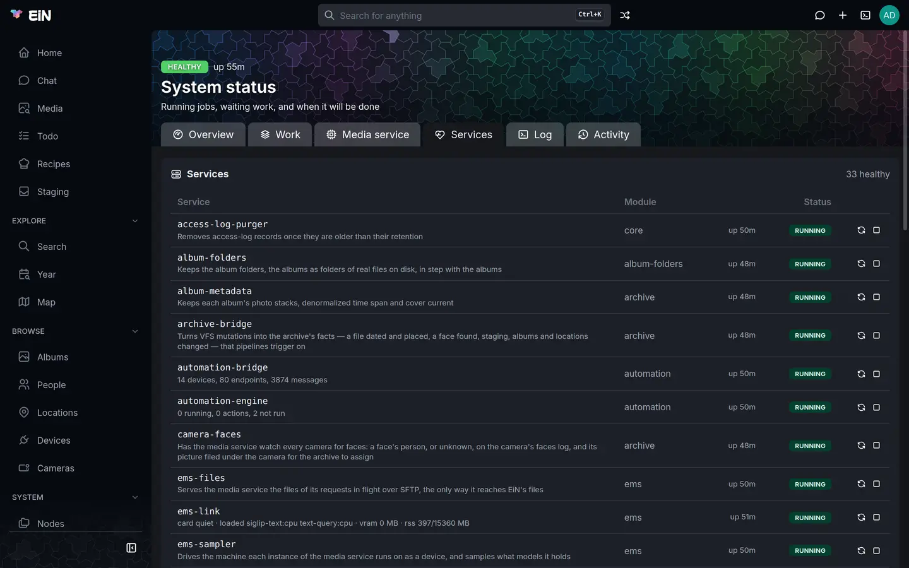
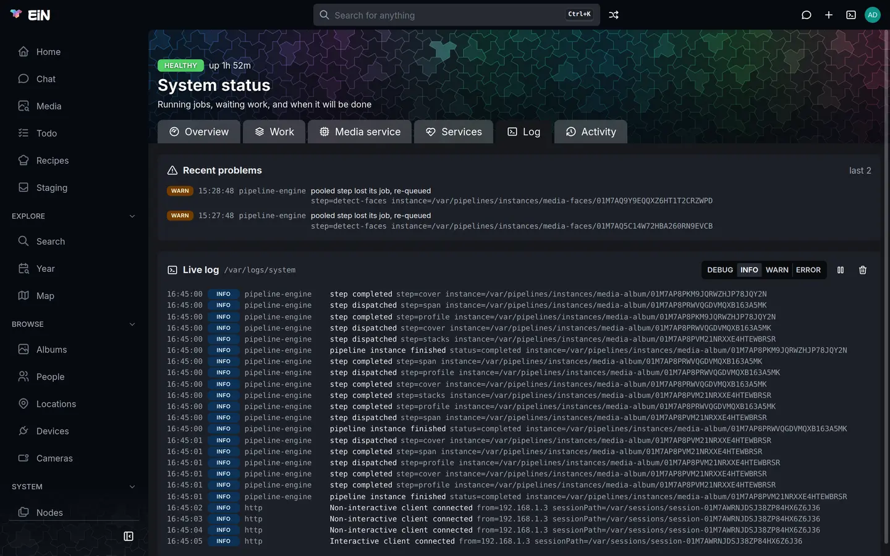
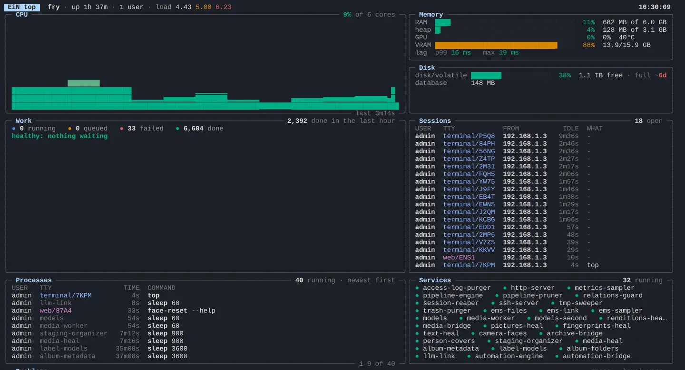

# Health and the dashboard

This page is for the administrator who keeps EiN running: how to tell at a glance whether it is well and keeping up, what each part of the **System dashboard** shows, how to ask the same questions in the terminal or from another computer, and what to do when the answer is not **Healthy**.

## Open the dashboard

Choose **Dashboard** under **System** in the sidebar. The sidebar shows it only to administrators; the page is at `/system`, and someone who is not an administrator and opens that address reads the same figures without the controls to start and stop services.



The page, **System dashboard**, has up to three badges above its title and five tabs below it, six with the `ems` module installed:

| Badge                                                         | What it says                                                                                                               |
| ------------------------------------------------------------- | -------------------------------------------------------------------------------------------------------------------------- |
| **Healthy**, **Catching up**, **Stuck** or **Needs a person** | How things stand. Hover it for the sentence behind it, such as `1,240 jobs waiting, the slowest kind done in 25m00s`.      |
| **offline**                                                   | The browser has lost its connection to EiN and is reconnecting; the figures are from the last update.                      |
| **warming up**                                                | The sampler that records CPU, memory and disk has not written anything yet. The charts fill in within a minute of a start. |

| Tab               | What it holds                                                                                       |
| ----------------- | --------------------------------------------------------------------------------------------------- |
| **Overview**      | The checks that are not fine, the machine's CPU and memory, the work done, storage and the instance |
| **Work**          | Every pipeline and every kind of job: what is waiting, how fast it goes, when it will be done       |
| **Media service** | With the `ems` module: the media service's own state; see [The media service](../ems/index.md)      |
| **Services**      | Which services run, with start, stop and restart for the administrator                              |
| **Log**           | The last problems logged, and the system log as it is written                                       |
| **Activity**      | Who signed in, opened a share link or downloaded what, and who changed what                         |

The tab you choose goes into the address (`/system?tab=work`), so a link opens the same view. The pipeline figures update whenever the pipelines change; every other card asks EiN for its own figures every 10 seconds, and only while its tab is open. The badges and the alarm above the tabs are kept current on every tab. Nothing is fetched while the browser tab is hidden, and the numbers refresh as soon as you come back.

## What the verdict means

The badge is the first line of the [`health`](../reference/commands-core.md#health) command. It is decided in this order: a failed check first, then whether anything is waiting, then whether the waiting work moves.

| Verdict            | When                                                                                                 | What to do                                                                                                |
| ------------------ | ---------------------------------------------------------------------------------------------------- | --------------------------------------------------------------------------------------------------------- |
| **Healthy**        | No check failed and nothing is waiting.                                                              | Nothing.                                                                                                  |
| **Catching up**    | Work is waiting, and some kind of it was done, or some pipeline instance finished, in the last hour. | Wait. After an import this can last hours; it turns to **Healthy** when the work is done.                 |
| **Stuck**          | Work is waiting, and none of it was done and no instance finished in the last hour.                  | Look at the checks on **Overview** and at **Where the work is** on **Work**; see below.                   |
| **Needs a person** | At least one check failed.                                                                           | Read the failed check on **Overview**: each one says what is wrong and, often, the command that fixes it. |

Warnings never change the verdict on their own. An install that has the `ems` module but no media service, or the Assistant but no language model, reads **Healthy** with a warning about each, and the same warnings show for a while after every start while the services load their models. An EiN with no modules has neither check.

![Above, a step that runs ends one of four ways: exit 0 completes it; exit 75, a busy service, leaves it waiting with its attempt given back for 30 seconds, doubling up to 10 minutes; exit 65, bad input, fails it for good; any other exit retries it, 3 attempts in all, then the instance fails, pipeline heal runs it again after 1 h, 6 h and 24 h, and after that it needs a person and the failed work check fails; below, the four verdicts in the order they are decided: Needs a person in red when a check failed, Healthy in green when nothing is waiting, Catching up in blue when work is waiting and some was done in the last hour, and Stuck in orange when none was](../diagrams/health.svg "A busy service only makes work wait; a person is asked for only when work fails through every retry and heal, or a check fails.")

## Read the checks

On **Overview**, a card above the tiles lists every check that is not fine, failed ones first, each with its reason; a red edge marks a failed check, a yellow one a warning. When every check is fine the card is not there. `health` in the terminal lists them all, the fine ones too.

These are the checks core makes about EiN's own work, with or without modules:

| Check          | State | Reason, as it reads                                                                                          | What to do                                                                                                                                            |
| -------------- | ----- | ------------------------------------------------------------------------------------------------------------ | ----------------------------------------------------------------------------------------------------------------------------------------------------- |
| `intake`       | ok    | `12 matched triggers waiting to start pipeline work`                                                         | Nothing: new work about to start.                                                                                                                     |
| `kind <name>`  | ok    | `340 left, 120/h  eta 2.8h`, or `340 waiting, the oldest for 4m10s`                                          | Nothing: a line of work that is being done, or has just arrived.                                                                                      |
| `kind <name>`  | warn  | `340 waiting for EMS, which could not run it yet; next try in 1m30s`                                         | With the Archive: the media service could not take the jobs; they are tried again on their own. See [The media service](../ems/index.md) if it lasts. |
| `kind <name>`  | warn  | `340 waiting, the oldest for 2h05m, none done in the last hour`                                              | The worker for this line is not getting through it. Check the **Services** tab and the **Log** tab.                                                   |
| `kind <name>`  | fail  | `340 waiting, and no worker offers this kind, the oldest for 12m30s`                                         | See [Work that nothing will run](#work-that-nothing-will-run).                                                                                        |
| `failed work`  | warn  | `3 failed instances, run again on their own after 1 h, 6 h and 24 h`                                         | Nothing yet: failed work is run again on its own.                                                                                                     |
| `failed work`  | fail  | `2 instances failed again after three more runs and need a person (pipeline-instances --status failed)`      | List them with `pipeline-instances -s failed` and see [Processing and pipelines](processing.md).                                                      |
| `input`        | ok    | `5 steps met input nothing can process, and will not be run again`                                           | Nothing: a damaged or unreadable file. Running it again would give the same result.                                                                   |
| `quiet steps`  | warn  | `1 running step silent for 30m00s or more: media-transcode/transcode`                                        | A step has written nothing and moved no progress for a long while. It keeps running; nothing stops a step for taking long.                            |
| `queue <name>` | fail  | `4 entries dropped after their delivery attempts (queue-dead /var/queues/archive-bridge: --retry or --drop)` | Look at them with `queue-dead <path>`, then put them back with `--retry` or delete them with `--drop`.                                                |

How long a step may stay silent before it counts as quiet is the setting [`CFG_PIPELINE_STEP_QUIET_MS`](../reference/settings.md#cfg_pipeline_step_quiet_ms), 30 minutes by default.

Modules add checks of their own, through the services they run. Each is there only with its module installed, and asked only while its service runs:

| Check                 | From                                                          | What it says                                                                                                                                                                          |
| --------------------- | ------------------------------------------------------------- | ------------------------------------------------------------------------------------------------------------------------------------------------------------------------------------- |
| `ems` and `ems …`     | the `ems` module's `ems-link` service (`ems-status --checks`) | Whether the media service answers, its model worker, each degradation and the card; the table is in [The media service](../ems/index.md#the-health-checks). Only `ems gpu` can fail.  |
| `llm` and `llm model` | the Assistant's `llm-link` service (`llm-status --checks`)    | Whether the language model answers, whose it is and where it runs, and whether its model has been tried with the assistant. See [The language model](../assistant/language-model.md). |
| the service's name    | any service whose check does not answer                       | `its check did not answer`, as a warning.                                                                                                                                             |

When a check names a hosted language model, its reason says so plainly, for example `…: questions, and what the assistant reads to answer them, leave this host`.

## The Overview tab

Under the checks, **Overview** shows the machine and the work in five parts.

- **CPU** and **Memory** tiles: the share of all the machine's processor cores in use, with the number of cores, the load and EiN's own share, and the share of the machine's memory in use, with how much of how much and EiN's own share; hover the tile for what EiN holds against its limit. Each has a small chart of the last six hours. A tile turns amber at 75% and red at 90%.
- **EMS GPU**, **EMS VRAM** and **EMS RAM** tiles, beside them, with the `ems` module installed: how busy the media service's card is, its temperature and its power draw; the card's memory in use; and the memory of the machine the media service runs on, with the media service's own share. That machine may be another than EiN's. The GPU tiles are not there without a card, and none of them without the media service; see [The graphics card](../ems/gpu.md).
- **Work**: **Done per hour**, the pipeline instances finished in the last hour, with the count for the last 24 hours and a chart of them; the total number of instances; and **Instances by state**, a bar of **In line**, **Running**, **Failed**, **Done** and **Cancelled**.
- **Storage**: each storage tier, its path, a bar of used and free space, `% used`, how much it grows per day and, when it grows, `full in ~N days`, in red when that is under 14 days. Tiers that share one disk say so, with the device in brackets: their free space is the same space, counted once. The database's size is in the corner. [Files and storage](../concepts/files.md) explains the tiers.
- A line at the bottom naming the instance: **host**, **uptime**, **deno** and **database**. It tells you which EiN you are looking at when you run more than one.

The storage projection is measured over the last seven days. A tier that is not growing has no "full in" figure, and a tier filling up fast is the one thing on this tab that needs action before it becomes a problem: [Your data](data.md) covers moving the archive to a bigger disk.

## The Work tab

**Work** shows what the pipelines are doing; [Processing and pipelines](processing.md) explains pipelines, how to rerun, cancel and retry work, and what each one does.



- **Where the work is** draws the work left to right as it moves: **Not started** (changes noticed, work not made yet, by pipeline), **In line** (made, waiting for a worker; each line of work under the workers that serve it, the one a worker is on now outlined), and **Running in EiN** (each worker, its slots and the line it is on, with how much of its turn is left). With the `ems` module installed, the media service's lanes and the models it holds follow. Under it, each line that is not moving says why. [Processing and pipelines](processing.md#watch-the-work-on-the-dashboard) explains it.
- The pipeline table has a row for each pipeline doing something, with **Workload**, **Not started**, **In line**, **Running**, **Failed**, **Done** and **Cancelled**; the idle ones fold into one row that **show** opens. **In** is the work arriving for it per hour, **Out** what it finished in the last hour, and **Finishes in** the work not started divided by **Out**; **no rate** when nothing finished recently, `—` when nothing waits. When queue entries were dropped after their delivery attempts, a red **N dropped** stands above the table. Choose a row to see that pipeline's instances.
- **Lines** lists each line of work in the work pools that has something in it or was done lately: **In line**, **Running**, **In**, **Out**, **Finishes in** and **Oldest in line**. A red **no worker** badge marks a line nothing serves; with the Archive, a yellow **waiting for EMS** badge marks a line resting because the media service refused several of its jobs in a row, with the next try in its tooltip.
- **Ongoing** lists the instances running now, with how far the running step has come, for a step that says, and how long each has run. Steps that have written nothing and moved no progress for the quiet time are listed above it in a yellow box.

### Work that nothing will run

When a line has jobs ready and no running worker serves it for more than five minutes, a red box, **Work that nothing will run**, stands above the tabs on every tab, and the `kind <name>` check fails. The box names the pool, how many jobs are ready and for how long, and the pipelines that queue that line.

- When it names pipelines, the worker that should serve the line is not running. Open **Services** and start the stopped one, or read the **Log** tab for why it stopped.
- When it says that no defined pipeline queues the line any more, the jobs belong to instances whose pipeline changed or is gone. If the pipeline now queues that step in another line, cancel the jobs with the command the box gives, and the engine queues them again in the new line:

  ```bash
  # in EiN's terminal, as an administrator
  pool cancel /var/pools/media --kind gpu-describe
  ```

  If the pipeline is no longer defined, cancelling does not last, since the engine queues the jobs again while their instances are open; `pipeline prune` removes the instances and their jobs once it has been gone for ten minutes. [Work that nothing will run](processing.md#work-that-nothing-will-run) has both.

## The Media service tab

The `ems` module adds this tab, and it is there only while that module is installed. It shows the media service's version, its models, what it runs now and what is on the graphics card; [The media service](../ems/index.md#on-the-dashboard) describes it.

## The Services tab

**Services** lists the services inside EiN, the ones that are not running first. Each row has the service's name, its own status line or description, how long it has been up, how many times it has restarted (`×3`), and its state: **running**, **starting**, **stopping**, **stopped**, **failed** or **disabled**. The heading counts them, `21 healthy`, or in red `2 down` when enabled services are not running.



An administrator has **Restart** and **Stop** on a running service and **Start** on a stopped one. A disabled service has no buttons; enable it from the terminal first. [Services and logs](services-logs.md) explains each service and the commands behind these buttons.

## The Log tab

**Log** has two cards. **Recent problems** shows the last 10 lines logged at WARN or ERROR, newest first, or **Nothing logged at WARN or above**. **Live log** follows the system log, `/var/logs/system`, as it is written: choose **DEBUG**, **INFO**, **WARN** or **ERROR** to show that level and above, pause it, or clear it. While you read further up, new lines do not scroll the view away.



With the Archive, a warning such as `pooled step could not run yet, job waiting` means the media service was not ready for a job; the job is tried again on its own, and the kind's other jobs run meanwhile. `pooled step could not run yet, kind resting` means it refused several in a row, so the whole kind waits. [Services and logs](services-logs.md) covers the logs and `dmesg`.

## The Activity tab

**Activity** lists, newest first, who reached EiN and what they did:

| Shown as                                           | When                                                                                                                                                                                                                                       |
| -------------------------------------------------- | ------------------------------------------------------------------------------------------------------------------------------------------------------------------------------------------------------------------------------------------ |
| **signed in**, **signed out**                      | Someone signed in or out in the Web UI, a terminal or over SSH. An SSH sign-in says `password` or `publickey`.                                                                                                                             |
| **sign-in failed**                                 | A wrong password, an account that may not sign in, or too many tries. The reason is under the row. An account that does not exist shows as **unknown account**: what was typed is not kept, since it is sometimes a password.              |
| **became administrator**, **elevation failed**     | A member of `sudo` chose **Administer…**, or got the password wrong.                                                                                                                                                                       |
| **opened share link**                              | A share link was opened. A visitor shows as the link's number; someone signed in as themselves.                                                                                                                                            |
| **downloaded**                                     | A file someone put in `/archive` or a home was sent in full, saved or shown, in the browser or over SFTP. Thumbnails and other renditions are not counted, and the same person reading the same file again within ten minutes counts once. |
| **downloaded zip**                                 | Several files were downloaded as one zip; the row names the folder that holds them and how many there were.                                                                                                                                |
| **created**, **changed**, **moved**, **deleted** … | A change to the archive, from the audit trail: the row names the kind of node and, for a change, what changed.                                                                                                                             |

Each row has the time, the account, where the event happened (a path), how it came (`web`, `terminal`, `ssh`, `sftp` or `http`) and from which address, and the session. Choose a name, path, address or session in a row to show only that; the session shows a sign-in together with everything that sign-in changed. Above the list you can show only **Sign-ins**, **Failures**, **Downloads**, **Share links** or **Changes**, and narrow by user, path, address, session and days. **Show more** reads further back.

What pipelines derive from each file (thumbnails, faces, text) is left out of the changes unless you turn on **Include what pipelines derived**: there are about ninety such records for every photo.

The same lists are in the terminal, for administrators only:

```bash
# in EiN's terminal
access-log --event sign-in-failed --since 2026-11-01
access-log /archive/albums/wrenfield-summer-1987 --event download --event download-archive
audit --sid session-01JC4ZK3E2 --no-pipeline
```

EiN keeps sign-ins and downloads for a year: the `audit-purger` service removes older ones, after **Days the access log keeps sign-ins and downloads** ([`CFG_ACCESS_LOG_RETENTION_DAYS`](../reference/settings.md#cfg_access_log_retention_days), 0 keeps them for good). Changes are kept as [Trace a result back to its cause](../concepts/pipelines.md#trace-a-result-back-to-its-cause) describes.

## Ask in the terminal

Every figure on the dashboard comes from an ordinary command, and you can run the same commands in EiN's terminal or over SSH. `health` gives the verdict and every check:

```bash
# in EiN's terminal
health
```

On an EiN with the Archive and the `ems` module, it reads like this:

```text
catching up: 1,240 jobs waiting, the slowest kind done in 2h48m
warn  kind transcribe  40 waiting for EMS, which could not run it yet; next try in 1m30s
ok    ems              EMS 3f2a91c answering, up 2.1h
ok    intake           12 matched triggers waiting to start pipeline work
ok    kind faces       1,188 left, 420/h  eta 2.8h
```

| What you want to know                                   | Command                                                                              |
| ------------------------------------------------------- | ------------------------------------------------------------------------------------ |
| The verdict and the checks                              | [`health`](../reference/commands-core.md#health)                                     |
| CPU, memory and event-loop lag, with history            | [`host-metrics`](../reference/commands-core.md#host-metrics)                         |
| Free space per tier, when it fills, the database's size | [`df`](../reference/commands-core.md#df)                                             |
| Which instance, its versions and uptime                 | [`system-info`](../reference/commands-core.md#system-info)                           |
| Each pool and kind of job: left, rates, oldest waiting  | [`pool-stat`](../reference/commands-core.md#pool-stat)                               |
| Every pipeline's counts and rates                       | [`pipeline-overview`](../reference/commands-core.md#pipeline-overview)               |
| The meters services add, such as the card's memory      | [`gauges`](../reference/commands-core.md#gauges)                                     |
| The services and their status lines                     | [`service-list --detail`](../reference/commands-core.md#service-list)                |
| The last problems in the log                            | [`dmesg --level warn -n 10`](../reference/commands-core.md#dmesg)                    |
| What is running now, and who is connected               | [`ps`](../reference/commands-core.md#ps), [`who`](../reference/commands-core.md#who) |

`host-metrics` also shows the event loop's lag, `lag     p99 1.2 ms  max 8.4 ms`, which the dashboard does not: how long ready work waits for EiN's process. High lag with low CPU is the case where everything feels slow and nothing looks busy; [Performance and sizing](performance.md) covers it.

Put `JSON_OUTPUT=1` in front of any of them for the answer as JSON. The verdict is then one of `healthy`, `catching-up`, `stuck` and `needs-person`:

```bash
# in EiN's terminal
JSON_OUTPUT=1 health | jq -r .verdict
```

## Watch it live with top

`top` draws on one screen what the dashboard spreads over its tabs: a CPU graph and the load, memory, the event loop and the services' gauges, the disks, the verdict with every check that is not fine and the work done in the last hour, the running commands, the sessions, the services and the latest problems. It redraws every 2 seconds.

```bash
# in EiN's terminal
top
```



In the terminal panel, press <kbd>Alt</kbd>+<kbd>M</kbd> first to give it the whole window ([The terminal](../shell/terminal.md)).

| Key                                                             | What it does                                               |
| --------------------------------------------------------------- | ---------------------------------------------------------- |
| <kbd>q</kbd> or <kbd>Ctrl</kbd>+<kbd>C</kbd>                    | Quit                                                       |
| <kbd>↑</kbd> <kbd>↓</kbd>, <kbd>k</kbd> <kbd>j</kbd>            | Scroll the list of commands                                |
| <kbd>PgUp</kbd> <kbd>PgDn</kbd>, <kbd>Home</kbd> <kbd>End</kbd> | Scroll a page, or to the top or bottom                     |
| <kbd>s</kbd>                                                    | Sort the commands: newest, oldest, by user or by command   |
| <kbd>+</kbd> and <kbd>-</kbd>                                   | Update less or more often, in steps from 0.5 to 60 seconds |
| <kbd>p</kbd>                                                    | Pause, so a list can be read; again to go on               |
| <kbd>Space</kbd>                                                | Update now                                                 |

`top -d 5` starts at 5 seconds between updates. `top -n 1` writes one frame and stops, which is what you want in a script or over `ssh` without a terminal.

## Check from another computer

EiN sends no e-mail and raises no alert outside itself: the dashboard and `health` are where problems show. To look without opening the Web UI, send `health` over SSH:

```bash
# on your own computer
ssh -p 2222 helen@ein.local health
```

`health` always ends with exit status 0, whatever the verdict, so a script that watches EiN has to read the verdict. The first word of the text is enough, or the JSON:

```bash
# on your own computer, for example from cron
verdict=$(ssh -p 2222 helen@ein.local 'JSON_OUTPUT=1 health' | jq -r .verdict)
[ "$verdict" = needs-person ] && echo "EiN needs a person" | mail -s "EiN" helen@example.com
```

[SSH and SFTP](../shell/ssh-sftp.md) explains signing in with a key so a script needs no password.

## Where the figures come from

The `metrics-sampler` service records the machine's and the work's figures, one log per series under `/var/logs/metrics`, and the dashboard, `top` and the commands above read them back. The charts therefore survive a reload of the page and a restart of EiN.

| Series      | What it holds                                             | How often  | Kept     |
| ----------- | --------------------------------------------------------- | ---------- | -------- |
| `cpu`       | Processor time used by the machine and by EiN's container | 15 seconds | 7 days   |
| `memory`    | Memory in use against the container's limit               | 15 seconds | 7 days   |
| `runtime`   | Event-loop lag                                            | 15 seconds | 7 days   |
| `pools`     | Jobs per pool, by state                                   | 15 seconds | 7 days   |
| `pipelines` | Instances completed per pipeline                          | 1 minute   | 30 days  |
| `disk`      | Free and total space per storage tier                     | 15 minutes | 90 days  |
| `nodes`     | How many nodes of each type                               | 15 minutes | 365 days |

With the `ems` module installed, its `gpu-sampler` service adds a `gpu` series, every 15 seconds, for the **EMS GPU** and **EMS VRAM** tiles, and an `ems-models` series, every minute, which holds the media service machine's memory for **EMS RAM**. Memory is read both ways: the whole machine's, and EiN's container's own, from its cgroup. CPU is read both ways too: the whole machine's, since the media service and the language model, when installed, load it from containers of their own, and EiN's container's share of it.

How the tree has grown over the years is not on the dashboard: **Statistics**, under **System**, shows it, and anyone can open it ([Home and statistics](../guide/home.md)).

## When something goes differently

| What you see                                                                                                          | Why                                                                                      | What to do                                                                                                                          |
| --------------------------------------------------------------------------------------------------------------------- | ---------------------------------------------------------------------------------------- | ----------------------------------------------------------------------------------------------------------------------------------- |
| **warming up** stays, the tiles are empty, `host-metrics` says `no metrics sampled yet — is metrics-sampler running?` | The `metrics-sampler` service is not running.                                            | Start it on the **Services** tab, or `service start metrics-sampler`, and read the **Log** tab for why it stopped.                  |
| **Storage** says **No tier data sampled yet**, `df` says `no disk sample yet — is metrics-sampler running?`           | The disk is sampled every 15 minutes; right after a start there is no sample yet.        | Wait 15 minutes. If it stays, check `metrics-sampler` as above.                                                                     |
| **offline** next to the verdict                                                                                       | The browser lost its connection to EiN, for example while EiN restarts.                  | Wait; it reconnects by itself. If it stays, reload the page and see [Troubleshooting](troubleshooting.md).                          |
| **Stuck**, with `waiting for EMS` on the kinds                                                                        | With the Archive: the media service is down, restarting or busy loading models.          | See [The media service](../ems/index.md). The work goes on by itself once it answers.                                               |
| **Stuck**, with `none done in the last hour` on a kind                                                                | The worker for that kind is stopped or hangs.                                            | Look on **Services** for a stopped or often restarted worker, and on **Log** for its errors. [Services and logs](services-logs.md). |
| **Needs a person**, `kind <name>` failed                                                                              | Nothing runs that kind of job.                                                           | [Work that nothing will run](#work-that-nothing-will-run).                                                                          |
| **Needs a person**, `ems gpu` failed                                                                                  | With the `ems` module: the media service is meant to have a graphics card and sees none. | [The graphics card](../ems/gpu.md#be-told-when-the-card-goes-missing).                                                              |
| **Needs a person**, `failed work` or `queue <name>` failed                                                            | Work failed for good, or queue entries were dropped.                                     | Follow the command in the check's reason, and see [Processing and pipelines](processing.md).                                        |
| `full in ~N days` in red                                                                                              | A storage tier will be full within two weeks at its present rate.                        | Free space, or move the archive to a bigger disk: [Your data](data.md).                                                             |
| The CPU or memory tile is red for long                                                                                | The machine's processors, or EiN's container's memory, are 90% or more in use.           | [Performance and sizing](performance.md).                                                                                           |
| **Dashboard** is not in the sidebar                                                                                   | You are not an administrator.                                                            | Ask an administrator, or open `/system` to read the figures; `health` works for everyone.                                           |

## Related pages

- [Processing and pipelines](processing.md)
- [Services and logs](services-logs.md)
- [The media service](../ems/index.md)
- [The language model](../assistant/language-model.md)
- [The graphics card](../ems/gpu.md)
- [Performance and sizing](performance.md)
- [Troubleshooting](troubleshooting.md)
- [Core commands](../reference/commands-core.md)
- [Settings](../reference/settings.md)
