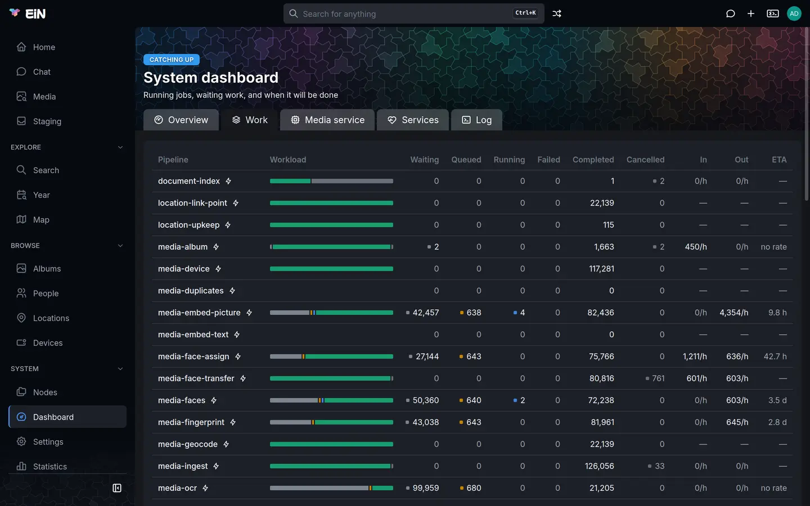

# Processing and pipelines

This page is for the administrator. It covers the work EiN does on what people upload: which
pipelines the modules bring, how to watch them on the **Dashboard** and in the terminal, what to do
when work fails or stops moving, how to run work again on purpose, and the settings that decide
how much runs at once.

## What runs after an upload

A pipeline waits for one kind of change and then runs its steps, each a command, on the node that
changed. [Changes and pipelines](../concepts/pipelines.md) explains the idea; this page is about
running it. Core brings the pipeline engine and no pipelines. The Archive brings all of the
pipelines below, so with only core installed nothing is processed.

Work is done in three places:

- **The pipeline engine** (the `pipeline-engine` service) matches changes to pipelines, creates an
  **instance** for each pipeline and node, and runs the short steps itself.
- **Pool workers** run the long steps. The engine puts each one as a job in a pool, and a worker
  takes it when it has room. The Archive brings `cpu`, for work done on this machine, such as
  reading metadata, making thumbnails and transcoding video, and `models`, for work done by a model
  in the [media service](../ems/index.md), such as finding faces or transcribing speech. A second
  model worker, `models-second`, runs beside `models` when `CFG_MODEL_SECOND_SLOTS` is above `0`;
  it is off by default.
- **Background services** of the Archive: `archive-bridge` turns changes into the events the media
  pipelines wait for, and `media-heal` finds files that are missing something and announces them
  again (see [Close gaps the pipelines missed](#close-gaps-the-pipelines-missed)).

Every pipeline runs at most once per node at a time: a file announced ten times while it waits is
worked on once. Waiting work is kept in nodes, so nothing is lost when EiN restarts.

### The Archive's pipelines

| Pipeline               | What it does                                                                              | Kind of work                   |
| ---------------------- | ----------------------------------------------------------------------------------------- | ------------------------------ |
| `media-ingest`         | Reads a photo's, video's or recording's metadata. Every other media pipeline waits on it. | `ingest`                       |
| `media-reindex`        | Reads the metadata again for a file whose bytes changed                                   | `ingest`                       |
| `media-stills`         | A photo's display sizes and face crops, a video's poster frames, a recording's waveform   | `stills`                       |
| `media-transcode`      | Video and audio the browser can play, a video's hover clip, storyboard and chapters       | `transcode`, `stills`, `shots` |
| `media-fingerprint`    | The fingerprints that find duplicates and photo stacks                                    | `fingerprint`                  |
| `media-faces`          | Finds the faces in a photo and crops each one                                             | `faces`                        |
| `media-video-faces`    | Finds the faces in a video and when each is on screen                                     | `faces`                        |
| `media-face-assign`    | Matches a found face to a person                                                          | `face-assign`                  |
| `media-face-transfer`  | Moves face tags from an older archive onto the faces EiN found                            | `face-transfer`                |
| `media-embed-picture`  | A picture vector, for searching by what is in the picture                                 | `embed-picture`                |
| `media-ocr`            | Reads the text written in a picture                                                       | `ocr`                          |
| `media-embed-text`     | Text vectors of a file's stored texts                                                     | `embed-text`                   |
| `media-transcribe`     | A transcript of what is said in a video or recording                                      | `transcribe`                   |
| `media-voiceprint`     | Who speaks when in a recording, with a voiceprint per voice                               | `diarize`                      |
| `media-speaker-assign` | Decides which person each voice is                                                        | `speaker-assign`               |
| `media-speaker-faces`  | Ties a video's voices to the faces seen speaking them, once its faces are found           | `diarize`, `speaker-assign`    |
| `media-device`         | Links a file to the camera or phone that took it                                          | run by the engine              |
| `media-geocode`        | Looks up the address of a file's GPS position                                             | run by the engine              |
| `media-album`          | An album's stacks, time span, missing cover and profile, when its members change          | run by the engine              |
| `media-duplicates`     | Decides again the duplicate findings of a staged file                                     | `dedupe`                       |
| `location-link-point`  | Links a photo to the location that contains its GPS point                                 | run by the engine              |
| `location-upkeep`      | Redraws a location and relinks the photos inside it when it or its photos change          | run by the engine              |
| `document-index`       | Extracts the text of a document and makes it searchable                                   | run by the engine              |
| `staging-unzip`        | Expands a zip that lands in a staging category, then removes the zip                      | `unzip`                        |
| `staging-sidecars`     | Pairs Takeout and XMP sidecars with their files                                           | `sidecars`                     |
| `staging-organize`     | Plans a staging category's suggested groups again                                         | `organize`                     |
| `staging-retime`       | Dates staged files again by the rules of the category they were moved into                | `retime`                       |
| `track-stage`          | Makes a GPX file dropped in staging into its device's route                               | run by the engine              |

The `cpu` worker takes `unzip`, `ingest`, `stills`, `face-assign`, `face-transfer`,
`speaker-assign`, `fingerprint`, `dedupe`, `retime`, `organize`, `sidecars` and `transcode`. The
`models` worker takes `faces`, `embed-picture`, `ocr`, `embed-text`, `transcribe`, `diarize` and
`shots`, and `models-second` the same kinds in the reverse order. `pipeline-list` prints every pipeline that is defined, with its trigger.

## Watch the work on the Dashboard

1. Sign in as an administrator and choose **Dashboard** in the sidebar, under **System**.
2. Read the badge above the title **System dashboard**: **Healthy**, **Catching up**, **Stuck** or
   **Needs a person**. [Health and the dashboard](monitoring.md) explains each word and the
   **Overview** tab.
3. Choose the **Work** tab.



The table has a row for every defined pipeline, also one that has never run, and a total row
**All pipelines** at the foot. The bar draws the same counts as the columns.

| Column        | What it counts                                                                                       |
| ------------- | ---------------------------------------------------------------------------------------------------- |
| **Waiting**   | Nodes the pipeline has matched but not yet started on: no instance yet                               |
| **Queued**    | Instances that are started and waiting for a worker or for an earlier step                           |
| **Running**   | Instances with a step running this moment                                                            |
| **Failed**    | Instances that failed                                                                                |
| **Completed** | Instances that finished. Older ones are pruned, so this is not a count of every file ever processed. |
| **Cancelled** | Instances stopped on purpose                                                                         |
| **In**        | Jobs that arrived per hour, over the last hour                                                       |
| **Out**       | Instances completed in the last hour, the rate the ETA divides by                                    |
| **ETA**       | When what is waiting will be done at that rate; **no rate** when nothing completed recently          |

Hover over the lightning sign beside a pipeline's name to see what starts it. Choose a row to open
the pipeline's page.

Below the table, **Kinds of work** lists what the pools hold, a row per kind of job: **Left**,
**Running**, **In**, **Out**, **ETA** and **Oldest waiting**. This is where the slow steps are. A
kind may carry a badge:

- **waiting for EMS**: the media service could not run this kind yet, because it was busy, loading
  a model, restarting or unreachable. The jobs are not failed. The kind rests for 30 seconds, then
  twice as long each time it is refused again, up to 10 minutes; hover over the badge for the next
  try.
- **no worker**: no running worker takes this kind, so the jobs will never run.

**Ongoing** lists the instances with a step running, with the target file and how long it has run.
A step that has written nothing for 30 minutes is listed above it as quiet, with "Still running;
nothing stops a step for taking long." No step is stopped for taking long; a quiet step is for you
to look at, not a fault in itself.

Two warnings can appear above the tabs or the table:

- **Work that nothing will run** names each kind that has jobs and no worker, and the pipelines
  that queue it. See [Work that nothing will run](#work-that-nothing-will-run).
- **N dropped**, above the table, counts events that failed every delivery attempt. See
  [Dropped events](#dropped-events).

## Watch the work in the terminal

Everything on the **Work** tab comes from ordinary commands, which you can run in
[the terminal](../shell/terminal.md) or over SSH:

```bash
# in EiN's terminal
health                          # the verdict in one line, and each check that decides it
pipeline-overview               # instances by pipeline, unfinished steps, queues, completions in the last hour
pool-stat                       # each pool and kind: what is left, how fast, workers and what they take
pipeline-instances -s failed    # the failed instances, newest first
top                             # all of it live, with CPU, memory and services; q quits
```

`pipeline-instances` lists 100 at a time and prints `(more: --after …)` when there are more; pass
that to `--after` for the next page. Give it pipeline names to narrow it:
`pipeline-instances -s failed media-faces media-ocr`.

## Look at one pipeline and its instances

A pipeline's page, opened from the **Work** table, shows its description, its **Trigger**, its
**Steps** and its **Priority**, and below them its **Instances**: **Status**, **Target**,
**Started** and **Duration**. The tabs **All**, **Running**, **Completed**, **Failed** and
**Cancelled** narrow the list, and **Load more** fetches the next page.

Choose an instance to open it. Its page shows the status, the target node and the steps:
**Step**, **Status**, **Depends on**, **Command** and **Duration**. A step's status is one of these:

| Status      | What it means                                                                                        |
| ----------- | ---------------------------------------------------------------------------------------------------- |
| `pending`   | Waits for the steps it depends on                                                                    |
| `queued`    | Waits for a free place in the engine                                                                 |
| `waiting`   | Waits in a pool for a worker; the pool and kind are shown beside it, and "retrying" if it ran before |
| `running`   | Runs now; "last output … ago" says when it last wrote anything                                       |
| `completed` | Finished                                                                                             |
| `failed`    | Failed on its last attempt                                                                           |
| `skipped`   | Not run: its condition said no, or the instance was cancelled                                        |

Choose a step to see its **Exit code**, its **Attempts**, its pool and its condition, and for a
failed step the **Error** it wrote. In the terminal, `pipeline-status` prints the same:

```bash
# in EiN's terminal
pipeline-status media-faces/<id>
```

An instance is named after the node it works on, so one file has the same id in every pipeline
that ran on it. Give the id as `<pipeline>/<id>`, as `pipeline-instances` and the pages show it; a
bare id that more than one pipeline uses is refused with the pipelines it could mean.

## When work fails

A failed step is tried again up to its limit of attempts, three unless the pipeline says
otherwise, before the instance fails. Two kinds of failure are treated differently:

- **The media service could not do it yet.** The step goes back to wait with its attempt given
  back, and its kind rests, as **waiting for EMS** shows. Nothing fails however long the media
  service is away.
- **The file itself cannot be processed**, such as bytes no decoder can open. The step fails at
  once, whatever attempts are left, and the file is not tried again. `health` counts these under
  `input` and treats them as settled.

### Failed work is run again on its own

The `pipeline-pruner` service runs `pipeline-heal --apply` every hour (`CFG_PIPELINE_PRUNE_INTERVAL`,
3600 seconds). It runs each failed instance again 1 hour after it failed, then 6 hours after the
next failure, then 24 hours after that. An instance that fails all three times is marked as needing
a person and left alone, and `health` then reads **Needs a person**. Instances that failed on their
input, and instances of pipelines no longer defined, are never run again.

`pipeline-heal` without `--apply` only says what it would do:

```bash
# in EiN's terminal
pipeline-heal
```

```text
would rerun 3, would mark 0 for a person; 12 waiting, 1 failed on their input
```

When you know the cause has passed, for example after the media service was fixed, run them all
now. `--now` skips the waits, and the run does not count as one of the three:

```bash
# in EiN's terminal
pipeline-heal --apply --now
```

[Your sidebar and top bar](../guide/customizing.md) shows how to give administrators a button that
runs `pipeline-heal --apply`.

### Work that needs a person

1. List the failed instances: `pipeline-instances -s failed`, or the **Failed** tab of the
   pipeline's page.
2. Open one and choose the failed step to read its **Error**.
3. Fix the cause: start the media service, free disk space, or replace the file.
4. Run the instance again with **Rerun** on its page, or with `pipeline-rerun`:

   ```bash
   # in EiN's terminal
   pipeline-rerun media-faces/<id>
   ```

To act on many at once, tick them on the pipeline's page and choose **Rerun**.

| To                                                       | On the pages          | In the terminal                                |
| -------------------------------------------------------- | --------------------- | ---------------------------------------------- |
| Run an instance afresh from the pipeline's current steps | **Rerun**             | `pipeline-rerun <pipeline>/<id> …`             |
| Run only the failed steps again                          | none                  | `pipeline-restart <pipeline>/<id>`             |
| Run one failed or skipped step again                     | **Retry** on the step | `pipeline-step-restart <pipeline>/<id> <step>` |
| Stop a running instance                                  | **Cancel**            | `pipeline-cancel <pipeline>/<id>`              |
| Delete instances, cancelling running ones first          | **Remove**            | `pipeline-remove <pipeline>/<id> …`            |

Only an administrator sees these buttons, and only an administrator can run these commands.

### Work that nothing will run

A kind with jobs and no worker never moves. **Work that nothing will run** on the **Dashboard**
and `health` (as a failed check `kind <name>`) both say so. The usual cause is that the worker
service is stopped:

1. Open the **Services** tab of the **Dashboard**, or run `service-list`, and look at `cpu` and
   `models`.
2. Start the one that is stopped, or read its log if it keeps stopping.
   [Services and logs](services-logs.md) shows how.

When no defined pipeline queues the kind any more, the jobs are left over from a pipeline that was
removed. The warning then gives the command that cancels them:

```bash
# in EiN's terminal
pool-cancel /var/pools/media --kind <kind>
```

### Dropped events

An event that fails ten delivery attempts, for example because its node no longer exists, is set
aside rather than tried forever. The **Work** table then shows **N dropped**, and `health` fails
its `queue …` check until you deal with them:

```bash
# in EiN's terminal
queue-dead /var/queues/archive-bridge           # list what was set aside
queue-dead --retry /var/queues/archive-bridge   # put them back in line
queue-dead --drop /var/queues/archive-bridge    # delete them
```

The engine's own queue is `/var/queues/pipeline-engine`. `--id` limits `--retry` or `--drop` to
one entry.

### Steps waiting for the media service

When **waiting for EMS** stays on a kind, the media service is the place to look:
[The media service](../ems/index.md) shows how to check it. Once it answers again, the kind tries
on its own at its next try. To try at once:

```bash
# in EiN's terminal
pool-wake               # every resting kind
pool-wake transcribe    # one kind
```

## Run work again on purpose

| You want to                                                     | Run                                                                                         |
| --------------------------------------------------------------- | ------------------------------------------------------------------------------------------- |
| Run one pipeline on one file                                    | `pipeline-start media-faces /archive/albums/christmas-2019/IMG_2041.jpg`                    |
| Transcode a video again although it has renditions              | `pipeline-start --var FORCE=-f media-transcode /archive/albums/christmas-2019/MVI_0412.mp4` |
| Make the renditions again under a folder, without the pipelines | `regenerate --force /archive/albums/christmas-2019`                                         |
| Announce files the Archive never saw, or that are missing work  | `media-scan /archive/albums`                                                                |

`pipeline-start` starts the run at once, in the normal lane, and skips the checks a trigger makes.
`--var` sets a variable the pipeline declares; `media-transcode`, `media-transcribe`,
`media-embed-picture` and `media-ocr` declare `FORCE`, which `-f` makes them redo work already done.
A pipeline that reads its starting event has nothing to read when started by hand, and
`pipeline-start` warns about it.

### Close gaps the pipelines missed

`media-scan` walks a folder and announces each file that was never taken in, or that lacks
something a pipeline should have given it: a fingerprint, display sizes, faces, renditions, or a
transcript made with other settings than the media service runs now. Each pipeline then skips
what is already done.

The `media-heal` service runs it for you, but only when nothing is waiting in the pools, so a scan
never repeats what is already on its way. It looks every `CFG_MEDIA_HEAL_INTERVAL` seconds (900),
and after a pass through the whole archive it rests for `CFG_MEDIA_HEAL_REST` seconds (21600, six
hours).

Run it by hand after installing the Archive on files that were already there, or to look at one
folder:

```bash
# in EiN's terminal
media-scan -n /archive/albums/christmas-2019    # only report what it would announce
media-scan /archive/albums/christmas-2019
```

A run examines up to 20000 files (`--scan-limit`) and announces up to 1000 (`--limit`), and
remembers where it stopped, so the next run goes on from there; `--restart` starts from the top. It
announces fewer as running `media-ingest` instances and waiting triggers add up, and nothing once they reach 500
(`--max-active`).

`CFG_MEDIA_TRANSCRIPTS_CURRENT` set to `off` stops transcripts from being made again when the
media service's speech settings change. On a large archive such a change otherwise means hours of
background work.

## Large imports and the bulk lane

Work on a staging category of the **Google Photos export** or **Scans** kind runs in the bulk lane,
below all other work, so what people upload in the meantime is processed first. Bulk work is put
behind, never stopped: it runs whenever nothing else that could run is waiting. Any category can be
put in that lane with `staging category <name> --lane bulk`, which applies to work announced from
then on. [Staging and importing for administrators](../archive/staging-admin.md) covers categories.

`pipeline-rerun` and `pipeline-start` always run in the normal lane; `pipeline-heal` keeps the
lane an instance had.

## How much runs at once

These settings are in the **Processing** category of **Settings → System**, or set with
`config set`. Saving one restarts the service that reads it, when it is read by a service, and work
in progress is picked up again; `CFG_PIPELINE_STEP_QUIET_MS` restarts nothing and counts from the
next look. [Configuration](configuration.md) explains how.

| Setting                                                                               | Default   | What it decides                                                                                                                                |
| ------------------------------------------------------------------------------------- | --------- | ---------------------------------------------------------------------------------------------------------------------------------------------- |
| [`CFG_CPU_SLOTS`](../reference/settings.md#cfg_cpu_slots)                             | `2`       | How much CPU work the `cpu` worker runs at once. A transcode takes two slots, other kinds one.                                                 |
| [`CFG_CPU_NON_ENTRY_SLOTS`](../reference/settings.md#cfg_cpu_non_entry_slots)         | `1`       | Slots kept first for work after ingest, so a long import does not hold back thumbnails and faces. Ingest borrows them when nothing else waits. |
| [`CFG_CPU_WORKERS`](../reference/settings.md#cfg_cpu_workers)                         | `4`       | The most CPU jobs in flight; the slots are the real limit                                                                                      |
| [`CFG_MODEL_SLOTS`](../reference/settings.md#cfg_model_slots)                         | `2`       | Requests the `models` worker keeps in flight against the media service. Size it to what the media service runs at once.                        |
| [`CFG_MODEL_KIND_QUANTUM_MS`](../reference/settings.md#cfg_model_kind_quantum_ms)     | `3600000` | How long the `models` worker stays on one kind before turning to the next, so faces do not starve the rest                                     |
| [`CFG_PIPELINE_MAX_CONCURRENT`](../reference/settings.md#cfg_pipeline_max_concurrent) | `4`       | Steps the engine itself runs at once                                                                                                           |
| [`CFG_PIPELINE_STEP_QUIET_MS`](../reference/settings.md#cfg_pipeline_step_quiet_ms)   | `1800000` | How long a running step may be silent before it is listed as quiet                                                                             |
| [`CFG_PIPELINE_PRUNE_INTERVAL`](../reference/settings.md#cfg_pipeline_prune_interval) | `3600`    | Seconds between the pruner's rounds, which also run `pipeline-heal`                                                                            |

The engine has more settings, for how many triggers and instances it holds; their defaults suit a
machine of any size, and [Settings](../reference/settings.md#processing) lists them all.
[Performance and sizing](performance.md) says what to set on a small or a large machine.

> [!TIP]
> More `CFG_MODEL_SLOTS` than the media service runs at once only moves the wait into its queue,
> and past its depth into **waiting for EMS**.

## Old instances are pruned

Instances are nodes under `/var/pipelines/instances/<pipeline>/`. Every hour the `pipeline-pruner`
service deletes pool jobs that finished more than 24 hours ago, runs `pipeline-heal --apply`, and
then keeps the 2000 most recently completed instances of each pipeline and deletes the rest. It
leaves failed and running instances alone. A pipeline that is no longer defined, because its module
was removed or it was renamed, loses all its instances once its definition has been gone for 10
minutes.

To delete by hand, use **Prune** on a pipeline's page, which removes its finished instances, or
only those of the tab you are on, or `pipeline-prune`:

```bash
# in EiN's terminal
pipeline-prune -s failed media-faces       # the failed instances of one pipeline
pipeline-prune --older-than 30d            # completed more than 30 days ago, every pipeline
```

## Pipelines come with modules

A module's pipelines are defined when it is set up and removed when it is removed;
[Modules](modules.md) covers both. Removing a pipeline cancels its running instances. To write a
pipeline of your own, see [Writing a module](../develop/modules.md).

## Related pages

- [Changes and pipelines](../concepts/pipelines.md): how a change becomes finished work.
- [Health and the dashboard](monitoring.md): the four words and the **Overview** tab.
- [The media service](../ems/index.md): where the model work and much of the media work runs.
- [Performance and sizing](performance.md): what the slots should be on your machine.
- [Services and logs](services-logs.md): starting, stopping and reading the workers.
- [Troubleshooting](troubleshooting.md): when photos do not get thumbnails, faces or dates.
- [Core commands](../reference/commands-core.md#pipeline): every `pipeline-` and `pool-` command.
