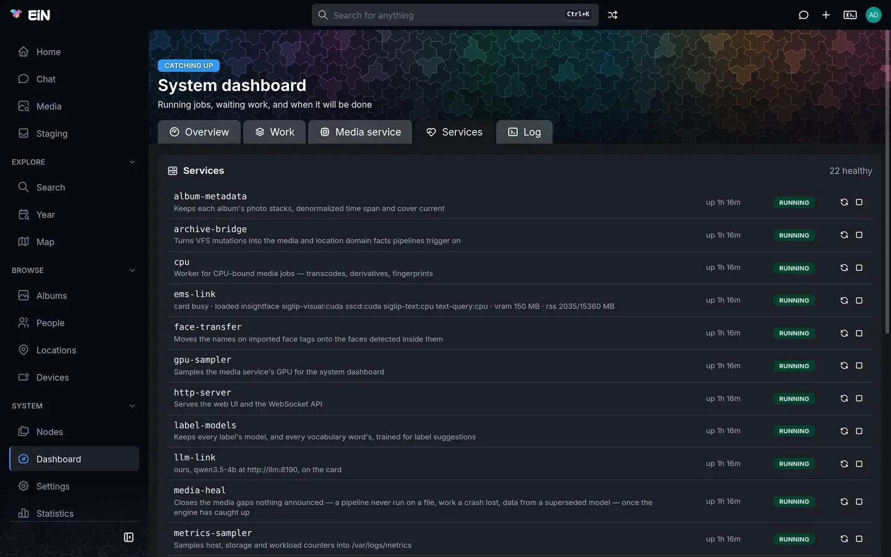
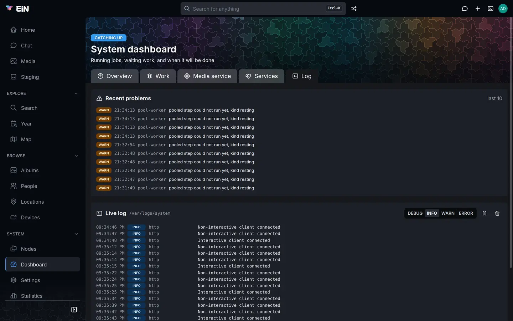

# Services and logs

This page is for whoever runs EiN: the services that run inside EiN and keep it working, how to see and restart them on the dashboard and in the terminal, and where EiN, its services and its containers write what they do. The containers themselves, and how to start and stop them with compose, are on [Installing in detail](install.md#run-ein-day-to-day).

## What a service is

Inside the `ein` container, EiN runs a set of long-running jobs it calls services: the web server, the SSH server, the pipeline engine, the workers that process your media, and small loops that tidy up on a timer. Each service is a shell script, `start.sh`, that EiN runs in a shell of its own as the administrator. A service is not a container: the media service (`ems`), the language model (`llm`) and the database (`db`) are containers beside EiN, and EiN watches the first two through services of its own, `ems-link` and `llm-link`.

Core brings nine services, and each module brings its own. With the Archive, the media service and the assistant installed, there are 20:

| Service             | From      | What it does                                                                                                                    |
| ------------------- | --------- | ------------------------------------------------------------------------------------------------------------------------------- |
| `http-server`       | core      | Serves the web UI and the WebSocket API                                                                                         |
| `ssh-server`        | core      | Serves the EiN shell and SFTP over SSH                                                                                          |
| `pipeline-engine`   | core      | Matches events against pipeline triggers and runs the resulting steps                                                           |
| `pipeline-pruner`   | core      | Runs failed pipeline work again after a growing wait, and keeps the pipeline instances and the pools bounded                    |
| `relations-guard`   | core      | Removes links that would dangle after a node is deleted                                                                         |
| `metrics-sampler`   | core      | Samples host, storage and workload counters into `/var/logs/metrics`, which the dashboard draws                                 |
| `session-reaper`    | core      | Removes expired sessions, and turns off expired share links; hourly                                                             |
| `tmp-sweeper`       | core      | Removes files left in `/tmp` once they are older than `CFG_TMP_RETENTION_HOURS`; hourly                                         |
| `trash-purger`      | core      | Removes trashed files for good once they are older than `CFG_TRASH_RETENTION_DAYS`; twice a day                                 |
| `archive-bridge`    | archive   | Turns changes in the tree into the media and location facts that pipelines trigger on                                           |
| `cpu`               | archive   | Worker for CPU-bound media jobs: transcodes, derivatives, fingerprints                                                          |
| `models`            | archive   | Worker for the model-bound media steps: faces, picture and text vectors, text in pictures, transcripts, voices                  |
| `media-heal`        | archive   | Closes media gaps nothing announced, such as a pipeline never run on a file or work a crash lost, once the engine has caught up |
| `album-metadata`    | archive   | Keeps each album's photo stacks, time span and cover current                                                                    |
| `label-models`      | archive   | Keeps the models behind label suggestions trained                                                                               |
| `person-covers`     | archive   | Gives every named person without a cover the crop of one of their own faces                                                     |
| `staging-organizer` | archive   | Runs the staging organizer when something waits for it, and matches the groups due a match                                      |
| `ems-link`          | ems       | Watches the media service and reports what it holds                                                                             |
| `gpu-sampler`       | ems       | Samples the media service's graphics card for the dashboard                                                                     |
| `llm-link`          | assistant | Watches the assistant's language model and reports whose it is and where it runs                                                |

Every time EiN starts, it registers and enables core's services and those of every module that is set up, then starts every enabled service as the last step of its start. A module's services are added when it is installed and removed with it; see [Modules](modules.md).

## See the services on the dashboard

1. Open **Dashboard** under **System** in the sidebar. The dashboard is the administrator's; see [Health and the dashboard](monitoring.md) for its other tabs.
2. Choose the **Services** tab.



The card lists every service, one row each, and asks again every 10 seconds while the tab is open:

- The service's name, and under it its description. A service that reports on itself shows that line instead, and its description when you hover it: `ems-link` shows what the media service holds, or `not answering`, and `llm-link` shows where the language model runs.
- How long it has been up, such as `up 8h 50m`. Hover it for the time it started.
- `×` and a number when EiN has restarted it since it was last started by hand. Hover it for "Restarted 2 time(s)".
- A badge: **running**, **starting**, **stopping**, **stopped**, **failed**, or **disabled** for a service that is switched off.

The heading counts them: `20 healthy`, or in red `1 down` when an enabled service is not running. Rows are sorted by what needs attention: failed services first, then other enabled services that are not running, then services that have restarted, then the rest by name.

**Settings → Modules** also shows a module's services and whether each runs, on the module's **Services** tab; the controls are here on the dashboard.

## Restart, stop and start a service

On the **Services** tab, as the administrator or in [admin mode](../guide/interface.md#admin-mode), each row has buttons at its right:

| Service is           | Buttons                                                                  |
| -------------------- | ------------------------------------------------------------------------ |
| running              | **Restart** (the circling arrows) and **Stop** (the square)              |
| stopped or failed    | **Start** (the triangle)                                                 |
| starting or stopping | a spinner; wait for it to settle                                         |
| disabled             | a dash; its tooltip says "Disabled — enable it from the shell to run it" |

The row shows a spinner while the action runs and is read again as soon as it is done. If the action fails, a red line above the table names it and the reason, such as `stop cpu: …`.

In the terminal the same actions are commands, which only an administrator may run:

```bash
# in EiN's terminal, as the administrator
service-restart models
service-stop label-models
service-start label-models
service-start-all      # every enabled service that is not running
```

`service restart models`, with a space, is the same command. Each answers with one line, such as `Restarted service 'models'`.

What happens when you stop a service:

- EiN sends the command the script is running a stop signal and waits for the script to end: 5 seconds by default, and up to 16 minutes for `pipeline-engine`, which lets the steps it runs finish. A script that has not ended by then is closed.
- Work the service would do waits. A media worker that is stopped leaves its jobs in the pool, and they run when it starts again; see [Processing and pipelines](processing.md).
- A stopped service stays stopped until you start it, or until EiN itself starts again, which starts every enabled service.
- `ems-link` and `llm-link` add the media service's and the language model's checks to [`health`](../reference/commands-core.md#health). While one is stopped, its checks are missing from the dashboard's verdict rather than failing.

> [!WARNING]
> Stopping `http-server` takes the web interface away, the page you stopped it from included, and stopping `ssh-server` closes SSH and SFTP. Start them again from the other one (`service-start http-server` over SSH), or restart EiN's container: `podman compose restart ein` in `~/ein`. Restarting `http-server` from the dashboard drops the page's connection for a moment.

Saving a setting on the Settings page restarts the services that read it by itself; [Configuration](configuration.md#what-a-change-restarts) lists what restarts what.

## When EiN restarts a service by itself

Every service that ships with EiN restarts when its script fails: when it ends with an exit code other than 0, EiN starts it again a second later, and the `×` count on its row goes up. A service that fails three times within a minute is not started again; it stays **failed** until you start it. A script that ends with 0 is **stopped**, and is not started again.

The count belongs to the run you started: **Restart**, or `service-restart`, starts it at 0 again.

## Look at services in the terminal

[`service-list`](../reference/commands-core.md#service-list) lists every service; anyone may run it.

```bash
# in EiN's terminal
service-list --detail
```

```text
NAME                 STATUS      ENABLED  RESTARTS DESCRIPTION
-------------------- ----------- -------- -------- -----------
album-metadata       running     yes      0        Keeps each album's photo stacks, denormalized time span and cover current
archive-bridge       running     yes      0        Turns VFS mutations into the media and location domain facts pipelines trigger on
cpu                  running     yes      0        Worker for CPU-bound media jobs — transcodes, derivatives, fingerprints
ems-link             running     yes      0        Watches the media service and reports what it holds
                     not answering
…
```

`--detail` asks each running service that reports on itself for its line, printed under its row; it is the line the dashboard shows. Without `--detail` the list is quicker. With `JSON_OUTPUT=1` it is JSON, with each service's start time.

[`service-status`](../reference/commands-core.md#service-status) shows one service, and where its output goes:

```bash
# in EiN's terminal
service-status ems-link
```

```text
Service: ems-link
Status: running
Enabled: yes
Description: Watches the media service and reports what it holds
Started: 2026-10-25T06:12:40.512Z
Restarts: 0
Output: /var/logs/services/ems-link/stdout.log
Errors: /var/logs/services/ems-link/stderr.log
```

`Last exit code` appears once the script has ended. [`top`](../reference/commands-core.md#top) shows the running services in a panel of its own, beside the machine's figures; [Health and the dashboard](monitoring.md) covers it.

## Where the logs are

EiN writes to four places. Three are logs in the tree, which you read in EiN's terminal; the fourth is the container's own log, which you read on the machine.

| Log                                    | What is in it                                                                                                                        | How long it is kept                                       |
| -------------------------------------- | ------------------------------------------------------------------------------------------------------------------------------------ | --------------------------------------------------------- |
| `/var/logs/system`                     | EiN's own messages: each line with a time, a level, the part of EiN that wrote it and the message                                    | Emptied each time EiN starts                              |
| `/var/logs/services/<name>/stdout.log` | What a service's script prints                                                                                                       | Emptied each time the service starts                      |
| `/var/logs/services/<name>/stderr.log` | What a service's script prints as errors                                                                                             | Emptied each time the service starts                      |
| The `ein` container's log              | The same messages as `/var/logs/system`, with the details behind them, such as an error's stack, and what EiN prints while it starts | Until the container is removed with `podman compose down` |

A service's own output goes only to its pair of logs under `/var/logs/services`, never to the container's log. Two other folders hold logs of other kinds: `/var/logs/metrics`, the figures the dashboard draws, and `/var/logs/jobs/<pid>`, the output of a command started with [`nohup`](../reference/commands-core.md#nohup) or kept running with [`detach`](../reference/commands-core.md#detach).

## Read the system log on the dashboard

Open **Dashboard** under **System** and choose the **Log** tab.



- **Recent problems** lists the last ten lines at WARN or ERROR, newest first, with the time, the part of EiN and the message. It is read again every 10 seconds. With none, it says "Nothing logged at WARN or above".
- **Live log** shows `/var/logs/system` as it is written: the last 200 lines when you open it, then every new line as it arrives, up to 500 kept. It follows the newest line while you are at the bottom, and stays put when you scroll up to read.

The controls at the right of **Live log**:

| Control                                  | What it does                                                                                                  |
| ---------------------------------------- | ------------------------------------------------------------------------------------------------------------- |
| **DEBUG**, **INFO**, **WARN**, **ERROR** | Shows lines at that level and above; **INFO** is chosen when the tab opens                                    |
| **Pause**                                | Stops adding lines. The stream stays open and the lines that arrive meanwhile are dropped; **Resume** goes on |
| **Clear**                                | Empties the panel. The log itself is unchanged                                                                |

A yellow `connecting` badge means the page is reaching the stream; a blue `paused` badge that it is paused.

## Read the logs in the terminal

[`dmesg`](../reference/commands-core.md#dmesg) prints the system log, oldest line first:

```bash
# in EiN's terminal
dmesg -n 50                  # the last 50 lines
dmesg --level warn -n 10     # the last 10 problems, as Recent problems shows them
dmesg --level error          # every error since EiN started
```

```text
2026-10-25 21:34:13 WARN  pool-worker pooled step could not run yet, kind resting
2026-10-25 21:35:02 INFO  service-registry Service 'label-models' started
```

`--level` filters before `-n` counts, so `--level warn -n 10` is the last ten problems, not the problems among the last ten lines. The levels are `debug`, `info`, `warn` and `error`. Pipe it on as with any command: `dmesg | grep ssh-server`.

For a service's output, use [`tail`](../reference/commands-core.md#tail), which prints each line as the service wrote it:

```bash
# in EiN's terminal
tail -n 50 /var/logs/services/ems-link/stdout.log
tail -f /var/logs/services/models/stderr.log      # keep following; Ctrl+C ends it
```

```text
ems-link: watching http://ems:8181
ems-link: down — not answering
```

`tail -f /var/logs/system` follows the system log in the terminal the way the **Live log** does.

## Read the container's log

The container's log is on the machine EiN runs on, and compose shows it:

```bash
# on the machine EiN runs on, in ~/ein
podman compose logs --tail 200 ein     # the last 200 lines
podman compose logs -f ein             # follow; Ctrl+C ends it
podman compose logs ems                # the media service: ems, llm or db for the others
```

With Docker, write `docker compose`. Each line reads `[2026-10-25 21:35:02] [INFO ] [service-registry] Service 'label-models' started`, followed by any details the message carries. This is the log to read when EiN does not start, since the tree's logs are not there until it has, and when a line in the system log needs its details: the system log keeps the message only. It also holds the admin password a new EiN prints once, `Admin password set to: …`, which is gone with the container after `podman compose down`.

The media service, the language model and the database write only to their containers' logs. [The media service](media-service.md#on-the-machine) covers reading its log.

## Log more, or less

How much EiN logs is set by two variables in `~/ein/.env`, read when the container starts:

| Variable      | Default | What it does                                                                                                             |
| ------------- | ------- | ------------------------------------------------------------------------------------------------------------------------ |
| `LOG_LEVEL`   | `INFO`  | The lowest level EiN logs: `DEBUG`, `INFO`, `WARN` or `ERROR`                                                            |
| `LOG_MODULES` | none    | A level for one part of EiN over `LOG_LEVEL`, by the name the log shows, such as `ssh-server:DEBUG,pipeline-engine:WARN` |

A line below the level is written nowhere: not to the system log, not to the container's log. The **DEBUG** button on the **Live log** shows DEBUG lines only once EiN writes them.

1. Add the line to `~/ein/.env`:

   ```ini
   # in ~/ein/.env
   LOG_MODULES=ssh-server:DEBUG
   ```

2. Apply it, which restarts EiN:

   ```bash
   # on the machine EiN runs on, in ~/ein
   podman compose up -d
   ```

Take the line out again when you have what you need; DEBUG fills the logs quickly. [Environment variables](../reference/environment.md#set-by-the-deployment) lists the other variables of the deployment.

## Add a service of your own

A service is a folder in the tree with a `start.sh`, and optionally a `config.json`. EiN runs `start.sh` in its own shell, the same shell language as the terminal, as the administrator, with `SERVICE_NAME` and `SERVICE_PATH` set. This one writes the free space to its log every hour:

1. Make the folder and the script:

   ```bash
   # in EiN's terminal, as the administrator
   mkdir -p /home/admin/services/disk-report
   edit /home/admin/services/disk-report/start.sh
   ```

   ```bash
   # /home/admin/services/disk-report/start.sh
   while true; do
     df
     sleep 3600
   done
   ```

2. Give it a description, and have it started again when it fails, in `/home/admin/services/disk-report/config.json`:

   ```json
   {
     "description": "Writes the free space to its log every hour",
     "restartPolicy": "on-failure"
   }
   ```

3. Register it, enable it and start it:

   ```bash
   # in EiN's terminal, as the administrator
   service-add disk-report /home/admin/services/disk-report
   service-enable disk-report
   service-start disk-report
   ```

It is on the dashboard from then on, and EiN starts it whenever it starts. Its output is in `/var/logs/services/disk-report/stdout.log`.

The keys `config.json` takes:

| Key             | Default | What it does                                                                                                            |
| --------------- | ------- | ----------------------------------------------------------------------------------------------------------------------- |
| `description`   | none    | The line under the service's name                                                                                       |
| `restartPolicy` | `never` | `on-failure` starts it again when it ends with an exit code other than 0, `always` whenever it ends, `never` not at all |
| `maxRestarts`   | `3`     | Restarts allowed within `restartWindow` before EiN leaves it failed                                                     |
| `restartWindow` | `60000` | That window, in milliseconds                                                                                            |
| `stopTimeout`   | `5000`  | Milliseconds a stop waits for the script to end before closing it                                                       |
| `env`           | none    | Variables set for the script, as an object of names and values                                                          |
| `workClass`     | none    | `background` makes its database work give way to people's, as EiN's own workers do                                      |
| `statusCommand` | none    | A command whose first line of output is shown beside the service                                                        |
| `checkCommand`  | none    | A command answering checks for `health`, as JSON                                                                        |
| `gaugeCommand`  | none    | A command answering gauges for `top` and the dashboard, as JSON                                                         |

To take a service away, stop it, disable it and remove it: `service-stop disk-report`, `service-disable disk-report`, `service-remove disk-report`. Removing it removes only the registration, not the folder. A module's services are declared in the module itself; [Writing a module](../develop/modules.md) covers them.

## When something goes differently

**A service is failed, with `×3` beside it.** Its script failed three times within a minute. Its `stderr.log` holds the output of the last attempt only, since each start empties it, so read it first: `tail -n 50 /var/logs/services/<name>/stderr.log`. `dmesg | grep "<name>"` shows EiN's lines about it, such as `Service 'cpu' exited with code 1` and `Service 'cpu' exceeded max restarts (3) within window`; the container's log has the details behind them. Start it again with **Start** once you have fixed the cause.

**`service start: 'x' is not enabled`.** The service is switched off; the dashboard shows it as **disabled**. Run `service-enable x`, then `service-start x`. Disabling one of core's or a module's services lasts only until EiN starts again, which enables them all.

**`service stop: service 'x' is not running`** or **`service 'x' is already running`.** The service was already in that state; the dashboard row may be up to 10 seconds old.

**`service remove: 'x' is running, stop it first`** or **`'x' is enabled, disable it first`.** Stop it and disable it, then remove it.

**`service-restart: permission denied: only an administrator may run it`.** Sign in as `admin`, or use [admin mode](../guide/interface.md#admin-mode) (`admin` in the terminal). The dashboard shows the buttons only to the administrator.

**A restart of `pipeline-engine` takes minutes.** It waits for the steps it runs to finish, for up to 16 minutes, and its row shows a spinner meanwhile.

**`ems-link` says `not answering`.** The media service's container is down or still starting; `ems-link` only reports it. [The media service](media-service.md#when-something-goes-differently) has what to do.

**The system log starts only a little while ago.** It is emptied each time EiN starts. Older lines, as far back as the container's life, are in the container's log: `podman compose logs ein`.

**The Live log says "Waiting for the stream" or shows `connecting`.** The page has lost its connection to EiN, for example while `http-server` restarts. It reconnects by itself; reload the page if it does not.

**The web interface is gone after stopping `http-server`.** Start it over SSH with `service-start http-server`, or restart the container with `podman compose restart ein`.

[Troubleshooting](troubleshooting.md) covers problems that are not a service's own.

## Related pages

- [Health and the dashboard](monitoring.md): the verdict, the dashboard's other tabs and `top`
- [Processing and pipelines](processing.md): the work the workers and the pipeline engine do
- [Installing in detail](install.md): the containers, and running them with compose
- [Configuration](configuration.md): settings, and which services a change restarts
- [The media service](media-service.md) and [The language model](language-model.md)
- [Core commands](../reference/commands-core.md): every `service-` command, `dmesg` and `tail`
