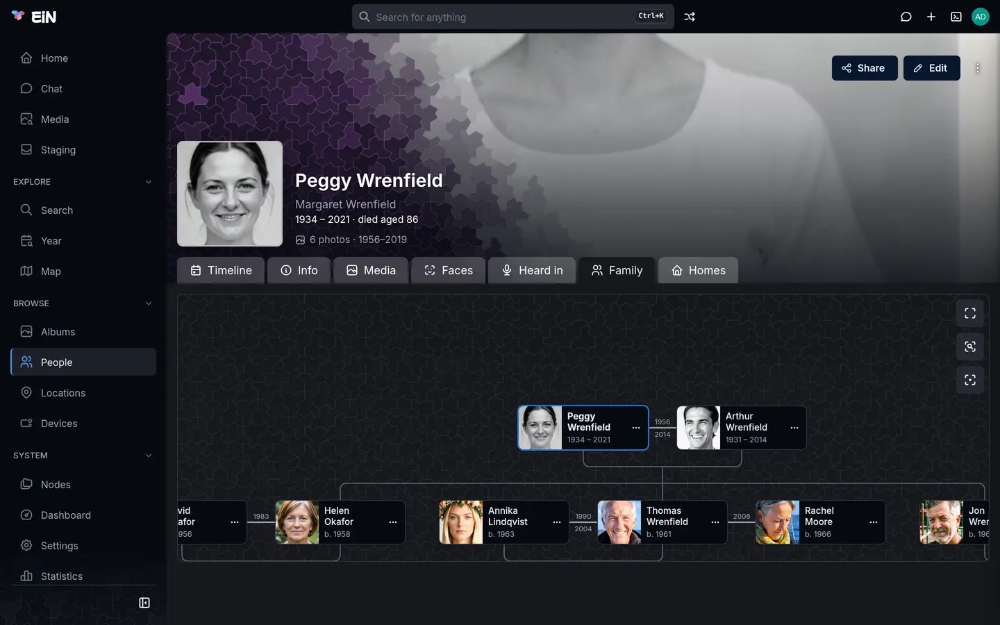
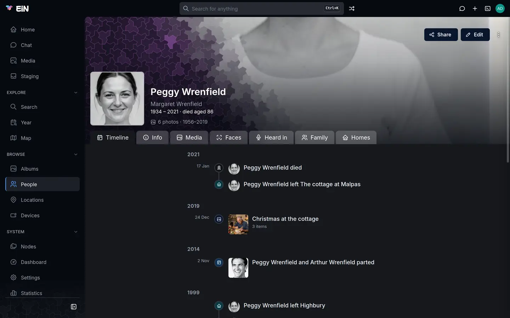

# Family tree, events and homes

This page shows how to record how the people in your archive are related, what happened in their
lives and where they lived, and what EiN makes of it: the family tree, the timelines, and the
birthdays and anniversaries on the Home page. It is for the family members who keep these records,
and it says which parts need an administrator.

## Who may change what

Everything on this page hangs off a person's page or a location's page. In the web interface, two
of the controls are shown only to an administrator:

| What                                       | Where                            | Who sees the controls              |
| ------------------------------------------ | -------------------------------- | ---------------------------------- |
| Parents, partners and children             | the person's **Family** tab      | administrators only                |
| A person's homes                           | the person's **Homes** tab       | administrators only                |
| A location's residents                     | the location's **Residents** tab | anyone who may change the location |
| Events of a person                         | ⋮ → **Add event** on the person  | anyone who may change the person   |
| Born and died                              | **Edit** on the person           | anyone who may change the person   |
| Events of an album, a location or a device | ⋮ → **Add event** on its page    | anyone who may change it           |

An administrator is someone signed in as `admin`, or a member of the `sudo` group who has chosen
**Administer…** in the account menu and entered their password again. See
[Accounts and groups](../admin/accounts.md). Who may change a person or a location is a matter of
its sharing; see [Sharing](../guide/sharing.md).

Everyone else reads the tree, the homes and the timelines like any other page, and sees no ⋯ menus
on the tree's cards and no **Add home** button.

> [!NOTE]
> The administrator rule belongs to the web interface only. The same changes are ordinary commands
> in the [terminal](../shell/terminal.md), and the [assistant](../assistant/chat.md) can propose parents,
> partners and events for you; there they need permission to change the people they touch, not
> administrator rights. See [In the terminal](#in-the-terminal).

## The family tree

Open a person and choose the **Family** tab. The address ends in `?tab=family`, so you can link to
someone's tree directly.



The tree is drawn the way family trees usually are:

- **Generations are rows.** Parents and grandparents are above, children and grandchildren below.
- **Couples sit side by side**, joined by a line. When the partnership has dates, the year it
  began is written over the line and the year it ended under it.
- **Each card** shows the person's picture, their name and their years: `1934 – 2021`, `b. 1958`
  for someone with only a birth date, `d. 2011` for someone with only a death date.
- **The person the page is about** has an outlined card and a bold name.
- **Click a name** to open that person's page.

The tree shows only people you may see. Someone whose page is hidden from you is left out, with
the lines to them.

### Show more of the family

A large family would not fit on a screen, so the tree opens with two generations up and two down
from the person, and the partners of everyone drawn. A card with more family behind it has a round
chevron on its edge: at the top when there are more parents ("Show &lt;name&gt;'s parents"), at
the bottom when there are more children ("Show &lt;name&gt;'s children"). Click one and the tree
loads one more generation that way: the parents above the card, or the children below it. The
chevron then turns round ("Hide &lt;name&gt;'s parents" or "Hide &lt;name&gt;'s children"), and
clicking it folds those relatives away again.

Two things are not drawn until you ask:

- **Brothers and sisters.** The tree walks up from the person and down from the person, so their
  siblings appear once you open the chevron on one of their parents' cards.
- **A partner's own family.** A husband's or wife's parents belong to another tree. Open the
  chevron on the partner's card to bring them in.

### Move around the tree

The tree moves inside its own box, as a map does, so the rest of the page stays where it is. Drag
it with the mouse or one finger. Scroll over it to zoom around the pointer, or pinch with two
fingers or on a trackpad. A double click or double tap on the space between the cards zooms in
there; hold <kbd>Shift</kbd> to zoom out. The buttons in the box's top right corner:

| Button                    | What it does                                                                         |
| ------------------------- | ------------------------------------------------------------------------------------ |
| **Full screen**           | Opens the tree in a window that fills the screen; **Leave full screen** closes it.   |
| **Fit the whole family**  | Shrinks the drawing until all of it fits the box.                                    |
| **Centre on this person** | Moves back to the person the page is about. Hidden while the whole family is fitted. |

### Brothers, sisters and in-laws

There is no brother or sister relation to record. Two people are siblings when they share a parent:
give both the same two parents and they are brother and sister, give them one parent in common and
they are half-siblings. In-laws and step-parents also follow from the ties you record: the partner
of someone's parent is their stepfather or stepmother, and the parent of someone's partner is their
father-in-law or mother-in-law. Set each person's **Gender** with **Edit** (see
[Edit a person](people.md#edit-a-person)) so that EiN can say father or mother rather than parent.

## Add a parent, partner or child

You need administrator rights for this in the web interface; see
[Who may change what](#who-may-change-what).

1. Open the person's **Family** tab.
2. Find the card of the person you are adding to. It can be any card in the tree, not only the
   person the page is about.
3. Click **⋯** on that card and choose **Add parent**, **Add partner** or **Add child**.
4. The dialog asks the question: "Whose child is &lt;name&gt;?", "Who is &lt;name&gt; with?" or
   "Who is a child of &lt;name&gt;?". Leave **Someone already here** selected and pick the person in
   **Who**. Type part of a name to narrow the list.
5. For a parent or a child, choose the **Kind**. For a partner, choose the **Relationship** and, if
   you know them, the dates in **From** and **Until**.
6. Press **Add**.

The tree, the person's header and their timeline are read again at once. The tree opens again as
it first did, two generations up and two down, so a relative added further out shows once you open
the chevrons to it again.

Each tie joins two people. **Add child** gives the child one parent: if both partners of a couple
are the child's parents, add the child from the other partner's card as well, or add the second
parent from the child's own card. Adding a partner links no children.

> [!WARNING]
> Choose **Someone already here**, not **Someone new**, in this dialog. **Someone new** makes the
> person outside the archive's people folder: they are not listed on the People page, their card in
> the tree does not open their page, and their birthday never reaches the Home page. To add someone
> who is not in the archive yet, a great-grandmother for example, first create them with
> **Create → Person** (see [Create a person by hand](people.md#create-a-person-by-hand)), then add
> them here with **Someone already here**.

### Parent kinds

| Kind         | Use it for                                                  |
| ------------ | ----------------------------------------------------------- |
| **Blood**    | A birth parent. This is the default.                        |
| **Adoptive** | A parent by adoption, as Jon and Kiri Wrenfield are to Leo. |
| **Step**     | A step-parent you want drawn as a parent, above the child.  |
| **Foster**   | A foster parent.                                            |

The tree draws every kind of parent alike. The kind shows in the words EiN uses for the tie, such as
"adoptive father" or "stepmother", when the [assistant](../assistant/chat.md) or `person-how-related` says
how two people are related. A step-parent does not have to be recorded as a parent at all: the
partner of a parent is already a stepfather or stepmother.

### Partnerships and their dates

**Relationship** is **Partner** or **Married**. **From** and **Until** take a year, a month or a
day: `1972`, `1972-05` or `1972-05-20`. Leave **Until** empty while the two are together.

The dates do more than label the line in the tree:

- **From** puts "&lt;A&gt; and &lt;B&gt; married" (or "became partners") on both people's
  timelines on that date.
- **Until** puts "&lt;A&gt; and &lt;B&gt; parted" on both timelines. Leave it empty when the
  partnership ended with a death: the death date already ends the anniversaries, and an **Until**
  on the day of death makes both timelines say the two parted that day.
- **From with a full date** makes the anniversary come round on the Home page: "Jon Wrenfield and
  Kiri Wrenfield — 30 years married". A partnership dated only to a year or a month, such as
  Thomas Wrenfield and Rachel Moore's from `2008-05`, has no day to come round on. See
  [Birthdays, memorials and anniversaries](#birthdays-memorials-and-anniversaries-on-the-home-page).

To add or correct the dates of a partnership that is already recorded, choose **Add partner**
again, pick the same partner, and fill in **From** or **Until**. EiN updates the dates of the
partnership you have instead of adding a second one, and keeps its **Relationship** as it was. To
change the **Relationship** or to clear a date, remove the relation and add it again.

### When EiN refuses

Problems show in a red box in the dialog, which stays open so you can correct them. People are
named there by the last part of their page's address, such as `Helen_Okafor`.

| Message                                                                             | What it means                                                           |
| ----------------------------------------------------------------------------------- | ----------------------------------------------------------------------- |
| "pick somebody, or create them"                                                     | **Who** is empty.                                                       |
| "person-set-parent: refusing to add parent: &lt;a&gt; is a descendant of &lt;b&gt;" | The tie would make someone their own ancestor. Check who is the parent. |
| "person-set-parent: &lt;a&gt; is already a parent of &lt;b&gt;"                     | The tie is already there.                                               |
| "person-set-partner: &lt;a&gt; and &lt;b&gt; are already partners"                  | The partnership is already there, and no dates were given to update.    |
| "person-set-partner: invalid from date '…' (YYYY[-MM[-DD]])", or the same with `to` | A date is not written as a year, a month or a day.                      |
| "person-set-partner: partnership end is before start"                               | **Until** is earlier than **From**.                                     |

## Remove a relation

1. On the **Family** tab, click **⋯** on the card of one of the two people and choose
   **Remove a relation…**.
2. The dialog lists their ties to the people on screen, such as "Arthur Wrenfield — partner" or
   "Helen Okafor — child". Choose one.
3. Press **Remove**.

The tie goes both ways, so this removes it from both people. Neither person is deleted, and nothing
goes to the trash: to undo it, add the relation again, with its kind and dates.

Only ties to people drawn in the tree are offered. If the dialog says "Nothing to remove — no
relations of theirs are on screen.", open the chevrons until the other person's card is shown.

## How two people are related

There is no page in the web interface that answers this. Ask the [assistant](../assistant/chat.md), for
example "How is Ruby related to Peggy?". Its answer can carry a small tree of only the people on the
line between the two, with a **Full screen** button. In the [terminal](../shell/terminal.md),
`person-how-related` answers in English or Swedish:

```bash
# in EiN's terminal
person-how-related /archive/people/Peggy_Wrenfield /archive/people/Ruby_Wrenfield
person-how-related /archive/people/Erik_Wrenfield /archive/people/Rachel_Moore
```

```text
Ruby Wrenfield is Peggy Wrenfield's granddaughter
Rachel Moore is Erik Wrenfield's stepmother
```

Add `--lang sv` after the two people for the Swedish word.

## Record an event

An event is a dated note on a person: a wedding, a move abroad, a graduation, a birth or a death.

1. Open the person's page, click ⋮ in the header and choose **Add event**.
2. Choose the **Type**: **Generic**, **Birth**, **Death**, **Marriage** or **Engagement**.
3. Type the **Date** as `1956`, `1956-06` or `1956-06-16`.
4. Write the **Description**, with Markdown if you like. Its first line becomes the event's title
   on the timeline.
5. **Written by** names the person who wrote the text. It starts as you, when your account is linked
   to a person; clear it or pick someone else.
6. Press **Add event**. It becomes available once there is a date or a description.

| Type           | What else it does                                                                                                                               |
| -------------- | ----------------------------------------------------------------------------------------------------------------------------------------------- |
| **Generic**    | Nothing more: it is an entry on the person's timeline.                                                                                          |
| **Birth**      | With a date, it sets the person's **Born**, replacing what was there. Its description joins the "&lt;name&gt; was born" entry on the timeline.  |
| **Death**      | With a date, it sets the person's **Died**, replacing what was there. Its description joins the "&lt;name&gt; died" entry.                      |
| **Marriage**   | Counts in the **Marriages by month** chart on the Statistics page. It does not record a partnership; see [Record a wedding](#record-a-wedding). |
| **Engagement** | Counts in the **Engagements by month** chart.                                                                                                   |

Things to know:

- **An event without a date is kept but placed on no timeline**, since there is nothing to place it
  by. Give it a date to see it.
- **Without a description**, the timeline shows a name made from the type and the date, such as
  `marriage-1956-06-16`. Write a first line that says what happened.
- **A person's events cannot be changed or removed in the web interface** once added. An
  administrator, or anyone who may change the person, can do it in the terminal: the events are
  files in the person's `events` folder.

  ```bash
  # in EiN's terminal
  ls /archive/people/Peggy_Wrenfield/events
  trash put /archive/people/Peggy_Wrenfield/events/event-1999
  ```

  `trash put` moves the event to your trash, where you can restore it; see
  [Your profile, favourites and trash](../guide/profile.md).

### Record a wedding

A wedding is best recorded in two parts, because each part feeds a different place:

1. **The partnership**, with **Add partner**, **Relationship** **Married** and the full date in
   **From**. It puts the wedding on both people's timelines and brings the anniversary to the Home
   page every year.
2. **A Marriage event**, if you have more to say, with the same date and a description such as
   "Married at Islington Town Hall". It carries the story, and counts in the Statistics chart.

When the event and the partnership fall on the same day, the timeline of the person who has the event
shows the two as one entry; the partner's timeline shows the partnership.

### Events of albums, locations and devices

Albums, locations and devices have **Add event** under ⋮ too, for someone who may change them. Their
events are always generic, and need both a **Date** and a **Description**.

- **On an album**, the date starts as the first day with pictures and no event yet. The event
  stands as a note among that day's pictures, signed "— &lt;writer&gt;", or with the name of the
  account that added it when it has no writer. If you may change it, a pencil on the note opens **Edit event**, where you change the date, the text or
  the writer and press **Save**, or press **Delete**. A deleted event goes to your trash, and the
  message "Event moved to the trash" has **Undo**.
- **On a location or a device**, the event appears on its **Timeline** tab. It cannot be changed in
  the web interface afterwards.

## What appears on a timeline

A person's **Timeline** tab is put together from what is recorded about them and their family. You
do not add entries to it directly.



| Entry                                                                          | Where it comes from                                      |
| ------------------------------------------------------------------------------ | -------------------------------------------------------- |
| "&lt;name&gt; was born", "&lt;name&gt; died"                                   | **Born** and **Died**, with any Birth or Death event     |
| The event's title                                                              | Their dated events                                       |
| "&lt;name&gt; moved to &lt;location&gt;", "&lt;name&gt; left &lt;location&gt;" | Their homes, on the **Moved in** and **Moved out** dates |
| "&lt;A&gt; and &lt;B&gt; married", "became partners", "parted"                 | Their partnerships' **From** and **Until**               |
| "&lt;child&gt; was born", with "Child of &lt;name&gt;"                         | Their children's **Born**                                |
| An album                                                                       | The albums with pictures of them                         |

A location's **Timeline** tab shows its residents moving in and out, its own events and the albums
with photos taken there. When it has none, it says "Nothing recorded at &lt;location&gt; yet.
Residents with dates, and albums with photos taken here, appear on its timeline."

A person's **Born** and **Died** also put them on the Year page for those years, with a "Born" or
"Died, aged N" badge; see [Media, Year and labels](media.md).

## Homes and residents

Where someone lived is one record seen from two sides: the person's **Homes** tab lists their
homes, and each location's **Residents** tab lists the people who lived there. A change on either
side shows on both.

### Add a home to a person

You need administrator rights for this in the web interface.

1. Open the person's **Homes** tab. It says "Where &lt;name&gt; has lived, and when."
2. Press **Add home**.
3. Choose **Location already here** and pick it in **Location**, or choose **New location** and type
   a **Location name**.
4. Fill in **Moved in** and, if they left, **Moved out**: `1972`, `1972-05` or `1972-05-20`. Leave
   **Moved out** empty while they live there.
5. Press **Add home**.

A new location made here has only its name. It has no place on the map until someone opens it and
gives it an address or a position; see [Locations and the map](places.md).

Each row shows the location, which opens its page, and the dates as they were entered:
`1956 – 1999`, `since 1983`, `until 1999`, or `dates unknown`. A home with a moved-in date and no moved-out date is marked
**current**. Homes without a moved-out date come first, then the others, the latest move first.

- **To correct the dates**, press the pencil on the row, change **Moved in** or **Moved out**, and
  press **Save changes**. The dates you leave are the new ones: emptying **Moved out** makes it a
  current home again.
- **To remove a home**, press the bin on the row, then **Remove** under "Remove &lt;location&gt; from
  this home history?". The location itself stays.

A person with no homes shows "No homes recorded."

### Add a resident to a location

The **Residents** tab of a location works the same way, from the other side, and anyone who may
change the location can use it.

1. Open the location and choose the **Residents** tab. It says "Who has lived at &lt;location&gt;,
   and when."
2. Press **Add resident**.
3. Choose **Person already here** and pick them in **Person**, or choose **New person** and type
   their **Name**. A new person made here is an ordinary person on the People page.
4. Fill in **Moved in** and **Moved out**, and press **Add resident**.

The pencil and the bin on each row correct the dates and remove the resident, as on the Homes tab;
the question there is "Remove &lt;name&gt; from the residents of &lt;location&gt;?". A location
with nobody recorded shows "No known residents."

### Why the dates matter

The dates are what turn a home into moves:

- **A home with a moved-in date** puts "&lt;name&gt; moved to &lt;location&gt;" on the person's
  timeline and on the location's. A moved-out date adds "&lt;name&gt; left &lt;location&gt;".
- **A home without dates** says where someone lived and nothing about when. It is listed on the
  Homes and Residents tabs as `dates unknown` and on the person's **Info** tab, but on no timeline.
- **A home without a moved-out date** counts as where the person lives now, even with no dates at
  all: the person's header shows it, and the location's header lists them under its current
  residents. Give a moved-out date to every home somebody has left.

### When saving a home fails

The form stays open with the reason in a red box:

| Message                                                                | What to do                                                                  |
| ---------------------------------------------------------------------- | --------------------------------------------------------------------------- |
| "pick a location, or create one", "pick somebody, or create them"      | Pick one in the list, or switch to **New location** or **New person**.      |
| "a location name is needed", "a name is needed"                        | Type the name.                                                              |
| "that name has no letters or digits to make a path from"               | Use a name with letters or digits in it.                                    |
| "person-set-home: --from '…' is not a date (YYYY[-MM[-DD]])"           | Write the date as `1972`, `1972-05` or `1972-05-20`.                        |
| "person-set-home: moved out … before moving in …"                      | **Moved out** is earlier than **Moved in**.                                 |
| "person-set-home: … already exists (use --update to change the dates)" | The home is already recorded. Close the form and use the pencil on its row. |

## Birthdays, memorials and anniversaries on the Home page

The **Events** panel on the Home page lists what comes round in the next 30 days and what came round
in the last 7, under **Today**, **Coming up** and **Recently**. It is filled from the dates on this
page, so what it shows depends on what you record:

| On the Home page                                                                 | Comes from               | Needs                                                            |
| -------------------------------------------------------------------------------- | ------------------------ | ---------------------------------------------------------------- |
| Birthdays: "&lt;name&gt; turns N", or "would have turned N" after their death    | the person's **Born**    | a full date, `1934-08-22`                                        |
| Memorials: "N years since &lt;name&gt; died"                                     | the person's **Died**    | a full date; only on round years                                 |
| Anniversaries: "&lt;A&gt; and &lt;B&gt; — N years married" or "… years together" | a partnership's **From** | a full date; **Married** says married, **Partner** says together |

A date known only to the year or the month never comes round, since it has no day. Round years, the
5th, 10th, 15th and 20th and then every 10th, are shown in bold, and they are kept first when there
are more than 16 entries. Birthdays stop after the 110th. An anniversary comes round up to the year
of the **Until** date or of the first partner's death, and for 75 years at most. Someone born on
29 February appears only in leap years.

Birthdays and memorials come from the people on the People page.
[Home, memories and statistics](../guide/home.md) describes the panel itself, and the Statistics page with
its charts of births, engagements, marriages and deaths by month.

## In the terminal

Everything on this page is also a command, which an administrator or a power user can run in the
[terminal](../shell/terminal.md) or over [SSH](../shell/ssh-sftp.md). The commands need permission
to change the people and locations they write to; they do not ask for administrator rights.

```bash
# in EiN's terminal
person-set-parent /archive/people/Leo_Wrenfield /archive/people/Kiri_Wrenfield --kind adoptive
person-set-partner /archive/people/Jon_Wrenfield /archive/people/Kiri_Wrenfield --kind married --from 1996-02-03
person-set-home --from 1996 /archive/people/Jon_Wrenfield /archive/locations/Kelburn
person-add-event --type marriage --date 1956-06-16 --body 'Married at Islington Town Hall' /archive/people/Peggy_Wrenfield
person-family-tree /archive/people/Peggy_Wrenfield
```

Give `person-set-parent`, `person-set-partner` and `person-how-related` the two people first and the
flags after them: placed before the people, a flag's value is taken for a person.

| Command                                                | What it does                                                                                   |
| ------------------------------------------------------ | ---------------------------------------------------------------------------------------------- |
| [`person-set-parent`](commands.md#person-set-parent)   | Adds a parent; the child comes first. `--kind blood\|adoptive\|step\|foster`.                  |
| [`person-set-partner`](commands.md#person-set-partner) | Adds a partnership, or updates the dates of one. `--kind partner\|married`, `--from`, `--to`.  |
| [`person-remove`](commands.md#person-remove)           | Removes the tie between two people, from both sides.                                           |
| [`person-set-home`](commands.md#person-set-home)       | Records a home with `--from` and `--to`; `--update` rewrites the dates of one already there.   |
| [`person-remove-home`](commands.md#person-remove-home) | Removes a home, from both the person and the location.                                         |
| [`person-add-event`](commands.md#person-add-event)     | Adds an event to a person, album, location or device.                                          |
| [`person-info`](commands.md#person-info)               | Shows a person's dates, relatives, homes and events, the undated ones too.                     |
| [`person-family-tree`](commands.md#person-family-tree) | Prints ancestors and descendants as text.                                                      |
| [`person-how-related`](commands.md#person-how-related) | Names how two people are related.                                                              |
| [`person-timeline`](commands.md#person-timeline)       | Prints a person's timeline.                                                                    |
| [`person-check`](commands.md#person-check)             | Looks for broken ties, impossible dates and loops in the tree: `person-check /archive/people`. |
| [`events`](../reference/commands-core.md#events)       | Prints what the Home page's Events panel shows.                                                |

You can also tell the [assistant](../assistant/chat.md) a parent, a partnership or an event the archive
should record, for example "Leo was adopted by Jon and Kiri". It proposes the command, and nothing
changes until you press **Run**; it runs as you, with your permissions. Homes are not among the
commands it is pointed to, so record those on the **Homes** or **Residents** tab.

## When something goes differently

**There is no ⋯ on the cards, or no Add home button.** These are shown only to administrators. Ask
one to make the change, or, if you are in the `sudo` group, choose **Administer…** in the account
menu first.

**A relative is missing from the tree.** Open the chevron on the nearest card that is shown;
siblings and a partner's family appear only then. If there is no chevron, the tie is not recorded,
or the relative's page is hidden from you.

**A card in the tree opens "Person not found."** The person was made with **Someone new** in the
relation dialog, outside the archive's people folder. Remove the relation, create the person with
**Create → Person**, and add the relation again with **Someone already here**. The stray person
stays under `/people`, where an administrator can delete it in the Nodes explorer or the terminal.

**A birthday or anniversary does not show on the Home page.** Check that the date has a day, that it
falls within the next 30 days or the last 7, and for an anniversary that the partnership has a
**From** date. When more than 16 entries fall in the window, the rest are left out; round years are
kept first.

**A move is not on the timeline.** The home has no dates. Press the pencil on its row and fill in
**Moved in**.

**Someone shows a home they left long ago as where they live.** That home has no moved-out date.
Add one.
