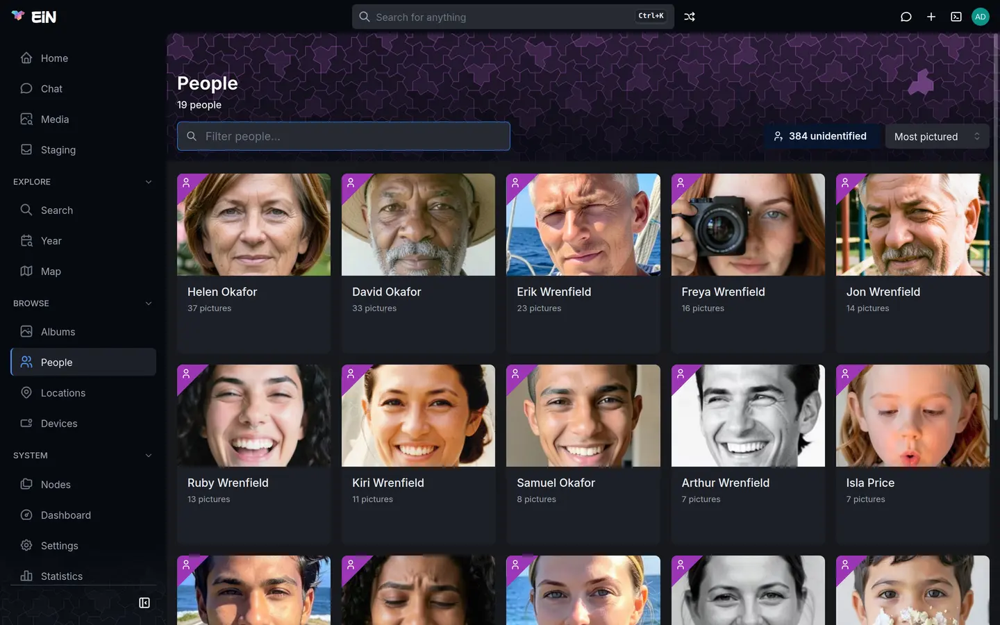
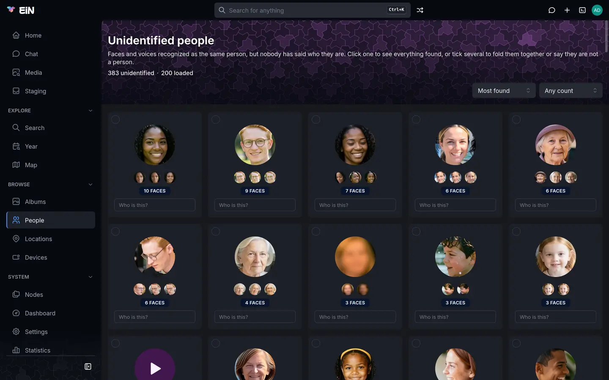
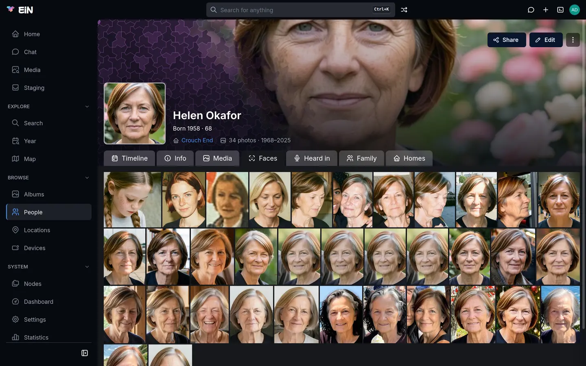

# People and faces

EiN finds the faces in your photos and videos and the voices in your recordings, and groups the ones that belong to the same person. This page is for everyone in the family who names those people, corrects what recognition got wrong, and browses a person's pictures.

## How faces become people

You do not have to tag anyone for recognition to start. Every photo, and frames sampled through every video, is searched for faces as it arrives, and every face that is found goes through the same three-way decision:

1. **It joins a person** when it looks enough like faces of that person in other photos, and the comparison clearly favours that one person over everyone else. That person may be named or still unidentified.
2. **It starts an unidentified person** when it matches nobody, but is clear and large enough to be worth treating as someone new. That person gets a placeholder name such as `Unknown 4XK9QM` and waits on the [Unidentified people](#name-the-people-recognition-found) page for someone to say who it is.
3. **It stays unknown** when it is too small or too unsure to start anyone. In the viewer its box reads **Unassigned**.

The next photo of the same stranger finds the first one, sees that it already belongs to an unidentified person, and joins that person instead of starting another. So when you name an unidentified person you name every face in the group at once, and new pictures of them join the named person by themselves from then on.

Two faces in the same photo are never made the same person automatically. Voices work the same way across recordings and the sound of videos: a voice that matches nobody starts an unidentified person when it speaks for at least 10 seconds in all in one recording, and two voices in one recording are never made the same person. In a video, a face seen speaking in step with a voice counts as evidence of who is speaking.


The work is done by the [media service](../ems/index.md) on your own machine; no photo, face or voice is sent anywhere to be analysed. Without the media service no faces are found, and they are found once it runs again. After a large import it takes a while for every picture to be looked at; the **Dashboard** reads **Catching up** until it is done (see [Health and the dashboard](../admin/monitoring.md)).

Faces are found in the pictures waiting in your [staging area](staging.md) too, before you file them into albums.

## The People page

Open **People** in the sidebar, under **Browse**.



- The header counts the named people (**19 people**). The filter box (**Filter people…**) matches the name and the full name as you type.
- **N unidentified** opens the people recognition found but nobody has named yet. It is there only when there are some. On a phone it is an icon with the count as a badge.
- **Sort** offers **Most pictured** (the default), **Name (A-Z)** and **Name (Z-A)**. Your choice is remembered in this browser. A name that starts with `?`, a placeholder for someone known only from a family record, sorts after the real names.
- Each card shows the person's cover picture, their name and how many pictures they are in, or their full name when they are in none. Click a card to open the [person's page](#a-persons-page).

The number on a card counts the faces and voices of that person in the library, so a recording they are heard in counts too. Faces and voices in files still waiting in someone's staging area count once those files are filed.

When nobody has been named yet, the page says **No people yet** and "Face recognition finds people in the pictures; name them under Unidentified, or add someone here." with a **New person** button.

You can also find a person from the search box in the top bar, or with `@` and their name on the Search, Media, Year and Map pages; see [Search and the finder](search.md).

## Name the people recognition found

Click **N unidentified** on the People page, or open `/people/unknown`.



The page is headed **Unidentified people**: "Faces and voices recognized as the same person, but nobody has said who they are." Under it, **N unidentified** says how many there are, and **N loaded** how many the page has fetched so far.

- **Sort** offers **Most found** (the default) and **Newest**.
- **Found** shows only people found at least so many times: **Any count**, **2+ times**, **5+ times**, **10+ times** or **50+ times**. A face and a recording the voice is heard in count one time each.
- Each card shows one large glimpse and up to three small ones: the best faces first, then round play buttons that play the voice's longest turn. The badges say **N faces** and **heard in N** (recordings).
- **Load more (N of M)** at the foot fetches the next cards.

Both choices are kept in the address, so a link opens the same view.

To name someone from their card:

1. Click in the card's **Who is this?** box and type the name, for example `Ruby Wrenfield`. Once you type, the box lists the matching people who already have a name.
2. Press <kbd>Enter</kbd>, or click one of the listed people, which adds this person to them at
   once. While it is saved, the box shows a spinner and the card fades in and out until it leaves
   the page.

What happens depends on the name:

- **A new name** names the person. They move to the People page with every face and voice they hold, and a message says **Named Ruby Wrenfield**.
- **The name of someone who already exists** adds the faces and voices to that person instead of making a second one, and the message says **Added to Ruby Wrenfield**. The name must match exactly, apart from capital letters, so pick it from the list rather than typing it differently.

> [!TIP]
> Before you name a card you are unsure of, open it. A card shows at most four glimpses; the [review](#look-at-everything-before-you-decide) shows every face and recording, which is where you notice that two people were put together.

When nobody is waiting, the page says "Nobody unidentified. Everyone recognized so far has a name." With a **Found** filter on, it says, for example, "Nobody unidentified found 5 or more times."

## Look at everything before you decide

Click a card, anywhere but its name box and its tick box, to open the review. Its title is the placeholder name, with the **N faces** and **heard in N** badges beside it.

- At the top, the **Who is this?** box ("A new name, or someone you already have") works like the card's. Its button reads **Name**, or **Add to &lt;name&gt;** when the name is someone who already exists. **Not a person** beside it is described in [Say what is not a person](#say-what-is-not-a-person).
- **Faces** shows every face of this person. Click a face to open the photo it came from in the viewer; the arrows then step through the photos of the faces shown. **Load more (N of M)** fetches more when there are many.
- **Voice** ("heard in N recordings") shows a tile for each recording the voice is heard in. The round button plays the voice's longest turn there, and **Open in the lightbox** opens the recording at that moment. **Pick all** picks every recording.

To pick faces or recordings, tick the box in their corner. Once something is picked, a click on a face picks it too instead of opening its photo; <kbd>Shift</kbd>+click picks a range, and <kbd>Ctrl</kbd>+<kbd>A</kbd> (<kbd>⌘</kbd>+<kbd>A</kbd> on a Mac) picks everything shown. <kbd>Esc</kbd> closes an open photo first, then clears what is picked, then closes the review.

The review has its own address, `/people/unknown?person=<id>`, so you can send it to a relative who may know who it is.

### Take some faces out (Split off, Move to…)

When the review shows faces of more than one person, pick the ones that do not belong. A bar appears with **N faces picked** and these actions:

| Action                       | Dialog                                                         | What it does                                                                                                                 |
| ---------------------------- | -------------------------------------------------------------- | ---------------------------------------------------------------------------------------------------------------------------- |
| **Split off as someone new** | **Split off N faces?** → **Split off**                         | The picked faces and recordings become a new unidentified person of their own, for you to name afterwards or add to someone. |
| **Move to…**                 | **Move N faces to someone?**, then **Who they are** → **Move** | They move to the named person you pick, and count as decided by a human, so no later pass moves them again.                  |
| **Not a person**             | **N faces: not a person?** → **Unassign and lock**             | They lose their identity and are locked, so recognition leaves them alone. Nothing is deleted.                               |
| **Clear**                    |                                                                | Unpicks everything.                                                                                                          |

When you have picked everything the person holds, **Split off as someone new** and **Move to…** are greyed out, with the note "That is everything they have. To give all of it to someone, name them or add them to someone above instead. Not a person removes them."

### Group similar faces

Recognition sometimes joins two people through one weak resemblance, and four glimpses on a card will not show it. With three faces or more, the review has an **Adjust group threshold** switch beside **Faces** (and with three recordings or more, one beside **Voice**):

1. Turn on **Adjust group threshold**. EiN compares every face of this person with every other ("Comparing every face against every other"), once.
2. Drag the **How alike** slider. The faces are laid out in groups, **Largest group** first, then **Group 2** and onward, each with its number of faces. The slider starts where the comparison suggests the groups part.
3. Tick a group's box to pick all of it, then use **Split off as someone new**, **Move to…** or **Not a person** as above.

Only the 30 largest groups are shown; the rest are counted under them ("Move the slider left to bring them up here."). A box someone drew by hand has nothing to compare and is in no group.

## Fold several unidentified people into one

Recognition often splits one person into a large group and a few small ones. To join them:

1. On the **Unidentified people** page, tick the box in the corner of each card. Once one is ticked, a plain click on a card ticks it too; <kbd>Ctrl</kbd>+<kbd>A</kbd> ticks every loaded card and <kbd>Esc</kbd> clears.
2. In the bar at the bottom, press **Merge**. It needs two cards or more.
3. The dialog **Merge N into one person?** names the one that survives: the card with the most faces, or the older one when two have as many. "&lt;name&gt; survives with all N faces. It keeps its own entry and stays unidentified — name it afterwards." It lists the others with their faces.
4. Press **Merge**. The other entries are removed, and their faces are marked as decided by a human, so no later pass undoes it.
5. Name the person that is left, from its card or its review.

The web interface merges only unidentified people. To fold one named person into another, for example a second Ruby made by a typo, use `person-merge` in the [terminal](../shell/terminal.md): faces, voices, events, relations and every other link move to the person you keep, and the other is removed. `--dry-run` shows what would move without changing anything.

```bash
# in EiN's terminal
person-merge --dry-run /archive/people/ruby-wrenfeld /archive/people/ruby-wrenfield
person-merge /archive/people/ruby-wrenfeld /archive/people/ruby-wrenfield
```

The last path is the person who stays. See [`person-merge`](commands.md#person-merge) in the command reference.

## Say what is not a person

A poster, a statue, a doll, a pattern in the wallpaper or the back of a head can all be taken for a face. Saying so keeps recognition from trying again:

- **Several cards at once:** tick them on the **Unidentified people** page and press **Not a person** in the bar.
- **One person:** press **Not a person** at the top of their review.

The dialog (**Not a person?**, or **N: not a person?** for several) says what happens: every face and recording they hold loses its identity and is locked, so recognition leaves it alone from now on, and the entry is removed. "The photos and recordings themselves are untouched." Confirm with **Not a person**.

- **Some faces of one person:** pick them in the review and press **Not a person** in the bar under it. The dialog (**N faces: not a person?**) locks only those, and the person keeps the rest. Confirm with **Unassign and lock**.

For faces wrongly given to someone who already has a name, use **Not a face** on their [Faces tab](#correct-a-persons-faces).

## Name a face in the viewer

You can also name people while you look at a picture. The [viewer](viewer.md) describes it fully; in short:

- Press <kbd>f</kbd>, or choose **Pin faces** in the **More** (⋮) menu, to show every face box with its name. Hovering a box, or a name in the details panel, lights up the other.
- Click a named box to open that person's page. Click the box of an unidentified person to get a **Who is this?** box: type the name and press <kbd>Enter</kbd> or the check mark. This always makes a new person, even when someone of that name exists; to add the faces to someone who already exists, use the review instead.
- In the details panel, under the people in the picture, an unidentified person is listed by a crop of their face and their placeholder name. Click it to open their review over the viewer.
- On a computer, **Edit faces** in the cog menu lets you select a box and press its name ("Change who this is"). The **Who is this?** dialog offers **Someone I know** (pick them under **Who it is**), **Someone new** (a new unidentified person, for you to name now or later) and, for a face recognition found, **Let recognition decide** (matched again against everyone except the person it is on now). Confirm with **Move** or **Match again**. This is also how you give a name to a face marked **Unassigned**.
- In **Edit faces** you can also drag a new box around a face recognition missed. It becomes a new unidentified person, and its review opens for you to name it. A box drawn by hand names the person in that picture, but is not used to recognise them in others.

**Edit faces** is offered on a computer, on photos you may change.

## Create a person by hand

Someone who is in no picture yet, a great-grandparent for the family tree for example, can be added by hand:

1. Open **Create** (the plus in the top bar) and choose **Person**, or press **New person** on an empty People page.
2. In **Create Person**, fill in **Name** (required), and if you like **Full name** and **Gender** (**Female**, **Male**, **Other** or **Unknown**).
3. Press **Create**. The new person's page opens.

Look on the People page first, so that you do not add someone who is already there: the dialog does not look for someone of the same name. The address of the new page is made from the name, and if a person already has that address the dialog shows an error instead; give the new person a name that tells the two apart.

Later faces only join a person through faces that already belong to them, so a person made by hand gets pictures once you give them a face: add an unidentified person to them by typing their name, or move faces to them with **Move to…** or **Someone I know**.

## A person's page

Click a person on the People page, a name in the viewer, or a person in search results.


The header shows:

- their cover picture and name, the full name under it, and "Born as &lt;birth name&gt;" when that is different;
- a life line: "1934 – 2021 · died aged 86" for someone who has died, "Born 1958 · 68" for someone living. A `~` before the age means it is approximate, because the birth date has no day;
- where they live now, linking to the location, their contact details (not on a phone; the Info tab lists them), and how many photos they are in, over which years ("34 photos · 1968–2025");
- allergies, marked with a warning sign, their labels, and the description.

If you may change the person, the header has **Share** and **Edit**, and under ⋮ **Add event**, **Split faces…** (administrators only) and **Move to trash**. **Share** shares the person's page and what hangs off it, not the photos they are in; see [Sharing](../guide/sharing.md). **Move to trash** returns you to the People page with "&lt;name&gt; moved to the trash" and **Undo**.

| Tab          | What it shows                                                                                                                                                                                                                   |
| ------------ | ------------------------------------------------------------------------------------------------------------------------------------------------------------------------------------------------------------------------------- |
| **Timeline** | Their life by year, the latest first: birth and death, events, moves, partnerships, their children's births, and the albums they appear in.                                                                                     |
| **Info**     | Everything recorded about them: **Person** (Name, Full name, Born as, Gender, Born, Died, Age or Age at death, Photos), **Contact**, **Allergies**, **Homes** with the years, **Family** (each relative by role) and **About**. |
| **Media**    | Every photo and video they are in, newest first, with the time rail at the side for jumping through the years.                                                                                                                  |
| **Faces**    | Every face of theirs, as a grid of crops. See [Correct a person's faces](#correct-a-persons-faces).                                                                                                                             |
| **Heard in** | Every recording they speak in. See [Recordings a person is heard in](#recordings-a-person-is-heard-in).                                                                                                                         |
| **Family**   | The family tree. See [Family tree, events and homes](family.md).                                                                                                                                                                |
| **Homes**    | Where they have lived, with the years. See [Family tree, events and homes](family.md).                                                                                                                                          |

The open tab is kept in the address (`?tab=faces`, `?tab=voices` and so on), so you can link straight to it.

When there is nothing to show, the Timeline says "Nothing recorded for &lt;name&gt; yet. Add an event to record something.", and the Media tab "No photos of &lt;name&gt; yet. They appear here once tagged, or once a detected face is assigned to them."

On the **Media** tab you can select pictures as in an album. If you may change the person, **Set as cover** in the selection bar makes the one selected picture their cover; **Set time** changes the capture time of pictures you may change (see [Dates and places of pictures](dates-places.md)).

On a phone, the tabs show only their icons, except the one that is open, and the header's buttons fold into ⋮.


## Correct a person's faces

The **Faces** tab shows every face assigned to the person, as crops in a grid. Click a crop to open the photo it came from in the viewer; the arrows step through the photos in the order of the grid. While there are more faces than are loaded, a note says "N of M loaded", and more load as you scroll.



Select faces as you select pictures in an album: hover a crop and tick its box, <kbd>Shift</kbd>+click for a range, or long-press on a phone. The selection bar then offers:

- **Download**: the selected crops, as one zip named "&lt;name&gt; faces" when there are several.
- **Set as cover**: makes the one selected crop the person's picture.
- **Not &lt;name&gt;**: takes the faces off this person.
- **Is &lt;name&gt;**: only in the **Doubtful** view, described below.

**Not &lt;name&gt;** opens the dialog **Not &lt;name&gt;?**, with the number of faces under its title and four choices:

| Choice                                   | What happens                                                                                                                                                               |
| ---------------------------------------- | -------------------------------------------------------------------------------------------------------------------------------------------------------------------------- |
| **Let recognition decide** (the default) | Each face is matched again against everyone except this person. It joins whoever it looks like, or becomes a new unidentified person. It is never put back on this person. |
| **Someone I know**                       | The faces move to the person you pick under **Who it is**.                                                                                                                 |
| **One new unidentified person**          | All the faces are the same person, not yet named. Name them later from the unidentified list.                                                                              |
| **Not a face**                           | They lose their identity and are locked, so recognition leaves them alone from now on.                                                                                     |

Press **Move**, or **Unassign and lock** for **Not a face**. After **Let recognition decide**, a short report (**Faces moved**) says where the faces went, for example "2 faces matched to Peggy Wrenfield", "3 faces became unidentified people" or "1 face left unassigned — too small or unclear to start a new person". Press **Done**.

If a face that was the person's cover leaves them, they get a new cover from their remaining faces.

### Doubtful faces

Somebody who is not sure a face is the person can mark it as doubtful in the viewer (see
[People in the picture](viewer.md#people-in-the-picture)), or with the
[`face-doubt`](commands.md#face-doubt) command. The face stays the person's until somebody answers.

When a person has doubtful faces, the Faces tab shows a switch: **All faces** or **Doubtful (N)**, "Faces somebody is not sure of, or that look more like somebody else". Each doubtful crop is badged with who marked it, for example "asked by peggy".

1. Choose **Doubtful (N)**.
2. Select the faces that are someone else and press **Not &lt;name&gt;**.
3. Select the faces that are right and press **Is &lt;name&gt;**. They stay, as a person's decision.

When none are left, the tab says "No doubtful faces of &lt;name&gt; left."

## Recordings a person is heard in

The **Heard in** tab lists, under "Heard in N recordings", a tile for each recording the person speaks in, those they speak most in first. The round button on a tile plays their longest turn in that recording. Hovering the name shows the recording's date and how long they speak in it ("speaks 1:42 in it"), and **Open in the lightbox** opens the recording at their turn.

To take a recording off the person, tick its tile and press **Not this person (N)**. Their voice in it loses its identity and is locked, so recognition does not give it back. Nothing asks first.

If the person speaks in no recording, the tab says "Not heard in any recording yet." Naming a voice in a transcript, and seeing who speaks when, is in [the viewer](viewer.md).

## Split a person who is really two

Naming an unidentified person approves every face in it. If it turns out to have held two people, an administrator can take them apart with **Split faces…** under ⋮ on the person's page. The dialog **Split &lt;name&gt;** compares the person's faces with each other, more strictly than recognition did.

1. Drag the **Similarity** slider until the people come apart; the badge says how many groups there are. **One group**, **Split in two**, **Suggested** and **Split off all but the largest** are shortcuts.
2. For each group, choose **Keep**, **Split off** (a new unidentified person; not offered for a group of one face), **Merge into…** (pick a named person) or **Not a person**. Every group starts on **Keep**.
3. Click a face to see the photo it came from; the arrows then step through that group, which is the way to check that the same person keeps turning up.
4. Read the summary at the foot, for example "40 faces stay · 1 new unidentified person", and press **Apply to N groups**.

At least one group has to stay: moving all of them is a rename, not a split. Only the 30 largest groups get a card; the smaller ones stay as they are. A box drawn by hand has nothing to compare and stays where it is.

## Edit a person

Press **Edit** on the person's page to open **Edit person**. Leave an optional field empty to remove it.

| Field                   | What to enter                                                                                                                                                                                    |
| ----------------------- | ------------------------------------------------------------------------------------------------------------------------------------------------------------------------------------------------ |
| **Name**                | The name shown everywhere. Required.                                                                                                                                                             |
| **Full name**           | Their whole name, shown under the name.                                                                                                                                                          |
| **Birth name**          | The name they were born with, shown as "Born as".                                                                                                                                                |
| **Gender**              | **Female**, **Male**, **Other** or **Unknown**.                                                                                                                                                  |
| **Born**, **Died**      | A year, a month or a day: `1934`, `1934-05` or `1934-05-20`. Without a day, their age is shown as approximate.                                                                                   |
| **Contact information** | **Add contact** adds a row with a **Type** (for example "Email, phone, address…") and the **Details**. An e-mail address becomes a link that writes to it, and a phone number one that calls it. |
| **Allergies**           | Shown with a warning sign in the header.                                                                                                                                                         |
| **Description**         | Free text, with Markdown.                                                                                                                                                                        |
| **Labels**              | Words to find the person by. A space starts the next label.                                                                                                                                      |

Press **Save**. If something is missing, the dialog says "a name is needed" or "each contact needs both a type and details". Events, parents, partners, children and homes are not in this dialog; see [Family tree, events and homes](family.md).

## Cover pictures

A named person without a cover gets one by themselves: the crop of one of their own faces. Faces someone named or confirmed come first, then photos where they are the only face, then clear faces looking into the camera, then the largest. A cover you choose yourself, with **Set as cover** on the Faces or Media tab, is never replaced by another pick. A cover is replaced only when it no longer works: the picture is gone, or it is the crop of a face that has since been taken off the person, because their card would then show somebody else.

## What EiN keeps of your decisions

Recognition only decides about faces nobody has decided about. Anything a person says is kept, and no later automatic pass undoes it:

| You                                                           | Afterwards                                                                                    |
| ------------------------------------------------------------- | --------------------------------------------------------------------------------------------- |
| Name an unidentified person                                   | Their faces count as named by a human. New faces that look like them join them by themselves. |
| Add someone to an existing person, or **Merge**               | The faces are marked as decided by a human.                                                   |
| **Move to…**, **Someone I know**                              | The faces stay with the person you picked.                                                    |
| **Split off as someone new**, **One new unidentified person** | The faces stay together as the new person.                                                    |
| **Not a person**, **Not a face**, **Not this person**         | The faces and voices are locked without a name.                                               |
| **Let recognition decide**                                    | The faces are never matched back to the person you took them from.                            |
| **Is &lt;name&gt;**, **Yes** to **Is this &lt;name&gt;?**     | The faces are marked as decided by a human, and the doubt goes.                               |
| **Set as cover**                                              | Your cover stays, as long as the picture is there and the face is still theirs.               |

Changing the recognition settings does not touch these decisions either.

## When something goes differently

**No faces are found at all.** Recognition needs the media service. Ask your administrator to check the **Dashboard**; see [The media service](../ems/index.md).

**A face in a photo has no box.** Faces that are very small, blurred or turned far away are not kept. Draw a box around it with **Edit faces** in the viewer, as described in [Name a face in the viewer](#name-a-face-in-the-viewer).

**One person is spread over many unidentified cards.** Tick the cards and [merge them](#fold-several-unidentified-people-into-one), or type the same name into each card's box.

**An unidentified person holds two people.** Open the review and use [Group similar faces](#group-similar-faces). For a named person, an administrator uses [Split faces…](#split-a-person-who-is-really-two).

**A person has someone else's faces.** Open their **Faces** tab, select the wrong ones and press **Not &lt;name&gt;**.

**A person's card shows more pictures than their page.** The card counts faces and voices, so each recording the person is heard in counts too.

**An action fails.** The reason appears in red under the bar or in the dialog. A change you are not allowed to make, to a picture or a person you may only view, is refused; ask whoever owns it, or your administrator.

**Recognition is too eager or too cautious.** An administrator can tune it under **Settings → System**, in the groups **Faces** and **Voices**. Changes apply to faces and voices decided from then on.

| Setting                                                                                  | Default     | What it decides                                                                                                                  |
| ---------------------------------------------------------------------------------------- | ----------- | -------------------------------------------------------------------------------------------------------------------------------- |
| **Face match threshold**                                                                 | 0.55        | How similar two faces must be before one is attached to a known person. Higher makes fewer wrong matches and more unknown faces. |
| **Face winner margin**                                                                   | 1.2         | How far the leading person must outweigh the runner-up. Higher leaves close calls unknown.                                       |
| **Confidence to start a new person from a face**                                         | 0.7         | How sure the detector must be before a face that matches nobody starts a new person.                                             |
| **Size to start a new person from a face (px)**                                          | 48          | How large such a face must be: its shorter side, in pixels of the displayed photo.                                               |
| **Minimum face confidence**, **Minimum face size (px)**, **Maximum head turn (degrees)** | 0.7, 24, 80 | Which detections are kept as faces at all.                                                                                       |
| **Speech to start a new person (seconds)**                                               | 10          | How long a voice that matches nobody must speak in one recording, in all, before it starts a new person.                         |

Every setting is described in the reference, under [Faces](../reference/settings.md#faces) and [Voices](../reference/settings.md#voices).
