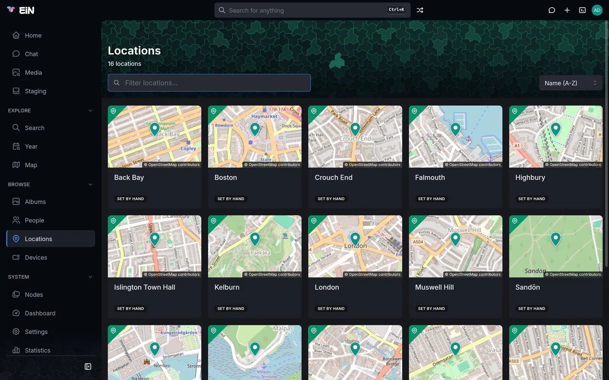

# Locations and the map

This page is for everyone in the family who works with places: the homes, cottages, churches and
towns where pictures were taken and people lived. It covers the **Locations** page, creating a
location and drawing where it lies, how pictures join a location by themselves, and the **Map**
page, where pictures, locations and GPS tracks are drawn together.

How one picture gets its position, and how you correct it, is on
[Dates and places of pictures](dates-places.md).

## What a location is

A location is a named place in the archive, such as "The cottage at Malpas", "Highbury" or
"London". It has a name and, if you give them, an address, a city and a country, a description,
labels and the people who lived there. Where it lies on the map is one of three shapes:

| Shape   | What it is                            | Where it comes from                                                         | Pictures inside join it |
| ------- | ------------------------------------- | --------------------------------------------------------------------------- | ----------------------- |
| Point   | One spot, with no size                | Coordinates typed or clicked when the location is created                   | No                      |
| Circle  | A centre and a radius                 | Drawn by hand, or worked out from the location's address or linked pictures | Yes                     |
| Polygon | An outline with three or more corners | Drawn by hand                                                               | Yes                     |

A location with a circle or a polygon does work for you:

- Pictures whose position falls inside it are linked to it. The viewer shows the location's name
  for them, and its **Media** tab lists them.
- Typing `@` and the location's name finds those pictures in [search](search.md) and on the map,
  and narrows the Year page to what holds them.
- An album's **Info** tab lists the locations of its pictures under **Places**.
- [Staging](staging.md) names the albums it suggests after the location most of their pictures are
  linked to, or else the nearest location within 500 m.

People's homes are locations too, so a location's page shows who lived there; see
[Family tree, events and homes](family.md#homes-and-residents). Locations are kept under
`/archive/locations` in the [tree](../concepts/tree.md).

## Browse the Locations page

Open **Locations** in the sidebar, under **Browse**.



The header counts the locations, for example "16 locations", and has these controls:

| Control               | What it does                                                                                                                         |
| --------------------- | ------------------------------------------------------------------------------------------------------------------------------------ |
| **Filter locations…** | Narrows the cards as you type, by name and address. Case and accents do not matter.                                                  |
| **Show**              | **All (N)** or **Needs location (N)**, the locations with no place on the map. It appears only while at least one location has none. |
| **Sort**              | **Name (A-Z)** or **Name (Z-A)**. This browser remembers your choice.                                                                |

Each card shows a small map of where the location lies, or a crossed-out pin when it has no place
yet, then its name, its address and one of these badges:

| Badge             | Means                                                                          |
| ----------------- | ------------------------------------------------------------------------------ |
| **set by hand**   | Someone drew its shape or typed its coordinates                                |
| **from N photos** | Its circle was worked out from N geotagged photos linked to it                 |
| **from address**  | Its circle comes from looking up its address                                   |
| **N suggestions** | The address lookup found candidates but was not sure; you pick one on its page |

Click a card to open the location. A location has no cover photo to choose in the web interface;
its card shows the map.

With no locations at all, the page says "No locations yet" and "Homes, churches, summer houses:
locations where people lived or pictures were taken.", with a **New location** button when you are
signed in. A filter that matches nothing says `No locations found matching "<text>"`.

## Create a location

You need to be signed in.

1. Press the plus (**Create**) in the top bar and choose **Location**. On an empty Locations page,
   **New location** does the same. See [The Create menu](../guide/interface.md#the-create-menu).
2. The **Create Location** dialog opens with a map beside the fields. Type a **Name**, for example
   `The cottage at Malpas`. It is the only field you must fill in.
3. If the place has an address, type it under **Address** as it was written down: street and
   number, postcode and town. The hint reads "Looked up on the map when no coordinates are given,
   and again whenever it is edited."
4. If you know exactly where it is, click the map under **Coordinates**, or type **Latitude** and
   **Longitude**. A marker shows the spot.
5. Press **Create**. The location's page opens.

What happens next depends on what you gave:

- **Coordinates** make the location a point, set by hand. An address you typed is kept as written
  and not looked up.
- **An address and no coordinates**: EiN looks the address up in the background, a few seconds after
  you press **Create**. Reload the location's page to see the answer: a circle with a radius of
  50 m on the building, a list of suggestions to choose from, or still "No location set yet." when
  nothing matched. See
  [Where a location's position comes from](#where-a-locations-position-comes-from).
- **Only a name**: EiN looks up the name the same way. A name such as `Falmouth` brings
  suggestions at best, because a name has no house number or postcode to confirm the answer.

> [!TIP]
> A point is an exact spot with no area, so no picture joins it. For a home, a church or a town,
> give the location a circle or a polygon; see [Draw a circle or a polygon](#draw-a-circle-or-a-polygon).
> A point can be turned into a circle there too.

If the dialog says "Give both latitude and longitude, or neither.", fill in the other half or
empty both. The page's web address is made from the name, `/locations/the-cottage-at-malpas` for
the example, so two locations whose names give the same web address cannot both exist. When the
dialog reports an error for that reason, choose another name.

## Where a location's position comes from

A location gets its place on the map from the first of these that gives one:

1. **Set by hand.** A circle or polygon drawn in **Edit location**, or coordinates given when the
   location was created. Nothing else ever moves it.
2. **Its pictures.** When at least two geotagged pictures are linked to the location directly, by
   hand in the terminal, EiN puts a circle around them, as
   wide as they spread. A picture far from the rest is left out, and pictures spread wider than
   25 km give no circle. Pictures that joined the location because they lie inside its shape do not
   count.
3. **Its address.** EiN asks OpenStreetMap's Nominatim service where the address is, or where the
   name is when there is no address. EiN uses the answer by itself only when the answer is a
   building, the house number or postcode you wrote agrees with it, and no answer that ranks almost
   as high lies more than 250 m away. The location then gets a circle with a radius of 50 m, and its
   **City** and **Country** are filled in. A less certain answer is kept as up to five suggestions
   for you to choose from.

| Source       | Badge on the card | Line on the Info tab                              |
| ------------ | ----------------- | ------------------------------------------------- |
| Set by hand  | set by hand       | "Set by hand"                                     |
| Its pictures | from N photos     | "Derived from N geotagged photos spread over N m" |
| Its address  | from address      | "Geocoded from the address"                       |

An address is looked up in Sweden first, and in the rest of the world when Sweden has no match. A
location with only a name is looked up worldwide. For a place abroad, write the town and the
country in the address, so that a street of the same name in Sweden does not win.

When you change the address of a location that was placed from its address, EiN looks up the
changed address. If it cannot be placed with certainty, the location loses its old position and
shows suggestions instead, or "No location set yet." when nothing matched. A location placed from
its pictures stays where its pictures are, and a location set by hand keeps its shape whatever the
address says.

## A location's page


The header shows the location's name and address, the people who live there, and its labels. If
you may change the location, it also has **Share**, **Edit** and a ⋮ menu with **Add event** and
**Move to trash**. On a phone all of these are in the ⋮ menu. Sharing a location works as for
anything else; see [Sharing](../guide/sharing.md).

| Tab           | What it shows                                                                                  |
| ------------- | ---------------------------------------------------------------------------------------------- |
| **Info**      | The map with the location's shape, its details and its current residents. The page opens here. |
| **Timeline**  | Residents moving in and out, the location's own events, and the albums with photos taken there |
| **Media**     | The pictures linked to the location, newest first, in month sections                           |
| **Residents** | Everyone recorded as having lived there, with their dates                                      |

The page's web address keeps the tab, for example `/locations/the-cottage-at-malpas?tab=media`, so
you can link straight to it.

### The Info tab

- **The map** shows the location's circle, polygon or point. The button in its top-right corner
  switches between **Map**, **Dark map** and **Satellite**.
- **Details** lists the address as written, the full address the lookup found when that differs,
  the city and country, the description, the shape ("Polygon, 6 points", "50.24400, -5.02700 ·
  radius 300 m", or the coordinates alone for a point), and where the position came from.
- **Current residents** lists the people living there, each with when they moved in, such as
  "since 2021", or "dates unknown". **All residents** opens the **Residents** tab. With nobody
  recorded, the card says "No known residents."; when everyone recorded has moved out, it says
  "Nobody lives here now, as far as the archive knows."

A location with no place says "No location set yet." under the map. If you may change the
location, **Location on map** beside it opens **Edit location**.

### The Media tab

The **Media** tab lists every picture linked to the location; see
[How pictures join a location](#how-pictures-join-a-location). You can select pictures and open
them in the viewer as in an album, and the selection bar offers **Set time**. With nothing linked,
the tab says "No photos here yet. Geotagged photos inside its area are linked to it
automatically." For a location with no place yet, it says "No photos here yet. Once it has a
location, geotagged photos inside its area are linked to it automatically."

## Pick from suggested locations

When the lookup found candidates but was not sure, the **Info** tab shows numbered pins on the map
and a **Suggested locations** card: "Geocoding was not confident enough to place this automatically.
Pick the right one, or set it by hand." Each row has the place's full name, its kind (such as
`city` or `house`) and its coordinates. Pointing at a row lights up its pin, and the other way
round.

1. Open the location's **Info** tab.
2. Click the numbered pin that looks right, or its row in the list.

The location gets a circle with a radius of 50 m at that spot, marked "Geocoded from the address",
and the suggestions disappear. If none of them is right, press **None of these** under the map or
**None of these — place it by hand** under the list. Both open **Edit location**, where you draw
the shape yourself.

Only someone who may change the location can pick a suggestion. Everyone else sees the list.

## Draw a circle or a polygon

You need permission to change the location.

1. Open the location and press **Edit**, or **Location on map** when it has no place yet.
2. The **Edit location** dialog has the fields on one side and **On the map** on the other. Choose
   **Circle** or **Polygon** above the map.
3. Draw the shape:
   - **Circle**: click the map to place the centre. The circle starts with a radius of 250 m. Drag
     the pin to move it, and drag the round handle on its right-hand edge to make it larger or
     smaller.
   - **Polygon**: click the map once for each corner. Drag a corner to move it, click one of the
     small handles halfway along a side to add a corner there, and right-click a corner to remove
     it. A polygon needs at least three corners.
4. Press **Save**.

The hint under the map repeats how the chosen mode works. When the location has suggestions, they
show on this map as numbered pins, for reference only.

After **Save**, the location is "Set by hand". Within a few seconds, the library's pictures inside
the shape are linked to it, and pictures it no longer covers are let go. Open the **Media** tab to
see them.

Make the shape cover everywhere pictures of the place were taken: the garden, the jetty below the
house, the whole village. A circle from an address is only 50 m around the building.

Good to know:

- Switching between **Circle** and **Polygon** clears what you drew. To start a shape again,
  switch to the other mode and back.
- Clicking the map does not move a circle that is already there. Move it by its pin.
- A location that is a point opens as a circle of 250 m around it. Move the pin or the handle and
  press **Save**, and the location becomes that circle.
- The dialog cannot take a location off the map. That is done in the terminal; see
  [In the terminal](#in-the-terminal).

If saving fails, the dialog stays open with the reason: "a polygon needs at least three corners"
or "a location needs a name".

## Change a location's name, address or description

Press **Edit** on the location. The **Edit location** dialog has these fields beside the map:

| Field           | Notes                                                                                                           |
| --------------- | --------------------------------------------------------------------------------------------------------------- |
| **Name**        | Required. A changed name shows everywhere; the page's web address stays the same.                               |
| **Address**     | "As it was written down. A changed address is looked up on the map again, unless the location was set by hand." |
| **City**        | Filled in when EiN places the location from its address by itself. You can type it yourself.                    |
| **Country**     | As for **City**.                                                                                                |
| **Description** | Free text, with Markdown.                                                                                       |
| **Labels**      | One word each. A label on a location opens a search for that label when clicked.                                |

Emptying a field other than **Name** removes it. **Save** stays greyed out until you change
something. After an address change, EiN says "Saved. The new address is looked up in the
background; a location set by hand is kept." Reload the page after a few seconds to see where the
lookup put it.

## How pictures join a location

You do not file pictures into a location. EiN links them by these rules:

- **A picture inside a shape is linked to it.** A picture in the library with a position, from its
  GPS or set by hand, that falls inside a location's circle or polygon is linked to that location.
  This happens when the picture gets its position, and again whenever the location's shape changes.
- **A picture has one location.** When it falls inside several shapes, as a picture taken in
  Highbury lies inside both Highbury and London, it goes to the location whose centre is nearest.
  London's **Media** tab therefore does not list the pictures linked to Highbury.
- **A point contains nothing.** A location that is only a point collects no pictures.
- **A changed shape moves the links.** Pictures the shape no longer covers are let go, or go to
  another location that covers them.
- **A link made by a person stays.** A link made by hand in the terminal is never replaced by one
  of these.

To put pictures in a location, give them a position inside it. Select them, press **Set location**
and choose the location under **A known location**: the pictures take the location's centre as
their position, and join it when it has a circle or a polygon. The steps are in
[Set the place of pictures](dates-places.md#set-the-place-of-pictures).

## Residents and events

The **Residents** tab lists everyone who has lived at the location. Anyone who may change the
location can add residents and correct their dates there with **Add resident**, choosing **Person
already here** or **New person** and giving **Moved in** and **Moved out**. A resident without a
**Moved out** date counts as living there, and appears under **Current residents** and in the
header. The same records are a person's homes, seen from the other side: see
[Add a resident to a location](family.md#add-a-resident-to-a-location).

Under ⋮, **Add event** writes a dated note on the location, which appears on its **Timeline** tab.
A location's event needs both a **Date** and a **Description**; see
[Events of albums, locations and devices](family.md#events-of-albums-locations-and-devices).

## Move a location to the trash

If you may change the location, open ⋮ and choose **Move to trash**. EiN returns you to the
Locations page and says "&lt;name&gt; moved to the trash", with **Undo**. You can also restore it
from **Trash** in the account menu, for as many days as an administrator keeps the trash; see
[Your profile, favourites and trash](../guide/profile.md).

## The Map page

Open **Map** in the sidebar, under **Explore**. The map fills the page, with no header.


The map draws three things:

- **Pictures** with a position that you may see, gathered into piles. Pictures in staging are left
  out until they are filed.
- **Locations** that have a place, as pins.
- **GPS tracks** that devices recorded.

Opened from the sidebar, the map starts over Gothenburg in Sweden, whatever your pictures show.
Zoom out to find them, or keep a bookmark of the view you use; see
[Share or bookmark a view](#share-or-bookmark-a-view).

### Move around the map

Drag the map to move it, and zoom with the mouse wheel or by pinching. The map has no zoom buttons,
and clicking a pile never zooms: it opens the pile. A small spinner in the top-left corner shows
while the map reads what is in view.

### Open pictures and piles

- **A single picture** is drawn as its thumbnail, and pointing at it shows its file name. Click it
  to open the [viewer](viewer.md). The arrow keys then move through the other single pictures on
  the map.
- **A pile** is several pictures close together, drawn as one of them with the count on it.
  Pointing at it says "N photos — click to browse". Click it to open **N photos here**: the
  pictures behind it in month sections, with the spot's coordinates under the title. Open one in
  the viewer, or select pictures as in an album. The browser's Back, or a phone's back gesture,
  closes it and leaves you on the map.
- **List the N photos in this view**, the button with four squares in the top-right corner, opens
  every picture in view the same way, titled "N photos in this view". It shows while pictures are
  drawn and the view holds some.

Piles depend on the zoom: zoom in, and a pile splits into smaller piles and single pictures.

### Locations and tracks on the map

- **Location pins** stand at each location's centre. Click a pin to open the location's page. The
  pins are hidden while the search box narrows the map; the years do not hide them.
- **Tracks** are the routes devices recorded, as coloured lines, one colour per day. Each track has
  three colours of its own that its days take in turn, so two days in a row differ, and other
  tracks use other colours. Pointing at a line shows the device's name and the day.

Tracks are always drawn in full: the years and the search box narrow the pictures only. How tracks
get into EiN from GPX files is on [A device's track](devices.md#a-devices-track).

### Choose what the map shows

The funnel button at the top of the right-hand corner is the **Show** menu:

| Choice        | Draws                          |
| ------------- | ------------------------------ |
| **All**       | Pictures, locations and tracks |
| **Media**     | Pictures only                  |
| **Locations** | Location pins only             |
| **Tracks**    | Tracks only                    |

While one layer is chosen, the button shows that layer's icon instead of the funnel.

### Change the map style

The button under it, **Map style**, opens a column of previews, each showing the place you are
looking at in one style. Pointing at a preview names it, and clicking it changes the map:

| Style         | What it is                              |
| ------------- | --------------------------------------- |
| **Map**       | OpenStreetMap's street map, the default |
| **Dark map**  | A dark grey map from Esri               |
| **Satellite** | Aerial photographs from Esri            |

The maps on a location's page and on an album's **Map** tab have their own style button in the
corner, with the same three styles.

### Narrow by years

Under the search box is a slider for the years, with the first year of the range drawn at its
left and the last at its right. Drag either handle, and the map reads again when you let go. While
the slider narrows the map, the two years turn white; with both handles at the ends, nothing is
narrowed. Only years with pictures take room on the slider, so the decades most pictures come from
get most of its length.

### Search the map

The box at the foot of the map reads "Search this view — type @ for a person, location or label".

1. Type what you are looking for. Words find pictures by what they show or contain, as on the Media
   page. `@` opens a list of people, locations and labels to pick from: type `@peg` and choose
   Peggy Wrenfield, for example.
2. Press <kbd>Enter</kbd> or the arrow at the right of the box. Nothing changes while you type.

The map then draws only the matching pictures in view and hides the location pins. For words, the
500 best matches in view are drawn. The box takes one person, one location and one label; when you
pick a second person, the last one counts. A location finds the pictures linked to it. Except on
a phone, an info icon beside the box shows what the box understood. To show everything again,
empty the box and press <kbd>Enter</kbd>.

Finding pictures by what they show needs the media service; see
[What needs the media service and a language model](search.md#what-needs-the-media-service-and-a-language-model).

### Share or bookmark a view

The address bar holds the whole view, so a bookmark or a link you send opens the same map, and a
reload keeps it. These parts of the address are the map's:

| Part                             | What it holds                                                     |
| -------------------------------- | ----------------------------------------------------------------- |
| `c`                              | The centre, as latitude and longitude                             |
| `z`                              | The zoom                                                          |
| `layers`                         | Which of `media`, `locations` and `tracks` are on; absent for all |
| `from`, `to`                     | The years                                                         |
| `base`                           | The map style; absent for **Map**                                 |
| `q`, `person`, `location`, `tag` | What the search box holds                                         |

For example, `/map?c=50.244,-5.027&z=14&layers=media&from=1968&to=1975` shows the pictures taken
around the cottage at Malpas from 1968 to 1975. Every address of the web interface is listed on
[Addresses in the web interface](../reference/routes.md).

## Where the maps and addresses come from

The map pictures and the address lookups come from outside services. Your photos, videos and
recordings are never sent to them.

| What                                           | From                                                     | What is sent                                                      |
| ---------------------------------------------- | -------------------------------------------------------- | ----------------------------------------------------------------- |
| The **Map** style, and the small maps on cards | OpenStreetMap's tile servers, `tile.openstreetmap.org`   | Your browser asks for the map squares of the area you look at     |
| The **Dark map** and **Satellite** styles      | Esri, `server.arcgisonline.com`                          | The same                                                          |
| A location's position from its address         | OpenStreetMap's Nominatim, `nominatim.openstreetmap.org` | The machine EiN runs on sends the location's address, or its name |
| Pictures' street addresses                     | Nominatim                                                | The machine EiN runs on sends each picture's coordinates          |

Without an internet connection, the maps have no background, while pins, thumbnails and tracks are
still drawn, and addresses cannot be looked up.

For administrators: the public Nominatim service answers one request a second, and EiN paces its
own requests to that. The environment variable `NOMINATIM_SEARCH_URL` points the address lookups at
another Nominatim server, such as one of your own; see
[Environment variables](../reference/environment.md#options-you-set).

## In the terminal

Locations are ordinary nodes, and these commands work on them in the
[terminal](../shell/terminal.md). Each links to its reference entry.

| Task                                                            | Command                                                                                                         |
| --------------------------------------------------------------- | --------------------------------------------------------------------------------------------------------------- |
| List the locations with their coordinates                       | [`location-list`](commands.md#location-list)                                                                    |
| See a location's shape                                          | [`position-get`](../reference/commands-core.md#position-get) `<location>`                                       |
| Give a location a point or a circle (`--polygon` for a polygon) | [`position-set`](../reference/commands-core.md#position-set) `<location>/position --lat=… --lng=… [--radius=…]` |
| Take a location off the map                                     | `position-set <location>/position --clear`                                                                      |
| Mark a shape as set by hand, as **Save** does                   | [`geocode-location`](commands.md#geocode-location) `<location> --drawn`                                         |
| Look an address up again, even for a placed location            | `geocode-location --force <location>`                                                                           |
| Place a location again from its pictures or its address         | [`location-locate`](commands.md#location-locate) `--force <location>`                                           |
| Change the name, address, city, country or description          | [`location-update`](commands.md#location-update)                                                                |
| Link the pictures inside a location's shape at once             | [`location-link-media`](commands.md#location-link-media) `--location <location>`                                |

To turn the point "Islington Town Hall" into a circle with a radius of 150 m, the way the dialog
does it:

```bash
# in EiN's terminal
position-set /archive/locations/Islington_Town_Hall/position --lat=51.5416 --lng=-0.1028 --radius=150
geocode-location /archive/locations/Islington_Town_Hall --drawn
```

Write negative coordinates with `=`, as `--lng=-0.1028`, so they are not read as an option. How to
link one picture to a location by hand is in [Dates and places of pictures](dates-places.md#in-the-terminal).

## When something goes differently

- **A location stays at "No location set yet."** The lookup found nothing for its address. Edit the
  address so it has a house number, a postcode, the town and, abroad, the country, or draw its shape
  yourself.
- **It shows suggestions although the address is right.** The address has no house number or
  postcode to confirm the answer, or two places share the name. Pick the right one, or press **None
  of these** and draw it.
- **Its circle is on the wrong building or in the wrong town.** Draw it yourself with **Edit**.
  A shape set by hand is never moved by a lookup.
- **Pictures taken there are not on its Media tab.** Look for the cause in this order:
  - the location is a point, which contains nothing: give it a circle or a polygon;
  - the pictures have no position: give them one with **Set location**, as in
    [Set the place of pictures](dates-places.md#set-the-place-of-pictures);
  - they lie inside another location whose centre is nearer, such as a house inside a town, and
    are on that location's **Media** tab;
  - they were linked to another location by hand or by the import, which is never replaced;
  - they are still in staging: file them into an album first;
  - you drew the shape a moment ago: wait a few seconds and open the **Media** tab again.
- **The page shows the old position after you changed the address.** The lookup runs in the
  background. Reload the page after a few seconds. A location set by hand does not move for an
  address.
- **Edit, Share and the ⋮ menu are missing.** You may not change this location. Ask whoever owns it
  to share it with you; see [Sharing](../guide/sharing.md).
- **The map is grey, with thumbnails and pins but no streets.** Your browser cannot reach the tile
  servers: you are offline, or a network filter blocks `tile.openstreetmap.org` or
  `server.arcgisonline.com`.
- **The Map page shows no pictures.** It opens over Gothenburg; zoom out. Check that **Show** is on
  **All** or **Media**, that the year slider's handles are at the ends, and that the search box is
  empty.
- **The location pins are gone from the map.** The search box narrows the map, or **Show** is on
  **Media** or **Tracks**.
- **A track ignores the year slider.** Tracks are always drawn in full; only the pictures are
  narrowed.

## Related pages

- [Dates and places of pictures](dates-places.md): a picture's position, street address, and
  **Set location**
- [Family tree, events and homes](family.md): homes, residents and events
- [Devices and GPS tracks](devices.md): the devices whose tracks the map draws
- [Search and the finder](search.md): finding pictures by location with `@`
- [Albums](albums.md): an album's **Map** and **Info** tabs
- [Viewing photos, videos and recordings](viewer.md): the place section of the details panel
