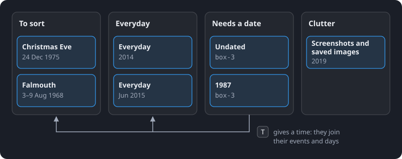

# Sorting in staging

Everything you upload waits in your own staging area until you decide where it goes. This page is
for family members sorting their uploads into albums. It covers the categories that hold your
files, the albums EiN suggests, the keys and buttons that file, discard or regroup those
suggestions, and how to undo any of it.

## What staging is

Pictures, videos and recordings you bring in do not go straight into the family's shared
library. They land in your **staging area**, a private inbox that only you can see. The page says
so under its title: "New media to sort before it joins the shared library. Only you can see it."
How files get there (**Upload**, dragging files onto a page, SFTP,
a phone's backup app over WebDAV) is on [Getting your photos in](importing.md).

While the files wait, EiN reads each one: its date, its place, the faces in it and its
thumbnails. It also checks whether you already have a copy. Then the **organizer** sorts them into
**suggested albums**, called groups on these pages: a birthday, a trip, a folder you named, a
year of everyday pictures. You go through the groups and decide for each one:

- file it as a **new album**;
- file it **into an album** that is already in the library;
- **discard** it to your trash.

Only filing makes the files visible to anyone else. Every decision can be undone.

Until a file is filed, the views of the whole library leave it out: the Media page and its
counts, the map, On this day, search, and the number on a person's card on the People page. The
faces and voices in it are found all the same, and count once the file is filed.

> [!NOTE]
> Staging is only for people who are signed in. A visitor browsing without an account does not see
> it in the sidebar, and opening its address asks them to sign in.

## Open staging

Open **Staging** in the sidebar, under **Media**. While you have only the Inbox, staging opens the
Inbox's page directly. Once you have more than one category, it opens on the overview of all of
them. A category's page leads back to the overview with **← Staging** above its title.

## The overview

The overview lists your categories as cards, two side by side (one on a phone). Click a card to open the category's
page; you upload from there. The header's one button is **New category**.

Each card shows:

- its newest pictures, videos and recordings: nine of them, or four or one when it holds fewer, or
  a crossed-out picture when it holds none;
- the category's name;
- a pen, **Edit**;
- a bar of its files by how far along they are: **Being prepared**, **To sort**, **Needs a
  date** and **Other files** (files that are not pictures, videos or recordings), or "Nothing here
  yet.";
- how many files it holds and their size;
- where the newest files are on their way in (below).

While files are on their way in, the overview's card for their category shows up to three
stages. Hold the pointer over one to see what it means.

| Stage                            | What it means                                                                |
| -------------------------------- | ---------------------------------------------------------------------------- |
| `N of M arriving`                | Uploading from this browser                                                  |
| `N being prepared, about <time>` | Their dates and places are being read; the groups they join may still change |
| `N being grouped`                | Read, and waiting for the organizer to put them in a group                   |

The organizer groups new files within a few minutes of their arrival.

When a folder that arrived in the Inbox looks like it came from one source, a blue box on the
Inbox's **Files** tab says so, for example "“Takeout” looks like Google Photos", with the two
strongest clues.

- **Move to category…** opens the move dialog, where you choose the category it goes into.
- **New category…** opens the **New category** dialog with the source's name under
  **Name**, here `Google Photos`; **Create and move “Takeout”** makes the category and moves the
  folder into it.
- The ✕ ("Keep it here, stop asking") leaves the folder where it is and stops asking.

Nothing moves by itself.

On the Inbox's **Sort** tab, a card heads the groups when GPX files wait for the device they
belong to: it lists them, and a button per device gives their routes to that device's track (see
[GPX files in staging](tracks.md#gpx-files-in-staging)). Another card appears when a family tree (a
GEDCOM file) waits; its **Review and import** opens it (see
[Look over a family tree before it is imported](family.md#look-over-a-family-tree-before-it-is-imported)).
A GPX or GEDCOM file uploaded into any category does not stay among its files but waits in the
staging area, so the cards are on the Inbox's Sort tab whichever category it came through (and on
the only category's while you have just one).

## Categories

A category keeps one source together: a Google Photos export in one, a box of scanned prints in
another, your phone in a third. Each category is a folder of your staging area. Categories are
only buckets to sort in: every category's files are grouped, dated and processed the same way, so
which one a file lands in changes nothing but where you find it.

The **Inbox** is always there and cannot be removed. Uploads land in it unless you choose another
category.

### Make a category

1. On the overview, choose **New category** in the header.
2. Fill in **Name**, the name the pages show, for example `Box 3`. When you came from a folder's
   hint (**New category…**), it holds the source's name, such as `Google Photos`.
3. Choose **Create**. The new category's page opens on its **Files** tab.

Its folder is made from the name, `files/box-3` for `Box 3`, or `files/box-3-2` when that is
taken. The folder never changes, even when you rename the category.

### Change or remove a category

Open **Edit** with the pen on the category's card, or with **Edit** in its page's header.
**Name** is the name the pages show; its folder stays as it is. Choose **Save** to keep a new
name.

To remove a category, choose **Remove** at the left of the dialog's buttons. Only an empty
category can be removed: in one that still holds files, **Remove** is greyed out and the dialog
says "Only an empty category can be removed: move or discard its files first." The Inbox cannot be
removed, and its dialog has no **Remove**.

## A category's page

The page's title is the category's name. Above it, **← Staging** leads back to the overview. On
the **Files** tab inside a folder, the title is the folder's name and the link above it leads one
level up: **← 1975** over the folder `summer` in `1975`, or **← Box 3** over a folder at the top
of the category.

The header has **Upload**, which adds files to the category's folder for today, **Edit**, and
under ⋮ **Keyboard shortcuts**. Inside a folder, the ⋮ menu also has **Move to folder…**, **Move to category…** and **Discard…** for the
folder on screen (see [Files: folders and moving](#files-folders-and-moving)). You can also drop
files anywhere on the page, on any tab, and they go into the category on screen; a folder dropped
there keeps its structure.

The page has five tabs, and a category opens on **Files**:

| Tab            | What it is for                                                | Its number                |
| -------------- | ------------------------------------------------------------- | ------------------------- |
| **Files**      | The category's folders and files                              | Files held                |
| **Sort**       | Deciding the suggested albums, one after another              | Groups                    |
| **Duplicates** | Exact copies and look-alikes, to resolve                      | Exact copies              |
| **Done**       | What was decided here, with **Undo**                          | Files filed and discarded |
| **Info**       | How to get files into it: its folder, SFTP and a phone backup |                           |

The **Duplicates** tab has a page of its own: [Duplicates](duplicates.md).

## Sort: the stream of suggested albums

The **Sort** tab lists the category's groups one after another, oldest first. Every picture,
video and recording that has been read is in exactly one group.

Until the first groups are made, the tab says **No groups yet**, with "Groups appear as your files
are prepared: N still to go." or "Groups appear here once uploaded files have been prepared and
organized, within minutes of their arrival." **Show the files** opens the **Files** tab.

### How the stream looks

At the right of the tabs, the page's header has:

- "◌ N applying" while decisions you made are still being carried out;
- the lanes, each with its number of groups, when more than one lane has groups; otherwise "N
  photos to decide in M groups";
- **Oldest first** or **Newest first**. Groups without a date come last either way.

On a phone the lanes and the order are in one button there.

Each group is a card with its name and all its pictures, in small rows. Click a picture to see it
in the viewer; that leaves the open group as it is. One group is **open**, the one the keys act on, its card's edge drawn in the accent colour. Click a group's name or the space around
its pictures, or press <kbd>J</kbd> and <kbd>K</kbd>, to open the next or previous one. Opening a group changes only its edge, so nothing on the page moves. A group too
large to show at once says "Too many pictures to show at once." with **Page through them**.

To step through a group's pictures and select them, click the chevron in its card's top right
corner, or press <kbd>Space</kbd>; the same button, or <kbd>Space</kbd> again, brings back the one
grid. The arrow keys, <kbd>[</kbd>, <kbd>]</kbd> and <kbd>O</kbd> expand the open group first.

An expanded group shows its pictures in a grid per day. A group that spans more than 40 days, such as
a year of everyday pictures, shows a grid per month instead, with the month's days as small
buttons above it; click one to select that day's pictures. Pictures without a date come last,
under **No date**. Below an expanded group, "Next:" and a name say which group follows.

A group's header shows its name, then its dates, how many photos and how many days it holds, for
example "Christmas Eve" over "24 Dec 1975 · 86 photos": the dates a group's name ends with are left
to the second line. Badges may follow:

| Badge              | Meaning                                                                |
| ------------------ | ---------------------------------------------------------------------- |
| **Trip**           | Two or more days away from home                                        |
| **Still indexing** | "Some of these are still being indexed, so the group may still change" |
| **Yours**          | "You edited this group, so the organizer leaves it as it is"           |

Point at a group's name and a pen appears beside it: click it, press <kbd>E</kbd>, or double-click
the open group's name, to rename the group in place. The name you edit is the one shown, without
dates; <kbd>Enter</kbd> keeps it, <kbd>Esc</kbd> gives it up.

In its top right corner every card has:

- **Add to existing**, with a dimmed number after it: how many library albums EiN found for the
  group, at 50% or more. It opens a dialog that lists them (see
  [Add to existing](#add-to-existing)). Before the group is compared with the library it says
  **Add to existing** alone.
- **Create album** (<kbd>N</kbd>), which opens the **Create album** dialog with the suggested name
  filled in: a new album from the group. On a phone it is the button under the group's pictures.
- a ⋮ menu with **Open as album page**, **Not a group**, **Set the time** (<kbd>T</kbd>) and
  **Discard** (<kbd>X</kbd>).
- the chevron that shows the group's pictures by day, or in one grid again.

On the open group, when you have selected some of its pictures or stepped to a day, **Create album**,
**Add to existing** and the menu act on those pictures, as the keys do: the menu then says, for
example, **Discard 12 photos**. Before **Add to existing**, every group has its proposal as a
button, what <kbd>Enter</kbd> does on it, when the proposal is something other than a new album:
for example **Add to “Sailing in the archipelago”**, **File 3 matched days · 120 photos** or
**Keep the library copies · 4 photos go**. Rest the pointer on **Add to “…”** to see how sure it
is.

Where you were is kept in the page's address, and per category in your browser, so a reload or a
link brings you back to the same group. When a stream holds 30 groups or more, a time rail at its
right edge brings the groups from a chosen date up.

### The lanes

The stream is divided into lanes. Each lane is a view of some of the category's groups. With
groups in two lanes or more, you choose one at the right of the tabs. The stream opens on To sort,
or on the first lane with groups when To sort has none, and moves on to the next lane once you
have decided the last group of the one you are in.

| Lane             | What it holds                                                                 |
| ---------------- | ----------------------------------------------------------------------------- |
| **To sort**      | Events, trips and folders a person named                                      |
| **Everyday**     | Each year's ordinary days, as one group per year, or per month in a busy year |
| **Needs a date** | Pictures with no date, or dated only to a year or a month                     |
| **Clutter**      | Screenshots and images saved from messages                                    |

Events and trips are named by what, where and when, each part only when it is known: "Midsummer Eve
· Harbour cottage · 21 Jun 2019", "With Anna and Bo · 3 Aug 2014", "Lisbon · 4–9 May 2015". The what
is a folder's name, a holiday, a birthday or the guests at home. The where is a place you named, a
point of interest, the town of a trip, or for an outing near home its neighbourhood, unless most of
that year's pictures were taken there. A group with neither says when in the week it was ("Saturday
evening", "Weekend"), or only its dates.

Home, which trips are away from and outings are near, is decided per year. It is the home on your
person's [Homes tab](family.md#homes-and-residents) that covers most of that year, when your
account is linked to your person; else the spot where at least a quarter of the category's located
pictures that year were taken; else the year before's home. A home without dates covers every year,
so the pictures can overrule it: in a year with 20 or more located pictures, none of them within a
kilometre of it, that spot is home instead. A home with dates is always taken as given.

Groups in the Everyday, Needs a date and Clutter lanes are named after what they hold:
"Everyday · 2014", "Screenshots and saved images · 2019", "Undated · box-3", or "1987 · box-3"
for pictures known only to a year. They are collections, not events, so they are not split,
merged or called "not a group". To take some pictures out of one, make them a group of their own
with **New group** on a day, or move them with <kbd>&lt;</kbd>, <kbd>&gt;</kbd> and <kbd>G</kbd>
(see [Change the groups](#change-the-groups)).

- **Everyday.** Each day of an Everyday group is compared with the library's albums. A day that
  matches one shows it in its header, for example "→ Christmas at the cottage 72%", with **File**,
  which files that day's pictures into the album. Select the day with <kbd>[</kbd> or <kbd>]</kbd>
  and <kbd>Enter</kbd> does the same. A closed Everyday group says how many of its days match an
  album, for example "→ 3 days match an album".
- **Needs a date.** Give the pictures a time with **T** (**Set the time…**): the **Set time**
  dialog takes one start time, and the pictures keep their spacing or follow a minute apart. A
  picture known only to a year or a month keeps that date unless you click its row to give it a
  time. Once dated, the organizer puts them with the events and days they belong to. The dialog is explained
  on [Dates and places of pictures](dates-places.md).
- **Clutter.** Its proposal is **Discard**.

### What Enter proposes

Each group has a **proposal**: what <kbd>Enter</kbd>, or the button on the group, does with it.
Each proposal is **sure** (EiN is confident), **likely** (probably right; have a look) or
**unsure** (a starting point). Resting the pointer on a group's **Add to “…”** button says which.

The button says what happens:

| Button                                    | When it is proposed                                                                                                                  |
| ----------------------------------------- | ------------------------------------------------------------------------------------------------------------------------------------ |
| **Add to “…”**                            | A library album you may add to matches the group well (likely or sure)                                                               |
| **Create album “…”**                      | No album fits: a new album under the group's name. A folder a person named is proposed as a new album under the folder's name, sure. |
| **Keep the library copies · N photos go** | Most of the group's photos are copies of photos already in the library; the copies go and the rest of the group stays to be sorted   |
| **Discard**                               | Clutter                                                                                                                              |
| **File N matched days · M photos**        | An Everyday group some of whose days match a library album you may add to; each matched day goes into its album and the rest stays   |
| "Nothing is proposed for it: …"           | Nothing to propose, for example an Everyday group with no matched days                                                               |

A folder a person named goes into an existing album only when the match is sure.
Nothing is ever filed by a match on its own: you decide every time.

### File a group

1. Open the group: click it, or press <kbd>J</kbd> or <kbd>K</kbd> until it is open.
2. Look at the proposal under the group's name, or on its button.
3. Press <kbd>Enter</kbd> or click the button.
   - For an existing album, the photos are filed at once.
   - For a new album, the **Create album** dialog opens with the suggested name under **Name**,
     without the dates the group's name ends with.
     Change it if you like, and choose **Create album**.
4. The group leaves the stream and the next one opens in its place. A green message says, for
   example, "86 photos filed in “Christmas at the cottage”", with **Undo**.

Instead of the proposal you can choose another way, with a button of the card or a key:

| Choice              | Key                                    | What it does                                                                                                                                                                              |
| ------------------- | -------------------------------------- | ----------------------------------------------------------------------------------------------------------------------------------------------------------------------------------------- |
| **Create album**    | <kbd>N</kbd>                           | The **Create album** dialog, with the suggested name filled in: a new album from the group, shared as your new albums are.                                                                |
| **Add to existing** | <kbd>A</kbd>                           | The albums EiN found for the group, with some of their pictures, and a search for any other album you may add to; **Move here** files into one (see [Add to existing](#add-to-existing)). |
| A suggestion        | <kbd>1</kbd> <kbd>2</kbd> <kbd>3</kbd> | Files the group at once into the first, second or third album of its **Add to existing**.                                                                                                 |

Filing moves the files out of your staging into the album. Everything EiN has read about them
goes along: dates, places, faces and thumbnails. Text in them, such as a letter or a sign, is read
once they are filed. A new album is shared the way your new albums are, as the administrator set
it up (see [Sharing](../guide/sharing.md)). Filed into an existing album,
the files are shared the way that album is. An album you may only look at is refused before
anything moves: "You can't add to “Christmas 1975”."

### File part of a group

You do not have to file a group whole.

1. Press <kbd>[</kbd> or <kbd>]</kbd> to step to a day (or a month) of the open group, or select
   pictures the way you do in an album (see [Albums](albums.md)). With the arrow keys on a picture,
   <kbd>Space</kbd> selects it.
2. <kbd>Enter</kbd>, <kbd>N</kbd>, <kbd>A</kbd> and <kbd>X</kbd>, and the open group's **Create album**,
   **Add to existing** and ⋮ menu, act on those pictures alone. On a day matched to an album, <kbd>Enter</kbd> adds it there. Filing the
   matched days and keeping the library copies are for the whole group, so on a day with no matched
   album, or on selected pictures, such a group has no proposal: <kbd>Enter</kbd> says "Nothing is
   proposed for it: create an album, add it to one, or discard it."
3. The rest of the group stays where it is.

With pictures selected, **New group of N pictures** under the open group makes them a group of
their own instead. The bar at the foot of the page then says, for example, "12 photos selected",
with **Split the group here** (in a lane, **New group**), **Move to “…”** for the group above and
the one below, and **Move to a group…** (see [Change the groups](#change-the-groups)).

### Add to existing

**Add to existing** on a card opens a dialog headed "Add “…” to an existing album" and what it
would file, for example "86 photos". It lists the library albums EiN found for the group at 50% or
more, best first; one less likely than that is not worth looking at, and is left out. Each
shows its name, a percentage, its dates and size, the reasons it was suggested as a list of points,
and a row of its own pictures, those taken nearest the group's days. Click a picture to see it in
the viewer, or the link beside the album's name to open the album in a new tab.

- **Move here** files the group, or the pictures of it you chose, into that album, as
  <kbd>1</kbd> to <kbd>3</kbd> do. An album you may only look at is marked "view only" and cannot
  be chosen.
- **Not this album** says the album is wrong for the group: see [Not this album](#not-this-album).
- **Find another album** searches every album you may add to by name; each one found is shown the
  same way, with **Move here**.

When nothing fits, the dialog says "No album in the library fits it well." An Everyday lane's days
are matched one by one: expand the lane to see them.

### Not this album

When a suggested album is wrong, choose **Not this album** beside it in the **Add to existing**
dialog. The message "“Christmas 1975” is no longer offered for “Christmas Eve · 24 Dec 1975”"
confirms it. The album is not offered again for this group, or for any group made mostly
of the same photos, until you undo it on the **Done** tab.

### Discard a group

**Discard** (<kbd>X</kbd>, or **Discard** in the card's ⋮ menu) moves the group's photos to your trash as one entry on the Trash page: "86 photos moved to the
trash". A group of 200 photos or more asks first, in a **Discard?** dialog. Nothing in staging is
deleted outright: **Undo** in the message, <kbd>Z</kbd>, the **Done** tab, or **Restore** on the
Trash page brings the photos back (see [Your profile, favourites and trash](../guide/profile.md)).

### Decide several groups at once

On a computer you can select several groups and decide them together:

- tick the box in a group's header, or Ctrl-click (Cmd-click on a Mac) its name or a closed group's pictures;
- hold <kbd>Shift</kbd> to select everything from where the selection started;
- press <kbd>Shift</kbd>+<kbd>J</kbd> or <kbd>Shift</kbd>+<kbd>K</kbd> to select on to the next or
  previous group;
- or draw a box around them from an empty part of the page (hold <kbd>Shift</kbd> to add,
  <kbd>Alt</kbd> to take away, <kbd>Esc</kbd> to stop).

With two or more groups selected, a bar at the foot of the page says how much, for example
"3 groups · 412 photos selected", with:

- **Merge N groups**, with two or more groups of the **To sort** lane selected whole: merges them
  into the first of them in the stream, which keeps its name;
- **Create suggested albums**: each group becomes a new album of its own, under its suggested name
  without the dates.

One group selected has no bar: its card's **Create album** and the rest act on it.

Its ✕ clears the selection. The keys decide on them too:

- <kbd>Enter</kbd> accepts each group's proposal, after the **Accept the proposals?** dialog has
  asked which to take (**Every proposal**, **Likely and sure** or **Only sure**);
- <kbd>N</kbd> makes one album of everything selected;
- <kbd>A</kbd> files it into an album you find by name, in the **Add to an album** dialog;
- <kbd>X</kbd> discards it after asking.

<kbd>Esc</kbd> clears the selection. A message shows the progress, for example "Filing 1,840 of
9,830 photos · 37 of 214 groups", with **Cancel**; when it is done, **Undo all** takes the whole run
back.

You can also drag selected pictures or groups onto another group's header, which says what the drop
would do as you arrive: it merges the groups into it, or moves the pictures there.

## Keys in the Sort tab

On a computer, <kbd>?</kbd>, or **Keyboard shortcuts** in the page's ⋮ menu, lists every key: under
**Staging** those for a group, then those on a picture, on a day or month, with pictures selected
and with groups selected. Keys do nothing while you type in a field or a dialog is open, and there
are none on a phone. All the app's shortcuts are on
[Keyboard shortcuts](../reference/shortcuts.md).

On a group:

| Key                                                                                                                          | What it does                                   |
| ---------------------------------------------------------------------------------------------------------------------------- | ---------------------------------------------- |
| <kbd>Enter</kbd>                                                                                                             | Accept the proposal                            |
| <kbd>N</kbd>                                                                                                                 | Create album from the group                    |
| <kbd>A</kbd>                                                                                                                 | Add to an existing album…                      |
| <kbd>X</kbd>                                                                                                                 | Discard                                        |
| <kbd>Z</kbd>                                                                                                                 | Undo                                           |
| <kbd>J</kbd> / <kbd>K</kbd>                                                                                                  | Next group / previous group                    |
| <kbd>Shift</kbd>+<kbd>J</kbd> / <kbd>Shift</kbd>+<kbd>K</kbd>, <kbd>Shift</kbd>+<kbd>↓</kbd> / <kbd>Shift</kbd>+<kbd>↑</kbd> | Select on to the next / previous group         |
| <kbd>E</kbd>                                                                                                                 | Rename                                         |
| <kbd>Space</kbd>                                                                                                             | Show the pictures by day, or in one grid again |
| <kbd>T</kbd>                                                                                                                 | Set the time of the pictures                   |
| <kbd>[</kbd> / <kbd>]</kbd>                                                                                                  | Previous / next day or month of the group      |
| <kbd>1</kbd> <kbd>2</kbd> <kbd>3</kbd>                                                                                       | Into suggested album 1, 2 or 3                 |
| <kbd>O</kbd>                                                                                                                 | Open the first picture                         |
| Arrow keys                                                                                                                   | Step through the pictures                      |

On a picture (after an arrow key), a day or month (after <kbd>[</kbd> or <kbd>]</kbd>), or
selected pictures:

| Key                                                     | What it does                                                                                         |
| ------------------------------------------------------- | ---------------------------------------------------------------------------------------------------- |
| Arrow keys                                              | Previous / next picture, the picture above / below                                                   |
| <kbd>Space</kbd>                                        | Select the picture, or the day's pictures                                                            |
| <kbd>O</kbd>                                            | Open the picture                                                                                     |
| <kbd>S</kbd>                                            | Split the group before them; in a lane, make them a new group                                        |
| <kbd>&lt;</kbd> / <kbd>&gt;</kbd>                       | Move them to the group above / below                                                                 |
| <kbd>G</kbd>                                            | Move them to a group…                                                                                |
| <kbd>Enter</kbd> <kbd>N</kbd> <kbd>A</kbd> <kbd>X</kbd> | Accept the proposal, create album, suggestions or discard, for the day or the selected pictures only |
| <kbd>Esc</kbd>                                          | Back to the group, or clear the selection                                                            |

With the arrow keys on a single picture and nothing selected, <kbd>Enter</kbd>, <kbd>N</kbd>,
<kbd>A</kbd> and <kbd>X</kbd> still act on the whole group. <kbd>&lt;</kbd>, <kbd>&gt;</kbd>,
<kbd>[</kbd> and <kbd>]</kbd> work on any keyboard layout, also where you type them with AltGr or
Option.

With groups selected:

| Key              | What it does                                 |
| ---------------- | -------------------------------------------- |
| <kbd>Enter</kbd> | Accept the proposals of the selected groups… |
| <kbd>N</kbd>     | Create album of the selection                |
| <kbd>A</kbd>     | Add the selection to album…                  |
| <kbd>X</kbd>     | Discard the selection…                       |
| <kbd>Esc</kbd>   | Clear the selection                          |

## Change the groups

The organizer's groups are suggestions. When one is wrong, change it. Every change but a rename
says so in a message with **Undo**, and every change is listed on the **Done** tab, where
**Undo** takes it back.

| To                            | Do this                                                                                                       | What happens                                                                                                                                                          |
| ----------------------------- | ------------------------------------------------------------------------------------------------------------- | --------------------------------------------------------------------------------------------------------------------------------------------------------------------- |
| Split a group                 | **Split here** on a day or month, or <kbd>S</kbd> on a picture, a day or a selection                          | That picture and the ones after it become a group of their own: "“A week in London” split in two". You cannot split before the first picture.                         |
| Move pictures to a neighbour  | Select them, then <kbd>&lt;</kbd> or <kbd>&gt;</kbd>                                                          | They join the group above or below.                                                                                                                                   |
| Move pictures to any group    | Select them, then <kbd>G</kbd>                                                                                | The **Move to a group** dialog: the five groups on each side, **Find a group by name**, or **New group** ("A group of their own, named by their dates").              |
| Make a new group              | **New group of N pictures** under the open group; in a lane, **New group** on a day or <kbd>S</kbd>           | The pictures become a group of their own, named by their dates.                                                                                                       |
| Merge groups                  | Select them, then **Merge N groups** in the bar at the foot of the page, or drag them onto the group's header | One group, the first of them in the stream, which keeps its name; dropped on a group, that group and its name.                                                        |
| Break up a group              | **Not a group** in the card's ⋮ menu                                                                          | The **Not a group?** dialog: the photos go back to their lanes, Everyday and the like, and the organizer does not suggest them as a group again. No photo is removed. |
| Rename                        | <kbd>E</kbd>, the pen beside the group's name, or double-click the open group's name                          | Type the name and press <kbd>Enter</kbd>; <kbd>Esc</kbd> keeps the old one.                                                                                           |
| Keep a group exactly as it is | **Open as album page** in the card's ⋮ menu, then ⋮ → **Keep album as is**                                    | The organizer leaves the group and its files alone. **Let the organizer manage album** hands it back; **Sort in Staging** returns to the group in the stream.         |

You can also drag pictures onto another group's header to move them there.

## What the organizer remembers

The organizer looks at a category again a couple of minutes after its files change. Groups can
change while files are still arriving and being read, which is what **Still indexing** warns of.
The stream follows along: a group that changes is read again, and one that is removed disappears.

What you decide is kept through every one of those runs:

- Your changes of the groups (splits, moves, new groups, merges, **Not a group**, names) are kept
  on every run until you undo them. On the **Done** tab all but a rename carry the badge **kept**: "The
  organizer keeps this change on every run until it is undone".
- A group whose pictures you changed by hand shows **Yours**, and the organizer leaves it as it is.
- **Not this album** keeps that album away from those photos until you undo it.

If the organizer changed a group while you were deciding on it, your decision is refused with "it
changed while you were deciding; look again". The group comes back with **Retry** and
**Dismiss**; look at it again before you decide.

## Files: folders and moving

The **Files** tab, the one a category opens on, shows the category one folder at a time.
Subfolders are cards with the number of entries in each; click one to go into it. The link above
the page's title leads one level up (see [A category's page](#a-categorys-page)). At the end of the tab
row, **Media** and **Nodes** choose what the tab shows:

- **Media** shows every picture, video and recording in the folder and its subfolders, by day.
  Select pictures to use **Add to album**, **Set time**, and, when you may change them all, **Set
  location** and **Label**.
- **Nodes** lists every entry of the folder, whatever its type (a PDF, a sidecar file), as the
  Nodes page does, filling the page below its header: details, list or icons, sorted by a click
  on a column's name, a folder opened in place with its arrow or gone into with a double click or
  <kbd>Enter</kbd>, and a panel beside it that previews the entry you are on. It stays within the
  category: **Up** stops at it and **Home** goes back to it. Select entries with a click,
  <kbd>Ctrl</kbd> or <kbd>Shift</kbd> and a click for more, or <kbd>Ctrl</kbd>+<kbd>A</kbd> (on a
  phone, press and hold one, then tap the others); the
  top of the panel then offers **Move to folder…**, **Move to category…** and **Discard…** for
  them, and <kbd>Delete</kbd> discards them too.

To move or discard a folder or files, use the ⋯ on a folder's card, the page's ⋮ menu for the
folder you are in, or the panel beside a selection in **Nodes**:

- **Move to folder…** moves it to another folder of the same category.
- **Move to category…** moves it into another category (offered when you have more than one). It
  first leaves the groups of its old category.
- **Discard…** moves it to your trash.

In the move dialog, choose the **Category**, step into a folder, and optionally type a name under
**Into a new folder here**. The line under it says where it goes, for example "Into Scans › box-3. Links
to them, in albums and suggested groups, follow them." Choose **Move here**.

The **Discard** dialog says: "They go to your trash, kept together as one entry on the Trash
page. Undo, here or on the Done tab, puts them back where they were." Choose **Discard**; the
message has **Undo**.

When a folder holds no pictures, videos or recordings, **Media** says so, adding "Nodes shows every
file, whatever its type." when it holds other files or folders. An empty category says "Nothing in
Box 3 yet" (with its own name) and offers **Upload**, which picks files into it.

## Info: getting files in

The **Info** tab says how to get files into the category besides **Upload**:

- its folder, `files/box-3`, and the path to copy into over SFTP, the way for tens of thousands
  of files; see [SSH and SFTP](../shell/ssh-sftp.md) and
  [Staging and importing for administrators](staging-admin.md);
- the address and folder a phone's backup app sends into, and in the EiN app **Back up this phone
  here**, which has the app's photo backup send into it; see
  [Back up your phone automatically](../guide/phone.md#back-up-your-phone-automatically).

## Done: what you decided, and Undo

The **Done** tab lists what was decided in the category, newest first, 50 at a time (**Show
older** for more). At the top: "N filed · M discarded". **Everything** shows every decision;
**Regrouping** shows only the changes you made to the groups.

Each row shows when it happened and what it was: "86 files → Christmas at the cottage" with the
album as a link, "12 files discarded", "Split “A week in London”", "“Christmas Eve · 24 Dec
1975” is not for Christmas 1975", and so on, with the groups it touched. Badges: **only you** for a private album, **kept** for a change
the organizer keeps, **in part** for a decision that stopped part-way. Each row has **Undo**, or
"undone" and the time once it is undone.

Undo puts things back:

- filed files move back into staging, and an album the decision made is removed once it is empty;
- discarded files come back from the trash, as long as they are still there;
- the groups get their pictures back, and a change of the groups stops applying;
- **Not this album** gives the group its candidates back.

The message says "Undone:" and what was undone. A file that was moved after the decision stays where it is: "Undone in
part: some files have moved since, and stay where they are".

In the **Sort** tab, <kbd>Z</kbd> undoes the decisions of this visit, newest first; one still
waiting to be carried out is cancelled instead. With nothing left, it says "Nothing to undo from
this visit; the Done tab lists every decision."

## On a phone

On a phone the Sort tab has no keys and no selecting of several groups. Tap a group to open it.
Each closed group has its proposal (or **Create album…**) as a button under its pictures. Its
header has the pen to rename it, the [Add to existing](#add-to-existing) button, and the ⋮ menu with
**Open as album page**, **Not a group**, **Set the time** and **Discard**. More on
[EiN on a phone](../guide/phone.md).

## If something goes differently

| What you see                                     | What it means                                                             | What to do                                            |
| ------------------------------------------------ | ------------------------------------------------------------------------- | ----------------------------------------------------- |
| **No groups yet**                                | The files are still being read, or the organizer has not grouped them yet | Wait a few minutes                                    |
| **Still indexing** on a group                    | Some of its pictures are still being read                                 | Decide later, or go ahead; the group may still change |
| "it changed while you were deciding; look again" | The organizer changed the group after you opened it                       | Look at the group, then **Retry**, or **Dismiss**     |
| "You can't add to “…”."                          | The album is one you may only look at                                     | Choose another album, or ask whoever owns it          |
| "Nothing is proposed for it: …"                  | EiN has nothing to suggest                                                | Choose yourself: a new album, any album, or discard   |
| **Remove** is greyed out in **Edit**             | The category still holds files                                            | Move or discard its files first                       |
| "Undone in part: …"                              | Some files were moved after the decision                                  | Look for them in the place they were moved to         |

The commands behind these pages, for use in the terminal, are under `staging` in the
[Archive commands](commands.md#staging).
