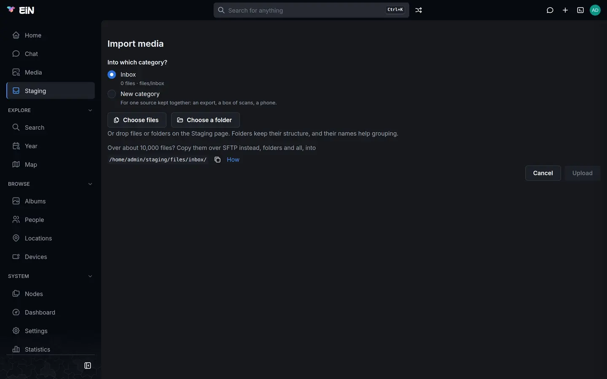
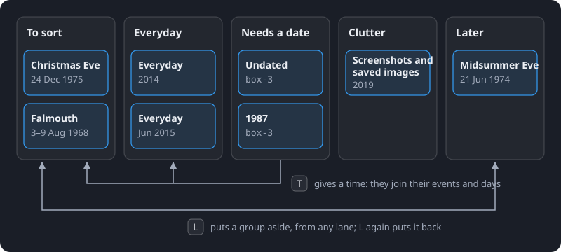

# Sorting in staging

Everything you upload waits in your own staging area until you decide where it goes. This page is
for family members sorting their uploads into albums. It covers the categories that hold your
files, the albums EiN suggests, the keys and buttons that file, discard or regroup those
suggestions, and how to undo any of it.

## What staging is

Pictures, videos and recordings you bring in do not go straight into the family's shared
library. They land in your **staging area**, a private inbox that only you can see. The page says
so under its title: "New media to sort before it joins the shared library. Only you can see it."
How files get there (**Import media**, dragging files onto a page, the Media page's upload, SFTP)
is on [Getting your photos in](importing.md).

While the files wait, EiN reads each one: its date, its place, the faces in it and its
thumbnails. It also checks whether you already have a copy. Then the **organizer** sorts them into
**suggested albums**, called groups on these pages: a birthday, a trip, a folder you named, a
year of everyday pictures. You go through the groups and decide for each one:

- file it as a **new album**, or a **new private album** only you can open;
- file it **into an album** that is already in the library;
- put it aside for **Later**;
- **discard** it to your trash.

Only filing makes the files visible to anyone else. Every decision can be undone.

Until a file is filed, the views of the whole library leave it out: the Media page and its
counts, the map, On this day, search, and the number on a person's card on the People page. The
faces and voices in it are found all the same, and count once the file is filed.

> [!NOTE]
> Staging is only for people who are signed in. A visitor browsing without an account does not see
> it in the sidebar, and opening its address asks them to sign in.

## Open staging

Open **Staging** in the sidebar, under **Media**. While you have only the Inbox, staging opens the
Inbox's page directly. Once you have more than one category, it opens on the overview of all of
them.

## The overview

The overview shows one card per category. The header has **Import media** and **New category**.

Each card shows:

- the category's name, and under it what it holds and its folder, for example
  `Scans · files/box-3`;
- a gear, **Category settings**;
- a bar of its files by how far along they are: **Being prepared**, **To sort**, **Needs a
  date** and **Other files** (files that are not pictures, videos or recordings), or "Nothing here
  yet.";
- how many files it holds and their size, followed by "filed into" and an album's name when its
  files go to that album by default;
- where the newest files are on their way in (below);
- **Import**, and **Continue** (**Open** while the category is empty).

While files are on their way in, a card and the top of a category's page show up to three
stages. Hold the pointer over one to see what it means.

| Stage                            | What it means                                                                |
| -------------------------------- | ---------------------------------------------------------------------------- |
| `N of M arriving`                | Uploading from this browser                                                  |
| `N being prepared, about <time>` | Their dates and places are being read; the groups they join may still change |
| `N being grouped`                | Read, and waiting for the organizer to put them in a group                   |

The organizer groups new files within a few minutes of their arrival. On a category's page,
**Group now** beside "being grouped" asks it to start at once; the message "Grouping asked for:
the new files are grouped within a few minutes" confirms it.

Drag files or folders over the overview and a tile appears for each category. Drop them on one
and they go into that category's folder for today, folders and all.

When a folder that arrived in the Inbox looks like it came from one source, a blue box above the
cards says so, for example "“Takeout” looks like Google Photos", with the two strongest clues. The
same box shows on the Inbox's **Files** tab.

- Its button moves the folder into your category of that kind, for example **Move to Google
  Photos export…**.
- When you have no such category, the button makes one first: **Make a Google Photos export
  category…** opens the **New category** dialog, whose **Create and move “Takeout”** makes the
  category and moves the folder into it.
- The ✕ ("Keep it here, stop asking") leaves the folder where it is and stops asking.

Nothing moves by itself.

Below the cards, a yellow box titled **Needs you** appears when a GPS track waits for the device
that recorded it; **Choose device** opens the Inbox's files, where you say which device it was
(see [Devices and GPS tracks](devices.md)). Last comes the folder to copy into over SFTP, for tens
of thousands of files; see [SSH and SFTP](../shell/ssh-sftp.md) and
[Staging and importing for administrators](staging-admin.md).

## Categories

A category keeps one source together: a Google Photos export in one, a box of scanned prints in
another, your phone in a third. Each category is a folder of your staging area, and what it holds
decides how EiN treats its files: how they are grouped, which clocks may date them, and in which
order they are processed.

The **Inbox** is always there and cannot be removed. Uploads land in it unless you choose another
category.

### The kinds of category

| What it holds            | Use it for                           | What it changes                                                                                                                                                                                                                                                     |
| ------------------------ | ------------------------------------ | ------------------------------------------------------------------------------------------------------------------------------------------------------------------------------------------------------------------------------------------------------------------- |
| **Inbox**                | Anything; the default                | Grouped by time and place. A date in a file name, such as a phone's `IMG_20190601_123456.jpg`, counts when nothing better dates the picture.                                                                                                                        |
| **Google Photos export** | A Google Takeout                     | Grouped by time and place. Google's JSON files are paired with their photos and give them their date, place and caption. An album folder's title names its group. Processed after other work, so what you upload to the Inbox meanwhile is ready first.             |
| **Scans**                | Scanned prints, negatives and slides | Grouped by folder and by runs of file names; when a scan was made never groups it. No scanner clock, file name or upload time dates a scan, only a date a person gave it, so most count under **Needs a date** until you give them one. Processed after other work. |
| **Phone**                | A phone's pictures                   | Grouped by time and place. Dates in file names count.                                                                                                                                                                                                               |
| **Camera**               | A camera's memory card               | Grouped by time and place. File names are not read as dates.                                                                                                                                                                                                        |
| **Messaging**            | Pictures saved from a messenger      | A group per folder and month, all in the **Everyday** lane. Dates in file names count. Sidecar files are left as they are.                                                                                                                                          |
| **Screenshots**          | Screenshots                          | Like Messaging.                                                                                                                                                                                                                                                     |
| **Other**                | Anything else                        | Grouped by time and place. File names are not read as dates.                                                                                                                                                                                                        |

How these work for dates is explained further on [Dates and places of pictures](dates-places.md).

### Make a category

1. On the overview, choose a kind on the dashed **New category** card ("Keep one source together:
   a Google Photos export, a box of scanned prints, a phone."), or choose **New category** in the
   header. On a category's page, click its name and choose **New category…**.
2. In the **New category** dialog, check **What it holds**. When you started from a kind's button,
   it is chosen already, and **Called** holds the kind's name.
3. Fill in **Called**, the name the pages show, for example `Box 3`.
4. Leave **Folder name** empty to have it made from the name, or type one: lowercase letters,
   digits and dashes, at most 48 characters. The folder name never changes.
5. Choose **Create**. The new category's page opens.

You can also make a category while importing. In **Import media**, choose **New category** under
"Into which category?", then **What it holds** and **Called**; the dialog shows the folder it
makes ("Folder files/box-3"). The category is made when you choose **Upload**.

### Change or remove a category

Open **Category settings** with the gear on the category's card, or from the ⋮ menu on its page.

| Field             | What it does                                                                                                                                                                               |
| ----------------- | ------------------------------------------------------------------------------------------------------------------------------------------------------------------------------------------ |
| **Called**        | The name the pages show. Its folder stays as it is.                                                                                                                                        |
| **What it holds** | The kind, from the table above. The Inbox's kind cannot be changed.                                                                                                                        |
| **Files go to**   | An album its files go to by default. Type in **Find an album** to choose one you may add to; **None** clears it. Without one: "No album by default: each group is filed where you choose." |

Choose **Save** to keep the changes.

An album under **Files go to** becomes the proposal for most groups that no library album matches
well, marked "· the category’s album" under the proposal, and it is the album **B** files into
until you choose another.

> [!WARNING]
> Changing **What it holds** resets everything the kind decides to the new kind's way: how the
> files are grouped, which clocks date them, the order they are processed in and whether sidecars
> are paired. Only the name and **Files go to** are kept. The files are dated again at once, and
> the organizer groups them again within minutes.

Some finer settings of a category, such as how readily a day becomes a group of its own, can only
be changed from the shell; see [Staging and importing for administrators](staging-admin.md).

To remove a category, choose **Remove category** in its settings, then **Remove** (or **Keep
it**). Only an empty category can be removed: "Only an empty category can be removed: move or
discard its files first." The Inbox cannot be removed.

## A category's page

The page's title is the category's name with a chevron. Click it to switch to another category,
to **All categories**, or to **New category…**.

The header has **Upload**, which adds files to the category's folder for today, and under ⋮:
**Upload a folder**, **Import media…**, **Category settings** and, with more than one category,
**All categories**. You can also
drop files anywhere on the page, on any tab, and they go into the category on screen.

Under the tab names, a thin bar shows the category's files and the stages of what is arriving,
with **Group now**. The four tabs:

| Tab            | What it is for                                   | Its number                |
| -------------- | ------------------------------------------------ | ------------------------- |
| **Sort**       | Deciding the suggested albums, one after another | Groups                    |
| **Duplicates** | Exact copies and look-alikes, to resolve         | Exact copies              |
| **Files**      | The category's folders and files                 | Files held                |
| **Done**       | What was decided here, with **Undo**             | Files filed and discarded |

The **Duplicates** tab has a page of its own: [Duplicates](duplicates.md).

## Sort: the stream of suggested albums

The **Sort** tab lists the category's groups one after another, oldest first. Every picture,
video and recording that has been read is in exactly one group.

Until the first groups are made, the tab says **No groups yet**, with "Groups appear as your files
are prepared: N still to go." or "Groups appear here once uploaded files have been prepared and
organized, within minutes of their arrival." **Show the files** opens the **Files** tab.

### How the stream looks

The line above the stream has:

- the lanes, each with its number of groups, when more than one lane has groups; otherwise "N
  photos to decide in M groups";
- "◌ N applying" while decisions you made are still being carried out;
- **Select**, to select every group of the lane at once (see
  [Decide several groups at once](#decide-several-groups-at-once));
- **Oldest first** or **Newest first**. Groups without a date come last either way.

One group is **open**. The others are closed to their name and two rows of their pictures. Click
a closed group, or press <kbd>J</kbd> and <kbd>K</kbd>, to open the next or previous one.

An open group shows its pictures in a grid per day. A group that spans more than 40 days, such as
a year of everyday pictures, shows a grid per month instead, with the month's days as small
buttons above it; click one to select that day's pictures. Pictures without a date come last,
under **No date**. Below the open group, "Next:" and a name say which group follows.

A group's header shows its name, then its dates, how many photos and how many days it holds, for
example "Christmas Eve · 24 Dec 1975" over "24 Dec 1975 · 86 photos". Badges may follow:

| Badge                   | Meaning                                                                                                                                           |
| ----------------------- | ------------------------------------------------------------------------------------------------------------------------------------------------- |
| **Trip**                | Two or more days away from home                                                                                                                   |
| **Still indexing**      | "Some of these are still being indexed, so the group may still change"                                                                            |
| **Later**               | Put aside with **L**                                                                                                                              |
| **Yours**               | "You edited this group, so the organizer leaves it as it is"                                                                                      |
| `⧉ 4 in library · 2× 1` | Some pictures are copies or look-alikes; its menu has **Compare**, **Keep the library copies** and **Select these** ([Duplicates](duplicates.md)) |

A closed group says where it is proposed to go when that is a library album, for example "→
Sailing in the archipelago likely". The open group has its proposal as a button with
<kbd>Enter</kbd>, or **New album…** with <kbd>N</kbd> when there is no proposal. Its ⋯ menu holds
every action.

Where you were is kept in the page's address, and per category in your browser, so a reload or a
link brings you back to the same group. When a stream holds 30 groups or more, a time rail at its
right edge brings the groups from a chosen date up.

### The lanes

The stream is divided into lanes. Each lane is a view of some of the category's groups.

| Lane             | What it holds                                                                 |
| ---------------- | ----------------------------------------------------------------------------- |
| **To sort**      | Events, trips, folders a person named, and runs of scans                      |
| **Everyday**     | Each year's ordinary days, as one group per year, or per month in a busy year |
| **Needs a date** | Pictures with no date, or dated only to a year or a month                     |
| **Clutter**      | Screenshots and images saved from messages                                    |
| **Later**        | Anything you put aside with **L**, whatever lane it came from                 |

Groups in the Everyday, Needs a date and Clutter lanes are named after what they hold:
"Everyday · 2014", "Screenshots and saved images · 2019", "Undated · box-3", or "1987 · box-3"
for pictures known only to a year. They are collections, not events, so they are not split,
merged or called "not a group". To take some pictures out of one, make them a group of their own
with **New group** on a day, or move them with <kbd>&lt;</kbd>, <kbd>&gt;</kbd> and <kbd>G</kbd>
(see [Change the groups](#change-the-groups)).

- **Everyday.** Each day of an Everyday group is compared with the library's albums. A day that
  matches one shows it in its header, for example "→ Christmas at the cottage 72%", with **File**,
  which files that day's pictures into the album. Select the day with <kbd>[</kbd> or <kbd>]</kbd>
  and <kbd>Enter</kbd> does the same. A closed Everyday group says how many of its days match an
  album, for example "→ 3 days match an album".
- **Needs a date.** Give the pictures a time with **T** (**Set the time…**): the **Set time**
  dialog takes one start time, and the pictures keep their spacing or follow a minute apart. A
  picture known only to a year or a month keeps that date unless you click its row to give it a
  time. Once dated, the organizer puts them with the events and days they belong to. The dialog is explained
  on [Dates and places of pictures](dates-places.md).
- **Clutter.** Its proposal is **Discard**.

### What Enter proposes

Each group has a **proposal**: what <kbd>Enter</kbd>, or the button on the group, does with it. In
the column beside the stream (on a wide screen) it comes with how sure it is:

| Dots | Word   | Meaning                     |
| ---- | ------ | --------------------------- |
| ●●●  | sure   | EiN is confident            |
| ●●○  | likely | Probably right; have a look |
| ●○○  | unsure | A starting point            |

The button says what happens:

| Button                                    | When it is proposed                                                                                                                  |
| ----------------------------------------- | ------------------------------------------------------------------------------------------------------------------------------------ |
| **Add to “…”**                            | A library album you may add to matches the group well (likely or sure), or it is the category's album under **Files go to**          |
| **New album “…”**                         | No album fits: a new album under the group's name. A folder a person named is proposed as a new album under the folder's name, sure. |
| **Keep the library copies · N photos go** | Most of the group's photos are copies of photos already in the library; the copies go and the rest of the group stays to be sorted   |
| **Discard**                               | Clutter                                                                                                                              |
| **File N matched days · M photos**        | An Everyday group some of whose days match a library album you may add to; each matched day goes into its album and the rest stays   |
| "No proposal: N, A, B or X."              | Nothing to propose, for example an Everyday group with no matched days in a category with no album under **Files go to**             |

Runs of scans and folders a person named go into an existing album only when the match is sure.
Nothing is ever filed by a match on its own: you decide every time.

### File a group

1. Open the group: click it, or press <kbd>J</kbd> or <kbd>K</kbd> until it is open.
2. Look at the proposal on the group's button, or at the top of the column beside the stream.
3. Press <kbd>Enter</kbd> or click the button.
   - For an existing album, the photos are filed at once.
   - For a new album, the **New album** dialog opens with the group's name under **Name**. Change
     it if you like, and choose **Create album**.
4. The group leaves the stream and the next one opens in its place. A green message says, for
   example, "86 photos filed in “Christmas at the cottage”", with **Undo**.

Instead of the proposal you can choose another way, each with its key:

| Choice                | Key                                    | What it does                                                                                                                                                                                                                  |
| --------------------- | -------------------------------------- | ----------------------------------------------------------------------------------------------------------------------------------------------------------------------------------------------------------------------------- |
| **New album**         | <kbd>N</kbd>                           | A new album from the group, shared as your new albums are.                                                                                                                                                                    |
| **New private album** | <kbd>P</kbd>                           | A new album only you can open ("Only you see it"). Its name is still listed among the albums.                                                                                                                                 |
| **Add to album…**     | <kbd>A</kbd>                           | The **Add to an album** dialog: type to find any album you may add to, or type a name and choose **New album “…”** with that name. Before you type, your recent albums are listed, and <kbd>1</kbd> to <kbd>8</kbd> pick one. |
| The target            | <kbd>B</kbd>                           | Files into the **target** album without asking. <kbd>Shift</kbd>+<kbd>B</kbd> chooses another target ("B now files into “Christmas at the cottage”").                                                                         |
| A candidate           | <kbd>1</kbd> <kbd>2</kbd> <kbd>3</kbd> | Files into one of the albums EiN found for the group (see [Candidates and compare](#candidates-and-compare)).                                                                                                                 |

The **target** is the album you chose with <kbd>Shift</kbd>+<kbd>B</kbd> for this category, else
the category's album under **Files go to** when you may add to it, else the album you filed into
last. The target and your recent albums are remembered in your browser.

Filing moves the files out of your staging into the album. Everything EiN has read about them
goes along: dates, places, faces and thumbnails. Text in them, such as a letter or a sign, is read
once they are filed. A new album is shared the way your new albums are, as the administrator set
it up (see [Sharing](../guide/sharing.md)); a private one only you can open. Filed into an existing album,
the files are shared the way that album is. An album you may only look at is refused before
anything moves: "You can't add to “Christmas 1975”."

### File part of a group

You do not have to file a group whole.

1. Press <kbd>[</kbd> or <kbd>]</kbd> to step to a day (or a month) of the open group, or select
   pictures the way you do in an album (see [Albums](albums.md)). With the arrow keys on a picture,
   <kbd>Space</kbd> selects it.
2. <kbd>Enter</kbd>, <kbd>N</kbd>, <kbd>P</kbd>, <kbd>A</kbd>, <kbd>B</kbd> and <kbd>X</kbd> act on
   those pictures alone; the line at the foot of the stream says so, for example "New album of 12
   pictures". On a day matched to an album, <kbd>Enter</kbd> adds it there. Filing the matched days
   and keeping the library copies are for the whole group, so on a day with no matched album, or
   on selected pictures, such a group has no proposal: <kbd>Enter</kbd> says "No proposal: N, A, B
   or X."
3. The rest of the group stays where it is.

With pictures selected, **New group of N pictures** under the open group makes them a group of
their own instead.

### Candidates and compare

On a computer, when the Sort tab is at least 1,100 pixels wide, a column stands beside the stream. It
starts with "Put it in" and the group's name, then the proposal and its dots. Below them are up to
three **candidates**: library albums the group may belong in, best first. Each shows its name, a
percentage, its dates and size, and up to three reasons in words, such as "within 40 min of its
photos for 12 of 12", "same places for 8 of 10 located photos", "2 of 3 people appear in it" or
"looks alike". An album you may only look at is marked "view only" and cannot be chosen. When EiN
compared the group with the library and found nothing, it says "No album in the library fits it
well."

One candidate is highlighted. Under the list, its pictures around the group's days are shown,
headed with its name and "around these days", with the group's own days marked "· when the group was
taken". **Earlier** and **Later** page through the album and **Open album** opens it.
**Compare side by side (C)** widens the column to half the page; **Narrow the column (C)** puts it
back.

- <kbd>,</kbd> and <kbd>.</kbd> move the highlight up and down.
- <kbd>1</kbd>, <kbd>2</kbd> and <kbd>3</kbd>, or a click, file the group into that candidate.

Further down the column are **New album**, **New private album**, the target with "⇧B chooses
another" (or **Choose a target…**), up to four recent albums, **Add to album…**, the ways to change
the group, **Later** and **Discard** ("To the trash, with Undo").

### Not this album

When a candidate is wrong, press <kbd>R</kbd>, or click the ✕ ("Not this album (R)") on the
highlighted one. The message "“Christmas 1975” is no longer offered for “Christmas Eve · 24 Dec
1975”" confirms it. The album is not offered again for this group, or for any group made mostly
of the same photos, until you undo it on the **Done** tab.

### Put a group aside or discard it

- **Later** (<kbd>L</kbd>) moves the group to the **Later** lane: "“Saturday evening” is in Later". No
  file moves, and the group stays in Later when the organizer regroups the category. In the
  Later lane the same key, **Back to its lane**, returns it.
- **Discard** (<kbd>X</kbd>, or **Discard the photos…** in the ⋯ menu) moves the group's photos to
  your trash as one entry on the Trash page: "86 photos moved to the trash". A group of 200
  photos or more asks first, in a **Discard?** dialog. Nothing in staging is deleted outright:
  **Undo** in the message, <kbd>Z</kbd>, the **Done** tab, or **Restore** on the Trash page brings
  the photos back (see [Your profile, favourites and trash](../guide/profile.md)).

### Decide several groups at once

On a computer you can select several groups and decide them together:

- tick the box in a group's header, or Ctrl-click (Cmd-click on a Mac) its name or a closed group's pictures;
- hold <kbd>Shift</kbd> to select everything from where the selection started;
- press <kbd>Shift</kbd>+<kbd>J</kbd> or <kbd>Shift</kbd>+<kbd>K</kbd> to select on to the next or
  previous group;
- choose **Select** → **All in To sort** (or whichever lane you are in), or **Those with a sure
  proposal**;
- or draw a box around them from an empty part of the page (hold <kbd>Shift</kbd> to add,
  <kbd>Alt</kbd> to take away, <kbd>Esc</kbd> to stop).

Then <kbd>Enter</kbd> accepts each group's proposal, after the **Accept the proposals?** dialog
has asked which to take (**Every proposal**, **Likely and sure** or **Only sure**);
<kbd>N</kbd> or <kbd>P</kbd> makes one album of everything selected, <kbd>A</kbd> and
<kbd>B</kbd> file it into an album, <kbd>X</kbd> discards it after asking, and <kbd>L</kbd> puts
the groups aside. <kbd>Esc</kbd> clears the selection. A message shows the progress, for example
"Filing 1,840 of 9,830 photos · 37 of 214 groups", with **Cancel**; when it is done, **Undo all**
takes the whole run back.

You can also drag selected pictures, or a group by the grip ⠿ in its header, onto a row of the
column or onto another group's header. Each place says what the drop would do as you arrive.

## Keys in the Sort tab

On a computer, the line at the foot of the stream shows the keys for where you are, each also a
button; **hide** folds it to a **Keys** chip. <kbd>?</kbd> lists every key. Keys do nothing while
you type in a field or a dialog is open, and there are none on a phone. All the app's shortcuts
are on [Keyboard shortcuts](../reference/shortcuts.md).

On a group:

| Key                                                           | What it does                                                   |
| ------------------------------------------------------------- | -------------------------------------------------------------- |
| <kbd>J</kbd> / <kbd>K</kbd>                                   | Next group / previous group                                    |
| <kbd>Enter</kbd>                                              | The proposal                                                   |
| <kbd>N</kbd>                                                  | New album from the group                                       |
| <kbd>P</kbd>                                                  | New private album                                              |
| <kbd>A</kbd>                                                  | Add to album…                                                  |
| <kbd>B</kbd>                                                  | Into the target, or **Choose a target…** when there is none    |
| <kbd>Shift</kbd>+<kbd>B</kbd>                                 | Choose the target                                              |
| <kbd>1</kbd> <kbd>2</kbd> <kbd>3</kbd>                        | Into that candidate                                            |
| <kbd>,</kbd> / <kbd>.</kbd>                                   | Highlight the candidate above / below                          |
| <kbd>R</kbd>                                                  | Not the highlighted candidate                                  |
| <kbd>C</kbd>                                                  | Compare with the highlighted album, or narrow the column again |
| <kbd>X</kbd>                                                  | Discard                                                        |
| <kbd>L</kbd>                                                  | Later, or back to its lane                                     |
| <kbd>Z</kbd>                                                  | Undo the last decision of this visit                           |
| <kbd>E</kbd>                                                  | Rename                                                         |
| <kbd>T</kbd>                                                  | Set the time of every picture                                  |
| <kbd>M</kbd> / <kbd>Shift</kbd>+<kbd>M</kbd>                  | Merge into the group above / merge the group below in          |
| <kbd>[</kbd> / <kbd>]</kbd>                                   | Previous / next day or month of the group                      |
| Arrow keys                                                    | Step through the pictures                                      |
| <kbd>O</kbd>                                                  | Open the first picture                                         |
| <kbd>Shift</kbd>+<kbd>J</kbd> / <kbd>Shift</kbd>+<kbd>K</kbd> | Select on to the next / previous group                         |

On a picture (after an arrow key), a day or month (after <kbd>[</kbd> or <kbd>]</kbd>), or
selected pictures:

| Key                                                                               | What it does                                                  |
| --------------------------------------------------------------------------------- | ------------------------------------------------------------- |
| <kbd>Space</kbd>                                                                  | Select the picture, or the day's pictures                     |
| <kbd>O</kbd>                                                                      | Open the picture                                              |
| <kbd>S</kbd>                                                                      | Split the group before them; in a lane, make them a new group |
| <kbd>&lt;</kbd> / <kbd>&gt;</kbd>                                                 | Move them to the group above / below                          |
| <kbd>G</kbd>                                                                      | Move them to a group…                                         |
| <kbd>Enter</kbd> <kbd>N</kbd> <kbd>P</kbd> <kbd>A</kbd> <kbd>B</kbd> <kbd>X</kbd> | Act on the day or the selected pictures only                  |
| <kbd>Esc</kbd>                                                                    | Back to the group, or clear the selection                     |

With the arrow keys on a single picture and nothing selected, <kbd>Enter</kbd>, <kbd>N</kbd>,
<kbd>P</kbd>, <kbd>A</kbd>, <kbd>B</kbd> and <kbd>X</kbd> still act on the whole group.
<kbd>&lt;</kbd>, <kbd>&gt;</kbd>, <kbd>[</kbd> and <kbd>]</kbd> work on any keyboard layout, also
where you type them with AltGr or Option.

## Change the groups

The organizer's groups are suggestions. When one is wrong, change it. Every change but a rename
says so in a message with **Undo**, and every change is listed on the **Done** tab, where
**Undo** takes it back.

| To                            | Do this                                                                                                                 | What happens                                                                                                                                                          |
| ----------------------------- | ----------------------------------------------------------------------------------------------------------------------- | --------------------------------------------------------------------------------------------------------------------------------------------------------------------- |
| Split a group                 | **Split here** on a day or month, or <kbd>S</kbd> on a picture, a day or a selection                                    | That picture and the ones after it become a group of their own: "“A week in London” split in two". You cannot split before the first picture.                         |
| Move pictures to a neighbour  | Select them, then <kbd>&lt;</kbd> or <kbd>&gt;</kbd>                                                                    | They join the group above or below.                                                                                                                                   |
| Move pictures to any group    | Select them, then <kbd>G</kbd>                                                                                          | The **Move to a group** dialog: the five groups on each side, **Find a group by name**, or **New group** ("A group of their own, named by their dates").              |
| Make a new group              | **New group of N pictures** under the open group; in a lane, **New group** on a day or <kbd>S</kbd>                     | The pictures become a group of their own, named by their dates.                                                                                                       |
| Merge two groups              | <kbd>M</kbd> (**Merge into “…”**, the group above) or <kbd>Shift</kbd>+<kbd>M</kbd> (**Merge “…” in**, the group below) | One group. It keeps a name a person gave; otherwise a name that says what or where rather than bare dates; otherwise the larger group's.                              |
| Break up a group              | **Not a group…** in the ⋯ menu or the column                                                                            | The **Not a group?** dialog: the photos go back to their lanes, Everyday and the like, and the organizer does not suggest them as a group again. No photo is removed. |
| Rename                        | <kbd>E</kbd>, **Rename** in the ⋯ menu, or double-click the open group's name                                           | Type the name and press <kbd>Enter</kbd>; <kbd>Esc</kbd> keeps the old one.                                                                                           |
| Keep a group exactly as it is | ⋯ → **Open as an album page**, then ⋮ → **Keep album as is**                                                            | The organizer leaves the group and its files alone. **Let the organizer manage album** hands it back; **Sort in Staging** returns to the group in the stream.         |

You can also drag pictures, or a whole group by its grip ⠿, onto another group's header to move
or merge them.

In a **Scans** category, groups are runs of scans in their folders, not events: split or merge
them instead of using **Not a group…**, which is refused there.

## What the organizer remembers

The organizer looks at a category again a couple of minutes after its files change, and when you
choose **Group now**. Groups can change while files are still arriving and being read, which is
what **Still indexing** warns of. The stream follows along: a group that changes is read again,
and one that is removed disappears.

What you decide is kept through every one of those runs:

- Your changes of the groups (splits, moves, new groups, merges, **Not a group**, names) are kept
  on every run until you undo them. On the **Done** tab all but a rename carry the badge **kept**: "The
  organizer keeps this change on every run until it is undone".
- A group whose pictures you changed by hand shows **Yours**, and the organizer leaves it as it is.
- **Not this album** keeps that album away from those photos until you undo it.
- A group put aside stays in **Later** until you bring it back.

If the organizer changed a group while you were deciding on it, your decision is refused with "it
changed while you were deciding; look again". The group comes back with **Retry** and
**Dismiss**; look at it again before you decide.

## Files: folders and moving

The **Files** tab shows the category one folder at a time. The line at the top leads back up to
the category; subfolders are cards with the number of entries in each.

- **Media** shows every picture, video and recording in the folder and its subfolders, by day.
  Select pictures to use **Add to album**, **Set time**, and, when you may change them all, **Set
  location** and **Label**.
- **Folder** lists every entry in the folder itself, whatever its type (a PDF, a sidecar file),
  200 at a time in name order, with **Name**, **Kind** and **Size**, a box to select each, and
  **Show more**.

To move or discard a folder or files, use the ⋯ on a folder's card, the **Actions** button for
the folder you are in, or **Actions** over a selection in **Folder**:

- **Move to folder…** moves it to another folder of the same category.
- **Move to category…** moves it into another category (offered when you have more than one). It
  first leaves the groups of its old category, and its files are dated again by the new
  category's rules.
- **Discard…** moves it to your trash.

In the move dialog, choose the **Category**, step into a folder, and optionally type a name under
**Into a new folder here**. The line under it says where it goes, for example "Into Scans › box-3. Links
to them, in albums and suggested groups, follow them." Choose **Move here**.

The **Discard** dialog says: "They go to your trash, kept together as one entry on the Trash
page. Undo, here or on the Done tab, puts them back where they were." Choose **Discard**; the
message has **Undo**.

An empty category says "Nothing in Box 3 yet" (with its own name) and offers **Import media**, and the folder to copy
into over SFTP.

## Done: what you decided, and Undo

The **Done** tab lists what was decided in the category, newest first, 50 at a time (**Show
older** for more). At the top: "N filed · M discarded". **Everything** shows every decision;
**Regrouping** shows only the changes you made to the groups.

Each row shows when it happened and what it was: "86 files → Christmas at the cottage" with the
album as a link, "12 files discarded", "Split “A week in London”", "“Christmas Eve · 24 Dec
1975” is not for Christmas 1975", and so on, with the groups it touched. Badges: **only you** for a private album, **kept** for a change
the organizer keeps, **in part** for a decision that stopped part-way. Each row has **Undo**, or
"undone" and the time once it is undone.

Undo puts things back:

- filed files move back into staging, and an album the decision made is removed once it is empty;
- discarded files come back from the trash, as long as they are still there;
- the groups get their pictures back, and a change of the groups stops applying;
- **Not this album** gives the group its candidates back.

The message says "Undone:" and what was undone. A file that was moved after the decision stays where it is: "Undone in
part: some files have moved since, and stay where they are".

In the **Sort** tab, <kbd>Z</kbd> undoes the decisions of this visit, newest first; one still
waiting to be carried out is cancelled instead. With nothing left, it says "Nothing to undo from
this visit; the Done tab lists every decision." **Later** is not listed on **Done**; bring a group
back from the Later lane instead.

## On a phone

On a phone the Sort tab has no keys, no column beside the stream and no selecting of several
groups. Tap a group to open it. Each closed group has its proposal (or **New album…**) as a
button under its pictures, and the ⋯ menu on each group has every action. More on
[EiN on a phone](../guide/phone.md).

## If something goes differently

| What you see                                     | What it means                                                             | What to do                                                      |
| ------------------------------------------------ | ------------------------------------------------------------------------- | --------------------------------------------------------------- |
| **No groups yet**                                | The files are still being read, or the organizer has not grouped them yet | Wait a few minutes, or choose **Group now** under the tab names |
| **Still indexing** on a group                    | Some of its pictures are still being read                                 | Decide later, or go ahead; the group may still change           |
| "it changed while you were deciding; look again" | The organizer changed the group after you opened it                       | Look at the group, then **Retry**, or **Dismiss**               |
| "You can't add to “…”."                          | The album is one you may only look at                                     | Choose another album, or ask whoever owns it                    |
| "No proposal: N, A, B or X."                     | EiN has nothing to suggest                                                | Choose yourself: a new album, any album, the target, or discard |
| **Remove category** is greyed out                | The category still holds files                                            | Move or discard its files first                                 |
| "Undone in part: …"                              | Some files were moved after the decision                                  | Look for them in the place they were moved to                   |

The commands behind these pages, for use in the terminal, are under `staging` in the
[Archive commands](commands.md#staging).
