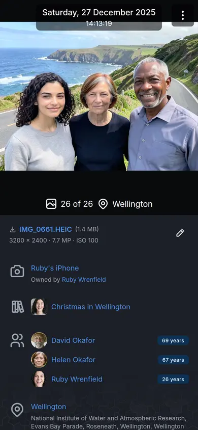

# Viewing photos, videos and recordings

The viewer shows one photo, video or recording at a time, large, with what EiN knows about it
beside it. This page is for everyone who looks at pictures in EiN, on a computer or on a phone: how
to open the viewer and move through files, what the details panel tells you, and how to work with
faces, text in pictures, playback, transcripts and slideshows.

## Open the viewer

Click any picture in a grid: an album, the **Media** page, a person's **Media** tab, your
**Favourites**, a search result. The picture grows out of its tile and fills the screen over the
page. With the keyboard, move to a tile with <kbd>Tab</kbd> and press <kbd>Enter</kbd> or
<kbd>Space</kbd>. While you are selecting pictures, a click ticks a tile instead of opening it;
[Albums](albums.md) explains selecting.

The viewer walks the list you opened it from, in that list's order. A search hit on something said
in a video or a recording opens it at the moment the words are spoken; see
[Search and the finder](search.md).

Each file in the viewer has its own address: the page's address with the file added in its
`fullscreen` parameter (`…?fullscreen=%2Fmedia%2F…`), or, opened on its
own, `/media/` followed by the file's path. You can copy it from the browser's address bar and send
it to someone who may see the file. Stepping to another
file replaces the address instead of adding to the browser's history, so one press of the browser's
Back button closes the viewer and returns you to the page underneath.

## What the viewer shows


On a computer:

- **Top left**: the close button (×).
- **Top right**: the details button (ⓘ, tooltip **Details (i)**), which shows or hides the
  [details panel](#the-details-panel), and beside it **Chat**, where the assistant module is
  installed, which opens the assistant in a drawer beside the picture, or as a dialog over it in a
  window narrower than 992 pixels. You can ask it about the picture you are looking at; see
  [Chatting with the assistant](../assistant/chat.md).
- **Left and right edges**: arrows to the previous and the next file.
- **The bar under the picture**, from left to right:
  - where you are in the list, such as **24 of 26**. The **Media** page leaves this out, because it
    loads its feed a part at a time and does not know the whole count;
  - the date and time the picture was taken, such as **Saturday, 27 December 2025, 13:16:18**;
  - the place: the name of the location the picture is linked to, or else the street address read
    from its GPS position;
  - the heart, **Favourite (s)**, when you are signed in;
  - **Start slideshow**;
  - **More** (⋮).

### The date under the picture

The date is shown as precisely as it is known, and no more. A picture known only to the year shows
**1975**, one known to the month shows **March 2004**, and neither is given an invented day or hour.

Point at the date to see where it came from: **from the camera clock**, **from GPS**, **entered by
hand**, **from Google Photos or a sidecar** or **from the file name**. A scan adds **a scan: its
scanner’s clocks are not when it was taken**. A picture taken in another time zone is shown at the
time on the photographer's clock, and the tooltip adds the same moment in your own time, such as
**27 Dec 2025, 01:16 your time**. [Dates and places of pictures](dates-places.md) explains which
date a picture gets and how to change it.

### The More menu

**More** (⋮) at the right end of the bar holds what you do to the view rather than to the file:

| Row                                            | What it does                                                                                                                             |
| ---------------------------------------------- | ---------------------------------------------------------------------------------------------------------------------------------------- |
| **Pin faces** / **Unpin faces** (<kbd>f</kbd>) | Shows every face box with its name, or hides them again. It reads **No faces**, greyed out, when none were found. For photos and videos. |
| **Show text** / **Hide text** (<kbd>t</kbd>)   | Lays the text read from the photo over it. Shown only when text was read.                                                                |
| **Edit text** / **Add text**                   | Opens the text for writing by hand. Shown on photos you may change.                                                                      |
| **Fullscreen** / **Exit fullscreen**           | Gives the viewer the whole screen.                                                                                                       |
| **Download**                                   | Saves the original file to your device.                                                                                                  |

The file name at the top of the details panel downloads the original too. To download several files
at once, select them in the grid and use **Download** in the selection bar.

## Move between files and close the viewer

- **Next file**: <kbd>→</kbd>, the arrow at the right edge, or swipe left on a touch screen.
- **Previous file**: <kbd>←</kbd>, the arrow at the left edge, or swipe right.

The list goes round: after the last file comes the first again, and before the first comes the
last.

To close the viewer, press × at the top left, press <kbd>Esc</kbd>, use the browser's Back button,
or on a phone swipe down on the picture. The picture shrinks back into its tile, so you see where
you were in the grid.

<kbd>Esc</kbd> first closes whatever lies over the picture: the enlarged map, the text dialog or
**Edit faces**. During a slideshow it stops the slideshow. Only then does it close the viewer.

## Zoom in on a photo

Photos and videos zoom; recordings do not, and nothing zooms during a slideshow.

| To                             | With a mouse and keyboard          | On a touch screen    |
| ------------------------------ | ---------------------------------- | -------------------- |
| Zoom in or out at a spot       | Turn the mouse wheel over the spot | Pinch                |
| Zoom in on a spot, or back out | Double-click a photo               | Double-tap           |
| Zoom in a step                 | <kbd>+</kbd> or <kbd>=</kbd>       |                      |
| Zoom out a step                | <kbd>-</kbd>                       |                      |
| Fit the whole picture again    | <kbd>0</kbd>                       | Double-tap           |
| Look around a zoomed picture   | Drag it                            | Drag with one finger |

Each file opens fitted to the screen. On a touch screen, swiping to the next file waits until the
picture is back at its fitted size; until then a one-finger drag moves around the picture. Over
text laid on the picture, the mouse wheel scrolls the text; hold <kbd>Ctrl</kbd> to zoom instead.

## Keyboard shortcuts in the viewer

| Key                          | What it does                                                          |
| ---------------------------- | --------------------------------------------------------------------- |
| <kbd>←</kbd> / <kbd>→</kbd>  | Previous / next file                                                  |
| <kbd>i</kbd>                 | Show or hide the details                                              |
| <kbd>f</kbd>                 | Show or hide the faces                                                |
| <kbd>t</kbd>                 | Show or hide the text in the picture                                  |
| <kbd>s</kbd>                 | Favourite or unfavourite                                              |
| <kbd>+</kbd> or <kbd>=</kbd> | Zoom in                                                               |
| <kbd>-</kbd>                 | Zoom out                                                              |
| <kbd>0</kbd>                 | Fit the picture                                                       |
| <kbd>Esc</kbd>               | Close: first a layer over the picture or a slideshow, then the viewer |

Videos and recordings have keys of their own; see [Play a video](#play-a-video). Press
<kbd>?</kbd> to see the shortcuts that work where you are, and see
[Keyboard shortcuts](../reference/shortcuts.md) for every key in EiN.

## On a phone or tablet

The viewer takes its phone layout on any touch screen, and in any browser window 768 pixels wide or
narrower.



- The date sits in a dark pill centred over the top of the picture, with the time beneath it.
- The bar under the picture keeps only the position in the list and the place.
- ⋮ in the top right corner holds **Favourite**, **Start slideshow**, the rows of the
  [More menu](#the-more-menu) and **Chat**.
- The details panel is closed when the viewer opens. Held upright, swipe up on the picture to pull
  up the details sheet over the bottom half, and swipe down on it to put it away. Held sideways,
  the details open as a panel on the right: press **Show details** beside ⋮, or swipe up, and swipe
  the panel to the right to close it.
- **Edit faces** is not offered on a phone held upright.

| Gesture                                | What it does                                                                      |
| -------------------------------------- | --------------------------------------------------------------------------------- |
| Swipe left / right                     | Next / previous file                                                              |
| Swipe up                               | Open the details                                                                  |
| Swipe down                             | Close the details; with the details closed, close the viewer                      |
| Pinch, or double-tap                   | Zoom a photo                                                                      |
| Drag with one finger on a zoomed photo | Look around it                                                                    |
| Tap a face                             | Open the person's page, or name an unnamed person; pin the faces to see the boxes |

A swipe that starts at the very edge of the screen is left to the phone itself, so its own Back
gesture closes the viewer.

Turning the phone sideways makes the viewer fullscreen, and turning it upright again leaves
fullscreen. An iPhone has no fullscreen for web pages, so there the viewer stays as it is.
[EiN on a phone](../guide/phone.md) covers the rest of the interface on a small screen.

## The details panel

On a computer the details panel opens on the right each time you open the viewer. Press the
details button (ⓘ) or <kbd>i</kbd> to close it while you look; it stays closed until you close the
viewer. On a phone you pull it up, as described above.

Each part of the panel is a row with an icon at its left. A row appears only when it has something
to show. From the top:

| Row               | What it shows                                                                                                                                                                                                                                                                                                                                                                                                                                                                                           |
| ----------------- | ------------------------------------------------------------------------------------------------------------------------------------------------------------------------------------------------------------------------------------------------------------------------------------------------------------------------------------------------------------------------------------------------------------------------------------------------------------------------------------------------------- |
| The file          | The file name, which downloads the original, and its size. Under it a line of facts: `3200 × 2400 · 7.7 MP · ISO 100 · 1/250 s`; a video adds its length and frame rate, and a recording its length, kbps, kHz and `mono` or `stereo`. Then the sharing chip, which says who can see the file ([Sharing](../guide/sharing.md)), and the file's labels; a label opens a search for it ([Media, Year and labels](media.md)). The cog at the right opens the [cog menu](#change-a-file-from-the-cog-menu). |
| Description       | What someone wrote about the file.                                                                                                                                                                                                                                                                                                                                                                                                                                                                      |
| Copies in staging | Only for a file of yours still in your staging area: its exact copies and look-alikes. See [Duplicates](duplicates.md).                                                                                                                                                                                                                                                                                                                                                                                 |
| Transcript        | For videos and recordings with speech: what is said, line by line. See [Read along with a transcript](#read-along-with-a-transcript).                                                                                                                                                                                                                                                                                                                                                                   |
| Camera            | The device that took it, linking to its page; **Owned by** whoever owned it then, with the years; **Shot by** the photographer, when someone has said who. Without a registered device, the make and model the file names. See [Devices and GPS tracks](devices.md).                                                                                                                                                                                                                                    |
| Albums            | Every album the file is in, with its cover. A file can be in several albums without being copied.                                                                                                                                                                                                                                                                                                                                                                                                       |
| People            | Everyone recognised or tagged in the picture, with their age that day. See [People in the picture](#people-in-the-picture).                                                                                                                                                                                                                                                                                                                                                                             |
| Place             | The location the file is linked to, as a link, the street address, and a small map. **Enlarge map** opens a large map of the spot.                                                                                                                                                                                                                                                                                                                                                                      |
| Stack             | For a photo stacked with others in this album: **N stacked photos**, or **Kept separate**, with a thumbnail of each and **Front** on the one the album shows. Click a thumbnail to see it in the viewer. **Make front**, **Keep separate** and **Allow stacking** are there when you may change the album and every photo in the stack. See [Albums](albums.md).                                                                                                                                        |
| Similar           | Up to 12 pictures that look most like this one, nearest first, leaving out the picture itself and the rest of its stack. Click one to walk these pictures in the viewer. **Show all** opens the **Media** page with every picture like it. Not shown for recordings.                                                                                                                                                                                                                                    |
| Comments          | Comments on the file, with who wrote them and when. Everyone who can see the file reads them. If you may change the file, write one in **Add a comment…** and press **Comment**. The bin beside a comment of your own (**Delete comment**) removes it.                                                                                                                                                                                                                                                  |
| Details           | A folded section for the machine-written facts. See [The Details section](#the-details-section).                                                                                                                                                                                                                                                                                                                                                                                                        |

### People in the picture

Each person has a badge with their age on the day the picture was taken: **69 years**, or
**8 months** for a child under one. A **~** in front, as in **~44 years**, marks an age that is
approximate because only the year or month of the person's birth is known. There is no age when the
picture has no date or the person has no birth date.

Pointing at a name lights up that person's face box on the picture, and pointing at a box lights up
the name. Click a name to open the person's page.

Point at a name for a moment and a card opens above it. It shows the person's picture, larger, with
their full name, the years of their life, where they live now and the start of their description,
as on their page; for a face nobody has named yet, the face itself. Under that is what you can do
with the face: **Show at 0:42** on a video (see [Faces in a video](#faces-in-a-video)), and **Not
sure this is them?** when you may change the picture. Moving the pointer onto the card keeps it open;
moving away closes it. On a phone there is nothing to point with, so the actions are small buttons
at the end of the row instead.

If you are not sure a face really is the person named, press **Not sure this is them?** (the
question mark on a phone). The card asks **Not sure this is &lt;name&gt;?**, still under their
picture to compare with, and you either:

- say who it is: pick someone, or type a name and choose **New person: &lt;name&gt;**, and press
  **Move**; or
- press **Mark as doubtful** to leave it to somebody who knows. The face stays the person's, marked
  as doubtful until somebody answers, here or on the person's Faces tab (see
  [Doubtful faces](people.md#doubtful-faces)).

A doubtful face always has an orange question mark at the end of its row. Press it, or point at
the name and press **Is this them?** in the card. It asks **Is this &lt;name&gt;?** and shows who marked the face, such as
"peggy is not sure.":

- **Yes**: it is them. The face stays theirs, as a person's decision, and the doubt goes.
- **No, it is…**: pick who it is instead, or a new name, as above, and press **Move**.
- **Withdraw**: takes your doubt back without answering it.

Readers who may not change the picture see the orange question mark and who marked the face, but
cannot answer.

Faces that recognition has grouped as one person but nobody has named yet are listed with a crop of
the face and a placeholder name, such as **Unknown 8F3C81**. Click one to open the review over the
viewer, where you name them or say they are someone you already have. [People and faces](people.md)
describes the review and how recognition works.


### The Details section

**Details**, at the bottom of the panel, unfolds the facts a reader seldom needs. Whether it is open
is remembered in this browser, for the next picture and the next visit.

| Row                       | What it shows                                                                                                                                                                                                                                |
| ------------------------- | -------------------------------------------------------------------------------------------------------------------------------------------------------------------------------------------------------------------------------------------- |
| **Path**                  | Where the file is in EiN's tree, such as `/archive/albums/cornwall-1968/img20120303_133900582.jpg`. Click it to open a terminal tab at the file ([The terminal](../shell/terminal.md)). Visitors who are not signed in see the path as text. |
| **Text in image**         | The text read from the picture.                                                                                                                                                                                                              |
| **Text language**         | The language the text was read in, and how sure the reading was. If you may change the file, a menu to choose another; see [Read the text in a picture](#read-the-text-in-a-picture).                                                        |
| **Type**                  | The kind of file, such as `image/heic`.                                                                                                                                                                                                      |
| **Taken at**              | The capture time exactly as stored, such as `2025-12-27T13:16:18+13:00`.                                                                                                                                                                     |
| **Taken at (UTC)**        | The same moment in UTC.                                                                                                                                                                                                                      |
| **Time source**           | Where the date came from, in words, and any note left with it.                                                                                                                                                                               |
| **Created**, **Modified** | The file's created and modified times.                                                                                                                                                                                                       |
| Hashes                    | Fingerprints of the file's bytes, such as `sha256`.                                                                                                                                                                                          |
| EXIF tags                 | Every tag the file carries, one per row, or **No EXIF recorded**.                                                                                                                                                                            |

## Change a file from the cog menu

The cog at the top right of the details panel (**Edit media**) opens a menu. It is there when you
may change the file, and for any signed-in reader for **Add to album**.

| Row                                   | Who sees it                                                                        | What it does                                                                                                                                                                                                                                                                                                 |
| ------------------------------------- | ---------------------------------------------------------------------------------- | ------------------------------------------------------------------------------------------------------------------------------------------------------------------------------------------------------------------------------------------------------------------------------------------------------------ |
| **Edit**                              | Readers who may change the file                                                    | Opens **Edit file**: description, labels and location. See below.                                                                                                                                                                                                                                            |
| **Share**                             | Readers who may change the file                                                    | Opens the Share dialog for this file. See [Sharing](../guide/sharing.md).                                                                                                                                                                                                                                    |
| **Add to album**                      | Signed-in readers                                                                  | Opens **Add to an album**. Type part of an album's name to find it, or a name that is not taken to make an album by that name. The file is linked into the album, not copied; a file from your staging area moves into it instead. A message such as **1 added to Christmas in Wellington** offers **Undo**. |
| **Edit faces**                        | Readers who may change the file, on photos and videos, not on a phone held upright | Draw, move or remove face boxes. See [Draw or correct a face box](#draw-or-correct-a-face-box).                                                                                                                                                                                                              |
| **Edit subtitles**, **Add subtitles** | Readers who may change the file, on videos and recordings                          | Opens what is said, line by line, beside the video or recording, to correct it. See [Correct the subtitles](#correct-the-subtitles).                                                                                                                                                                         |
| **Rotate left**, **Rotate right**     | Readers who may change the file, on photos and videos                              | Turns the file a quarter turn.                                                                                                                                                                                                                                                                               |
| **Mirror horizontally**               | Readers who may change the file, on photos and videos                              | Flips the file left to right. A tick shows while it is mirrored.                                                                                                                                                                                                                                             |

A turn or a flip is kept on the file, for everyone who sees it. EiN moves the face boxes with the
picture and makes the smaller versions it shows again. A video is re-encoded by the media service,
which takes a while; until it is done the video plays the old way round. To undo a turn, turn it
back. The rotate and mirror rows are not offered for a file that cannot be decoded. There is no
cropping and no colour editing in EiN.

### Change the description, labels or location

1. In the cog menu, choose **Edit**. The **Edit file** dialog opens, with the file name under its
   title.
2. In **Description**, write what the picture shows or what you know about it. Formatting such as
   bold and lists is kept.
3. In **Labels**, pick a label in use or type one. A space starts the next label.
4. To set where it was taken, pick a place in **A known location**, or click the spot in
   **On the map**, or type its coordinates there. The dialog warns: "The new location replaces the
   position the file carries, for the map and for searching by location."
5. To take the location away, press **Clear location**. The dialog warns: "The file will have no
   location, for the map or for searching by location."
6. Press **Save**. It stays greyed out until you have changed something; **Cancel** closes the
   dialog without saving.

The date is not changed here. To change when pictures were taken, select them in the grid and use
**Set time** in the selection bar; see [Dates and places of pictures](dates-places.md).

## Faces in the viewer

Face boxes stay hidden until you point at a face; then that face's box and name appear.

- **Pin faces** in the More menu, or <kbd>f</kbd>, shows every box with its name. They stay pinned as
  you move from file to file, until you unpin them or reload the page. On a touch screen, where
  nothing can be pointed at, pinning is the way to see the boxes.
- Click a named box to open that person's page.
- Click the box of an unnamed person to open a small field, **Who is this?**. Type a name and press
  <kbd>Enter</kbd> or the tick. This gives them a name as a person of their own. If they are someone
  already in the archive, click their placeholder name in the details panel instead and choose the
  person in the review.
- A face that belongs to nobody reads **Unassigned**.
- A dashed box is a tag: "Tag: a box with a name, not used to recognise faces". It says who is
  there without helping to recognise them in other pictures. A box drawn by hand is a tag, and so
  is a found face whose box someone has moved or resized.

### Draw or correct a face box

Use **Edit faces** when recognition missed a face, drew the box in the wrong place, or matched the
wrong person. It is offered on photos and videos you may change, except on a phone held upright. On
a video it pauses the video, and you draw on the frame on screen; the large play button leaves the
picture while you draw, and the one on the bar still plays. A box you draw on a video belongs to
that moment and shows from half a second before it to half a second after. A box already there can
be chosen and removed or given to someone else, but not moved or resized.

1. In the cog menu, choose **Edit faces**. The bar under the picture reads **Draw a new box or
   select a face**, and every box shows.
2. To add a face, drag a box over it. To change a face, click its box.
3. Drag the box to move it, or drag one of the round handles on its edges and corners to resize it.
   The bar reads **Adjust the box, change who it is, or remove it**.
4. Under the box, choose:
   - **Done** to save the box;
   - **Cancel** to drop your changes to it;
   - the person's name (tooltip **Change who this is**) to say who the face is, in the dialog
     described below;
   - **Remove**, then **Confirm remove**, to take the face away.

A box you drew is given an unidentified person of its own, and the review opens so you can name
them or say they are someone already in the archive. A found face whose box you move or resize
keeps its person, but becomes a tag and no longer helps recognition. To leave **Edit faces**, choose
it again in the cog menu, press × in the bar under the picture, or press <kbd>Esc</kbd>.

The dialog for a face's name is **Who is this?**, with **Now marked as Helen Okafor** or
**Not marked as anyone** under the title:

- **Someone I know**: pick the person in **Who it is**, then press **Move**.
- **Someone new**: "the face becomes a new unidentified person, for you to name now or later".
  Press **Move**.
- **Let recognition decide**: the face is matched again against everyone else. Press
  **Match again**. The bar then says what happened, such as **Recognition matched the face to Ruby
  Wrenfield.**, **Recognition made the face a new unidentified person.** or **Recognition left the
  face unassigned: too small or unclear to start a new person.** This choice is not there for a
  tag, which recognition cannot match.

Changes you make to faces are decisions by a person, and later recognition runs leave them alone;
see [People and faces](people.md).

## Read the text in a picture

EiN reads the text in photos: letters, postcards, signs, printed pages, and handwriting in English,
Swedish and Finnish. The media service does the reading in the background. A picture still in your
staging area is read once it is filed into an album.


- **Show text**, in the More menu, or <kbd>t</kbd>, darkens the picture and lays the text over it in
  a typewriter face. Long text scrolls. The row is there only when text was read.
- The text stays shown as you move from picture to picture, until you close the viewer, so you can
  page through a scanned letter. It is hidden during a slideshow.
- **Hide text**, or <kbd>t</kbd> again, takes it away.

The text is also under **Text in image** in the [Details section](#the-details-section), and
search finds pictures by it; see [Search and the finder](search.md).

### Correct the text, or add it by hand

1. In the More menu, choose **Edit text**, or **Add text** when nothing was read. With the text
   shown, the pencil at its top right does the same.
2. The dialog **Text in the picture** opens: the picture on the left (above, on a narrow screen), which you can zoom to read
   closely, and a text box on the right.
3. Type or correct the text.
4. Press **Save**, or <kbd>Ctrl</kbd>+<kbd>Enter</kbd>. Saving empty text removes it.

What you write replaces what was read. It is offered on photos you may change. Saving does not wait
for the media service: when it is away, the text is saved at once and search finds it once the
service is back.

### Read the text again in another language

When the reading came out wrong because EiN took the text for another language, choose the language
yourself:

1. Open **Details** at the bottom of the details panel.
2. In **Text language**, choose the language. The menu starts at **Automatic**, which shows what was
   detected, such as **Automatic: English (93%)**, and offers Swedish, Finnish, English, Danish,
   Norwegian, German and French.

EiN reads the picture again in that language, and the text follows after a while. Choose
**Automatic** to let EiN tell the language again. Readers who may not change the file see the
language without the menu.

## Play a video

A video starts playing when it opens. If your browser blocks that, press play.

On a computer, click the picture to pause or play, and double-click it to go fullscreen. A large
play button sits in the middle while the video is paused. The controls fade while the video plays
and come back when you move the mouse.

| Control                                | Key                                                          | What it does                                                                                                           |
| -------------------------------------- | ------------------------------------------------------------ | ---------------------------------------------------------------------------------------------------------------------- |
| Play / Pause                           | <kbd>Space</kbd> or <kbd>k</kbd>                             | Plays or pauses.                                                                                                       |
| **Back 10 s**                          | <kbd>j</kbd>                                                 | Goes back ten seconds.                                                                                                 |
| **Forward 10 s**                       | <kbd>l</kbd>                                                 | Goes forward ten seconds.                                                                                              |
| **Previous chapter**, **Next chapter** | <kbd>Shift</kbd>+<kbd>←</kbd>, <kbd>Shift</kbd>+<kbd>→</kbd> | Jumps between chapters, when the video has them.                                                                       |
| **Mute** / **Unmute**                  | <kbd>m</kbd>                                                 | Turns the sound off or on. The slider beside it sets the volume, where the browser lets a page do that.                |
| The clock                              |                                                              | Where you are and how long the video is, such as `0:42 / 2:11`, and **Chapter 2 of 5** when it has chapters.           |
| **Subtitles** (CC)                     | <kbd>c</kbd>                                                 | Shows or hides subtitles, when the video has a transcript. The tooltip names the language: **Subtitles: English (c)**. |
| **Picture-in-picture**                 | <kbd>p</kbd>                                                 | Plays the video in a small window that stays on top, where the browser offers it.                                      |
| **Cast to a screen**                   |                                                              | Sends the video to a television or other screen. Shown only while your browser finds one.                              |
| **Fullscreen**                         |                                                              | Gives the player alone the whole screen, with its controls and subtitles.                                              |

The volume you set is remembered in this browser for the next video or recording. There is no
control for the playback speed.

On a phone, tap the picture to show or hide the controls. Three buttons sit over the middle of the
picture: back ten seconds, play or pause, and forward ten seconds, or previous and next chapter
when the video has chapters. **More** (⋮) on the bar holds **Picture-in-picture** and
**Cast to a screen…**, where the browser offers them. There is no mute button: use the phone's own volume buttons. On an
iPhone, **Fullscreen** opens Safari's own player, which shows the subtitles when they are
on. Elsewhere, a wide video put fullscreen with the player's button turns the screen sideways
where the browser allows it.

### The timeline and chapters

Click or drag on the timeline to jump. Pointing at it shows the time there and, once the media
service has made the video's storyboard, a small frame from that moment.

The media service finds the cuts in a video and makes each scene a chapter. A video whose file
names the camera or phone that recorded it is taken to be one take, so there only a clear cut makes
a chapter, not a lamp switched on or the exposure changing. Chapters show as pieces
of the timeline with gaps between them; a video with too many to fit gets a small tick at each start
instead. Pointing at the timeline shows the chapter too, such as `1:24 · Chapter 3`. **Previous
chapter** more than two seconds into a chapter goes back to its start, and otherwise to the chapter
before.

Move to the timeline with <kbd>Tab</kbd> to use the keyboard on it: <kbd>←</kbd> and
<kbd>→</kbd> go back and forward five seconds, <kbd>Page Down</kbd> and <kbd>Page Up</kbd> go to the
previous and next chapter (or a tenth of the video, without chapters), and <kbd>Home</kbd> and
<kbd>End</kbd> go to the start and the end.

### Subtitles

A video or recording with a transcript has the CC button. Subtitles start on; once you turn them
off, they stay off for the next video or recording in this browser, until you turn them on again.
When two or more people speak, each line starts with the
speaker's name, in a colour of their own. A voice nobody has named is called **Speaker 1**,
**Speaker 2** and so on.

### Faces in a video

The face boxes follow the faces as the video plays, and **Pin faces** works as it does on a photo.
In the details panel, point at a person or an unnamed face and press **Show at 0:42** in the card
above it. Just above the button the card says when they are on screen, for example **On screen
0:00–0:39, 0:42–1:28**.
The video pauses on the frame where the face is seen most clearly and keeps a box on the face from
there. While it does, a lit button at the end of the row reads **Stop following Ruby Wrenfield**:
press it, or **Stop following** in the card, to let go. On a phone the button is always in the row.

## Listen to a recording


A recording starts playing when it opens. Its picture is the waveform of the sound, and the waveform
is the timeline: the part already played is brighter, a line marks where you are, and a click or a
drag on it jumps there. A large play button sits on it while the recording is paused. Under it are
play or pause (**Play (Space)**, **Pause (Space)**), **Back 10 s** and **Forward 10 s**, mute and
the volume slider (not on a phone), and the clock; at the right end **Subtitles** (CC) when it has a
transcript, **Picture-in-picture** where the browser offers it, and **Fullscreen**. With subtitles
on, the line being said shows between the waveform and the buttons.

<kbd>Space</kbd> or <kbd>k</kbd> plays and pauses, and <kbd>j</kbd>, <kbd>l</kbd>, <kbd>m</kbd>,
<kbd>c</kbd> and <kbd>p</kbd> work as on a video. Move to the waveform with <kbd>Tab</kbd> to use
the same keys as on a video's timeline.

## Read along with a transcript

The media service writes down what is said in videos and recordings, and works out who speaks when.
The transcript appears near the top of the details panel, under the file.

- Each line starts with its time. The line being said is in bold and is kept in view as it plays.
- Click a line to jump to that moment.
- Where the voice changes, the line carries the speaker's name.

Above the lines is a chip for each voice, such as **Speaker 1 · 1:38**: who it is and how long they
speak in the file.

- The small play button on a chip (**Hear Speaker 1**) jumps to the start of that voice's longest turn.
- Click a chip to say who it is. A named voice opens the person's page. An unnamed one opens the
  review, where you name them or say they are someone already in the archive. A voice that belongs
  to nobody yet becomes an unidentified person of its own first; this needs permission to change
  the file.

A transcript can also read **No speech was detected.**, or **Transcript unavailable.** when it could
not be loaded.

### Correct the subtitles

The transcript is written by a machine, and it mishears: a name, a word in a dialect, a line it
invents over a quiet stretch, or one it never heard. You can correct it on a video or a recording
you may change.

1. In the cog menu at the top right of the details panel, choose **Edit subtitles**, or **Add
   subtitles** when there are none.
2. The dialog **Subtitles** opens where the viewer was playing, and pauses it: the video (or the
   recording's waveform) on the left, above a timeline that shows where every line lies, and the
   lines on the right (below, on a narrow screen). The line being said is drawn over the picture as
   it reads now, with your changes, and tinted in the list.
3. Correct a line by typing in it. Each line has its start and end, which you can type
   (`1:23.4`, or seconds such as `83.4`), and a play button that plays just that line and stops.
4. The line you are in has buttons to start or end it at the playhead, split it at the cursor, join
   it with the next line, and delete it. **Add line** puts a new line at the playhead.
5. Press **Save**, or <kbd>Ctrl</kbd>+<kbd>Enter</kbd>. An empty line is left out. A line that ends
   before it starts is marked in red and must be fixed first.

The keys work while you type in a line, so you can listen and write at once:

| Key                                                           | What it does                                                                |
| ------------------------------------------------------------- | --------------------------------------------------------------------------- |
| <kbd>Ctrl</kbd>+<kbd>Space</kbd>, <kbd>Alt</kbd>+<kbd>K</kbd> | Play or pause. Outside a text box <kbd>Space</kbd> and <kbd>k</kbd> do too. |
| <kbd>Alt</kbd>+<kbd>J</kbd> / <kbd>Alt</kbd>+<kbd>L</kbd>     | Back or forward two seconds.                                                |
| <kbd>Alt</kbd>+<kbd>P</kbd>                                   | Play the line, from its start to its end.                                   |
| <kbd>Alt</kbd>+<kbd>I</kbd> / <kbd>Alt</kbd>+<kbd>O</kbd>     | The line starts, or ends, at the playhead.                                  |
| <kbd>Alt</kbd>+<kbd>N</kbd>                                   | A new line at the playhead.                                                 |
| <kbd>Alt</kbd>+<kbd>S</kbd>                                   | Split the line at the cursor.                                               |
| <kbd>Alt</kbd>+<kbd>↑</kbd> / <kbd>Alt</kbd>+<kbd>↓</kbd>     | The line before, or after.                                                  |

Closing with changes not saved asks first. What you save is what the subtitles, the transcript in
the details panel and search show from then on, and EiN keeps it: the file is not transcribed
again, not even when the media service's transcription improves. The speakers stay as they were.
Saving does not wait for the media service: when it is away, the lines are saved at once and search
finds the new words once the service is back.

For a recording or video you reach from a search for words that are said in it, the viewer opens at
the moment they are said.

## Watch a slideshow

1. Open the picture to start from, in the album or list you want to show.
2. Press **Start slideshow** (the play button in the bar). On a phone it is in ⋮. It is greyed out
   when the list holds only one file.
3. The browser goes fullscreen, if it allows that; if not, the slideshow runs in the window. The
   close button, the arrows, the details panel and the face boxes go away, and the bar lies over the
   bottom of the picture. Pinned face names stay on and follow the picture.
4. Each photo stays on screen for **Seconds per slide**, 3 unless you change it, and fades into the
   next. With **Ken Burns effect** on, as it is unless you turn it off, each photo slowly pans and
   zooms. Videos and recordings play to their end before the next file. One that will not play is
   skipped after one slide's time.

The slideshow follows the list's order and goes round from the last file to the first, until you
stop it. There is no shuffle. <kbd>←</kbd> and <kbd>→</kbd> still step back and forward. While it
runs, the screen is kept from going to sleep.

To stop the slideshow, click the picture, press <kbd>Esc</kbd>, or leave fullscreen.

To change the timing or turn the pan and zoom off, open your picture at the top right, choose
**Profile**, then the **Preferences** tab, and look under **Playback**:

| Setting               | What it does                                       | Default |
| --------------------- | -------------------------------------------------- | ------- |
| **Seconds per slide** | How long each photo is shown in a slideshow.       | `3`     |
| **Ken Burns effect**  | Slowly pan and zoom each photo during a slideshow. | on      |

They are yours alone and do not change anyone else's slideshows. See
[Your profile, favourites and trash](../guide/profile.md), and in the settings reference
[`CFG_USER_SLIDESHOW_SECONDS`](../reference/settings.md#cfg_user_slideshow_seconds) and
[`CFG_USER_KEN_BURNS`](../reference/settings.md#cfg_user_ken_burns).

## Mark a favourite

Press the heart in the bar, or <kbd>s</kbd>; on a phone choose **Favourite** in ⋮. The heart turns
red. Press it again (**Unfavourite**) to take the picture out of your favourites.

Your favourites are your own: open your picture at the top right and choose **Favourites** to see
them all, by day. To heart many pictures at once, select them in the grid and use **Favourite** in
the selection bar. Visitors who are not signed in have no favourites and see no heart. See
[Your profile, favourites and trash](../guide/profile.md).

## What you see depends on who you are

| You are                              | What differs                                                                                                                                                                                           |
| ------------------------------------ | ------------------------------------------------------------------------------------------------------------------------------------------------------------------------------------------------------ |
| Signed in, and may change the file   | Everything on this page.                                                                                                                                                                               |
| Signed in, and may only see the file | The cog menu holds only **Add to album**. You read comments but cannot write them, and see the text language without the menu. No **Edit text**, **Edit subtitles**, **Edit faces**, rotate or mirror. |
| A visitor who is not signed in       | No heart, no cog menu and no sharing chip. **Path** is plain text.                                                                                                                                     |
| Someone who opened a share link      | The pictures without the details panel; the details button and <kbd>i</kbd> are not there.                                                                                                             |

[Sharing](../guide/sharing.md) explains who can see what.

## When something is not as expected

**A picture you added a moment ago has no thumbnail, faces, text or transcript yet.**
The media service works through added files in the background, and the viewer fills in as each step
finishes. Until it is done, an administrator sees the **Dashboard** read **Catching up**. Text in
pictures waits until the file leaves staging. See [Getting your photos in](importing.md).

**"This rendition could not be played. It may still be transcoding."**
The version of the video or recording that the browser plays has not been made yet, or failed. Wait
a while and open it again.

**"This browser or device cannot play AV1, the format this video is in."**
EiN makes its playable videos in the AV1 format, and this browser or device cannot decode it. Use a
current browser on another device, or **Download** the original.

**"This file cannot be played"**, with "The original is damaged, so no preview or playable version
could be made from it."
The uploaded file itself cannot be read; the reason is under the message. **Download** it to check
the file on your own device.

**A PDF or a Word file shows nothing.**
The viewer has no reader for documents. Use **Download** in the More menu to open the file on your
device. Its text can still be found with search; see [Supported files](file-types.md).

**Show text is not in the More menu.**
No text was read from this picture, or it is a video or a recording. Add the text yourself with
**Add text**, if you may change the file.

**Start slideshow is greyed out.**
The list holds only one file. Open the viewer from an album or a longer list.

**The date or the place is wrong.**
See [Dates and places of pictures](dates-places.md).

## From the shell

What the viewer shows and changes can also be done in [EiN's terminal](../shell/terminal.md):

| Command                                                                              | What it does                                                       |
| ------------------------------------------------------------------------------------ | ------------------------------------------------------------------ |
| [`media-details`](commands.md#media-details) `<file>`                                | Everything the details panel shows about a file.                   |
| [`file-set-description`](commands.md#file-set-description) `--text '…' <file>`       | Sets or clears the description.                                    |
| [`file-set-text`](commands.md#file-set-text) `--text '…' <file>`                     | Writes the text in a picture by hand.                              |
| [`file-set-text-language`](commands.md#file-set-text-language) `<file> <code\|auto>` | Reads the text again in a language.                                |
| [`file-set-transcript`](commands.md#file-set-transcript) `<file> < subtitles.vtt`    | Writes what is said in a video or recording, as WebVTT, by hand.   |
| [`file-set-orientation`](commands.md#file-set-orientation) `--rotate cw <file>`      | Turns a file; `ccw` and `180` too, and `--toggle-mirror` flips it. |
| [`star`](../reference/commands-core.md#star) `<path>`, `star -d <path>`              | Marks a favourite, or takes it away.                               |

```bash
# in EiN's terminal
media-details /archive/albums/cornwall-1968/img20120303_133900582.jpg
file-set-text-language /archive/albums/cornwall-1968/img20120303_133900582.jpg en
```
