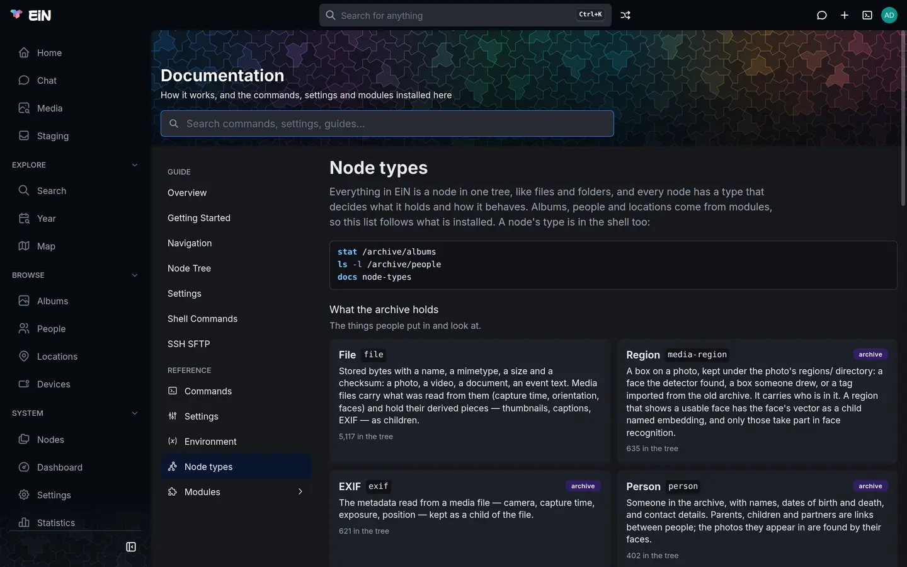

# Nodes and node types

Everything EiN keeps is a node: a photo, an album, a person, an account, a log, a command. This
page takes one node apart, says what each part means and how to look at it in the web interface and
the shell, and explains what a node's type decides. It is for anyone who wants to understand what
they see in `ls -l`, in **Nodes** or in a node's **Properties**.

The examples come from the Wrenfield family's archive. Its paths, such as `/archive/albums` and
`/archive/people`, and the types `album` and `person` exist with the [Archive](../archive/index.md)
installed; what the page says about nodes is core's and holds for every type.

## What a node is made of

Every node has the same five parts, whatever its type:

| Part               | What it is                                                                                                                     | How to see it    |
| ------------------ | ------------------------------------------------------------------------------------------------------------------------------ | ---------------- |
| **Id**             | A fixed identifier of 26 letters and digits, given when the node is made. It stays the same when the node is moved or renamed. | `info`, `stat`   |
| **Type**           | A word that says what the node is: `file`, `directory`, `album`, `person`. Set when the node is made.                          | `info`, `ls -l`  |
| **Properties**     | What every node has, as a file on a computer does: owner, group, mode, access list, times and link count.                      | `props`, `ls -l` |
| **Attributes**     | What this node's type needs: a photo's size, checksum and capture time; a person's names and dates.                            | `attrs`          |
| **Name and place** | The name the node has in the folder that holds it. A node does not store its own name; the folder does.                        | `ls`, `find`     |

Some types also hold **content**: a file its bytes, a log its lines, a queue its messages, a
position its shape on the map. And any node can hold **children**, a file included.

![One node taken apart: the album christmas-2019 holds it under the name 20191225_155434.jpg, which gives its path; the node has the id 01JA7Q3M5X8R2C4V6B9N0P1T2W, the type file and the tier disk, properties (owner helen, group users, mode rwxr-x---, no access list, who created, changed and modified it and when, and 1 link) and attributes (name, mimetype image/jpeg, size, sha256, takenAt and labels), and beneath it its content, the bytes on disk in files/2W/, and its children thumbnails/, metadata/, regions/ and position](../diagrams/node.svg "A node keeps its id, type, properties and attributes; its name belongs to the folder that holds it.")

Take a photo from the Wrenfield family's album:

```bash
# in EiN's terminal
info /archive/albums/christmas-2019/20191225_155434.jpg
```

```text
id: 01JA7Q3M5X8R2C4V6B9N0P1T2W
type: file
```

The path names the photo; the id names the node behind it. `resolve-id` goes the other way, from an
id back to the node's path:

```bash
# in EiN's terminal
resolve-id 01JA7Q3M5X8R2C4V6B9N0P1T2W
```

## Look at a node

### In the web interface

The **Nodes** page browses the whole tree. It is in the sidebar under **System**, for
administrators.

1. Open **System → Nodes**.
2. Go to the node, by its folders or by typing its path in the address bar.
3. Choose **Properties** in the node's context menu, or press <kbd>Alt</kbd>+<kbd>Enter</kbd>.


The properties dialog has three tabs:

- **General** shows the node's **Id**, **Type**, **Links**, **Created**, **Changed** and
  **Modified**, a file's **Mimetype** and **Size**, a link's **Link to**, and the **Mode**,
  **Owner** and **Group**, which you can change there and save with **Apply**.
- **Attributes** shows the attributes, a **Key** and a **Value** to a row. If you may change the
  node, you can edit a row, remove it or **Add** one, and save with **Apply**, or **Reset** to go
  back to what is stored. The **Attributes** tab beside the listing shows them as JSON instead,
  saved with **Save**; when you may not change the node it says _You can read these attributes but
  not change them._
- **Sharing** is the **Share** dialog's body; [Permissions in depth](../admin/permissions.md)
  explains it.

Everyone else meets nodes through the pages modules make for them: with the Archive, an album's page shows an `album` node
and the files in it, a person's page a `person` node and what links to it.

### In the terminal

Five commands show a node, each a different amount of it. All of them take a path.

| Command | What it prints                                                                            |
| ------- | ----------------------------------------------------------------------------------------- |
| `info`  | The id and the type.                                                                      |
| `props` | The properties.                                                                           |
| `attrs` | The attributes.                                                                           |
| `stat`  | All of it: id, type, properties and attributes.                                           |
| `ls -l` | One line for each node in a folder: type, mode, links, owner, group, size, time and name. |

`info`, `props`, `attrs` and `stat` print YAML with the keys in alphabetical order, and JSON with
`JSON_OUTPUT=1` in front. A person's attributes, for example:

```bash
# in EiN's terminal
attrs /archive/people/Peggy_Wrenfield
```

```text
born: '1934-08-22'
died: '2021-01-17'
fullname: Margaret Wrenfield
gender: female
name: Peggy Wrenfield
```

`ls -l` starts each line with the node's type, so it shows at a glance what a folder holds:

```bash
# in EiN's terminal
ls -l /archive/people/Peggy_Wrenfield
```

```text
directory rwxrwxr-x 1 admin users 2 14 Mar 2026 09:12:40 children
directory rwxrwxr-x 1 admin users 1 14 Mar 2026 09:12:41 partners
```

The size column is a file's size in bytes, and for every other node the number of children it
has. A `+` after the mode says the node has an access list, and a link ends with `->` and where it
points. Names that start with a dot are left out unless you add `-a`.

> [!NOTE]
> In these commands `-L` means _do not_ follow a link: `stat -L` shows the link itself, `stat`
> without it the node the link points to. That is the opposite of `stat -L` on Linux.

The [command reference](../reference/commands-core.md#stat) has every option of
[`stat`](../reference/commands-core.md#stat), [`props`](../reference/commands-core.md#props),
[`attrs`](../reference/commands-core.md#attrs), [`info`](../reference/commands-core.md#info) and
[`ls`](../reference/commands-core.md#ls).

## Properties

Properties are the same for every type. `props` prints them under these names:

| Property     | **General** shows it as | What it is                                                                                                                          |
| ------------ | ----------------------- | ----------------------------------------------------------------------------------------------------------------------------------- |
| `uid`        | **Owner**               | The account that owns the node, by number.                                                                                          |
| `gid`        | **Group**               | The node's group, by number.                                                                                                        |
| `mode`       | **Mode**                | The permission bits, as `chmod` writes them: `0750` or `rwxr-x---`. `props` prints the number in decimal, so `0755` shows as `493`. |
| `acl`        | (the **Sharing** tab)   | The access list: more users or groups, each with bits of their own. Absent when there is none.                                      |
| `birthtime`  | **Created**             | When the node was made, and by whom.                                                                                                |
| `changetime` | **Changed**             | When its properties last changed, and by whom.                                                                                      |
| `modtime`    | **Modified**            | When its attributes last changed, and by whom.                                                                                      |
| `count`      | **Links**               | How many folders hold the node. Usually 1; more when it has hard links.                                                             |
| `softlink`   | **Link to**             | Where a `softlink` points. Only on links.                                                                                           |
| `tier`       | (beside **Type**)       | Where a file's bytes are stored: `disk`, `volatile` or `db`. Fixed when the file is made.                                           |

Each time is a pair of the account's number and the moment, in milliseconds since 1970. `ls -l`
shows the later of the changed and modified times, with owner and group by name.

Owner, group, mode and access list decide who may read or change the node.
[Permissions in depth](../admin/permissions.md) explains them and the commands that change them:
`chmod`, `chown`, `acl` and `share-set`. Links are explained in [Links](links.md), and the tiers
in [Files and storage](files.md).

## Attributes

Attributes hold what a node's type needs, as JSON values: text, numbers, lists and objects. Each
type has its own:

| Type        | Attributes it carries, for example                                                  |
| ----------- | ----------------------------------------------------------------------------------- |
| `file`      | `name`, `mimetype`, `size`, `sha256`; a photo also `takenAt`, its capture time      |
| `person`    | `name`, `fullname`, `birthname`, `born`, `died`, `gender`, `contact`, `description` |
| `album`     | `name`, the title shown on its page, which may differ from the folder's name        |
| `directory` | often none                                                                          |

So `/archive/albums/christmas-2019` is the album's path, and _Christmas at the cottage_, the
title on its page, is its `name` attribute.

### Change an attribute

Change what a node means through the command or page made for it, when there is one: with the
Archive, give Peggy a death date with `person-update --died=…` or on her page, describe a photo with
`file-set-description`, and rename an album on its page. Those check the value and keep everything
that depends on it in step.

For anything else, `attrs` sets and removes attributes directly:

```bash
# in EiN's terminal
attrs -s 'birthname=Margaret Cole' /archive/people/Peggy_Wrenfield
attrs -J 'contact=[{"type":"phone","data":"01632 960 418"}]' /archive/people/Helen_Okafor
attrs -d contact /archive/people/Helen_Okafor
```

- `-s key=value` sets an attribute to the text after the first `=`.
- `-J key=value` sets it to a JSON value: a number, `true`, a list, an object. Invalid JSON is
  refused with _invalid JSON for attribute 'key'_.
- `-d key` removes it.

Each option may be given several times. The attributes you do not name are left as they are. The
**Attributes** tab in **Properties** does the same from the web interface.

> [!WARNING]
> `attrs` writes what you give it without knowing what the type expects. A wrong value, such as a
> date in the wrong form, can make a page or a pipeline misread the node. Prefer the commands made
> for the type.

## Content and children

A node's type decides whether it holds content, and of what kind. `cat` prints it:

| Type        | Content                                                  |
| ----------- | -------------------------------------------------------- |
| `file`      | Its bytes: a photo, a video, a text.                     |
| `log`       | Lines with a time each, kept for a retention period.     |
| `queue`     | Messages waiting to be read; reading one removes it.     |
| `router`    | Nothing kept: what is written reaches whoever reads now. |
| `position`  | A point, a circle or an outline on the map.              |
| `track`     | Timestamped GPS points.                                  |
| `embedding` | A numeric fingerprint, for similarity search.            |

A `directory`, `album` or `person` holds no content, only attributes and children.

Children work the same for every type. With the Archive, a photo keeps what EiN works out about it beneath itself:

| Child           | What it holds                                           |
| --------------- | ------------------------------------------------------- |
| `thumbnails/`   | Smaller renditions, a video's poster and storyboard     |
| `metadata/exif` | The metadata read from the file, an `exif` node         |
| `regions/`      | A `media-region` node for each face or box on the photo |
| `position`      | Where the photo was taken, a `position` node            |

```bash
# in EiN's terminal
ls /archive/albums/christmas-2019/20191225_155434.jpg
```

Deleting a node deletes its children with it: `rm` refuses a node that has children unless you
add `-r`. Names are unique within a folder, so a folder cannot
hold two children of the same name. How the tree is laid out, folder by folder, is in
[The tree](tree.md).

## What a node's type decides

The type is a plain word stored on the node, and it decides three things:

- **What the node holds.** Whether it has content, and what attributes it is expected to carry.
- **How EiN treats it.** A `softlink` is followed to its target; a `queue` hands out its messages
  in order; a `session` disappears when its connection ends; a `file` is shown as a picture, a video
  or a text by its mimetype.
- **Where it shows.** The Archive's pages list `album`, `person`, `location` and `device` nodes;
  the search box's `@` completes their names, and labels'. `find -type person` finds a type
  anywhere in the tree.

A node's type does not change after it is made. To turn a folder into an album, for example, make
a new album and move the files into it.

### Where types come from

Core has its own types: the ones every installation needs, such as `file`, `directory`,
`softlink`, `user`, `group`, `log` and `queue`. Modules add theirs: the Archive brings `album`,
`person`, `location`, `device`, `media-region`, `exif` and `album-profile`. A module describes its
types in its manifest, with a label, a description and a category; [The module manifest](../develop/manifest.md) shows how.

A type is not registered anywhere before it is used. `mknode -t <type>` makes a node of any type,
and a module's commands are often built on it: `person-create` makes a `person` node with
`mknode -t person` and its attributes. A type no installed module describes still works; it is
simply undescribed.

The types fall into three groups:

| Group         | What is in it                                                                                                                |
| ------------- | ---------------------------------------------------------------------------------------------------------------------------- |
| **Content**   | What the archive is made of: files, positions and tracks, and with the Archive albums, people, locations, devices and faces. |
| **Structure** | How the tree is arranged: directories, links, accounts and groups.                                                           |
| **System**    | How EiN runs: commands, logs, queues, pools, routers, sessions, terminals, embeddings, share links.                          |

### List every type

[Node types](../reference/node-types.md) describes every type of an EiN with all its modules. Your
own installation lists what it has, with how many of each:

- In the web interface, open **System → Documentation** and choose **Node types**. Each type shows
  its label, its description, the module it comes from and how many are in the tree. A type that
  no installed module describes, perhaps left by a module since removed, is listed under **Also in
  the tree**.
- In the terminal, run `docs node-types`. Each line has the type, its count, the module it comes
  from (`core` for core's own) and its description.



## When something goes differently

- **`info`, `stat` or `attrs` answers _Node not found_ or _Access denied for operation 'r'_.** The path is
  wrong, or the node is one you may not read. EiN leaves out what you may not open, so a node can
  exist and still not be found by you; [Permissions in depth](../admin/permissions.md) explains why.
- **`stat` shows a different node than the one you named.** The path is a link, and `stat` follows
  it. Add `-L` to see the link itself.
- **`attrs` changes the target, not the link.** It too follows the link and changes the target. Add `-L`
  to change the link node.
- **`mknode` answers _missing type_.** It needs `-t` and a type.
- **`mknode` answers _tier is not an attribute; use --tier_.** The storage tier is a property:
  give it with `--tier=disk`, `--tier=volatile` or `--tier=db`.
- **The Attributes tab is read-only.** You may read the node but not change it.

## Related pages

- [How EiN works](../start/how-ein-works.md): the ideas EiN is built on, in one page.
- [The tree](tree.md): every standard path and what is there.
- [Links](links.md): softlinks and hard links.
- [Files and storage](files.md): where a file's bytes are kept.
- [Changes and pipelines](pipelines.md): what happens when a node is made or changed.
- [Permissions in depth](../admin/permissions.md): owner, group, mode and access lists.
- [Node types](../reference/node-types.md): every type, described.
- [Commands by task](../shell/commands.md#files-and-nodes): the commands that work on nodes.
