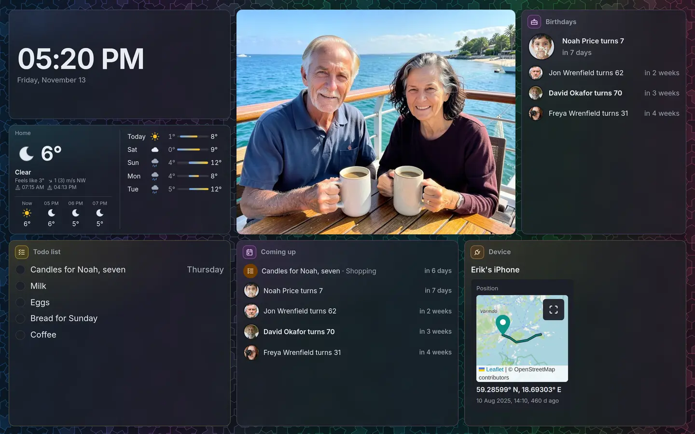

# Show a dashboard on a screen

A screen on the wall — a monitor by the front door, a tablet in the kitchen — shows a dashboard full
screen and never signs in. You give it a **display link**: a link that shows the dashboard as an
account sees it, so its todo lists, devices and birthdays are filled in, while whoever has the link
can change nothing. This page is for whoever sets up the screen; making the account is the
administrator's.



## An account for screens

A display link shows the dashboard, and anything else, as one account sees it. Rather than your
own, use an account made for screens, so a screen sees only what it should:

1. An administrator makes an account, such as **Kitchen display**, in **Settings → Accounts**; see
   [Accounts and groups](../admin/accounts.md). It needs no password anyone knows.
2. Put it in the groups whose things the screen shows, such as your household's group for its todo
   lists, and **devices** for the devices.
3. Take it out of the **Users** group: on the account, untick **Users** under **Groups**. Every
   account is in it, and it sees what is shared with everyone with an account, such as most albums
   and people. Left in, so does the screen. The share dialog says so when the account you choose
   is still in it.

A card showing something the account may not read, such as a device outside its groups, says so on
the screen instead.

A link never shows things as an administrator, nor as an account in the **admin**, **sudo** or
**ssh** groups, nor as a disabled one. Anyone may make a display link as their own account; only an
administrator makes one as another account.

## Make the display link

1. Open the dashboard and choose **Share**.
2. Under **Show it on a screen**, choose **Shows it as**: the account for screens. Choosing
   yourself warns that anyone with the link can read everything you can.
3. Choose how long it **Works for**. A screen wants **No end date**, which the dialog offers first.
4. Choose **Create link**, and copy the address.

The link's row then says "Shows it as Kitchen display sees it". A screen reads with the account's
groups as they were when it opened the link: after changing them, open the link on the screen again.
If the account is later disabled,
deleted or put in one of the groups above, the row says "Opens nothing" and why, and the screen
shows **This link no longer works**.

## Set up the screen

1. On the screen, open the link. It opens the dashboard full screen.
2. Make the link the browser's start page, so the screen comes back to it after a restart. A
   browser in kiosk mode, such as `chromium --kiosk <link>`, also hides its own toolbars.
3. To hide the browser without kiosk mode, move the pointer and choose **Fill the screen**.

What the screen does by itself:

- It stays on the dashboard: there is no sidebar, and the cards lead nowhere.
- It follows the dashboard: a card added or moved shows on it at once, and what the cards show is
  read again as it changes or every few minutes.
- Nobody has to scroll it: a card with more than fits shows its rows in turn, gliding by slowly.
- It loads itself again each night at about half past three, to take what an update of EiN brought.
- It stays signed in through its link for 30 days after it was last used; while it is on, that is
  for good. If it loses its session, it opens the link again by itself rather than asking to sign in.
- It is kept awake where the browser allows it. Browsers allow that only over HTTPS: over plain HTTP,
  turn off the screen's own sleep, or reach EiN over HTTPS; see
  [Ports, HTTPS and remote access](../admin/network.md).

How long a link's session lasts is the administrator's to change: **Share link session expiry** in
**Settings**, `CFG_LINK_SESSION_EXPIRES_SEC`.

## Turn it off

Choose **Delete link** in the dashboard's **Share** dialog. Every screen showing it goes to **This
link no longer works** at once. Deleting the account does the same for every link shown as it.

## From the terminal

```bash
# in EiN's terminal: a link shown as the account display, with no end date
share-link create '/archive/dashboards/Kitchen.yaml' --as display --never
share-link list '/archive/dashboards/Kitchen.yaml'
```
