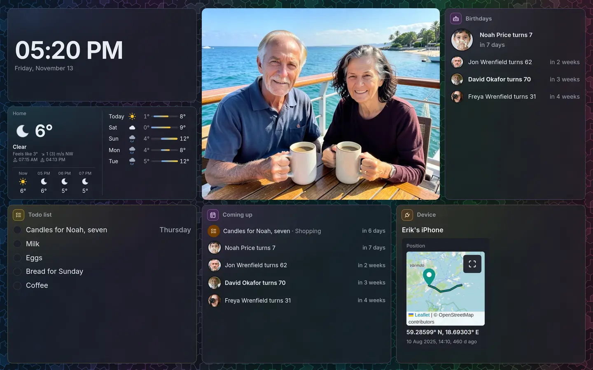

# Show a dashboard on a screen

A screen on the wall — a monitor by the front door, a tablet in the kitchen — shows a dashboard full
screen and never signs in. You give it a **display link**: a link that shows the dashboard as an
account sees it, so its todo lists, devices and birthdays are filled in, while whoever has the link
can change nothing. This page is for whoever sets up the screen; making the account is the
administrator's.



## An account for screens

A display link shows the dashboard, and anything else, as one account sees it. Rather than your
own, use an account made for screens, so a screen sees only what it should:

1. An administrator makes an account, such as **Kitchen display**, in **Settings → Users**; see
   [Accounts and groups](../admin/accounts.md). It needs no password anyone knows.
2. Put it in the groups whose things the screen shows, such as your household's group for its todo
   lists, and **devices** for the devices.
3. Take it out of the **Users** group: on the account, untick **Users** under **Groups**. Every
   account is in it, and it sees what is shared with everyone with an account, such as most albums
   and people. Left in, so does the screen. The share dialog says so when the account you choose
   is still in it.

A card showing something the account may not read, such as a device outside its groups, says so on
the screen instead.

A link never shows things as an administrator, nor as an account in the **admin**, **sudo** or
**ssh** groups, nor as a disabled one. Anyone may make a display link as their own account; only an
administrator makes one as another account.

## Make the display link

1. Open the dashboard and choose **Share**.
2. Under **Show it on a screen**, choose **Shows it as**: the account for screens. Choosing
   yourself warns that anyone with the link can read everything you can.
3. Choose how long it **Works for**. A screen wants **No end date**, which the dialog offers first.
4. Choose **Create link**, and copy the address.

The link's row then says "Shows it as Kitchen display sees it". A screen reads with the account's
groups as they were when it opened the link: after changing them, open the link on the screen again.
If the account is later disabled,
deleted or put in one of the groups above, the row says "Opens nothing" and why, and the screen
shows **This link no longer works**.

## Set up the screen

1. On the screen, open the link. It opens the dashboard full screen.
2. Make the link the browser's start page, so the screen comes back to it after a restart. A
   browser in kiosk mode, such as `chromium --kiosk <link>`, also hides its own toolbars.
3. To hide the browser without kiosk mode, move the pointer and choose **Fill the screen**.

What the screen does by itself:

- It stays on the dashboard: there is no sidebar, and the cards lead nowhere.
- It follows the dashboard: a card added or moved shows on it at once, and what the cards show is
  read again as it changes or every few minutes.
- Nobody has to scroll it: a card with more than fits shows its rows in turn, gliding by slowly.
- It loads itself again each night at about half past three, to take what an update of EiN brought.
- It stays signed in through its link for 30 days after it was last used; while it is on, that is
  for good. If it loses its session, it opens the link again by itself rather than asking to sign in.
- It is kept awake where the browser allows it. Browsers allow that only over HTTPS: over plain HTTP,
  turn off the screen's own sleep, or reach EiN over HTTPS; see
  [Ports, HTTPS and remote access](../admin/network.md).

How long a link's session lasts is the administrator's to change: **Share link session expiry** in
**Settings**, `CFG_LINK_SESSION_EXPIRES_SEC`.

## On a TV

A TV that plays video but runs no browser of its own — a Google Cast TV or Chromecast, a TV that
plays from the network (DLNA) — can still show a dashboard: the
[media service](../ems/index.md) opens it in a browser of its own, as you see it and changing
nothing, and makes live video of it. In EiN's terminal:

```bash
page-stream start /dashboard-wall/Kitchen
```

It answers the stream's id and where to play it: a path ending in `.mp4`, for a Cast device, the
same ending in `.ts`, for a DLNA TV, one ending in `screen.mp4`, the same video saying it lasts a
day, which Chrome hands a TV near it, and one ending in `index.m3u8`, a live HLS playlist, for a
player that takes HLS (Safari, VLC, an Apple TV). Put EiN's address in front, such as
`http://ein.local:8080/live/3f2a…9c.mp4`, and play it in anything that plays a stream from an
address. Anyone with the address can watch it, without signing in, until the stream stops.

- The video is a few seconds behind the dashboard, and a moving dashboard looks as it does in a
  browser, at 30 frames a second, 1920×1080 unless you give `--width`, `--height` or `--fps`.
- It stops by itself 20 seconds after the last one watching stops (`--idle` for longer), and
  `page-stream stop <id>` stops it at once. `page-stream list` lists yours.
- Each stream takes about two processor cores of the media service's machine while the page
  moves, and an encoder of its graphics card when it has one. Two run at once unless the
  administrator allows more (`EMS_PAGES`).

With the [Devices](../devices/index.md#play-on-a-speaker-or-a-screen) module there is no need
to: **Show on…** under the dashboard's **⋮** gives its wall to a Cast or DLNA screen, which streams it
as above and plays it until it is stopped, and `echo /dashboard-wall/Kitchen > /dev/living-room-tv/show`
does the same from the terminal.

Any other page can be streamed the same way, such as the slideshow of what a search finds:
`page-stream start '/slideshow?q=sailboat&slideshow=screen'`, the
[slideshow page](../archive/viewer.md#start-a-slideshow-from-a-link), which shows the slideshow
alone. The video carries the page's sound, such as a video's in the slideshow, and
`page-stream press <id> ArrowRight` presses a key in the page, as someone at it would: the slideshow
moves on. `page-stream state <id>` says what the page shows, where it says so, and `page-stream
message <id> '{"seek":80}'` moves the slideshow's video to 1:20.

### On a TV where your phone is

When you reach EiN over the internet, away from home, the cast icon, **Show on a screen near you**,
gives a TV where you are a dashboard's wall, an album's slideshow or the slideshow of what the
**Media** page found, from the header's corner after **Share** and **Edit** (beside **⋮** on a
phone), and the file open in the [viewer](../archive/viewer.md), from the bar under the picture, or
on a phone from the viewer's top right corner. EiN cannot see the TV in the room you are in, but
your browser can: EiN makes something the TV can fetch, and the browser hands its address to the TV
you choose in its own list of screens. The TV then fetches it from EiN, over the internet.

- A page goes as live video of it, with its sound: the media service makes it as above. An album's
  slideshow, or the **Media** page's, goes as the slideshow page, which starts at the first
  picture with nothing of the album's page before it. Chrome hands the TV the
  video that says it lasts a day, since it offers a TV nothing shorter than 15 seconds and, on a
  phone, no HLS; Safari hands it the HLS playlist.
- A recording or a video from the viewer goes as itself, as a Cast screen in the house is given it
  ([Play on a speaker or a screen](../devices/index.md#from-the-app)): a video that is not H.264
  within 1080p is made into H.264 by the media service while the TV plays it, and one whose length
  is not known cannot go. Its transcript goes with it, and the TV shows it as subtitles while the
  viewer's subtitles are on. EiN keeps the addresses working while your browser keeps the page
  open, and a few minutes after.
- A picture from the viewer goes as itself in Chrome; in Safari as the viewer showing it, as live
  video of that page.

- Chrome offers the Google Cast screens on the network you are on, and Safari the AirPlay ones.
  Firefox offers none, and the icon is not there.
- In Chrome, a tap on the icon opens Chrome's list of screens at once, and what you sent plays on
  the TV you choose a few seconds later. For this Chrome loads Google's Cast script, from Google,
  the first time you tap the icon, and then each time EiN opens in that browser, so that a page
  opened again finds the TV that plays and its controls. The TV stays connected until you stop it:
  whatever you send next goes to it without the list again. Chrome casts only from an address
  reached over HTTPS; elsewhere it works as Safari does.
- In Safari, a tap on the icon makes the video, the icon spinning meanwhile, and opens the browser's
  own list of screens as soon as the browser has found the TVs that can play it, which takes a few
  seconds at most; the list cannot open sooner, since before then the browser offers no TV. When
  that has not happened within five seconds of the tap, after which the browser no longer counts
  it, a dialog opens instead: **Choose the screen** there opens the list, saying **Looking for
  screens near you…** while the browser looks. If no TV takes it, the dialog says why.
- While a TV plays something, or Chrome is connected to one, a blue cast icon stands in the top bar,
  also after the page is opened again. It opens **Casting**, headed by what you sent and its name,
  such as **Album:** and the album's name, which takes you back to it. Below are the controls: for
  a recording or a video play and pause, **Back 10 seconds**, **Forward 30 seconds** and how far it
  has come; for a slideshow a card with what it shows now, the picture or video with its name and
  where it is (**3 of 31**), and **Previous**, **Pause or play** and **Next**, which move and hold
  the slideshow itself, as its keys do, and show on the TV a few seconds later; while the slideshow
  plays a video or a recording, a slider of its length with where it is, and **Back 10 seconds**
  and **Forward 10 seconds**, which a picture has not. **Stop casting**, at the bottom, stops the TV.
  Close them and the TV plays on. Opened from something else, such as the next picture in the
  viewer, they offer to show that instead. While Chrome holds a TV that plays nothing from here,
  they offer **Disconnect**.
- In the [viewer](../archive/viewer.md), the cast icon is blue while a TV plays or is connected. A
  recording or a video the TV plays plays on the phone too, in step with the TV and without sound, with the
  faces and subtitles over it as you have them; its controls play, pause and move the TV's, and it shows the TV loading while the TV loads after a move. In
  Chrome, while it is connected to a TV, the recording, video or picture the viewer opens on or
  moves to goes to the TV and starts at once, unless the TV shows a page, such as a dashboard's
  wall. In Safari, nothing in the viewer
  starts by itself while the TV plays anything, and play on another recording or video gives the
  TV that one instead; where the browser lets the TV go with the old one, its list of screens
  opens to choose it again.
- A video no TV has taken is let go a minute after you close the dialog.
- The TV reaches EiN at the address you opened it at, so EiN must be reachable from the internet
  over HTTPS ([Reach EiN from outside your home](../admin/network.md#reach-ein-from-outside-your-home)),
  and the video takes some of the upload of EiN's own connection while the TV plays it.
- Chrome offers a screen nothing shorter than 15 seconds: for a shorter recording or video the
  dialog says so.
- Keep EiN open on the phone while the TV plays: Chrome on Android pauses the TV when you leave the
  page or the screen locks, and it plays on when you come back. A page's stream waits five minutes
  for that.
- **Stop** in the dialog, the TV's own remote or the browser's list of screens stops it and lets the
  TV go. A page's stream stops by itself five minutes after the TV stops reading it.

For a page it is there when the [media service](../ems/index.md) is installed, which names
`page-stream start` as the setting `CFG_PAGE_STREAMER`; `stream-page <route>` does the same from
the terminal. The slideshow's controls press keys in the page, ask it what it shows and move its
video, by the command the setting `CFG_PAGE_CONTROL` names, `page-stream`; `stream-page --press <id>
<key>`, `--state <id>` and `--message <id> <json>` do the same. For a recording or a video it is there when the [Devices](../devices/index.md) module
is installed, which names `devices-nearby` as the setting `CFG_FILE_STREAMER`; `stream-file <path>`
answers the address, `stream-file --renew <id>` keeps it five minutes more and `stream-file --stop
<id>` lets go of it.

## Turn it off

Choose **Delete link** in the dashboard's **Share** dialog. Every screen showing it goes to **This
link no longer works** at once. Deleting the account does the same for every link shown as it.

## From the terminal

```bash
# in EiN's terminal: a link shown as the account display, with no end date
share-link create '/archive/dashboards/Kitchen.yaml' --as display --never
share-link list '/archive/dashboards/Kitchen.yaml'
```
