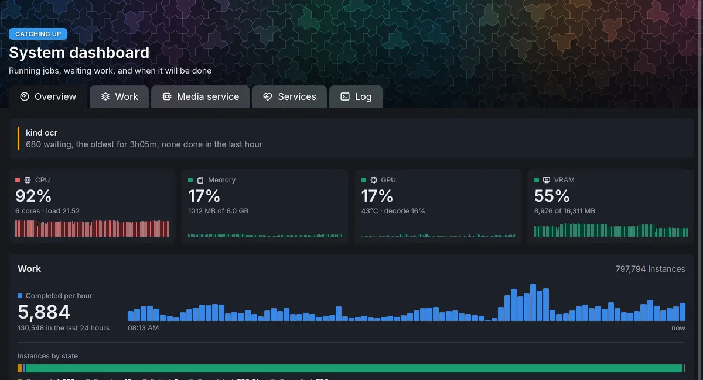

# The media service

The media service, EMS, holds every media tool and model the Archive uses: it reads metadata, makes
thumbnails and video renditions, finds faces, voices and text, transcribes speech and makes pictures
searchable. This section applies once the [Archive](../archive/index.md) is installed, and this page
is for the administrator who installs the media service, watches it and tunes it.

## Two parts

The media service comes in two parts, installed in different ways:

- **The `ems` module**, EiN's side of it: the client the Archive calls the media service through,
  its health on the **Dashboard**, with the **Media service** tab and the graphics card's readings,
  and `ems-text-embed`, which turns text into vectors so that things can be found by meaning.
  Installing the `archive` module installs the `ems` module with it ([Modules](../admin/modules.md)).
- **The media service itself**, the `ems` container that runs beside EiN. The installer's `--ems`
  adds it ([Add the media service](#add-the-media-service)); the module does not.

The Archive needs both: without them, nothing it takes in gets thumbnails, dates, faces or
searchable text. Without the Archive they have nothing to do. The one other use of them is the
assistant's command search, which with their text vectors finds commands by meaning
([Find the command you need](../shell/terminal.md#find-the-command-you-need)).

## What the media service does

EiN itself runs no media tool. Whenever a file needs looking at, EiN sends the media service a
request naming the file, and the media service answers or writes the result where EiN asked. It
keeps no data of its own and knows nothing of the tree: it reads the files EiN stores, and nothing
else.

| Work                                                | What you see in EiN                                              |
| --------------------------------------------------- | ---------------------------------------------------------------- |
| Reading dates, places, cameras and codecs           | Dates and places on pictures; staging can group files            |
| Thumbnails, picture sizes, posters and waveforms    | Pictures, videos and recordings show in the grids and the viewer |
| Video and audio renditions (AV1 video, AAC audio)   | Videos and recordings play in the browser                        |
| Faces, voices and who is speaking                   | [People and faces](../archive/people.md)                         |
| Transcripts and language detection                  | What is said in videos and recordings, searchable                |
| Text in pictures and handwriting, text in documents | Text found in photographed pages, letters and PDFs, searchable   |
| Picture and text vectors                            | Finding pictures by what they show, and text by meaning          |
| Fingerprints and copy detection                     | [Duplicates](../archive/duplicates.md)                           |
| Shot boundaries                                     | Chapters in a video                                              |

The media service generates no text. The chat belongs to the assistant's
[language model](../assistant/language-model.md), and no processing step depends on it.

## What happens without it

With the Archive installed and no media service, EiN still takes in, keeps and shares what you
upload, but nothing new is read:

- Uploads wait in staging as **being prepared**.
- New files get no metadata, thumbnails, faces, transcripts or search vectors.
- The **Dashboard** shows the warning `http://ems:8181 is not answering; work that needs it waits`
  on its **Overview** tab. A warning does not stop **Healthy**.

None of this work is lost. Each step that needs the media service waits without using up its
retries, and runs once the media service answers again.

## Models and their licences

EiN's own code, the media service's included, is under the MIT licence. The media service's image
also downloads and carries models and tools made by others, each under its own licence, and some
of those licences forbid commercial use. An installation used commercially must check them, or go
without the features that rest on them ([Using EiN commercially](#using-ein-commercially)). This is
what the image carries, all of it used by the Archive:

| What it does in EiN                                 | Model or tool                                                                                                                                                                                                                           | Licence: code / weights                                                                                             | Note                                                                                                                           |
| --------------------------------------------------- | --------------------------------------------------------------------------------------------------------------------------------------------------------------------------------------------------------------------------------------- | ------------------------------------------------------------------------------------------------------------------- | ------------------------------------------------------------------------------------------------------------------------------ |
| Faces in pictures and videos                        | [InsightFace](https://github.com/deepinsight/insightface/tree/master/python-package) `buffalo_l`                                                                                                                                        | [MIT](https://github.com/deepinsight/insightface/tree/master/python-package#license) / non-commercial research only | **Non-commercial**                                                                                                             |
| Transcripts                                         | [Whisper](https://github.com/openai/whisper#license) `large-v3`, as [faster-whisper](https://github.com/SYSTRAN/faster-whisper/blob/master/LICENSE) runs [it](https://huggingface.co/Systran/faster-whisper-large-v3)                   | MIT / MIT                                                                                                           |                                                                                                                                |
| Where speech is, for transcripts                    | [Silero VAD](https://github.com/snakers4/silero-vad/blob/master/LICENSE)                                                                                                                                                                | MIT / MIT                                                                                                           |                                                                                                                                |
| Who is speaking when                                | NVIDIA [Streaming Sortformer](https://huggingface.co/nvidia/diar_streaming_sortformer_4spk-v2#licence) `diar_streaming_sortformer_4spk-v2` at commit `84edd514b8`, run by [NeMo](https://github.com/NVIDIA-NeMo/NeMo/blob/main/LICENSE) | Apache-2.0 / [CC BY 4.0][cc-by]                                                                                     | Attribution                                                                                                                    |
| Voiceprints, to tie a voice to a person             | NVIDIA [TitaNet large](https://huggingface.co/nvidia/speakerverification_en_titanet_large#licence) at commit `0dc382f401`, run by NeMo                                                                                                  | Apache-2.0 / [CC BY 4.0][cc-by]                                                                                     | Attribution                                                                                                                    |
| The face seen speaking                              | [LR-ASD](https://github.com/Junhua-Liao/LR-ASD/blob/main/LICENSE), its TalkSet weights                                                                                                                                                  | MIT / MIT, in the same repository                                                                                   |                                                                                                                                |
| Picture vectors: finding pictures by what they show | Google's [SigLIP 2 So400m/16-384](https://huggingface.co/google/siglip2-so400m-patch16-384), as [Immich exports it](https://huggingface.co/immich-app/ViT-SO400M-16-SigLIP2-384__webli)                                                 | — / [Apache-2.0][apache]                                                                                            | Immich's export states no licence of its own                                                                                   |
| Text vectors: finding text by meaning               | [jina-embeddings-v5-text-small](https://huggingface.co/jinaai/jina-embeddings-v5-text-small#license), built on [Qwen3-0.6B-Base](https://huggingface.co/Qwen/Qwen3-0.6B-Base) ([Apache-2.0][apache])                                    | — / [CC BY-NC 4.0][cc-by-nc]                                                                                        | **Non-commercial**; Jina AI licenses it for commercial use                                                                     |
| Text in pictures                                    | [PP-OCRv6](https://github.com/PaddlePaddle/PaddleOCR/blob/main/LICENSE), run by [RapidOCR](https://github.com/RapidAI/RapidOCR/blob/main/LICENSE)                                                                                       | Apache-2.0 / [Apache-2.0][apache]                                                                                   |                                                                                                                                |
| Handwriting in Swedish and Finnish                  | The National Archives of Finland's [multicentury-ppocrv6-medium](https://huggingface.co/Kansallisarkisto/multicentury-ppocrv6-medium) and [multicentury-htr-model](https://huggingface.co/Kansallisarkisto/multicentury-htr-model)      | — / [Apache-2.0][apache]                                                                                            | The second is fine-tuned from Microsoft's TrOCR below                                                                          |
| Handwriting in English                              | Microsoft's [TrOCR large handwritten](https://huggingface.co/microsoft/trocr-large-handwritten)                                                                                                                                         | [MIT](https://github.com/microsoft/unilm/blob/master/LICENSE) / not stated                                          | Trained on the [IAM database](https://fki.tic.heia-fr.ch/databases/iam-handwriting-database), for non-commercial research only |
| The language of read text                           | [Lingua](https://github.com/pemistahl/lingua-py/blob/main/LICENSE.txt)                                                                                                                                                                  | [Apache-2.0][apache], its models included                                                                           |                                                                                                                                |
| Copies of pictures and videos                       | Meta's [SSCD](https://github.com/facebookresearch/sscd-copy-detection#license) `sscd_disc_mixup`                                                                                                                                        | MIT / not stated                                                                                                    |                                                                                                                                |
| Copies of recordings                                | [Chromaprint](https://github.com/acoustid/chromaprint/blob/master/LICENSE.md)                                                                                                                                                           | LGPL-2.1 as a whole; its own code MIT                                                                               |                                                                                                                                |
| Shot boundaries: chapters in a video                | [TransNetV2](https://github.com/soCzech/TransNetV2/blob/master/LICENSE), its weights [converted to PyTorch](https://huggingface.co/Sn4kehead/TransNetV2)                                                                                | MIT / [Apache-2.0][apache]                                                                                          | The authors' own weights are in their MIT repository                                                                           |
| Video and audio: renditions, stills, waveforms      | [FFmpeg](https://github.com/BtbN/FFmpeg-Builds#package-list) 9.0, BtbN's `gpl` build                                                                                                                                                    | GPL-3.0, as built                                                                                                   | Debian's own FFmpeg is in the image too                                                                                        |
| Pictures: turning, sizes, AVIF                      | [ImageMagick](https://imagemagick.org/license/) with [libheif](https://github.com/strukturag/libheif/blob/master/COPYING) and [aom](https://aomedia.googlesource.com/aom/+/refs/heads/main/LICENSE)                                     | ImageMagick License; LGPL-3.0; BSD-2-Clause                                                                         |                                                                                                                                |
| Dates, places, cameras: metadata                    | [ExifTool](https://exiftool.org/#license)                                                                                                                                                                                               | The same terms as Perl: Artistic or GPL                                                                             |                                                                                                                                |
| Camera RAW files                                    | [rawpy](https://github.com/letmaik/rawpy/blob/main/LICENSE) with [LibRaw](https://github.com/LibRaw/LibRaw#licensing)                                                                                                                   | MIT; LGPL-2.1 or CDDL-1.0                                                                                           |                                                                                                                                |
| Pictures for the models, HEIC included              | [Pillow](https://github.com/python-pillow/Pillow/blob/main/LICENSE) and [pillow-heif](https://github.com/bigcat88/pillow_heif#readme)                                                                                                   | MIT-CMU; BSD-3-Clause                                                                                               | pillow-heif's binary wheels are GPL-2.0, as they bundle x265                                                                   |
| Text of PDF files                                   | [PyMuPDF](https://github.com/pymupdf/PyMuPDF/blob/main/COPYING)                                                                                                                                                                         | AGPL-3.0                                                                                                            |                                                                                                                                |
| Text of Word and OpenDocument files                 | [python-docx](https://github.com/python-openxml/python-docx/blob/master/LICENSE) and [odfpy](https://github.com/eea/odfpy#redistribution-license)                                                                                       | MIT; GPL-2.0 or later, or Apache-2.0                                                                                |                                                                                                                                |

[cc-by]: https://creativecommons.org/licenses/by/4.0/legalcode
[cc-by-nc]: https://creativecommons.org/licenses/by-nc/4.0/legalcode
[apache]: https://www.apache.org/licenses/LICENSE-2.0

In the licence column, code comes before weights where a model has both; `—` means the media
service runs the weights with no code of the model's own, through the libraries the models run on.
These are under permissive licences: [PyTorch](https://github.com/pytorch/pytorch/blob/main/LICENSE)
under a BSD-style licence, [ONNX Runtime](https://github.com/microsoft/onnxruntime/blob/main/LICENSE)
and [CTranslate2](https://github.com/OpenNMT/CTranslate2/blob/master/LICENSE) under MIT, and
[transformers](https://github.com/huggingface/transformers/blob/main/LICENSE),
[sentence-transformers](https://github.com/huggingface/sentence-transformers/blob/master/LICENSE)
and [OpenCV](https://github.com/opencv/opencv/blob/4.x/LICENSE) under Apache-2.0.

The image passes each model's weights on unmodified: as their maker publishes them or, where the
table names an export or a conversion, as the one who made it publishes it. They come as is,
without warranties, as their licences say. Beside them, the image writes out two files derived
from published ones: the Finnish handwriting recogniser's character list, and TrOCR's tokenizer in
the format transformers reads. The image's `/usr/share/doc/ein-ems/NOTICE.md` points
to this page, names the models under Creative Commons and Apache-2.0, links the Creative Commons
licences and holds the text of Apache-2.0.

### Using EiN commercially

Three features rest on models whose terms allow no commercial use:

- **Faces**, in pictures and in videos, and with them the face seen speaking, since LR-ASD reads
  the faces InsightFace finds: InsightFace's models are for non-commercial research only.
- **Finding text by meaning**, in transcripts, read text and documents, and the assistant's
  command search: jina-embeddings-v5-text-small is under CC BY-NC 4.0.
- **English handwriting**: TrOCR large handwritten states no licence, and it is trained on the IAM
  database, whose terms allow non-commercial research only. The National Archives of Finland's
  transcriber, under Apache-2.0, is fine-tuned from it.

No setting turns one of these features off, in EiN or in the media service: with the media service
there, the Archive asks it for all of them. The one way to go without them is to go without the
media service, with `./setup.sh --no-ems`, and so without everything in
[What the media service does](#what-the-media-service-does). The assistant's command search alone
can leave the text vectors out: with [`CFG_TEXT_EMBEDDER`](../reference/settings.md#cfg_text_embedder)
empty, it matches words instead.

Other licences in the table set conditions on passing a model or tool on: CC BY 4.0 and CC BY-NC
4.0 a credit to its maker and a link to the licence, Apache-2.0 a copy of the licence, which this
page and the image's notice give; GPL, LGPL and AGPL conditions on passing the software and its
source on. Check each licence for what it asks of your installation.

## Add the media service

The installer adds it with `--ems`, at the first install or any time after:

1. On the machine EiN runs on, run:

   ```bash
   # on the machine EiN runs on, in ~/ein
   ./setup.sh --ems
   ```

   With the Archive not installed yet, add it in the same run: `./setup.sh --ems --module archive`
   installs the media service, and the Archive with the `ems` module at EiN's start.

2. Wait for the download. The first time, `setup.sh` prints
   `== Getting the images (the media service the first time: about 30 GB)`: the image carries
   every model, and downloading it takes a while and about 30 GB of disk. Installed from your own
   source, it is built on the machine instead, which takes about an hour more. [Install EiN](../start/install.md#what-you-need)
   lists what the machine needs with the media service.
3. `setup.sh` starts the containers and prints `EiN is up at http://…:8080/` once EiN answers.
4. Open **Dashboard** under **System** in the sidebar, and choose the **Media service** tab. For the
   first minutes the media service loads its models; the tab then shows the **healthy** badge.

`--ems` writes `EIN_EMS=1` to `~/ein/.env`, so a later `./setup.sh` keeps it. When `setup.sh` found
an NVIDIA card with its CDI spec at the first install (`EIN_GPU=1`), the media service gets the card;
[The graphics card](gpu.md) explains how.

To leave the media service out again, run `./setup.sh --no-ems`. Its container stops and is
removed; your files and everything already made from them stay.

## How EiN reaches it

In the standard install, both containers run on the same machine and only EiN talks to the media
service, on the compose network. Nothing outside the machine reaches it. Three things connect
them, all set up by `setup.sh`:

| What        | Where it is set                                                                           | Value                            |
| ----------- | ----------------------------------------------------------------------------------------- | -------------------------------- |
| The address | `CFG_EMS_URL` for EiN, in `compose.yaml`                                                  | `http://ems:8181`                |
| The key     | `EMS_KEY` in `.env`, made at the install; EiN gets it as `CFG_EMS_KEY`                    | 48 random hexadecimal characters |
| The folders | The same four folders under the data folder, mounted at the same paths in both containers | see below                        |

| Path in both containers | What it holds   | The media service may |
| ----------------------- | --------------- | --------------------- |
| `/files`                | your originals  | read                  |
| `/old`                  | older originals | read                  |
| `/files-volatile`       | the renditions  | read and write        |
| `/files-tmp`            | scratch space   | read and write        |

Because a path means the same file on both sides, nothing is ever copied between them, and the
media service can never change an original. It refuses any path outside these four.

The key is a secret: no shell in EiN sees it, and the settings page never shows it once it is set.
The media service accepts a request only with that key. Leave `CFG_EMS_URL`, `EMS_KEY`, `EMS_PORT`
and `EMS_ROOTS` as `setup.sh` and the compose files set them; [Configuration](../admin/configuration.md)
explains how a value set in the deployment relates to the settings page.

## Check that it is running

### On the dashboard

Open **Dashboard** under **System** and choose the **Media service** tab. It asks the media service
how it is, again and again, while the tab is open.

- **Media service**: a badge, **healthy**, **degraded** or **model worker down**, and the facts:
  **version**, **commit**, **api**, **uptime**, **batch worker** and **query worker** (`up`, or `down`,
  with `×` and the number of restarts), **card**, **driver** and **url**.
- **Graphics card mode**, when there is a card: who has the card now (see
  [The graphics card](#the-graphics-card) below).
- An orange box for each degradation, such as `gpu degraded`, and a yellow one for each warning.
- **Graphics card memory**: the card's memory split by process, the media service's workers and
  everything **outside EMS**, and what is free; **GPU load**, **Batch worker RAM** and **Query worker RAM**.
- **Models**: every model the media service can load, loaded or not, with **Status** (for example
  **GPU loaded** or **CPU loading**), **Loaded**, **Last used**, **Size** and **Activity**. Hover a
  model's name for what it does. The heading counts them: for example `3 of 15 loaded · 2 on the GPU`.
- **Executing**: the requests running or waiting now, and the three lanes they go through, **models**,
  **tools** and **encodes**, each with how many run at once.

When the media service does not answer, the tab shows only **The media service is not answering**,
with the address it tried.

The **Overview** tab shows **GPU** and **VRAM** tiles beside the computer's own CPU and memory when
the media service has a card. With no card, or no media service, they are not there.



**About EiN** in the account menu also has a **Media service** tile: its version, the API it speaks,
its commit, how long it has been up and the card it runs on, or **Not answering**.

### The health checks

The dashboard's verdict and the [`health`](../reference/commands-core.md#health) command read these
checks about the media service:

| Check        | State | When                                                                       |
| ------------ | ----- | -------------------------------------------------------------------------- |
| `ems`        | ok    | It answers: `EMS <commit> answering, up <time>`                            |
| `ems`        | warn  | It does not answer: `<address> is not answering; work that needs it waits` |
| `ems worker` | warn  | `the model worker is down; EMS starts it again`                            |
| `ems gpu`    | fail  | The card is meant to be there and is not, or the card stopped working      |
| `ems card`   | ok    | Who has the card, `busy` or `quiet`, and which search models are on it     |

Only `ems gpu` fails, and a failed check turns the verdict to **Needs a person**. The others are
warnings: while the media service restarts or loads its models, the work that needs it waits.

### In the terminal

[`ems-status`](commands.md#ems-status) prints the whole answer the dashboard
draws, and its options shorten it:

```bash
# in EiN's terminal
ems-status            # everything: version, models, requests, card, memory
ems-status --brief    # one line, degradations first
ems-status --checks   # the checks above
ems-gpu               # the card now, with the last six hours
```

```text
ok    ems  EMS 3f9a2c1 answering, up 2.4h
ok    ems card  quiet, search on it: text-query, siglip-text
```

[`service-list --detail`](../reference/commands-core.md#service-list) shows the same one line as
`ems-status --brief` beside the `ems-link` service. When the media service does not answer,
`ems-status` says `ems-status: http://ems:8181 is not answering` and exits with 1.

### On the machine

The media service is the `ems` service of compose:

```bash
# on the machine EiN runs on, in ~/ein
podman compose ps ems          # or docker compose
podman compose logs -f ems     # what it says, as it says it
podman compose restart ems
```

Compose checks it every 30 seconds, and gives it 120 seconds to start before a failed check counts.

## The graphics card

The media service uses an NVIDIA card when it has one, and the CPU otherwise. Without a card every
model and every encoder still runs, only more slowly. Where each
model runs is the media service's own decision, made each time it loads one; it changes how fast an
answer comes, never what it is. A model that does not fit on the card runs on the CPU, except transcription and the Swedish
and Finnish handwriting reader, which wait for room on the card. To make room, the media service unloads the models used
longest ago first, and only as many as it needs.

With a card, the media service hands the card between indexing and search, and **Graphics card
mode** on the **Media service** tab shows which has it:

| Mode          | What it means                                                                                           |
| ------------- | ------------------------------------------------------------------------------------------------------- |
| **busy**      | Indexing has the graphics card and search runs on the CPU, until no indexing work has come for a while. |
| **quiet**     | No indexing work, so its models are unloaded and search runs on the graphics card, as far as it fits.   |
| **switching** | Handing the graphics card over between indexing and search.                                             |
| **off**       | No graphics card to share: every model runs where its setting says.                                     |

When the mode is off, which `EMS_CARD_QUIET_AFTER=0` makes it too, the tab leaves **Graphics card mode** out.

It turns **quiet** after 600 seconds without indexing work (`EMS_CARD_QUIET_AFTER`). A search never
waits for the card: a separate model process answers searches on the CPU throughout.

[The graphics card](gpu.md) covers preparing the machine, checking that every model really runs on
the card, [sharing the card with the language model](gpu.md#share-one-card-with-the-language-model)
and [being told when the card goes missing](gpu.md#be-told-when-the-card-goes-missing).

## Change how it works

The media service is configured by its environment alone. `~/ein/.env` is that environment, so an
`EMS_` line there reaches it:

1. Add or change the line in `~/ein/.env`:

   ```ini
   # in ~/ein/.env
   EMS_WHISPER_LANGUAGES=sv,en
   ```

2. Apply it:

   ```bash
   # on the machine EiN runs on, in ~/ein
   podman compose up -d
   ```

   Under podman-compose, a container that `podman compose up -d` makes again has no swap limit, so
   the media service's idle models may go to swap and a search waits for them; `./setup.sh` makes
   the containers again with the limit.

Any change restarts the media service, and EiN with it, since both read `.env`. Requests in flight fail and are retried; see
[When the media service restarts](#when-the-media-service-restarts).

These are the settings an administrator is most likely to need:

| Setting                   | Default                       | What it does                                                                                                                                                                                                                                   |
| ------------------------- | ----------------------------- | ---------------------------------------------------------------------------------------------------------------------------------------------------------------------------------------------------------------------------------------------- |
| `EMS_MEMORY`              | `16g`                         | The most memory the container may use. Compose reads it, not the media service.                                                                                                                                                                |
| `EMS_WHISPER_LANGUAGES`   | empty                         | The languages spoken in your recordings, as codes separated by commas, the most common first. Detection is biased towards them; empty lets detection alone decide.                                                                             |
| `EMS_WHISPER_LANGUAGE`    | empty                         | One language every recording is transcribed as; detection never runs. Right only when every recording is in that language.                                                                                                                     |
| `EMS_EXPECT_GPU`          | empty                         | `1`: the machine is meant to have a card, and the `ems gpu` check fails when none is visible.                                                                                                                                                  |
| `EMS_CARD_SHARE_MB`       | `0`                           | The most of the card the media service holds, in MB, for a card shared with the language model; `0` is all of it.                                                                                                                              |
| `EMS_CARD_QUIET_AFTER`    | `600`                         | Seconds without indexing work before search gets the card; `0` keeps search on the CPU.                                                                                                                                                        |
| `EMS_MODEL_IDLE_EVICT`    | `21600`                       | Seconds a model may sit unused before it is unloaded.                                                                                                                                                                                          |
| `EMS_MODEL_PINNED`        | `text-query`                  | Models loaded at start and never unloaded, separated by commas. The search models, `text-query` and `siglip-text`, are pinned in the query worker whatever this says, and only there, so the default pins nothing unless `EMS_QUERY_WORKER=0`. |
| `EMS_MODEL_MAX_RSS`       | 0.6 of the container's memory | The batch worker's memory ceiling, such as `10g`. At the ceiling the worker finishes its requests and starts again; `0` turns the ceiling off.                                                                                                 |
| `EMS_LIMIT_MODELS`        | `8`                           | Model requests admitted at once.                                                                                                                                                                                                               |
| `EMS_LIMIT_TOOLS`         | `4`                           | Tool requests at once: metadata, thumbnails, fingerprints, document text. Each tool uses one core, so this is a number of cores.                                                                                                               |
| `EMS_LIMIT_ENCODES`       | `2`                           | Transcodes and other whole-file decodes at once.                                                                                                                                                                                               |
| `EMS_QUEUE_DEPTH`         | `64`                          | Requests that may wait before a new one is answered `busy`.                                                                                                                                                                                    |
| `EMS_INTERACTIVE_RESERVE` | `1`                           | Slots more for a request a person is waiting on, so a person never waits behind indexing.                                                                                                                                                      |
| `EMS_VIDEO_ENCODER`       | empty                         | The video encoder: empty picks `av1_nvenc` on a card that offers it and `libsvtav1` otherwise.                                                                                                                                                 |
| `EMS_CPU_ENCODE_MAX_MB`   | `4000`                        | Memory one video decode on the CPU may grow to. A long video is encoded in pieces within it; one that cannot be is refused. `0` turns the CPU encode off.                                                                                      |
| `EMS_TOOL_STALL`          | `900`                         | Seconds a tool may go without using the CPU or moving a byte before it is stopped as stuck. Not a limit on how long it may take.                                                                                                               |

> [!WARNING]
> Leave `EMS_WHISPER_MODEL` as it is (`large-v3`). It must match the model built into the image;
> another name makes the first transcription download one, or fail without a network.

A change to the transcription settings changes what EMS reports as its transcript settings. With
**Keep transcripts current** ([`CFG_MEDIA_TRANSCRIPTS_CURRENT`](../reference/settings.md#cfg_media_transcripts_current))
left on, the Archive then transcribes every video and recording again in the background, behind new
media. On a large archive that is hours of work.

### Settings on EiN's side

EiN's own settings for the media service are in the **Media service** and **Transcription** groups
of **Settings → System**, with `CFG_MODEL_SLOTS`, the Archive's, in **Processing**. All can be set
with `config set`:

| Setting                                                                                     | Default                                                     | What it does                                                                            |
| ------------------------------------------------------------------------------------------- | ----------------------------------------------------------- | --------------------------------------------------------------------------------------- |
| [`CFG_EMS_URL`](../reference/settings.md#cfg_ems_url)                                       | `http://127.0.0.1:8181`; the install sets `http://ems:8181` | Where the media service answers                                                         |
| [`CFG_EMS_KEY`](../reference/settings.md#cfg_ems_key)                                       | none; the install sets it                                   | The key the media service expects                                                       |
| [`CFG_EMS_CONNECT_RETRY`](../reference/settings.md#cfg_ems_connect_retry)                   | `90`                                                        | Seconds a background request keeps retrying while the media service refuses connections |
| [`CFG_EMS_LINK_INTERVAL_SECONDS`](../reference/settings.md#cfg_ems_link_interval_seconds)   | `60`                                                        | How often `ems-link` asks whether the media service answers                             |
| [`CFG_WHISPER_LANGUAGE`](../reference/settings.md#cfg_whisper_language)                     | empty                                                       | A language sent with every transcription; empty lets the media service decide           |
| [`CFG_WHISPER_VAD_MIN_SILENCE_MS`](../reference/settings.md#cfg_whisper_vad_min_silence_ms) | empty                                                       | The pause that ends a stretch of speech                                                 |
| [`CFG_WHISPER_WORD_TIMESTAMPS`](../reference/settings.md#cfg_whisper_word_timestamps)       | empty                                                       | `1` for the time of every word, `0` for timings per segment                             |
| [`CFG_MODEL_SLOTS`](../reference/settings.md#cfg_model_slots)                               | `2`                                                         | Model requests the Archive keeps in flight against the media service at once            |

For the languages of a family archive, prefer `EMS_WHISPER_LANGUAGES` in `.env` to
`CFG_WHISPER_LANGUAGE`: the first biases detection, so a holiday clip in English is still
transcribed as English; the second forces one language on everything. [Processing pictures](../archive/processing.md#how-much-runs-at-once) explains `CFG_MODEL_SLOTS` and the other slots.

## When the media service restarts

A restart takes tens of seconds, longer when models load. Meanwhile:

- A background request that finds the connection refused tries again for up to
  `CFG_EMS_CONNECT_RETRY` seconds (90) before the step gives up for now.
- A step that cannot reach the media service, finds it `busy`, or finds a model still loading waits
  without using up an attempt, and runs again later.
- A request a person is waiting on, such as a search, does not wait: it fails at once.
- The `ems-link` service writes each change to its log, such as
  `ems-link: down — not answering` and `ems-link: up — …`.

When the media service comes back with a different build, `ems-link` runs every failed pipeline
instance again at once, since a new build is the likeliest fix for what failed under the old one.
It logs `ems-link: EMS <old> -> <new>; failed work runs again: …`. [Services and logs](../admin/services-logs.md) shows how to read that log.

## Update the media service

`./setup.sh` without options downloads the newest images of EiN and of each service it runs, the
media service included, and starts them again. Only the layers that changed are downloaded. [Updating](../admin/updating.md) has the
whole procedure.

## When something goes differently

**The Media service tab says The media service is not answering.** Look at the container:
`podman compose ps ems`. If it is not running, `podman compose logs ems` says why; start it with
`podman compose up -d`. If `.env` has `EIN_EMS=0`, the media service is not installed: run
`./setup.sh --ems`.

**It answers, but the badge says model worker down.** The model process stopped; the media service
starts it again by itself. If it keeps stopping, the count after `×` beside **batch worker** climbs:
`podman compose logs ems` says why. When it ran out of memory, give the container more with
`EMS_MEMORY` in `.env`.

**`gpu degraded` and the verdict is Needs a person.** The card the machine should have is not
visible to the media service, or its context was lost. A reboot that renumbers the cards is the
usual cause; [The graphics card](gpu.md) has the fix.

**A warning `no keys configured: authentication is off`.** The media service got no key. Check that
`EMS_KEY` is in `~/ein/.env`, and run `podman compose up -d`.

**A warning `no roots configured: every file request will be refused`.** `EMS_ROOTS` is empty. It
is set in `compose.ems.yaml`; undo a change to that file with `git -C ~/ein checkout compose.ems.yaml`
and run `podman compose up -d`.

**Uploads stay being prepared for a long time.** Look at **Executing** on the **Media service** tab.
Requests waiting in the lanes mean the media service is busy: after a large import, the **Dashboard**
reads **Catching up** until the work is done. With a card, a model shown as **CPU loaded** is several
times slower than on the card; see [Performance and sizing](../admin/performance.md).

**The first transcription or face search after a quiet spell is slow.** Models are unloaded after
`EMS_MODEL_IDLE_EVICT` seconds unused, and loading one again takes tens of seconds. The **Models**
table shows it as loading.

**The download or the build fails, or the disk fills.** The media service's image is about 30 GB,
and podman downloads or builds it in a folder beside its own storage, not in `/tmp`. Free space there and run `./setup.sh` again.

[Troubleshooting](../admin/troubleshooting.md) covers problems that are not the media service's own.

## Related pages

- [The Archive](../archive/index.md)
- [The graphics card](gpu.md)
- [Installing in detail](../admin/install.md)
- [Configuration](../admin/configuration.md)
- [Health and the dashboard](../admin/monitoring.md)
- [Processing and pipelines](../admin/processing.md)
- [Performance and sizing](../admin/performance.md)
- [Media service commands](commands.md)
- [Settings](../reference/settings.md#media-service)
