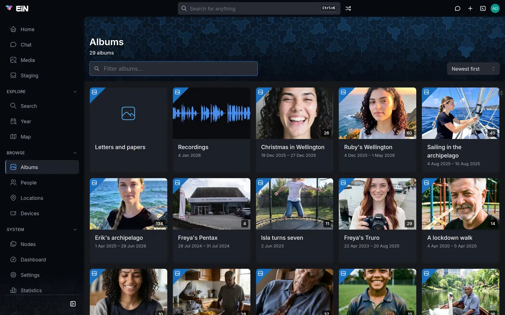
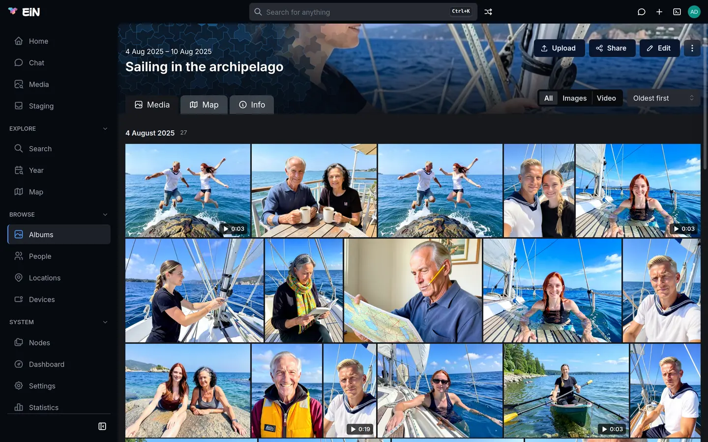
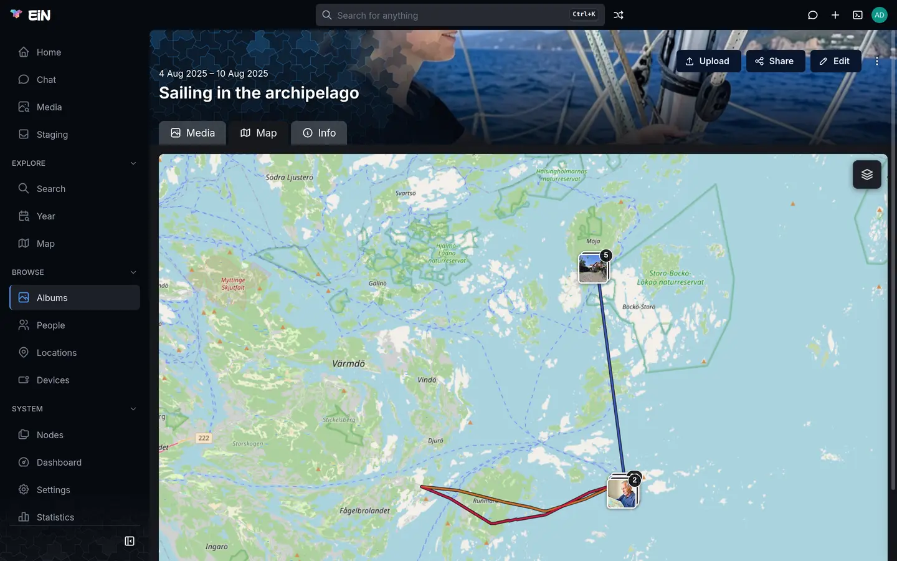
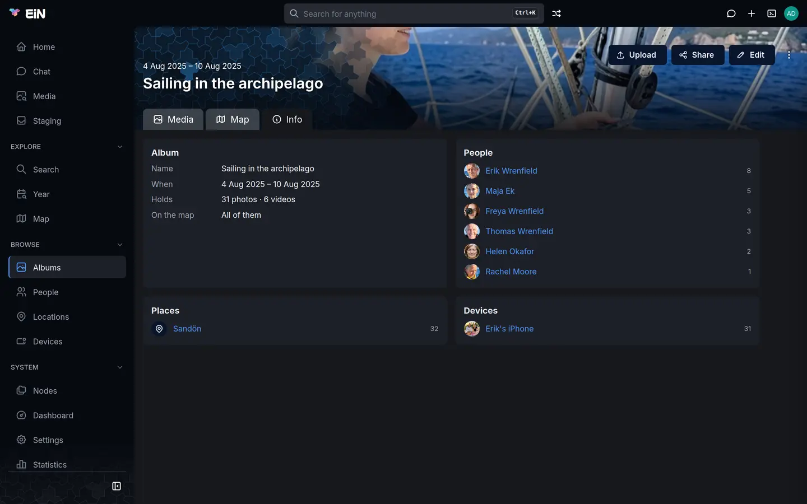
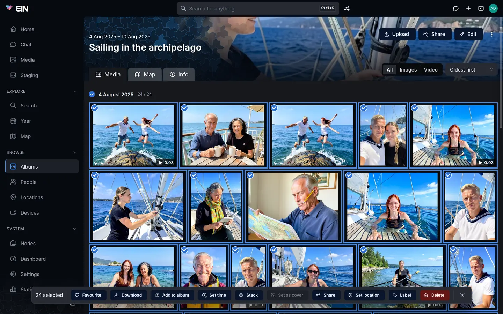

# Albums

An album gathers the photos, videos and recordings of one occasion: a summer, a trip, a birthday.
This page is for everyone who browses and organises the family's pictures. It covers finding an
album, making one, filling it, changing it, and acting on the pictures in it.

## Browse the albums

Choose **Albums** in the sidebar, under **Browse**. The page lists every album you may see, with
their number under the title, for example **29 albums**.



Each card shows:

- the album's cover, with the number of items it holds in the corner;
- its name;
- its dates, from the first picture to the last, or the span someone set (see
  [Change an album's name, description and dates](#change-an-albums-name-description-and-dates));
- its labels, if it has any.

Rest the pointer on a card to read the album's description. A card with a photo icon instead of a
picture belongs to an album with nothing to show yet, such as one that holds only documents.

To narrow the list, type in **Filter albums…**. It matches the album's name as you type. Case and
accents do not matter, and every word must appear, in any order: `wellington christmas` finds
"Christmas in Wellington". The **×** in the box clears it. When nothing matches, the page says
`No albums found matching "<what you typed>"`.

**Sort** orders the cards. EiN remembers your choice in this browser.

| Choice                         | Order                                      |
| ------------------------------ | ------------------------------------------ |
| **Newest first** (the default) | The albums with the latest dates first     |
| **Oldest first**               | The albums with the earliest dates first   |
| **Name (A-Z)**                 | Alphabetical by name                       |
| **Most items**                 | The albums holding the most pictures first |

Sorted by date, the page has a rail at its right edge, **Scroll through time**, that marks the years
with albums; drag along it to jump through them.

The list holds the albums people made. The albums that [staging](staging.md) suggests for your
uploads stay in your staging area until you file them, so they are not here.

On an archive with no albums yet, the page says **No albums yet** and, if you are signed in, offers
**New album**.

### Open an album at random

**Random album**, the button with two crossing arrows beside the search box in the top bar, opens
an album picked at random. <kbd>Alt</kbd>+<kbd>R</kbd> does the same from anywhere outside a text
field. It picks among the albums people made that you may open, never a staging suggestion.

To find one particular album, start typing its name in the search box at the top
(<kbd>Ctrl</kbd>+<kbd>K</kbd>, or <kbd>⌘</kbd>+<kbd>K</kbd> on a Mac).
[Search and the finder](search.md) covers that, and the **Search** page, which also finds albums by
what their pictures show.

## Create an album

You need to be signed in.

1. Choose **Create**, the plus in the top bar, then **Album**. On an empty Albums page, **New
   album** does the same.
2. **Create Album** opens. In **Name**, type what the album is called, for example
   `Sailing in the archipelago`.
3. If you like, write a **Description**. It takes Markdown, so you can use headings, lists and
   links.
4. Choose **Create**.

EiN makes the album and opens it, empty. Add pictures to it as
[Add pictures to an album](#add-pictures-to-an-album) describes.

The name is also the album's folder in the tree, `/archive/albums/<name>`, so two albums cannot
share a name. If one is taken, the dialog shows an error in red and makes nothing.

You can also make an album while adding pictures to it: in **Add to an album**, type a name no album
has and choose **New album “<name>”**. And when you sort your uploads in staging, filing a group
into an album of its own makes one.

An album you create starts out shared the way your albums are by default. An administrator sets
that for everyone, and you can change it for yourself with **How widely what you create is shared**
under **Profile → Preferences**. [Sharing](sharing.md) explains both, and how to share one album
differently with **Share**.

## What an album page shows



The header holds, from the top:

- links to the previous and next album, when the album is part of a series;
- the album's dates;
- its name, over its cover;
- its description;
- a chip that says how widely it is shared (visitors do not see it; [Sharing](sharing.md) explains
  the colours);
- its labels. Choosing one searches for everything that carries it.

If you may change the album, the header also has **Upload**, **Share** and **Edit**, and under
**⋮** the items **Add event** and **Move to trash**. On a phone they are all under **⋮**. If you may
only look at the album, none of them is there. With the default sharing, everyone with an account
sees every album and only its owner changes it, so on someone else's album you usually have none of
these buttons.

Below the header are three tabs: **Media**, where the album opens, **Map** and **Info**. The tab
you choose goes into the page's address (`?tab=map`, `?tab=info`), so a link can open the album on
it.

### The Media tab

- **Show** narrows the grid to one kind: **All**, **Images**, **Video**, **Audio** or
  **Documents**. It offers only the kinds the album holds, and is not there at all when the album
  holds one kind.
- **Sort** puts the pictures **Oldest first** (the default) or **Newest first**. EiN remembers the
  choice in this browser, for every album.

Folders inside the album come first, as square cards (see
[Folders inside an album](#folders-inside-an-album)). The pictures follow in sections, one for each
day they were taken. The heading of a day gives its date and how many pictures it has. An album
with pictures from more than 240 different days is shown by month instead, and one with more than
240 months by year. Pictures with no date at all are gathered under **Undated**.

What the tiles show:

- a video or a recording shows its length; a video plays a short silent preview when the pointer
  rests on it, or on a touch screen when it scrolls into view;
- a stack of similar photos shows how many it holds (see
  [Stacks of similar photos](#stacks-of-similar-photos));
- a heart marks a picture in your favourites;
- a lock marks a picture that keeps its own sharing; you see it if you may change the album.

Notes added with **Add event** appear among the days (see [Add a note to a day](#add-a-note-to-a-day)).
Once the album holds more than 120 pictures and notes, a **Scroll through time** rail at the right
lets you jump through its days.

Choose a picture to open it in the viewer. The viewer walks the album in the order the grid shows,
and after the last picture it goes on to the first. [Viewing photos, videos and recordings](viewer.md) covers it.

### The Map tab



The **Map** tab shows the album's pictures that have a position, and the routes any GPS device
recorded during the album's dates. The map opens fitted to both.

- A picture on its own is drawn as its thumbnail; choose it to open it in the viewer.
- Pictures close together form a pile with a count. Choose it to list them in **N photos here**.
- Choosing never zooms. Zoom with the mouse wheel or a pinch; the map has no zoom buttons.
- The layers button in the corner switches between **Map**, **Dark map** and **Satellite**.

The routes come from the album's whole span, so widening its dates in **Edit album** brings in the
journey there and back. When nothing has a position and no route was recorded, the tab says
**Nothing in this album has a position, and no device recorded a route while it was taken.**
[Dates and places of pictures](dates-places.md) shows how to give pictures a place, and
[Devices and GPS tracks](devices.md) how a route gets in.

### The Info tab



| Section           | What it shows                                                                                                                               |
| ----------------- | ------------------------------------------------------------------------------------------------------------------------------------------- |
| **Album**         | **Name**, **When** (its dates), **Holds** (for example "31 photos · 6 videos") and **On the map**: **All of them**, or how many of how many |
| **About**         | The description                                                                                                                             |
| **People**        | The people in its pictures, most often first                                                                                                |
| **Places**        | The locations its pictures are linked to                                                                                                    |
| **Devices**       | The cameras and phones that took them                                                                                                       |
| **Photographers** | The people who took them                                                                                                                    |
| **Labels**        | The labels its pictures carry, with how many carry each                                                                                     |

Each name opens its page. In **People**, **Places** and **Devices**, the number beside a name
searches the album for the pictures that have it; in **Labels**, a label searches the album for
that label. **People**, **Places**, **Devices** and **Photographers** show their first 10, then
**Show all N** and **Show fewer**; **Labels** shows them all. When nobody is tagged and nothing is
linked to a place or a device, the tab says so.

## Add pictures to an album

There are two ways: upload files from your computer or phone straight into the album, or add
pictures that are already in EiN.

### Upload straight into the album

You can do this if you may change the album.

1. Open the album.
2. Choose **Upload** and pick the files. Or drag files from your computer and drop them anywhere on
   the page: while you drag, the page says **Drop files to upload** and, under it, **Into** and the
   album's name.
3. Follow the upload under the **Uploads** button, which appears in the top bar once files are
   going up. It shows each upload's progress, with **Cancel** while files are going up,
   **Retry failed** when some failed, and **Clear**.

The files go straight into the album; they skip [staging](staging.md). They are shared as the
album is: whoever can see the album can see them. A file whose name the album already has is
stored under a numbered name beside it; nothing is replaced. **Upload** takes files, not folders,
and the files of a folder you drop go into the album without their folder. On a phone, the picker
offers your photos, videos, recordings and GPX files, and the camera.

When the upload ends, the album shows the files. Each one shows a placeholder until EiN has made its
thumbnail, and goes to its day once its date has been read, which can take a few minutes after a
large upload. [Getting your photos in](importing.md) explains what happens to each file and why it
takes a while.

> [!TIP]
> For a card full of pictures you have not sorted, use **Create → Import media** instead. Those
> files wait in your private staging area, where EiN suggests albums for them and nobody else sees
> them until you file them. [Getting your photos in](importing.md) compares the ways in.

A suggested album from staging takes no uploads.

### Add pictures that are already in EiN

1. Select the pictures, in any grid: an album, the **Media** page, a person's page, a search.
   [Select pictures](#select-pictures) shows how.
2. Choose **Add to album** in the selection bar. In the viewer, the same is in the pencil menu.
3. **Add to an album** opens. In **Find an album, or name a new one**, type part of the album's
   name, then choose it from the list.

The list holds the albums you may change. An album whose whole name you type but cannot change is
listed greyed out, marked **View only**. To put the pictures in an album that does not exist yet,
type its name and choose **New album “<name>”**.

EiN says what it did, for example **12 added to Christmas in Wellington**, adding **3 already
there** when some were in it before, and offers **Undo**.

The pictures are not copied. Each stays where it lives, and the album gets a link to it, so one
picture can be in several albums at once. A date, a place, a name on a face or a label given to it
shows in every album it is in. The one exception is a file from your staging area: it moves into
the album, and the message adds **N moved out of staging**.

## Change an album's name, description and dates

Choose **Edit** in the album's header. **Edit album** opens.

| Field                                 | What it does                                                                                       |
| ------------------------------------- | -------------------------------------------------------------------------------------------------- |
| **Name**                              | What the album is called everywhere. Required.                                                     |
| **Description**                       | Text about the album, in Markdown. It shows under the title and on the Info tab.                   |
| **Labels**                            | The album's own labels. Pick one in use or type one; a space starts the next label.                |
| **Starts** and **Ends**               | The album's span, as `YYYY-MM-DD`. See below.                                                      |
| **Previous album** and **Next album** | Its neighbours in a series. Type part of an album's name to find one, or clear the field for none. |

Choose **Save**. EiN says **Album saved**.

Renaming changes the name on every page. The album's folder in the tree keeps its first name, so
links to the album, and to the pictures in it, keep working.

**The span.** An album's dates are those of its first and last picture. **Starts** and **Ends** let
you reach out past them, to cover the journey there and back: the dates show on the card and over
the title, the Albums page sorts by them, and the Map tab draws the routes recorded within them.
You cannot move them inside the pictures: **Starts** stops at the first picture's day and **Ends**
at the last one's. The line under the fields says what the pictures span, for example "The media run
from 2025-08-04 to 2025-08-10. Reach out past them to cover the journey there and back." To let
the span follow the pictures again, clear the field or set it back to the pictures' own day. An
album whose pictures have no dates has only the span you set; the line then reads "Nothing in the
album is dated yet; the span is what you set here."

**A series.** Albums of one summer after another, or the parts of a long journey, can lead from one
to the next. Pick the album before this one in **Previous album**, or the one after it in **Next
album**; the album you pick links back to this one by itself. The header then shows a small pill
for each neighbour, with an arrow, its cover and its name, above the dates. Rest the pointer on it
to see a larger cover, and choose it to go there.

## Choose the cover

The cover is the picture on the album's card and behind its title.

1. Open the album and select one picture. It can be one that lives in the album or one added to it
   from elsewhere.
2. Choose **Set as cover** in the selection bar.

The header changes to the picture at once. **Set as cover** is in the bar only if you may change the
album, and it works with exactly one picture selected; with more it is greyed out. A person's page
has the same button for the person's picture.

An album without a cover of its own is given one by EiN: one of its own pictures, picked at random,
a photo before a video or a recording. A cover you choose is never replaced. If the cover picture is
deleted, the album shows another of its pictures in its place.

## Stacks of similar photos

When someone takes several shots of the same moment, EiN folds them into a stack in the album: one
tile, the stack's front photo, with a count in its corner. The other photos are still in the
album; the stack only hides them from the grid. No file moves.

Photos are stacked when they follow one another, look alike, and were taken at most 10 seconds
apart. An administrator can change both limits under **Settings → System**, in the **Albums** group:
**Stack similarity**
([`CFG_ALBUM_STACK_THRESHOLD`](../reference/settings.md#cfg_album_stack_threshold), 0.75) and
**Stack time gap (seconds)**
([`CFG_ALBUM_STACK_MAX_GAP_SECONDS`](../reference/settings.md#cfg_album_stack_max_gap_seconds),
10).

A stack belongs to one album. The same photos can be a stack in one album and separate in another.

To look through a stack, open its tile. The details panel of the viewer has a section headed with the
count, for example **5 stacked photos**, and a thumbnail of each photo, the front marked **Front**.
Choose a thumbnail to see that photo. If you may change the album and every photo in the stack,
the section has these buttons:

| Button             | What it does                                                                            |
| ------------------ | --------------------------------------------------------------------------------------- |
| **Make front**     | Makes the photo you are looking at the one the grid shows.                              |
| **Keep separate**  | Takes this photo out of stacks in this album. The section then reads **Kept separate**. |
| **Allow stacking** | On a photo kept separate: lets it be stacked again.                                     |

To stack photos yourself, select two or more in the album and choose **Stack** in the selection
bar. If one of them is already in a stack, the others join it and its front stays the front.

Selecting a stack's tile selects its front photo only, so **Download**, **Delete** and the other
actions of the bar act on that one photo.

## Folders inside an album

An album can hold folders, for example one for each day of a long trip. They show as square cards
above the pictures, with the folder's name and how many entries it holds. If you may change the
album, a lock on a card marks a folder that keeps its own sharing.

Choose a card to open the folder. It opens like an album page of its own, with the same tabs. The
album's grid shows only the pictures at the album's own level: open a folder to see what is in it.
An album that holds only folders says **No media here — open a folder above.**

The web interface shows folders but has no button that makes one. They come from an import, from
copying folders over [SFTP](../shell/ssh-sftp.md), or from `mkdir` in the
[terminal](../shell/terminal.md). Once a folder is there, open it and choose **Upload** to upload
into it. The selection bar's **Stack**, **Set as cover** and **Share** are offered in the album
itself, not in its folders.

## Add a note to a day

A note tells what happened on a day of the album: who arrived, where you sailed, why it rained.

1. In the album's header, choose **⋮**, then **Add event**.
2. **Add event** opens. **Date** is filled in with the first day of the album's pictures that has no
   note yet; change it as you like, as `YYYY-MM-DD`.
3. Write the note in **Description**.
4. **Written by** is you, when your account is linked to a person; choose someone else if they
   wrote it.
5. Choose **Add event**.

The note appears among the pictures, at its day, signed with the writer's name. If you may change
it, a pencil on the note (**Edit event**) opens it again, with **Delete** to send it to the trash;
EiN says **Event moved to the trash** and offers **Undo**.

## Select pictures

You select pictures to act on several at once: download them, add them to another album, give them
a date or a place, delete them.



| To                           | Do this                                                                                                                    |
| ---------------------------- | -------------------------------------------------------------------------------------------------------------------------- |
| Select one picture           | Point at it and tick the checkbox in its corner. On a touch screen, press and hold it; the phone gives a short buzz.       |
| Add or take away one picture | <kbd>Ctrl</kbd>+click it (<kbd>⌘</kbd>+click on a Mac). Once anything is selected, a plain click or tap does the same.     |
| Select a run                 | <kbd>Shift</kbd>+click: everything from the last picture you picked to this one, across days too.                          |
| Select a whole day           | Choose the date in the day's heading. Its count then reads, for example, **24 / 24**. Choose it again to deselect the day. |
| Select everything            | <kbd>Ctrl</kbd>+<kbd>A</kbd> (<kbd>⌘</kbd>+<kbd>A</kbd> on a Mac).                                                         |
| Clear the selection          | <kbd>Esc</kbd>, or the **×** at the right end of the selection bar.                                                        |

While anything is selected, every picture shows its checkbox, and a plain click selects instead of
opening. <kbd>Ctrl</kbd>+<kbd>A</kbd> takes the pictures the page has loaded; in a long album,
scroll to its end first to take them all. With the viewer open, <kbd>Esc</kbd> closes the viewer and
leaves the selection alone. A picture that has the keyboard's focus opens with <kbd>Enter</kbd> or
<kbd>Space</kbd>. <kbd>?</kbd> lists these keys with the others; see [Keyboard shortcuts](../reference/shortcuts.md).

## The selection bar

As soon as one picture is selected, a bar floats at the foot of the page with the count, for example
**24 selected**, and buttons for what you can do. On a narrow screen the buttons fold into one
**Actions** menu.

Which buttons you see depends on the page and on what you may change. On an album page, in order:

| Button                                  | What it does                                                                                                                                                                                                                                                                                                 | Shown                                                              |
| --------------------------------------- | ------------------------------------------------------------------------------------------------------------------------------------------------------------------------------------------------------------------------------------------------------------------------------------------------------------ | ------------------------------------------------------------------ |
| **Favourite** / **Unfavourite**         | Adds the pictures to your favourites, or takes them out when every one is there already. EiN says, for example, **12 files added to favourites**, with **Undo**. [Your profile, favourites and trash](profile.md) has the Favourites page.                                                                   | When you are signed in                                             |
| **Download**                            | Saves the original files: one file as itself, several as one zip named after the album.                                                                                                                                                                                                                      | Always                                                             |
| **Add to album**                        | Adds the pictures to another album, as [above](#add-pictures-that-are-already-in-ein).                                                                                                                                                                                                                       | When you are signed in                                             |
| **Set time**                            | Gives the pictures a date and time. [Dates and places of pictures](dates-places.md) covers the dialog.                                                                                                                                                                                                       | When you may change every selected picture                         |
| **Stack**                               | Stacks the pictures, as [above](#stacks-of-similar-photos). Needs two or more.                                                                                                                                                                                                                               | On an album you may change                                         |
| **Set as cover**                        | Makes the picture the album's cover. Needs exactly one.                                                                                                                                                                                                                                                      | On an album you may change                                         |
| **Share**                               | Shares the pictures **Like the album**, or gives them **Their own sharing**, for example to keep a few private in a shared album. [Sharing](sharing.md) covers the dialog. Greyed out when the selection holds a picture only added here from elsewhere: that picture has the sharing of the place it lives. | On an album you may change                                         |
| **Set location**                        | Says where the pictures were taken. [Dates and places of pictures](dates-places.md) covers it.                                                                                                                                                                                                               | When you may change every selected picture                         |
| **Label**                               | Adds labels to the pictures, in **Add labels**. [Media, Year and labels](media.md) covers labels.                                                                                                                                                                                                            | When you may change every selected picture                         |
| **Delete** (red) or **Remove** (orange) | Takes the pictures out of this album, as the next section explains.                                                                                                                                                                                                                                          | When you may change every selected picture that lives in the album |

Other pages have most of the same buttons. **Stack**, **Set as cover** and **Share** are the
album's own; a person's page has **Set as cover** too.

## Delete or remove pictures

A picture in an album either lives there, because it was uploaded or filed into that album, or it
was added to the album from elsewhere, and only a link to it is there. The last button of the
selection bar treats the two differently:

- **Delete** sends a picture that lives in the album to your trash. It leaves every other album it
  was added to as well, and comes back to all of them if you restore it.
- **Remove** takes a picture that was only added to the album out of it. The picture stays where it
  lives, and in any other album it is in.


The tiles look alike either way; the button tells you which you have. It reads **Remove**, in
orange, when every selected picture was only added here. When any of them lives here it reads
**Delete**, in red: the pictures that live here go to the trash, and the ones only added here are
taken out of the album.

Neither asks first. EiN says what it did, for example **3 moved to the trash, 2 taken out of this
album**, and offers **Undo**, which brings back the deleted pictures and puts the links back.
Deleted pictures wait in your trash, under your picture in the top bar → **Trash**, for 30 days by
default ([`CFG_TRASH_RETENTION_DAYS`](../reference/settings.md#cfg_trash_retention_days)); after that
they are gone for good. [Your profile, favourites and trash](profile.md) covers the Trash page, and
[Links](../concepts/links.md) what deleting and the trash do to links.

When you delete a picture, what EiN worked out about it, such as faces and a transcript, goes with
it, and comes back with it if you restore it.

### Move a picture to another album

The web interface has no button that moves a picture from one album to another. **Add to album**
links it into the other album; if you then delete it from the first, it goes to the trash and leaves
the other album too.

To move pictures, use `mv` in the [terminal](../shell/terminal.md), if you may change both albums.
`mv` keeps every link to them working, in other albums, covers and favourites:

```bash
# in EiN's terminal
mv -n "/archive/albums/Sailing in the archipelago/IMG_0412.jpg" "/archive/albums/Erik's archipelago/"
```

A moved picture keeps the sharing it had. To give it the sharing of the album it moved into, select
it there, choose **Share**, then **Like the album** and **Save**.

## Undo a change

| What you did                     | How to undo it                                                                                                                                                                                   |
| -------------------------------- | ------------------------------------------------------------------------------------------------------------------------------------------------------------------------------------------------ |
| **Favourite** or **Unfavourite** | **Undo** in EiN's message, or the other button                                                                                                                                                   |
| **Add to album**                 | **Undo** in EiN's message takes the pictures out again, and files from staging go back to it. An album made in the same step may stay behind, empty; move it to the trash if you do not want it. |
| **Delete** or **Remove**         | **Undo** in EiN's message, or **Restore** on the Trash page for what was deleted                                                                                                                 |
| **Move to trash** on an album    | **Undo** in EiN's message, or **Restore** on the Trash page                                                                                                                                      |
| **Delete** on a note             | **Undo** in EiN's message, or **Restore** on the Trash page                                                                                                                                      |
| **Edit album**                   | No undo: open **Edit** and change it back                                                                                                                                                        |
| **Set as cover**                 | Choose another picture as the cover                                                                                                                                                              |
| **Stack**                        | **Keep separate** on each photo, in the viewer's details                                                                                                                                         |

## Move an album to the trash

In the album's header, choose **⋮**, then **Move to trash**. Nothing asks first. EiN takes you back
to the Albums page and says, for example, **Sailing in the archipelago moved to the trash**, with
**Undo**, which puts the album back and returns you to it. The album waits in your trash with
everything that lives in it, and you can restore it from the Trash page for as long as the trash
keeps it.

The pictures that live in the album leave every other album they were added to, until you restore
it. The pictures that were only added to it stay where they live.

## Suggested albums from staging

When you upload into your staging area, EiN groups the files and suggests albums for them. Those
live in your staging area, only you see them, and you decide them on the **Staging** page. You can
open one as an album page (**Open as an album page** in staging). It then shows why its pictures
were grouped, with **Sort in Staging** to go back to it, a match percentage, and under **⋮** the
choice **Keep album as is** or **Let the organizer manage album**. It has no **Upload** and no
**Move to trash**, and **Edit** changes only its name and labels. [Sorting in staging](staging.md)
covers all of it.

## If something looks different

| What you see                                                                                                | Why                                                                                                        | What to do                                                                                                                 |
| ----------------------------------------------------------------------------------------------------------- | ---------------------------------------------------------------------------------------------------------- | -------------------------------------------------------------------------------------------------------------------------- |
| No **Upload**, **Share** or **Edit** on an album                                                            | You may look at the album but not change it.                                                               | Ask its owner, or an administrator, to share it with you so that you can edit it. See [Sharing](sharing.md).               |
| A placeholder where a picture should be, after an upload                                                    | Its thumbnail is not made yet. The media service makes it, after the pictures uploaded before it.          | Wait. [Getting your photos in](importing.md) explains why it takes time.                                                   |
| Uploaded pictures are not on their day yet                                                                  | Their dates have not been read yet.                                                                        | Reload the page a little later.                                                                                            |
| An album has no dates on its card                                                                           | None of its pictures has a date, and no span is set.                                                       | Set **Starts** and **Ends** in **Edit album**, or give the pictures a time with **Set time**.                              |
| **Share** in the selection bar is greyed out                                                                | The selection holds a picture that was only added to this album; it has the sharing of the place it lives. | Select only pictures that live here. Share the others where they live.                                                     |
| **Set as cover** is greyed out                                                                              | It needs exactly one picture selected.                                                                     | Select one.                                                                                                                |
| **Stack** is greyed out                                                                                     | It needs two or more.                                                                                      | Select more.                                                                                                               |
| The last button reads **Remove**, not **Delete**                                                            | Every selected picture was only added to this album.                                                       | **Remove** takes them out of this album only. To delete a picture, go to the album where it lives.                         |
| A picture is gone from an album nobody changed                                                              | Someone deleted it where it lives, or moved that album to the trash.                                       | It comes back to every album when it is restored from the trash of whoever deleted it.                                     |
| **Nothing in this album has a position, and no device recorded a route while it was taken.** on the Map tab | No picture has a place, and no route falls within the album's dates.                                       | Give pictures a place with **Set location** ([Dates and places of pictures](dates-places.md)), or widen the album's dates. |
| **This album holds more than 20,000 entries; 20,000 of them are shown.**                                    | An album page shows at most 20,000 pictures.                                                               | Split it into folders or several albums, or search inside it.                                                              |
| `album: Node already exists in parent … with name: …` when you create an album                              | An album or folder of that name is already in `/archive/albums`.                                           | Choose another name.                                                                                                       |

## In the terminal

Everything on this page is a command underneath, and the [terminal](../shell/terminal.md) runs the
same commands. A few of them:

```bash
# in EiN's terminal
album create "/archive/albums/Christmas in Wellington" --description "Christmas with Helen and the children"
album add "/archive/albums/Christmas in Wellington" "/archive/albums/Ruby's Wellington/IMG_2231.jpg"
album set "/archive/albums/Christmas in Wellington" spanStart 2025-12-18
album set "/archive/albums/Christmas in Wellington" next "/archive/albums/Ruby's Wellington"
album-stack refresh "/archive/albums/Christmas in Wellington" --dry-run -v
album-random
```

An album's path is its folder, `/archive/albums/` and the name it was created with; renaming it
does not change the path. [`album`](../reference/commands-archive.md#album),
[`album-stack`](../reference/commands-archive.md#album-stack) and
[`album-random`](../reference/commands-archive.md#album-random) have every option in the
[archive's commands](../reference/commands-archive.md).

## Related pages

- [Viewing photos, videos and recordings](viewer.md): the viewer an album's pictures open in.
- [Sharing](sharing.md): who sees an album, share links, and keeping some pictures private.
- [Getting your photos in](importing.md): every way files get in, and what happens to them.
- [Sorting in staging](staging.md): your private inbox and the albums it suggests.
- [Dates and places of pictures](dates-places.md): **Set time** and **Set location**.
- [Links](../concepts/links.md): how one picture can be in several albums.
