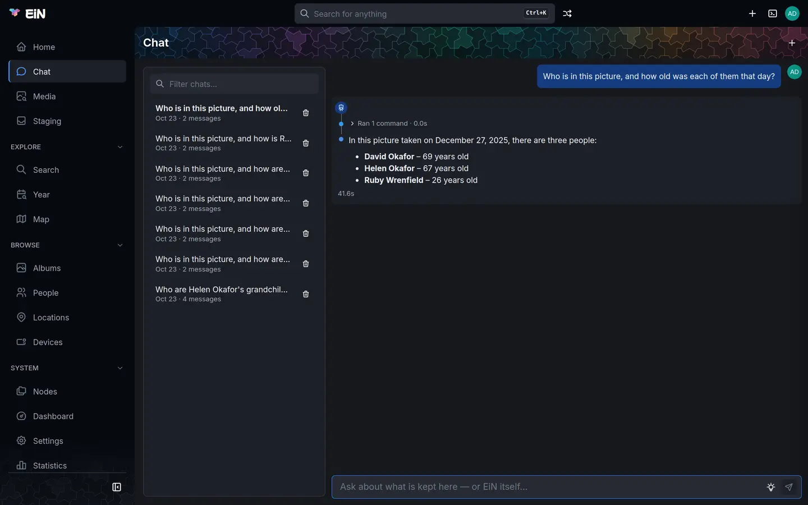

# Chatting with the assistant

The assistant answers questions about what your family keeps in EiN, and about EiN itself, in your own words. It looks things up by running EiN's own commands as you, shows you every command it ran, and asks you before it changes anything. This page is for everyone who uses the chat.

The chat comes with the assistant module. If you do not see **Chat** in the sidebar, the module is not installed; your administrator can add it (see [Modules](../admin/modules.md)).

## Open the chat

There are three places to open it, and they all show the same conversations.

- **Chat** in the sidebar opens the Chat page, with your recent chats in a box beside the conversation.
- The **Chat** button in the top bar (a speech bubble) opens the chat in the side drawer, beside the page you are on, so you can ask about that page. Choose the button again to close the drawer. The drawer's title, **Chat**, is a link (**Open as page**) that opens the same conversation as the full Chat page. On the Chat page itself there is no chat button.
- In the viewer the top bar is covered, so the viewer has a **Chat** button of its own at the top right, next to the details button. The drawer then stays open beside the picture, with a **Close chat** button (×) of its own.

On a phone the top bar's chat button opens the chat as a dialog that fills the screen; **Back** or the × closes it. In the viewer on a phone, open the menu at the top right and choose **Chat**. See [EiN on a phone](phone.md) for what else differs.


You can make the drawer wider or narrower by dragging its left edge; [Finding your way around](interface.md#pages-dialogs-the-side-drawer-and-full-screen) explains the drawer. No keyboard shortcut opens the chat.

## Ask a question

1. Click in the box at the bottom, which reads "Ask about what is kept here — or EiN itself…" ("Ask anything…" on a phone). A click on any empty part of the chat puts the cursor there too.
2. Type your question. <kbd>Shift</kbd>+<kbd>Enter</kbd> starts a new line; the box grows to eight lines.
3. Press <kbd>Enter</kbd>, or click the send button (a paper plane).

The answer grows in front of you. It says "Waiting…" at first, "Thinking…" while the language model works out its next step, and "Running commands… 2 done" with the command it is running underneath. The answer's words appear as they are written. An answer takes from a few seconds to a few minutes, depending on how many commands the question needs and how fast your machine runs the language model.

While a chat is answering, its box is locked and the send button is grey. There is no button to stop an answer once you have asked. You can start a new chat and ask something else in the meantime.

A new, empty chat shows a robot and "Ask about what is kept here, or about EiN itself.", and under it two questions the installed modules suggest, such as "When were we last at the beach?".

The assistant answers in the language you ask in, whatever language the archive is kept in. The chat's own buttons and messages are in English.

### What the assistant knows about the page you are on

Every question carries what you have in front of you, so you do not have to name it:

- the date and time, from the clock of the machine EiN runs on, so "this week" and "today" work;
- the page you have open: its name and the sidebar entry it is under, what it says it shows, which tab is open, and the person, album, place or other thing the page is about;
- the picture, video or recording open in the viewer.

So on Peggy Wrenfield's page you can ask "When was she born?", and in the viewer "Who is in this picture?". A dialog, or the chat itself, is never the page it is asked about.

"I", "me", "my" and "we" mean you only when your account is linked to a person in the archive. You can tell: your account menu then has a **Me** row. Without the link, the assistant says it cannot tell who you are. Your administrator makes the link (see [Accounts and groups](../admin/accounts.md)). A file you ask it to make without saying where goes in your home folder.

The assistant knows nothing from your other chats. Each chat is a conversation of its own.

The assistant reads only text: what EiN has recorded about a picture, such as its date, place, the people whose faces are named in it, its caption and any text found in it. It does not look at the picture itself. If nobody has named a face yet, it cannot tell you who that is; see [People and faces](people.md).

### Think harder

The bulb inside the question box asks the model to think before every step. The answer takes about twice as long, and the assistant picks its commands more carefully.

- Off, its tooltip reads **Think harder (slower)**. Click it and it turns yellow: **Thinking harder: slower, more careful**.
- It stays on in this browser, for every chat, until you click it again.
- A question you asked with it shows a small bulb beside it (**Asked with "think harder"**), and the answer shows the model's thoughts.

Try it when an answer came back as **No answer**, or when the commands the assistant ran were not the ones the question needed.

## Read an answer


An answer that needed no command is a plain bubble. An answer for which the assistant ran something, or that has a card, pictures or links under it, is drawn as a timeline, starting with a robot, with a dot for each step:

| What you see                                     | What it is                                                                                                                                                                                                                                                                               |
| ------------------------------------------------ | ---------------------------------------------------------------------------------------------------------------------------------------------------------------------------------------------------------------------------------------------------------------------------------------- |
| **Thought for 1.2s**                             | What the model thought before it answered, when it thinks (always with **Think harder**). Click to read it.                                                                                                                                                                              |
| Words between steps                              | What the model said while it worked.                                                                                                                                                                                                                                                     |
| **Ran 3 commands · 0.4s**                        | The commands it ran, folded to one line, with ", 1 failed" when one failed. Click to open: each command shows the line as it ran, how long it took, and what it printed, after the thought that led to it. Long output is folded behind **output · N lines**; a failure is shown in red. |
| **Waited 42s for the language model to restart** | The language model was away and came back during the answer.                                                                                                                                                                                                                             |
| The answer                                       | The reply itself, with lists, bold text, tables and links where they help.                                                                                                                                                                                                               |
| After the answer                                 | A proposal card, a table, cards, pictures, links and **Show in search**, each described below.                                                                                                                                                                                           |

Under the answer is the time it took, such as "12.3s"; point at it to see the date and time of the answer. Point at your picture beside a question to see when you asked it.

Opening **Ran N commands** is how you check an answer: you see exactly what the assistant looked up and what EiN told it.

### Pictures

Pictures come as a grid of up to 24 thumbnails under the answer; click one to open it in the [viewer](viewer.md). The text says in a sentence what they are rather than listing them. Ask for more in the same chat and the assistant leaves out the pictures it has already shown you there.

A plain request for pictures, such as "Show photos of Peggy Wrenfield in Falmouth", is answered straight from a search, without the longer back-and-forth: the answer begins "Here are …", and its two steps, `parse-search` and `search`, show as its commands. This happens when **Think harder** is off and the request starts with words like "show", "find", "get", "photos", "pictures" or "videos", or the Swedish "visa", "hitta" or "bilder", and asks nothing more. A request with "who", "when", "how many", "this" or "my" in it is answered the longer way, through the commands.

### Links

Names in the answer are links: a picture opens in the viewer, a person, album or place opens its page, and a web address opens as usual. Under the answer, links to the people, places and folders the answer is about are lined up for you. Before the answer reaches you, EiN checks every link as you: a link to something that does not exist, or that you may not see, is left as plain words.

### Show in search

When the assistant searched, **Show in search** opens that search with its filters filled in: on the Media page for photos, videos and recordings, and on the Search page when it looked for albums, people, places, devices or tracks. Use it to see how the assistant understood your question, and to change the filters yourself. [Search and the finder](search.md) explains the filters.

### Tables

When you ask for a table, or the answer has many rows, the chat draws a table under it. EiN reads the rows from the command itself rather than from the model, so no value is copied wrongly. The table has a title, a header that stays in view as you scroll, and numbers aligned to the right. Under it are the command that printed the rows and how many there are, such as "42 rows", with ", the first 1000 shown" when there are more than 1,000.

### Cards

Some answers come with a card drawn under them:

| Card            | When                                              | What it shows                                                                                                                            |
| --------------- | ------------------------------------------------- | ---------------------------------------------------------------------------------------------------------------------------------------- |
| **Chart**       | When you ask for a chart, a graph or a diagram    | A line, bar or pie chart of a log's entries, or of numbers the assistant counted. With fewer than two values it says "Nothing to chart." |
| **Family tree** | For a question about family                       | The tree around a person, or the line of relations between two people. Comes with the archive.                                           |
| **Map**         | When you ask where something is, or ask for a map | The places and pictures the answer named, pinned where the archive has them. Comes with the archive.                                     |

A card is drawn as you each time it appears, so it shows the archive as it is when you look, and leaves out anything you may not see.

## When the assistant offers to make a change

The assistant reads on its own, but it never changes anything without you. When your question needs a change, such as writing a picture's caption, adding an event to someone's timeline, setting someone's parent or partner, or creating, moving or removing a file, it answers "Shall I run this?" and shows a proposal card:

- a header, **Bash**, and a title saying what the change does;
- the exact commands as a small script: `set -e` first, then each command under its title as a comment line starting with `#`;
- a yellow border while it waits for you;
- the buttons **Run** and **Decline**.

Asked "Add to Ruby Wrenfield's timeline that she graduated in December 2021", the card could read:

```bash
set -e

# Add an event (blob) to a person, album, location or device
person-add-event --date=2021-12 --body='Graduated' /archive/people/Ruby_Wrenfield
```

To decide:

1. Read the commands. Check the names, dates and paths: the card shows what the assistant understood.
2. If something is wrong, click into the script and change it. The card then says **edited**; **reset** puts the proposal back as it was.
3. Click **Run** to run the whole script, or **Decline** to leave things as they are.

**Run** runs the script exactly as the card shows it, as you, as if you had typed it in the [terminal](../shell/terminal.md). Because of `set -e`, it stops at the first line that fails; take that line out if you want the rest to run regardless.

The card then shows how it went: green **Done** with "· exit 0" and what the commands printed, red **Failed** with the exit code and the error, or **Dismissed** when you declined. The assistant goes on by itself: it reads what happened and takes the next step, which may be another card, or gives its answer. After you decline, it is told not to propose the same change again. Pages open beside the chat show the change at once. A card can be run or declined only once.

### It runs as you

Every command the assistant runs, and every script you run from a card, runs as you, with your permissions. It sees what you can see in the browser and nothing more, and a change you may not make fails the same way it would if you made it yourself. In [admin mode](interface.md#admin-mode) the assistant reads with the administrator's rights too.

What counts as a change is decided by EiN, not by the model. A line runs at once only when every command in it is known to only read and nothing is written to a file; anything else becomes a card. The assistant cannot open the editor, sign in or out, run a service's own program (services are started with `service-start`, which it proposes like any change), or ask itself a question. [Teaching the assistant](../develop/assistant.md) describes how this works.

### Visitors who have not signed in

Where the administrator has turned on **Visitors may browse** (see [Browse without signing in](interface.md#browse-without-signing-in)), someone who has not signed in can ask questions too. The assistant changes nothing for them: no proposal card appears, and the answer says that a change needs signing in. A visitor's conversation is kept only in the open page. There are no recent chats, **New chat** starts over, and the conversation is gone when the page is closed or reloaded.

## Your conversations



- **Start a new chat** with the plus button (**New chat**). Start one for each new topic: the assistant remembers only what was said in the current chat. If the chat you are in has no messages yet, **New chat** stays in it rather than making another empty one.
- **Titles** are the first question, on one line, cut at 60 characters. A chat cannot be renamed.
- **Recent chats**: on the Chat page they are in the box at the left, the most recently used first, each with its title, the time (today) or the date, and how many messages it has. The **Filter chats…** box above them matches titles, not what was said. In the drawer and on a phone, the **Recent chats** button (a clock) opens the same list as a menu. With nothing to show, the list says "No previous chats", or "No chats match" when the filter finds none.
- **Come back to a chat** by its address: the Chat page shows `/chat/<id>` in the address bar, so you can bookmark a conversation. A chat opens only for you; anyone else who follows the address gets their own latest chat instead.

To delete a chat:

1. Open the Chat page from the sidebar.
2. In the recent chats box, click the trash icon (**Delete chat**) beside the chat.
3. Your browser asks `Delete “<title>”?`; confirm.

The chat is deleted for good: it does not go to the [trash](profile.md). The menu in the drawer and on a phone has no delete button, and a chat cannot be deleted while it is answering.

### Where your conversations are kept

Each chat is a log in your home folder, under `~/.chats/`. The folder and its logs are yours alone: other users cannot open them. An administrator can, because an administrator's access passes every permission. Chats are kept until you delete them; EiN removes none on its own.

A chat's log holds your questions, the answers, the commands that ran and what they printed, so it holds copies of what the assistant read to answer you.

From the [terminal](../shell/terminal.md) you can list, read and delete your chats; see [`assistant-chat`](../reference/commands-assistant.md#assistant-chat):

```bash
# in EiN's terminal
assistant-chat list
assistant-chat read <id>
assistant-chat delete <id>
```

### Long chats forget their beginning

With every question the assistant gets the earlier turns of the chat again, but long results from earlier turns go back shortened, and once the earlier turns add up to about 20,000 characters the oldest are dropped. Everything stays on your screen and in the log, but the assistant no longer reads the first questions of a long chat. Start a new chat for a new topic, or say again what matters.

## When the assistant cannot answer

While the language model is starting or restarting, for example after an update or a restart of the machine, the answer says "The language model is restarting; waiting for it…". The chat keeps trying, for three minutes unless your administrator has changed **Wait for the language model (seconds)** ([`CFG_LLM_WAIT`](../reference/settings.md#cfg_llm_wait)). If the model comes back in time, the answer goes on and its timeline notes how long it waited.

Each command gets a minute. When commands take too long, the assistant stops running them and answers from what it has, saying what was slow.

When there is no answer, a red card takes its place:

| Card                      | It says                                                                      | What happened                                                                                                                                                    | What to do                                                                                 |
| ------------------------- | ---------------------------------------------------------------------------- | ---------------------------------------------------------------------------------------------------------------------------------------------------------------- | ------------------------------------------------------------------------------------------ |
| **Assistant unavailable** | "The assistant is not available right now."                                  | The language model could not be reached within the wait, a step took longer than three minutes, or your browser lost contact with EiN.                           | Try again later. If it keeps happening, tell your administrator.                           |
| **No answer**             | "The assistant could not answer this question."                              | The model gave up: it kept repeating a command, used commands that do not exist, kept running commands after its 12 for one question, or the chat no longer fit. | Ask more plainly, name the person or album, turn on **Think harder**, or start a new chat. |
| **Answer too long**       | "The answer was too long to finish. Ask for less, such as the last 20 rows." | The answer was longer than the model may write at once.                                                                                                          | Ask for less, or ask for a table.                                                          |

Under the text, the card gives the technical reason in small type, such as `model service unreachable: http://llm:8190: …; still away after 180s`. Pass it on to your administrator if you ask for help.

**Retry**, on the card, asks the same question again as a new message. It works after a reload too.

If every question waits the full time and then shows **Assistant unavailable**, the language model is not running, or none has been set up; that is for your administrator. [The language model](../admin/language-model.md) covers setting it up and [Troubleshooting](../admin/troubleshooting.md) what to check.

The assistant can also be wrong while looking sure. It is told to say only what the commands printed, but a small model sometimes picks the wrong command or misreads a result. When an answer matters, open **Ran N commands** to see what it looked up, or **Show in search** to see how it read your question.

## Where your questions go

Usually the language model runs on the same machine as EiN, and nothing you ask leaves it. The chat says nothing about it then. The **Language model** tile in **About EiN**, in your account menu, says "on this host" under the model's name.

Your administrator can choose a hosted provider's model instead. The chat then shows a line above the question box, with a globe icon, naming the provider, for example:

```text
Answered by OpenAI: your questions, and the names, places and search results used to answer them, leave this server.
```

With a provider, what goes there is your questions, what is on your screen (the page's name and the path of the thing or picture it shows), your name, and what the commands printed: names, dates, places, captions, and the text of files the assistant read. Pictures, videos and recordings themselves are never sent. Searches you type as sentences are read by the same model, so they go to the provider too. [The language model](../admin/language-model.md) has the details for administrators.

## Questions to try

These work on the demo archive of the Wrenfield family; use the names in your own archive instead.

| Ask                                                                            | What you get                                                             |
| ------------------------------------------------------------------------------ | ------------------------------------------------------------------------ |
| Show photos of Peggy Wrenfield in Falmouth                                     | A grid of pictures, straight from a search, with **Show in search**      |
| Who is Helen Okafor?                                                           | Her dates, parents, partner, children and life events                    |
| How are Ruby Wrenfield and Helen Okafor related?                               | The answer in words, with a family tree card of the line between them    |
| Who are Helen Okafor's grandchildren?                                          | A list of names, linked to their pages                                   |
| Whose birthday is coming up?                                                   | Birthdays, anniversaries and other events around today                   |
| Who is in this picture, and how old was each of them that day?                 | With a picture open in the viewer: the people named in it and their ages |
| Where were the pictures of Sailing in the archipelago taken? Show me on a map. | A map card with the places pinned                                        |
| Add to Ruby Wrenfield's timeline that she graduated in December 2021           | A proposal card to run or decline                                        |
| Which services are running?                                                    | A list or table of EiN's services and how they are doing                 |
| How much disk space is used?                                                   | The space used and free, from the machine EiN runs on                    |

For more about finding pictures without the chat, see [Search and the finder](search.md).
