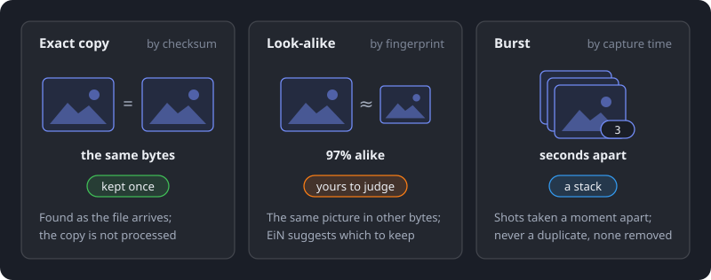

# Duplicates

This page is for anyone sorting new pictures in staging. It covers how EiN tells exact copies,
look-alikes and bursts apart, where it marks them, and how you remove the copies you do not want.
The version you keep is filled in with anything the copies held that it lacks.

Everything here happens in your own staging area, before pictures join the shared library. How
pictures get there is on [Getting your photos in](importing.md), and the rest of staging is on
[Sorting in staging](staging.md).

## Copies, look-alikes and bursts

EiN sorts "the same picture twice" into three kinds and treats each one differently.



| Kind       | What it is                                                                                                                                                          | When EiN finds it                                     | What happens                                                                                              |
| ---------- | ------------------------------------------------------------------------------------------------------------------------------------------------------------------- | ----------------------------------------------------- | --------------------------------------------------------------------------------------------------------- |
| Exact copy | The same file, byte for byte: the same photo uploaded twice, or a second copy of an export                                                                          | As the file is read on arrival                        | One copy is kept. The others are not processed, and each one shows its original's picture                 |
| Look-alike | The same picture in other bytes: a smaller version a phone app or cloud service saved, a re-save in another format, a mild crop, a video or recording encoded again | Once the file is prepared and its fingerprint is made | Marked with how alike the files are, for example "97% alike". EiN suggests the better one, and you decide |
| Burst      | Several shots taken a moment apart                                                                                                                                  | When the pictures are grouped                         | Not a duplicate. The shots are folded into a stack, and nothing is removed                                |

EiN compares each new file with the library photos you can open and with the rest of your own
staging area, across all your categories. A copy in someone else's staging area, or in a library
album you cannot open, does not count.

EiN does not take two shots for one picture when their times tell them apart. Two photos whose
camera clocks (or GPS times) are a second or more apart are two shots. So are two photos from one camera, of one size and taken in
the same second, when the camera recorded different fractions of that second. A picture that
looks like thirty or more other files, such as a dark frame or a test chart, counts as alike to
none of them.

## An exact copy shows its original

When a file arrives that is an exact copy of one you can open, in the library or earlier in your
staging area, EiN does not process it. It makes no previews, finds no faces and adds nothing to
search. Taking in a second copy of a large export therefore costs a moment per file, not minutes.

While it stays a copy:

- the **Duplicates** tab shows it with its original's picture and size, since the bytes are the same;
- it joins no suggested group in **Sort**;
- the **Media** view of the **Files** tab leaves it out (the **Folder** view lists every file, copies too);
- it does not count among the files being prepared.

Among identical files in your staging area, the one that arrived first is the original. When you
file an original into the library, its copies still in staging become copies of the library photo.

When a copy no longer has an original you can open, EiN processes it where it is, like any new
file. If you discard the original in staging, this happens at once, and the copy is then grouped
like any other file. If the original goes some other way, for example when someone deletes it from the
library, it happens within the hour.

## Where duplicates are marked

### In the Sort stream

In the open group, a picture that copies or looks like another one carries a badge in its corner:

| Badge  | Tooltip                                         | Means                                                |
| ------ | ----------------------------------------------- | ---------------------------------------------------- |
| **⧉**  | "In the library already: compare"               | It is a copy or look-alike of a photo in the library |
| **2×** | "Another one here is the same picture: compare" | It is a copy or look-alike of another staged photo   |

Click a badge to open [Compare](#compare-side-by-side) for that picture.

The open group's header also gets a chip with the totals, for example "⧉ 4 in library · 2× 1".
Its menu has these items:

- **Compare** opens the first marked picture side by side with its matches.
- **Keep the library copies** removes the group's pictures the library already has. It removes
  only those that need no look: exact copies, and smaller versions of a library photo (see
  [Remove all](#remove-a-whole-list-at-once) for what counts). Look-alikes that need a look stay
  in the group.
- **Select these** selects the marked pictures, so you can act on them together. It is offered on a computer.

When at least four in five of the open group's pictures are copies or smaller versions of library
photos, the group's proposal becomes **Keep the library copies · N photos go**, marked sure (●●●).
<kbd>Enter</kbd> removes them, and the rest of the group stays to be sorted. The message says,
for example, "12 photos of “Cornwall, summer 1968” removed", with **Undo**.

### On the Files tab

In the **Media** view of a category's **Files** tab, tiles carry the same **⧉** and **2×** badges.
A photo that is kept over copies left out of the list also gets **2×**, so you can see that it
has copies. Click the badge to compare.

### In the viewer

When you open one of your own staged pictures in the [viewer](viewer.md), its details panel
says which sets it belongs to, with one of these lines:

- "A copy of a library photo" or "A copy of a photo in this import"
- "Looks like a library photo" or "Looks like a photo in this import"
- "Kept over 2 copies" or "Kept over 1 look-alike"

Under the line are the set's other files as thumbnails, with the kept one marked **Kept**, and why
it is kept. **Compare** opens the files side by side, and for look-alikes **Not duplicates** keeps
them apart. If you remove the picture you are viewing, the viewer closes.

### Bursts become stacks

A burst is not a duplicate, so it has no set to remove. In a suggested group, consecutive photos that look alike
and were taken within seconds of each other are folded behind one tile, which shows a stack icon
and the number of shots. Each album makes its own stacks the same way once the pictures are filed.
The files never move. You can choose the front photo or keep one out of a stack: see
[Albums](albums.md).

How alike and how close in time the shots must be are two settings an administrator can change,
**Stack similarity** ([`CFG_ALBUM_STACK_THRESHOLD`](../reference/settings.md#cfg_album_stack_threshold),
0.75 by default) and **Stack time gap (seconds)**
([`CFG_ALBUM_STACK_MAX_GAP_SECONDS`](../reference/settings.md#cfg_album_stack_max_gap_seconds), 10).

## The Duplicates tab

Open **Staging**, choose a category, and select the **Duplicates** tab, the second tab after
**Sort**. The number on the tab counts the category's exact copies. Look-alikes are counted inside
the tab.

The tab reads what EiN already found while the files arrived, so it opens at once however large
the category is. At the top, a switch shows four lists, each with its count:

| List                          | What it holds                                                                | When it is empty                                             |
| ----------------------------- | ---------------------------------------------------------------------------- | ------------------------------------------------------------ |
| **Copies of library photos**  | Staged photos with the same bytes as a photo in the library                  | "No photo of this category is a copy of one in the library." |
| **Copies within this import** | Staged photos with the same bytes as another staged one, which arrived first | "No photo of this category is a copy of another one here."   |
| **Like library photos**       | Staged photos that are the same picture as a library photo, in other bytes   | "No photo of this category looks like one in the library."   |
| **Alike within this import**  | Staged photos that are the same picture as each other                        | "No two photos of this category look like one picture."      |

"This import" means your staging area: an original in another of your categories counts too. A
category's tab lists the copies that lie in that category. The tab opens on the first list that
has something in it. The lists hold videos and recordings as well as photos.

### Reading a set

The tab shows one card per **set**: the file kept and the files it would replace. The card
heading says what the set is, for example "2 copies of a library photo", "1 copy of a photo in
this import", "1 photo like a library photo" or "2 photos alike in this import". Beside it, a set
of look-alikes shows how alike they are ("97% alike"), and every set shows how much space removing
the copies frees.

Each file is a tile with a label in its corner:

| Label              | Means                                                                                             |
| ------------------ | ------------------------------------------------------------------------------------------------- |
| **Keep · library** | The kept file is a library photo. The album holding it is named under the tile                    |
| **Keep**           | The kept file is one of your staged photos                                                        |
| **Drop**           | This file goes to your trash when you remove the set                                              |
| **Elsewhere**      | A file of the set that this removal leaves alone, for example a copy in another category (dimmed) |

Under each tile are its picture size, file size and the time it was taken. A copy that holds
something the kept file lacks says so, for example "gives description, labels".

Under the tiles, one line says why the kept file is kept and what it gains, for example "kept: it
is in the library · the kept one gains: description, star". Yellow lines warn of anything to look
out for. They are listed under [When something looks wrong](#when-something-looks-wrong).

### Which copy is kept

A library photo is always kept: nothing in staging removes or changes a library photo, except to
fill it in. Between your staged files, EiN keeps these:

- In a set of exact copies, the file that arrived first ("kept: it came first").
- In a set of look-alikes, the better picture, by the first of these rules that tells two apart:

| Rule                                                                                                  | What the line says                                    |
| ----------------------------------------------------------------------------------------------------- | ----------------------------------------------------- |
| More pixels                                                                                           | "kept: it has more pixels (4032×3024 over 1600×1200)" |
| A better format: RAW, then HEIC, then TIFF or PNG, then JPEG, then WebP, then GIF                     | "kept: its format is better"                          |
| A surer time: typed in by hand, then GPS, then the camera's clock, then a sidecar, then the file name | "kept: its time is surer"                             |
| The larger file                                                                                       | "kept: it is the larger file"                         |
| A name that is not a copy's, such as one without `(2)`, a trailing `-1` or `copy`                     | "kept: its name is not a copy’s"                      |
| Otherwise, the one that arrived first                                                                 | "kept: it came first"                                 |

When you pick another one yourself, the line says "kept: you chose it".

### What the kept one gains

Removing a set merges the copies into the kept file before they go. The kept file is **filled in,
never overwritten**. From the copies it takes a description, a time typed in by hand, a place or a
sidecar when it has none, the labels and your star when it lacks them, and the copies' people,
comments and albums. The line "the kept one gains: …" lists what it will get.

The copies then leave your suggested groups. When the kept file is staged in the same category,
it takes a copy's place in its group. The copies go to your trash together, as one entry.

## Remove the copies of one set

1. Open **Staging**, choose the category, and select the **Duplicates** tab.
2. Choose a list at the top.
3. Look at a set. If you are not sure which file is better, click **Compare**.
4. Click **Remove 1 copy** (for exact copies) or **Remove 1 photo** (for look-alikes). The button
   gives the number of files that go.

The set leaves the list at once, and a message says how many files were removed, for example
"2 removed", with **Undo**. While removals are still running, "◌ 2 applying" shows at the top.

To keep a different staged file, click **Keep this one** under its tile. It is offered in sets
within this import and in sets of look-alikes. EiN keeps that file and removes the other staged
files of the set. A library photo stays whichever file you pick.

On a computer you can work through the list with the keyboard:

| Key                         | What it does                        |
| --------------------------- | ----------------------------------- |
| <kbd>J</kbd> / <kbd>K</kbd> | Mark the next or previous set       |
| <kbd>Enter</kbd>            | Remove the marked set's copies      |
| <kbd>C</kbd>                | Compare the marked set              |
| <kbd>Z</kbd>                | Undo the last removal of this visit |

Clicking a set marks it too. All keys are on [Keyboard shortcuts](../reference/shortcuts.md).

## Compare side by side

**Compare** opens a set's files large, side by side. You can open it from the **Duplicates** tab,
from a badge in **Sort** or on the **Files** tab, and from the viewer. The dialog is titled
**Copies** or **Look-alikes**. Under the title, the set's likeness and why the kept file is kept
appear, for example "97% alike · kept: it has more pixels (4032×3024 over 1600×1200)".

Each file is labelled **Keep · library**, **Keep**, **Drop**, **Library** (a library photo that
stays) or **Stays**. Under each are its picture size, file size, the time it was taken, the camera,
and how alike it is. When a file has exact copies of its own, "and 2 byte copies" says so: they
go with it when it is removed.

| Key                         | What it does                                       |
| --------------------------- | -------------------------------------------------- |
| <kbd>←</kbd> / <kbd>→</kbd> | Move between the files                             |
| <kbd>K</kbd>                | Keep the file in focus instead (staged files only) |
| <kbd>Enter</kbd>            | Remove the others                                  |
| <kbd>X</kbd>                | Not duplicates (look-alikes only)                  |
| <kbd>Esc</kbd>              | Close without changing anything                    |

The buttons at the bottom do the same: **Not duplicates** (for look-alikes), **Cancel** and
**Remove the others**. On a phone, tap a file to focus it and use the buttons.

## Say that two pictures are not duplicates

Look-alikes can be wrong: two photos of the same view, or two shots of one moment that the camera
did not time apart. Click **Not duplicates** on the set, in **Compare** or in the viewer. The set
leaves the list, and the message "Kept apart: not duplicates" has **Undo**. EiN remembers the
choice on each staged file and never pairs those files again.

This choice is not listed on the **Done** tab, so the message's **Undo** is the only way back in
the web interface. Exact copies cannot be kept apart, since their bytes are the same.

## Remove a whole list at once

Three lists have a button at the top that resolves every set needing no look:

| List                          | Button                           | What it removes                                                                                                              |
| ----------------------------- | -------------------------------- | ---------------------------------------------------------------------------------------------------------------------------- |
| **Copies of library photos**  | **Remove all N copies…**         | Every copy                                                                                                                   |
| **Copies within this import** | **Remove all N copies…**         | Every copy but the one kept                                                                                                  |
| **Like library photos**       | **Remove all smaller versions…** | Only staged photos that are smaller versions of a library photo, at least 95% alike, and that cannot be two shots of a burst |

**Alike within this import** has no such button: those sets are for you to look at one by one.

1. Choose the list and click its **Remove all** button.
2. Read the dialog, for example **Remove all copies of library photos?** It explains that each
   copy goes to your trash once the kept file is filled in. It also says that a set whose kept
   file is gone, or that you cannot fill in, is left as it is.
3. Click **Remove 120 copies** (or **Remove them** for smaller versions), or **Cancel**.

A bar shows the progress, for example "Removing copies of library photos: 40 copies so far, 80
left". **Stop** ends the run once the batch being removed is done; the button reads
**Stopping…** until then. When the run ends, one message says how many copies were removed and
has **Undo** for the whole run. Each set is checked again right before it is removed, so a set that
changed meanwhile is left alone.

## Undo a removal

Nothing is deleted outright. Every removal can be taken back:

- with **Undo** in the message that follows it;
- with <kbd>Z</kbd> on the **Duplicates** tab or in **Sort**, for removals made during this visit;
- from the **Done** tab, where each removal is one entry, for example "3 copies of 2 photos
  removed", with **Undo**. See [Sorting in staging](staging.md).

Undo brings the copies back where they were, with their places in their groups, and they are
listed as copies again. What the kept file gained stays, since it overwrote nothing.

Each removal is also one entry on your Trash page, named for example "Duplicates from Phone: 3
copies". Undo is the better way back, because it also puts the copies back into their groups.
The Trash page is described on [Your profile, favourites and trash](profile.md).

## When something looks wrong

| What you see                                                        | What it means                                                                                                                                                                                   | What to do                                                                                                                                                               |
| ------------------------------------------------------------------- | ----------------------------------------------------------------------------------------------------------------------------------------------------------------------------------------------- | ------------------------------------------------------------------------------------------------------------------------------------------------------------------------ |
| "perhaps two shots of a burst: same size, same camera, same second" | The files may be two shots rather than one picture twice                                                                                                                                        | **Compare** them. If they differ, click **Not duplicates**                                                                                                               |
| "a staged one has more pixels than the library’s"                   | Your new file is larger than the library photo, but the library photo is still the one kept                                                                                                     | To keep both, click **Not duplicates** and file your photo like any other. You can then remove the smaller one from its album yourself, as [Albums](albums.md) describes |
| "files in other folders stay"                                       | A copy lies in another category                                                                                                                                                                 | Remove it from that category's **Duplicates** tab                                                                                                                        |
| "its original is gone or changed: nothing is dropped"               | The kept file is no longer there with the same bytes. **Remove** is greyed out                                                                                                                  | Nothing to do. EiN checks every finding each hour, and the set changes or goes away                                                                                      |
| "you cannot write the kept one, which would gain from the copies"   | You may not change the library photo, and a copy holds something it would gain. **Remove** is greyed out                                                                                        | Ask someone who may change that photo, or, if what the copy holds does not matter, discard it on the **Files** tab (its **Folder** view lists copies too)                |
| "it changed: look again"                                            | The set changed after the page read it                                                                                                                                                          | Open the tab again                                                                                                                                                       |
| "look-alikes are for you to look at: Remove all leaves them"        | **Remove all** skips this set                                                                                                                                                                   | Look at it and use **Remove**, **Keep this one** or **Not duplicates**                                                                                                   |
| The message "Left as it is: …" after **Remove**                     | The set changed before the removal ran, so nothing was removed. This also happens after **Keep this one** on the only staged photo beside a library photo, since nothing else is left to remove | Look at the set again. To keep both pictures, use **Not duplicates**                                                                                                     |
| A copy you expected is not listed                                   | It is in someone else's staging area, in an album you cannot open, or not prepared yet                                                                                                          | Look-alikes appear once the file is prepared; see [Getting your photos in](importing.md)                                                                                 |

## Copies already in the library

The **Duplicates** tab compares new files with the library. It does not look for copies among
photos that are already in the library, and EiN has no page that does this for family members.
An administrator can look for them with the **Duplicates** tool on the Nodes page, or with
[`duplicates`](../reference/commands-archive.md#duplicates) and
[`merge-duplicates`](../reference/commands-archive.md#merge-duplicates) in the shell.

The web uploader sends every file, even one the library already has, and EiN then sets the copy
aside without processing it. You do not need to check for copies before you upload.

## From the shell

Everything the tab does is a `staging` subcommand you can run yourself in
[EiN's terminal](../shell/terminal.md):

```bash
# in EiN's terminal
staging duplicates inbox --counts                    # copies and look-alikes in the inbox, by kind
staging duplicates inbox --exact --where library     # the sets of copies of library photos
staging dedupe inbox --apply --exact --where library --dry-run   # what Remove all would do
staging separate <file> <other>                      # these files are not duplicates
```

`staging dedupe` must be run by the owner of the staging area, since the copies go to their trash.
Every flag is in the [`staging` reference](../reference/commands-archive.md#staging), and the
administrator's side of staging is on [Staging and importing for administrators](../admin/staging.md).
