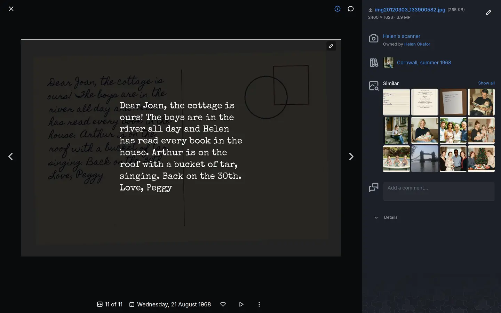
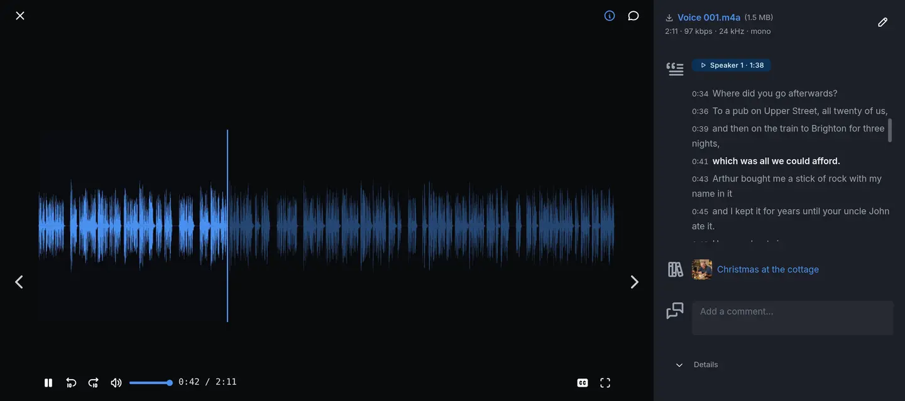

# Supported files

EiN keeps any file you give it. What it works out from a file depends on what kind of file it is:
a photo gets thumbnails, faces and a date, a video also gets a version your browser can play, and a
document has its text read for search. This page is for everyone who brings files into EiN. It
lists the formats EiN recognises, what it makes from each, and what happens to the rest.

## What EiN does with each kind of file

| Kind                            | Formats                                                    | What EiN works out                                                                                                  |
| ------------------------------- | ---------------------------------------------------------- | ------------------------------------------------------------------------------------------------------------------- |
| [Photos](#photos)               | JPEG, HEIC, PNG, TIFF, WebP, AVIF, GIF, BMP, camera RAW    | date, place, camera, thumbnails, faces, text in the picture, what it shows, look-alikes                             |
| [Videos](#videos)               | MP4, MOV, M4V, MTS and M2TS, MPG, AVI, MKV, WebM, 3GP, FLV | date, place, camera, a playable version, a preview clip, chapters, faces, what is said and who says it, look-alikes |
| [Recordings](#recordings)       | M4A, MP3, WAV, FLAC, Ogg and Opus, AMR                     | date, a playable version, a picture of the sound, what is said and who says it, the same recording twice            |
| [Documents](#documents)         | PDF and plain text                                         | the text, for search; the text of scanned pages too                                                                 |
| [Sidecar files](#sidecar-files) | Google Takeout JSON, XMP                                   | nothing of their own: they give their picture its date, place and caption                                           |
| [GPS tracks](#gps-tracks)       | GPX                                                        | the route, added to the track of the device that recorded it                                                        |
| [Zip files](#zip-files)         | ZIP                                                        | in staging, expanded into the files it holds                                                                        |
| [Everything else](#other-files) | any file                                                   | kept as it is, and nothing more                                                                                     |

The work happens in the background after a file arrives, and each part shows up when it is done;
[Getting your photos in](importing.md#why-new-pictures-have-no-thumbnails-yet) explains the order.
A file you upload into staging is read once it arrives, but the text in pictures and documents is
read only when you file it into an album.

## How EiN tells what a file is

EiN looks at the first bytes of a file, not at its name. A JPEG photo named `IMG_0412.png` is
still a JPEG photo, and a file with no extension at all is recognised the same way. It makes no
difference whether the file came in with **Import media**, an upload into an album, or by dropping
it on a page. A file copied in over [SFTP](../shell/ssh-sftp.md) is the exception: when EiN knows
its extension, such as `.png`, `.docx` or `.md`, the type that extension names is the one it keeps,
and only a file with an extension EiN does not know is recognised by its first bytes.

The name decides in two cases, because the bytes say too little:

- **Camera RAW files.** Most RAW formats look like a TIFF picture from their first bytes, so EiN
  goes by the extension, such as `.NEF` or `.CR3`. Capital or small letters do not matter.
- **Sidecar files.** A text file ending in `.json` is JSON data, and one ending in `.xmp` is an XMP
  sidecar, not a document to read.

Once the media service has read a photo, video or recording, the type it reports is the one EiN
keeps. To see what EiN made of a file, run `mime` in the terminal; see
[In the terminal](#in-the-terminal).

## Photos

EiN recognises JPEG, HEIC and HEIF (what iPhones take), PNG, TIFF, WebP, AVIF, GIF and BMP, and the
camera RAW formats below.

For each photo, EiN:

- reads its date, its GPS position and the camera or phone that took it; see
  [Dates and places of pictures](dates-places.md) and [Devices and GPS tracks](devices.md);
- makes thumbnails and screen-sized copies in the AVIF format: a square of 320 pixels, and copies
  that fit inside 512, 800, 1,600 and 2,560 pixels. These copies are never larger than the photo,
  so a small one gets only the sizes up to its own;
- finds the faces in it ([People and faces](people.md));
- reads any text in it, printed or handwritten, so that search finds it
  ([Read the text in a picture](viewer.md#read-the-text-in-a-picture));
- works out what it shows, so that you can search for "a dog on a beach";
- takes a fingerprint, which finds copies, look-alikes and bursts ([Duplicates](duplicates.md)).



### Camera RAW

EiN takes the RAW files of these cameras:

| Extension              | Camera                                     |
| ---------------------- | ------------------------------------------ |
| `.cr2`, `.cr3`, `.crw` | Canon                                      |
| `.nef`, `.nrw`         | Nikon                                      |
| `.arw`, `.sr2`         | Sony                                       |
| `.raf`                 | Fujifilm                                   |
| `.orf`                 | Olympus                                    |
| `.rw2`, `.raw`         | Panasonic                                  |
| `.pef`                 | Pentax                                     |
| `.dng`                 | Adobe DNG, used by many cameras and phones |
| `.x3f`                 | Sigma                                      |
| `.mrw`                 | Minolta                                    |
| `.dcr`, `.kdc`         | Kodak                                      |
| `.3fr`                 | Hasselblad                                 |
| `.iiq`                 | Phase One                                  |
| `.erf`                 | Epson                                      |
| `.srw`                 | Samsung                                    |
| `.rwl`                 | Leica                                      |

A RAW file gets everything a JPEG gets. EiN develops it for the thumbnails; a RAW file whose sensor
data cannot be read is shown from the JPEG preview the camera put inside it. Faces and text are read
from that preview too. A RAW file and the JPEG the camera saved beside it stay two pictures; when
EiN finds them to be duplicates, it suggests keeping the RAW, as the better format
([Which copy is kept](duplicates.md#which-copy-is-kept)).

## Videos

EiN recognises MP4, MOV (what iPhones and many cameras record), M4V, MTS and M2TS (AVCHD
camcorders), MPG, AVI, MKV, WebM, 3GP and FLV.

For each video, EiN:

- reads its date, its GPS position and the camera or phone that recorded it;
- makes a still for its tile and the poster shown before it plays;
- makes a version your browser plays, at most 1920 × 1080 pixels, in the AV1 format inside an MP4
  file, with the sound at 128 kbit/s;
- makes a silent clip of up to 20 seconds that plays when you point at the tile. A video shorter
  than 2 seconds gets none: its still already shows it all;
- makes the small pictures you see when you move along the timeline, and finds where one shot cuts
  to the next, which become its chapters ([Play a video](viewer.md#play-a-video));
- finds the faces in it, and works out what it shows;
- writes down what is said in it and recognises who says it, so that search finds the words and the
  viewer can show subtitles;
- takes a fingerprint, which finds copies and look-alikes.

The viewer plays the AV1 version, not the original. A browser or device that cannot play AV1 says
so; the original can still be downloaded. If a video is too long or too heavy for the media service
to convert within its limits, which can happen on a machine without a graphics card, it gets no
playable version. Use **Download** to watch it on your own device.

## Recordings

EiN recognises M4A (what phone voice memos are), MP3, WAV, FLAC, Ogg and Opus, and AMR. M4B
audiobooks count as recordings too.

For each recording, EiN:

- reads its date, where the file has one;
- makes a version your browser plays: AAC at no more than 128 kbit/s and 44.1 kHz, in an `.m4a`
  file;
- draws a picture of the sound, its waveform, which is the recording's tile and what you see while
  it plays;
- writes down what is said in it and recognises who says it
  ([Listen to a recording](viewer.md#listen-to-a-recording));
- takes a fingerprint of the sound, which finds the same recording twice. A recording shorter than
  about 2.5 seconds gets none.



## Documents

EiN reads the text of PDF files and of plain text files, so that search finds a document by what it
is about: a search for `Christmas letter` finds the family newsletter of 2019. See
[Search and the finder](search.md#find-photos-videos-recordings-and-documents).

- **PDF.** EiN reads the text the PDF holds. A page with almost no text, such as a scanned letter,
  is read as a picture instead, handwriting included. At most 40 pages of one PDF are read this
  way; the pages after that keep only the text they hold.
- **Plain text.** Any file that is text, whatever its name: `.txt`, a Markdown note, an HTML page.
  An SVG drawing is text too, so EiN treats it as a document, not as a picture. Copied in over
  SFTP, a `.md` or `.html` file takes the type its name gives instead, and its text is not read.

A document's text is read once the file is in an album or elsewhere in the library, not while it
waits in staging. Files in folders whose name starts with a dot, such as the trash, are not read.

Documents have no thumbnail: they show as a plain tile, and the viewer has no reader for them. Use
**Download** to open one on your device. The **Documents** choice on the [Media page](media.md#show-one-kind-of-file)
also lists RTF files, but EiN does not read their text: search finds them by their file name only.
An old Word (`.doc`) file is not recognised at all and is kept as one of the [other files](#other-files).

### Word and OpenDocument files

The media service can read the text of Word (`.docx`) and OpenDocument (`.odt`) files, but EiN
recognises a file by its first bytes, and these formats begin like any zip file. A `.docx` or
`.odt` file you upload is therefore kept as a zip file (one copied in over SFTP keeps its type, and
its text is read):

- its text is not read, so search finds it by its name only;
- in a staging category, it is expanded like any other zip, into the parts it is made of, and the
  file itself is removed.

To keep such a document whole and findable, save it as a PDF before you bring it in. To keep the
Word file itself, upload it straight into an album rather than into staging
([Upload straight into the album](albums.md#upload-straight-into-the-album)).

## Sidecar files

A sidecar is a small file beside a picture that says things about it:

- the JSON file Google Photos writes beside every photo and video of a Takeout, such as
  `IMG_0001.jpg.supplemental-metadata.json`;
- the XMP file a photo editor or a scanning tool writes, `IMG_0001.jpg.xmp` or `IMG_0001.xmp`.

A sidecar is not a picture or a document of its own. In staging, EiN pairs it with its picture and
moves it under it, and the picture takes its date, its place where the file has no GPS position,
and its caption. [A Google Takeout export](importing.md#a-google-takeout-export) shows what each
part of a Takeout becomes. A sidecar that matches no picture stays where it is, among the
category's **Other files**.

## GPS tracks

A GPX file is a route recorded by a GPS tracker, a watch or a tracking app. In staging it is not a
picture: EiN adds its points to the track of the device that recorded it, and the file goes. On a
device's page you can upload GPX files to its track directly. See
[GPX files in staging](devices.md#gpx-files-in-staging) and
[Upload a GPX file to a device's track](devices.md#upload-a-gpx-file-to-a-devices-track).

## Zip files

A zip file that you upload or copy anywhere into a staging category is expanded once its upload has
ended: what it holds goes into the folder the zip lies in, and the zip is removed. Outside staging,
for example uploaded into an album, a zip stays a zip.
[Zips and Google Takeout exports](importing.md#zips-and-google-takeout-exports) has the details.

Only zip files are expanded. A `.tar`, `.7z` or `.rar` archive is kept as it is.

## Other files

Any other file is kept as it came, with its name and size, and nothing is made from it. In staging
it counts among the category's **Other files**, and the **Folder** view of the **Files** tab lists
it, where you can move or discard it ([Sorting in staging](staging.md#files-folders-and-moving)).
It does not appear on the Media page, in albums' grids or in search by content. You reach it over
[SFTP](../shell/ssh-sftp.md) or in the [terminal](../shell/terminal.md), and an administrator also
on the **Nodes** page.

Some media formats are among these, because EiN does not recognise them from their first bytes:

| Format                        | Usual extension |
| ----------------------------- | --------------- |
| Windows Media video and audio | `.wmv`, `.wma`  |
| AIFF audio                    | `.aif`, `.aiff` |
| AAC audio outside an M4A file | `.aac`          |
| JPEG XL                       | `.jxl`          |

To have EiN work with such a file, convert it on your own computer first: a video to MP4, a sound to
M4A, FLAC or WAV, a JPEG XL picture to JPEG or PNG.

## Your originals stay as they are

EiN never changes the bytes of the file you uploaded. Thumbnails, playable versions, transcripts,
read text and everything else it works out are kept beside the file. When you correct a date,
turn a picture or write its text by hand, EiN changes what it keeps, not the file. **Download** in
the viewer, and the file name at the top of its details panel, always give you the original.

## When a file does not show up as expected

| What you see                                                                        | Why                                                                                                                 | What to do                                                                                                      |
| ----------------------------------------------------------------------------------- | ------------------------------------------------------------------------------------------------------------------- | --------------------------------------------------------------------------------------------------------------- |
| A new picture shows a plain tile with a picture icon                                | Its thumbnails are not made yet.                                                                                    | Wait. A large import keeps the media service busy for a long while.                                             |
| A file you uploaded into staging is counted under **Other files**                   | EiN did not recognise it as a picture, video or recording: a document, a sidecar, or a format from the table above. | Look at it in the **Folder** view of the **Files** tab. Convert an unrecognised media file and upload it again. |
| A video or recording says "This file cannot be played"                              | The file is damaged: nothing can read it. The reason is under the message.                                          | **Download** it and check it on your own device.                                                                |
| A video says "This browser or device cannot play AV1, the format this video is in." | The browser cannot play the format EiN makes playable videos in.                                                    | Use a current browser, or **Download** the original.                                                            |
| A document is not found by its words                                                | It is still in staging, it is a format whose text EiN does not read, or it is a `.docx` or `.odt` kept as a zip.    | File it into an album. Save Word and OpenDocument files as PDF.                                                 |
| A `.docx` file in staging turned into a folder of XML files                         | It was expanded as a zip.                                                                                           | Discard the parts, and bring the document in as a PDF or upload it straight into an album.                      |
| A RAW file is shown as an ordinary picture with no RAW detail                       | Its sensor data could not be read, so it is shown from the preview inside it.                                       | Nothing is lost: the original is kept, and **Download** gives it to you.                                        |

[Viewing photos, videos and recordings](viewer.md#when-something-is-not-as-expected) covers the
viewer's other messages.

## In the terminal

`mime` shows the type EiN stored for a file, the type its name suggests, and the type its first
bytes say, and whether it counts as camera RAW:

```bash
# in EiN's terminal
mime "/archive/albums/Christmas in Wellington/IMG_0412.HEIC"
```

```text
stored:  image/heic
ext:     image/heic
content: image/heic
raw:     no
```

A file whose `stored` line says `application/octet-stream` was not recognised; one that says
`application/zip` is kept as a zip.

Two commands do a file's reading again, for a file you may change:

| Command                    | What it does                                                                                                      |
| -------------------------- | ----------------------------------------------------------------------------------------------------------------- |
| `exif-extract -f <file>`   | Reads a photo's, video's or recording's date, place and camera again. A file marked as unreadable is tried again. |
| `index-document -f <file>` | Reads a document's text again.                                                                                    |

Every command and its options are in the
[archive's command reference](../reference/commands-archive.md#exif-extract) and the
[core command reference](../reference/commands-core.md#mime).

## Related pages

- [Getting your photos in](importing.md): every way to bring files into EiN, and what happens next.
- [Sorting in staging](staging.md): where uploaded files wait until you file them.
- [Viewing photos, videos and recordings](viewer.md): how each kind of file is shown and played.
- [Search and the finder](search.md): finding files by what they show, say and contain.
- [Duplicates](duplicates.md): copies and look-alikes, and which format is kept.
- [Files and storage](../concepts/files.md): how EiN stores files and what it keeps beside them.
- [The media service](../admin/media-service.md): the part of EiN that does the reading.
