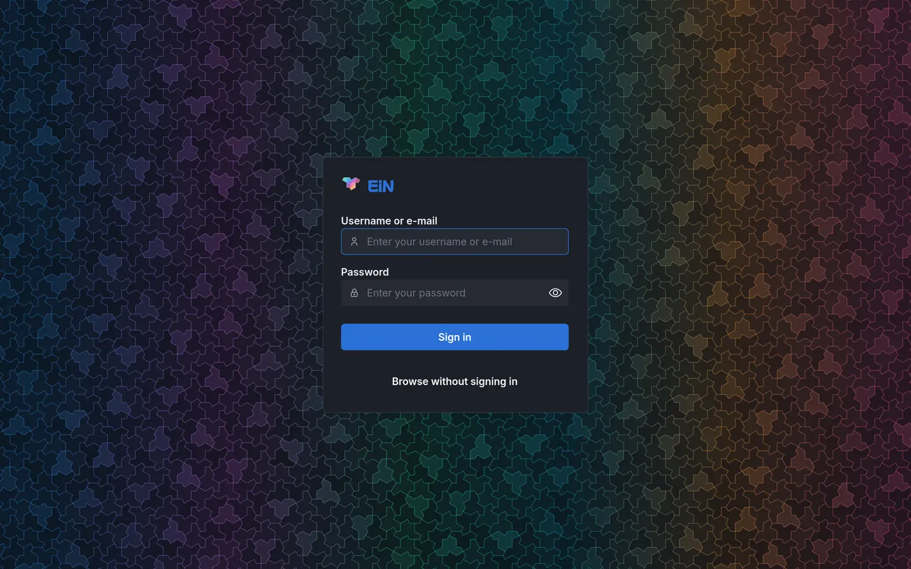
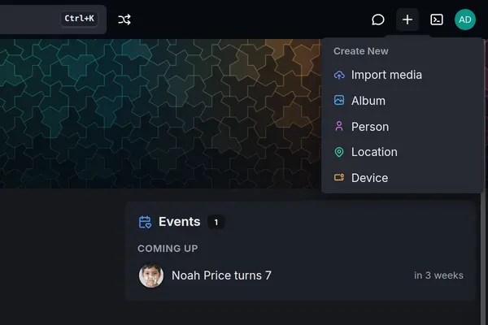
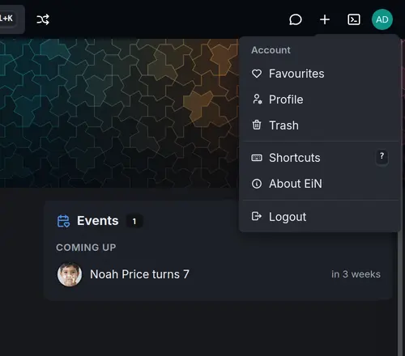
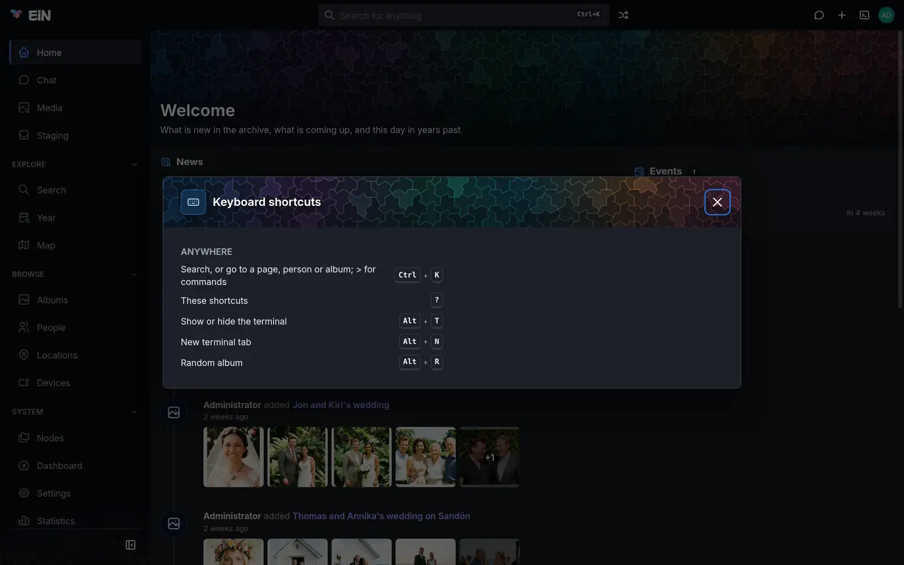

# Finding your way around

This page shows the parts of EiN's web interface and what each one does: the top bar, the sidebar,
the headers of pages, and the dialogs and side panel that pages open in. It also covers signing in
and out. It is for everyone who uses EiN in a browser.

## Sign in

Open the address your administrator gave you, for example `http://ein.local:8080`, in a current
browser. EiN shows its sign-in page.

1. In **Username or e-mail**, type your username, or the e-mail address of your account.
2. In **Password**, type your password. The eye at the right of the field shows what you typed.
3. Choose **Sign in**, or press <kbd>Enter</kbd>.

EiN loads afresh and opens **Home**. If you followed a link to a particular page while signed out,
you land on the sign-in page first and go on to that page once you are in.

> [!NOTE]
> A fresh installation has one account, `admin`, whose password the installer prints once.
> [Install EiN](../start/install.md) and [First steps](../start/first-steps.md) take it from there.

### If you cannot sign in

The sign-in page says what went wrong in a red box above the fields:

| Message                                             | What it means                                                                                                                | What to do                                                                                              |
| --------------------------------------------------- | ---------------------------------------------------------------------------------------------------------------------------- | ------------------------------------------------------------------------------------------------------- |
| `Username or e-mail is required`                    | The first field is empty.                                                                                                    | Fill it in.                                                                                             |
| `login: authentication failed`                      | The username or e-mail, or the password, is wrong. EiN does not say which, so that nobody can find out which accounts exist. | Check both and try again. If you have forgotten your password, ask an administrator to set another one. |
| `login: account disabled`                           | Your password is right, but an administrator has turned off sign-in for your account.                                        | Ask an administrator.                                                                                   |
| `login: password reset required`                    | Your password is right, but your account is waiting for an administrator to set a password.                                  | Ask an administrator to set one.                                                                        |
| `login: too many failed sign-ins; try again in N s` | There have been too many wrong passwords from your network address.                                                          | Wait the number of seconds it gives, then try again.                                                    |

A wrong password takes about a second to be answered. After five failed sign-ins from one network
address, EiN makes that address wait before it checks another password: one second at first,
doubling with each further failure, up to 15 minutes. After five failures on one account, each
attempt on that account is slowed by up to 10 seconds, but the account is never locked, so someone
guessing at your password cannot lock you out. Failures are forgotten an hour after the last one.
Administrators find the rest in [Accounts and groups](../admin/accounts.md).

## Browse without signing in

An administrator can let people look around without an account, with **Visitors may browse** under
**Settings → Permissions** (the setting
[`CFG_GUEST_BROWSING`](../reference/settings.md#cfg_guest_browsing)). It is off by default, and
then anyone who has not signed in is sent to the sign-in page.

Where it is on, opening EiN takes you straight to **Home**, and the sign-in page offers **Browse
without signing in**. As a visitor:

- you see only what has been shared with visitors, and you cannot change anything;
- the top bar has a **Sign in** button where the terminal button and your picture would be, and no
  **Create** menu;
- the sidebar leaves out **Staging** and **Settings**;
- a page that belongs to an account, such as **Profile**, **Trash**, **Favourites**, **About EiN**
  or a form that creates something, sends you to sign in, and back to that page afterwards.

Someone can also send you a share link, an address with `/s/` in it. It opens what was shared
without an account, even where visitors may not browse. There, you see only the pages of what the
link opens: no sidebar and no search box, and the EiN mark leads back to what was shared.
[Sharing](sharing.md) covers share links, including the page that says **This link no longer
works**.

## Sign out

Choose your picture at the right end of the top bar, then **Logout**. EiN signs this browser out,
ends your terminal sessions and shows the sign-in page.

Your sign-in also ends by itself. By default a browser stays signed in for 1 day after its last
visit, and a session unused for 12 hours ends; an administrator can change both under **Settings →
Permissions**. When your sign-in ends, or an administrator disables your account, the page reloads
and shows the sign-in page.

## The parts of the screen

Every page sits in the same frame: the top bar across the top, the sidebar down the left, the page
itself in the middle, and the side drawer at the right when something is open in it.

What you see depends on the modules installed on your EiN. EiN itself gives the frame, Home,
Search, Settings, Statistics, Documentation and the administrator's pages. The archive module adds
the pages for photos, albums, people and places, and the assistant adds the chat. This page
describes EiN with both installed; on yours, some entries may be missing.

The browser tab is titled with the page's name followed by `· EiN`, for example `Albums · EiN`;
on Home it says `EiN` alone. The interface is in English and always dark: there is no light theme
and no other language.

## The top bar

From left to right:

| Part                                    | What it does                                                                                                                                                                                                                                     |
| --------------------------------------- | ------------------------------------------------------------------------------------------------------------------------------------------------------------------------------------------------------------------------------------------------ |
| The EiN mark and name                   | Go to **Home**. On a phone the mark opens and closes the menu instead.                                                                                                                                                                           |
| The search box, **Search for anything** | Finds pages, albums, people and places as you type; <kbd>Enter</kbd> searches everything. <kbd>Ctrl</kbd>+<kbd>K</kbd> (<kbd>⌘</kbd>+<kbd>K</kbd> on a Mac) puts the cursor in it from anywhere. [Search and the finder](search.md) explains it. |
| **Random album** (two crossing arrows)  | Opens an album picked at random; <kbd>Alt</kbd>+<kbd>R</kbd> does the same. Added by the archive.                                                                                                                                                |
| **Disconnected** (with a red dot)       | Shown only while the connection to EiN is lost. EiN tries again every 2 seconds by itself.                                                                                                                                                       |
| **Uploads**                             | Appears once you upload something. While files are going up it is a ring, with "Uploading N of M" in its tooltip; choose it for the files, **Cancel**, **Retry failed** and **Clear**. See [Getting your photos in](importing.md).               |
| **Chat** (a speech bubble)              | Opens the chat in the side drawer; choose it again to close the drawer. Added by the assistant; see [Chatting with the assistant](assistant.md).                                                                                                 |
| **Create** (a plus)                     | The **Create New** menu, below. Signed in only.                                                                                                                                                                                                  |
| **Toggle Terminal (Alt+T)**             | Opens and closes the terminal, which drops down over the page. Signed in only, and not on a phone. See [The terminal](../shell/terminal.md).                                                                                                     |
| Your picture                            | The account menu, below. Its tooltip is your name.                                                                                                                                                                                               |
| **Sign in**                             | For visitors only, in place of the terminal button and your picture.                                                                                                                                                                             |

A button that opens a page in the side drawer is lit while the drawer shows it, and it is left out
on that page itself: on the **Chat** page there is no chat button.

> [!WARNING]
> Uploads run in the open browser tab. Closing or reloading the tab while files are still going up
> stops them, and EiN does not warn you first.

### The Create menu

Choose the plus to make something. Each row opens a form in a dialog over the page you are on.

| Row              | Opens                                                                                | More                                   |
| ---------------- | ------------------------------------------------------------------------------------ | -------------------------------------- |
| **Import media** | **Import media**: choose a category in staging and the files or folders to bring in. | [Getting your photos in](importing.md) |
| **Album**        | **Create Album**                                                                     | [Albums](albums.md)                    |
| **Person**       | **Create Person**                                                                    | [People and faces](people.md)          |
| **Location**     | **Create Location**                                                                  | [Locations and the map](places.md)     |
| **Device**       | **Register Device**                                                                  | [Devices and GPS tracks](devices.md)   |

EiN itself puts no rows in this menu; the modules do. Without a module that adds one, there is no
plus in the top bar.

### The account menu

Choose your picture at the right end of the top bar. The menu is headed **Account**.

| Row                        | Shown                                                  | What it does                                                                                                                                                                                                           |
| -------------------------- | ------------------------------------------------------ | ---------------------------------------------------------------------------------------------------------------------------------------------------------------------------------------------------------------------- |
| **Me**                     | When your account is linked to a person in the archive | Opens that person's page.                                                                                                                                                                                              |
| **Favourites**             | With the archive                                       | The pictures you have marked with a heart.                                                                                                                                                                             |
| **Profile**                | Always                                                 | Your name, description, preferences and password.                                                                                                                                                                      |
| **Trash**                  | Always                                                 | What you have deleted, to restore or remove for good.                                                                                                                                                                  |
| **Shortcuts** <kbd>?</kbd> | Always                                                 | Opens the list of keyboard shortcuts.                                                                                                                                                                                  |
| **About EiN**              | Always                                                 | A dialog with EiN's version, how long it has been running, the installed modules with their versions, the services it uses (the language model, the media service) and the versions of PostgreSQL and Deno it runs on. |
| **Administer…**            | For members of the `sudo` group, outside admin mode    | Admin mode, below.                                                                                                                                                                                                     |
| **Leave admin mode**       | In admin mode                                          | Back to your own rights.                                                                                                                                                                                               |
| **Logout**                 | Always                                                 | Signs you out.                                                                                                                                                                                                         |

[Your profile, favourites and trash](profile.md) covers **Me**, **Favourites**, **Profile** and
**Trash**.

Your picture is the cover photo of the person your account is linked to. Without a linked person it
shows the first letters of your username, as an image drawn by the outside service
`ui-avatars.com`; without a connection to the internet, the first letter of your name shows
instead.

### Admin mode

A member of the `sudo` group can act as the administrator for a while, the way `sudo` works on
other systems, without signing in as `admin`:

1. Choose your picture, then **Administer…**.
2. In the **Administer** dialog, "Enter your password again to act as the administrator until you
   sign out or leave admin mode.", type your own password in **Password**.
3. Choose **Administer**.

The page reloads with the administrator's rights. While they last, your picture has an orange ring
and a small orange shield at its lower left, and its tooltip ends in "(administrator)". A wrong
password shows "That is not your password."

Choose **Leave admin mode** in the same menu to go back to your own rights; signing out ends admin
mode as well. [Accounts and groups](../admin/accounts.md) explains who is in `sudo` and the `admin`
command that does the same in the terminal.

## The sidebar

The sidebar lists the pages, in four sections. The first has no heading.

| Section | Entry             | Opens                                                                                     | Shown to       | Added by  |
| ------- | ----------------- | ----------------------------------------------------------------------------------------- | -------------- | --------- |
|         | **Home**          | On this day, News and Events: [Home, memories and statistics](home.md)                    | everyone       | EiN       |
|         | **Chat**          | Conversations with the assistant: [Chatting with the assistant](assistant.md)             | everyone       | assistant |
|         | **Media**         | Every photo, video, recording and document: [Media, Year and labels](media.md)            | everyone       | archive   |
|         | **Staging**       | Your uploads waiting to be sorted: [Sorting in staging](staging.md)                       | signed in      | archive   |
| Explore | **Search**        | Albums, people, locations, devices and tracks by name: [Search and the finder](search.md) | everyone       | EiN       |
| Explore | **Year**          | One year's pictures: [Media, Year and labels](media.md)                                   | everyone       | archive   |
| Explore | **Map**           | Pictures and tracks on a map: [Locations and the map](places.md)                          | everyone       | archive   |
| Browse  | **Albums**        | [Albums](albums.md)                                                                       | everyone       | archive   |
| Browse  | **People**        | [People and faces](people.md)                                                             | everyone       | archive   |
| Browse  | **Locations**     | [Locations and the map](places.md)                                                        | everyone       | archive   |
| Browse  | **Devices**       | Cameras, phones, scanners and trackers: [Devices and GPS tracks](devices.md)              | everyone       | archive   |
| System  | **Nodes**         | A file manager over the whole [tree](../concepts/tree.md)                                 | administrators | EiN       |
| System  | **Dashboard**     | How EiN is doing: [Health and the dashboard](../admin/monitoring.md)                      | administrators | EiN       |
| System  | **Settings**      | How this installation is set up: [Configuration](../admin/configuration.md)               | signed in      | EiN       |
| System  | **Statistics**    | How the archive has grown: [Home, memories and statistics](home.md)                       | everyone       | EiN       |
| System  | **Documentation** | EiN's own guide, and the commands, settings and modules installed on your EiN             | everyone       | EiN       |

"Administrators" means the `admin` account, or someone in admin mode. For anyone else **Settings**
opens on its **Modules** tab, the only one they get. A section left with no entries is not shown.

- **Where you are.** The entry of the page you are on is lit, with a bar in the accent colour at
  its left.
- **Fold a section.** Click its heading (**Explore**, **Browse** or **System**) to fold it away, and
  again to unfold it. A folded section still shows the entry of the page you are on. This browser
  remembers which sections you folded.
- **Collapse to icons.** The button at the foot of the sidebar, **Collapse to icons**, narrows it to
  a column of icons; hold the pointer over an icon to see its name. The same button, then called
  **Show labels**, brings the names back. This browser remembers the choice.

You and your administrator can rename, reorder, hide and add entries: see
[Your sidebar and top bar](customizing.md). On a phone the sidebar is out of sight until you
choose the EiN mark or swipe right: see [EiN on a phone](phone.md).

## Page headers

Most pages open with a header: a band in EiN's coloured pattern with the page's title, a line
under it, and often counts.

- **Actions** stand at the header's right: **Upload**, **Share** and **Edit** as buttons, in that
  order, on the pages that offer them, then <kbd>⋮</kbd> (**More actions**) with the page's other
  actions and **Move to trash** last. Where the header is narrow the buttons fold into
  <kbd>⋮</kbd> too. Actions that change something are offered only on what you may change.
- **Tabs** sit along the header's foot, such as **Media**, **Map** and **Info** on an album. The
  chosen tab is part of the page's address (`?tab=`), so a link can open a given tab; see
  [Addresses in the web interface](../reference/routes.md).
- **Scrolled down**, the header's last row, its tabs or filters, stays in view under the top bar,
  with <kbd>⋮</kbd> holding every action of the page. On a wide screen the page's name appears at
  that row's left.

Pages that are tools rather than things to look at, such as **Nodes**, **Trash** and **Chat**, have
a header one line high instead, with the title at the left and the page's controls at the right.
The **Map** page has no header; the map fills the page.

**Move to trash** puts the thing in your trash and leaves its page. A message at the foot of the
screen says it was moved, with **Undo** to put it back.

## Pages, dialogs, the side drawer and full screen

The same page can open in four ways. Which one you get depends on where you open it from.

| Opens as        | What you see                                                                                                                                                   | Examples                                                    | To close it                                                                                       |
| --------------- | -------------------------------------------------------------------------------------------------------------------------------------------------------------- | ----------------------------------------------------------- | ------------------------------------------------------------------------------------------------- |
| A page          | The page in the middle of the frame; the address in the browser changes.                                                                                       | Anything in the sidebar                                     | The browser's **Back**                                                                            |
| A dialog        | A box over the dimmed page, with a coloured header band, an icon and a title. On a phone it fills the screen, except a question that only asks you to confirm. | The **Create** forms, **About EiN**, **Keyboard shortcuts** | The **×** at the top right, <kbd>Esc</kbd>, or a click outside the box. On a phone, **Back** too. |
| The side drawer | A panel at the right. On a wide screen it sits beside the page, which makes room for it; on a narrower one it covers the page.                                 | The chat, from the top bar's chat button                    | Its top-bar button again. Where it covers the page, **Back** closes it too.                       |
| Full screen     | Over everything, the top bar included.                                                                                                                         | The viewer for photos, videos and recordings                | **Back** or <kbd>Esc</kbd>                                                                        |

A few things to know about each:

- **A dialog** is not part of the address, so reloading the page closes it. A link inside a dialog
  opens its page in the frame and closes the dialog.
- **The side drawer** keeps the width you give it. Drag its left edge, or click the edge and press
  <kbd>←</kbd> or <kbd>→</kbd> to make it 20 pixels wider or narrower, between 360 and 960 pixels
  (460 at first). This browser remembers the width. On the drawer's own page, such as **Chat**,
  the drawer steps aside, because the page shows the same thing at full size. On a phone the chat
  button opens the chat as a dialog instead.
- **Full screen** is part of the address (`?fullscreen=`), so a reload, or a link you send someone,
  opens it again. On a wide screen an open side drawer stays beside the viewer, so you can read the
  chat next to a photo; see [Viewing photos, videos and recordings](viewer.md).

## Keyboard shortcuts

Press <kbd>?</kbd> anywhere outside a text field, or choose **Shortcuts** in the account menu, to see
the **Keyboard shortcuts** dialog. It lists the keys that work anywhere, and a group for each part
of the screen that has keys of its own, such as the viewer or the **Nodes** explorer, while that
part is on screen.

| Keys                                                              | What they do                                             |
| ----------------------------------------------------------------- | -------------------------------------------------------- |
| <kbd>Ctrl</kbd>+<kbd>K</kbd> (<kbd>⌘</kbd>+<kbd>K</kbd> on a Mac) | Search, or go to a page, person or album; > for commands |
| <kbd>?</kbd>                                                      | These shortcuts                                          |
| <kbd>Alt</kbd>+<kbd>T</kbd>                                       | Show or hide the terminal                                |
| <kbd>Alt</kbd>+<kbd>N</kbd>                                       | New terminal tab                                         |
| <kbd>Alt</kbd>+<kbd>R</kbd>                                       | Random album (with the archive)                          |

On a Mac the list shows <kbd>Alt</kbd> as <kbd>⌥</kbd>. Where a dialog or the viewer covers the
search box, <kbd>Ctrl</kbd>+<kbd>K</kbd> opens the same search as a dialog of its own. Every key EiN
knows, by area, is in [Keyboard shortcuts](../reference/shortcuts.md).

## Messages and other things you will see

- **Messages at the foot of the screen** say what has happened, often with **Undo**. They leave
  by themselves after 4 seconds, or 8 seconds when they offer an action. EiN has no list of past
  messages.
- **Back to top**, a round button at the lower right, appears once you have scrolled a screen's
  height down a page.

## When something goes differently

| What you see                                                                                     | Why                                                                                    | What to do                                                                                                  |
| ------------------------------------------------------------------------------------------------ | -------------------------------------------------------------------------------------- | ----------------------------------------------------------------------------------------------------------- |
| **Disconnected** in the top bar                                                                  | The connection to EiN dropped: your network, or EiN restarting.                        | Wait; EiN reconnects by itself every 2 seconds. If it stays, ask your administrator whether EiN is running. |
| The sign-in page appears while you were working                                                  | Your sign-in ended, or an administrator disabled your account.                         | Sign in again.                                                                                              |
| **Nothing here**: "There is no page at … The link may be mistyped, or what it led to has moved." | The address leads to no page.                                                          | **Go back** or **Go home**.                                                                                 |
| **This page did not load**                                                                       | Its code could not be fetched, usually because EiN was updated while the tab was open. | **Reload**.                                                                                                 |
| **Something broke on this page**: "The rest of EiN still works."                                 | An error while drawing the page; the error text is shown under it.                     | **Reload**. If it keeps happening, send the error text to your administrator.                               |
| An entry you expect is not in the sidebar                                                        | It is for administrators, its module is not installed, or someone hid it.              | See the sidebar table above, [Modules](../admin/modules.md) and [Your sidebar and top bar](customizing.md). |

## Where to go next

- [Search and the finder](search.md): everything the search box and the **Search** page can find.
- [The terminal](../shell/terminal.md): the command line behind <kbd>Alt</kbd>+<kbd>T</kbd>.
- [Keyboard shortcuts](../reference/shortcuts.md): every key, by area.
- [Your sidebar and top bar](customizing.md): rename, hide and add entries.
- [EiN on a phone](phone.md): the menu behind the mark, swiping and adding EiN to the home screen.
- [Your profile, favourites and trash](profile.md): your own pages from the account menu.
- [Addresses in the web interface](../reference/routes.md): every page's address, for links.
