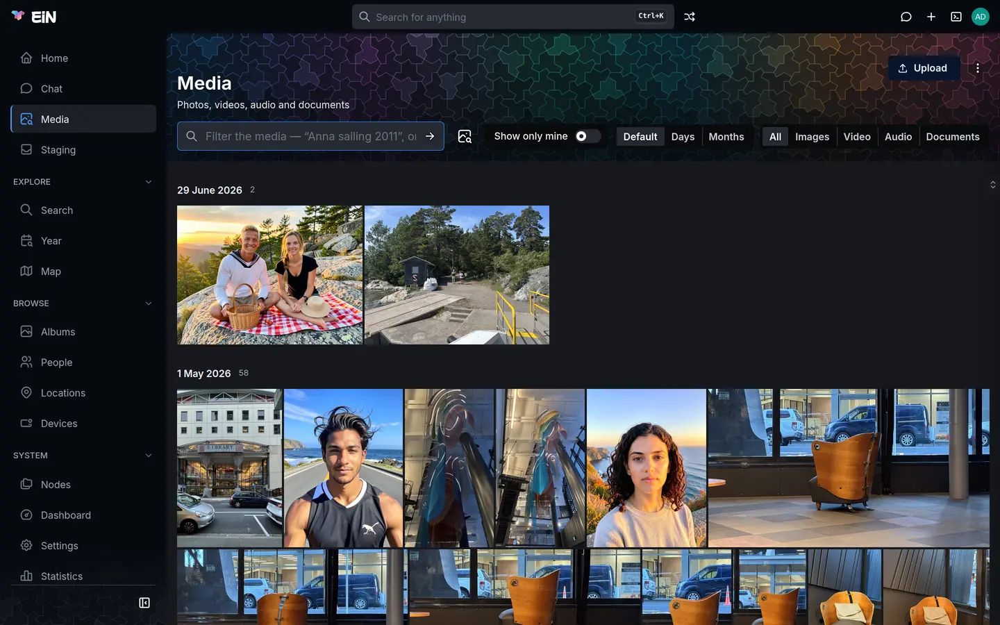
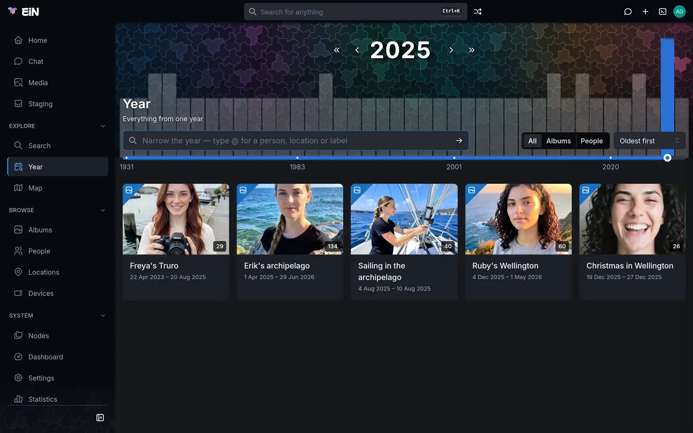

# Media, Year and labels

The **Media** page shows every photo, video, recording and document you may see, and searches them. The **Year** page shows what one year of the archive holds. Labels are words you put on pictures and albums so that you can find them again. This page is for everyone who browses the archive.

## The Media page

Open **Media** in the sidebar. The page is headed **Media**, "Photos, videos, audio and documents", with a search box and its controls under the title.



The page works in two ways:

- **With the box empty, it is a feed**: everything you may see, newest first, in sections by date.
- **With anything typed or picked in the box, it is a search**: the best matches first, in one grid without dates. See [Search from the Media page](#search-from-the-media-page).

### Browse the feed

- Each section is headed by its date, such as "29 June 2026", and the number of pictures in it. As you scroll, the date of the section you are in stays at the top of the page.
- Click a date heading to select everything under it. Click it again to clear the selection.
- A picture known only to a year, such as a scan dated 1975, sits under the year alone. Pictures with no date at all come last, under **Undated**. [Dates and places of pictures](dates-places.md) explains where dates come from.
- Above the feed, a row of round rings shows this day in earlier years: one for each earlier year with pictures taken on today's date, marked "1 year ago", "12 years ago" and so on. A ring plays that year's pictures as a story. [Home, memories and statistics](home.md) describes it.
- Once the feed holds more than 120 pictures, a time rail runs down the right edge of the page. Drag it to move through the years; the feed loads the pictures from the date you drag to.
- Click a picture to open it in the viewer, where the arrows walk through the feed. The viewer's "N of M" counter is not shown here, because the feed loads part of the archive at a time. [Viewing photos, videos and recordings](viewer.md) covers the viewer.
- On a phone, in the **Default** layout, pinch the grid to fit between 2 and 5 pictures across.

Files in your staging area are not in the feed, and not in the page's searches, until you file them into an album. See [Sorting in staging](staging.md).

### Choose a layout

**Layout** decides how the feed is drawn:

| Layout      | How the feed looks                                                                                                  |
| ----------- | ------------------------------------------------------------------------------------------------------------------- |
| **Default** | By day, each picture at its own shape, in rows that fill the width.                                                 |
| **Days**    | By day, in square tiles: three across on a phone, more on a wider screen.                                           |
| **Months**  | By month, in square tiles: five across on a phone, more on a wider screen. Good for getting around a large archive. |

A search is one grid without dates, so **Layout** is hidden while you search. Your choice is remembered in this browser, not for your account: another computer or phone starts with **Default**.

### Show only what you added

Turn on **Show only mine** to see only the files you added yourself, the ones uploaded or imported under your account. It narrows searches from the box as well as the feed. With nothing of yours to show, the page says "Nothing you have added yet."

The switch is off by default, and like the layout it is remembered in this browser. Visitors who have not signed in do not have it.

### Show one kind of file

**Show** keeps one kind of file:

| Choice        | What is shown                                                      |
| ------------- | ------------------------------------------------------------------ |
| **All**       | Photos, videos, recordings and documents.                          |
| **Images**    | Photos.                                                            |
| **Video**     | Videos.                                                            |
| **Audio**     | Recordings.                                                        |
| **Documents** | PDF, Word, OpenDocument, RTF, Markdown, HTML and plain text files. |

Choosing a kind keeps the feed: the videos alone are still newest first, by date. The kind goes into the page's address (`/media?kind=video`), so a link you copy opens the same view. Documents show as a placeholder tile with no picture; [Supported files](file-types.md) lists which ones EiN reads the text of.

### Narrow by label

When the pictures shown carry labels, a row of label pills appears above them, each with the number of pictures that carry it. Click a pill to keep only those pictures: the label becomes a `#label` chip in the box, and the page turns into a search. Click another pill to narrow further, to pictures that carry both labels. Remove a chip with its × to widen the view again.

A label that every picture shown already carries would narrow nothing, so it is left out of the row, as are the labels you have already chosen. [Labels](#labels) explains how pictures get them.

### Search from the Media page

Type in the box, where it says "Filter the media — “Anna sailing 2011”, or type @ to pick someone", and press <kbd>Enter</kbd>. On a computer the box has the keyboard as soon as the page opens, so you can start typing at once.

- Words find pictures by what they show, by the text written in them and by what is said in recordings and videos. "Christmas tree" finds Christmas pictures from every decade, whether or not anyone labelled them.
- A year in what you type becomes a chip, such as "1998" or "from 2010", and a kind of file, such as "videos", sets **Show**. With a language model set up, the names of people and places become chips too.
- `@` opens a list of people, locations, labels, devices and albums. Pick one to keep only the pictures that have it: `@Peggy Wrenfield`, `@The cottage at Malpas`, `#sailing`.
- The picture button beside the box, **Search with a picture**, finds what looks like a picture from your device, such as a photo of an old print.

The results are one grid, best matches first. Each tile shows its score as a percentage, measured against the best match, which is 100%. The search is kept in the page's address, so you can send someone the link and it opens the same search. Remove the chips and empty the box to return to the feed.

[Search and the finder](search.md) explains the rest: how the box reads a sentence, the **Interpreted filter** beside the box, what needs the media service and what a language model adds.

### Act on pictures

Select pictures as you would in an album: hover over a picture and tick its box, <kbd>Shift</kbd>+click to select a range, <kbd>Ctrl</kbd>+click (<kbd>⌘</kbd>+click on a Mac) to add or remove one, <kbd>Ctrl</kbd>+<kbd>A</kbd> to select everything loaded, and <kbd>Esc</kbd> to clear. On a touch screen, press and hold a picture. <kbd>?</kbd> lists these keys, and [Albums](albums.md) describes selecting in full.

A bar at the bottom says how many are selected and offers what you may do with them:

| Button                          | What it does                                                                            | Shown when                          |
| ------------------------------- | --------------------------------------------------------------------------------------- | ----------------------------------- |
| **Favourite** / **Unfavourite** | Hearts the pictures, or takes them out of your favourites when all of them are hearted. | You are signed in.                  |
| **Download**                    | Downloads one file as itself, several as one zip file.                                  | Always.                             |
| **Add to album**                | Links the pictures into an album you choose, or one you name there.                     | You are signed in.                  |
| **Set time**                    | Sets when the pictures were taken. See [Dates and places of pictures](dates-places.md). | You may change every selected file. |
| **Set location**                | Sets where they were taken. See [Dates and places of pictures](dates-places.md).        | You may change every selected file. |
| **Label**                       | Puts labels on them. See [Put labels on pictures](#put-labels-on-pictures).             | You may change every selected file. |
| **Delete**                      | Moves them to your trash, with **Undo** in the message that follows.                    | You may change every selected file. |

On a phone the buttons fold into one **Actions** menu. Your favourites and your trash are described in [Your profile, favourites and trash](profile.md).

### Upload from the Media page

**Upload**, at the top right of the page, picks files to send, and **Upload a folder**, under ⋮, picks a whole folder. You can also drop files anywhere on the page: the screen says "Drop files to upload" and "Into staging, folders and all".

All three send the files to your staging area, into today's folder of your inbox, and not into the library. They appear on the Media page once you have filed them into an album. You need to be signed in to upload. [Getting your photos in](importing.md) explains every way in and what happens to a file afterwards.

## The Year page

Open **Year** under **Explore** in the sidebar. The page is headed **Year**, "Everything from one year", and opens on the current year, or on the year its address names: `/year?year=1968` opens 1968.



### Pick a year

There are three ways to move, and they work together:

- **The arrows beside the year.** **‹** and **›** step one year earlier or later. **«** and **»** jump to the nearest earlier or later year that holds anything, which saves stepping through the empty years between sparse decades. Pointing at **«** or **»** names the year it jumps to, for example "Previous year with entries: 1983", or says "No earlier entries" when there is none; with **Albums** or **People** chosen under **Show**, it counts those instead.
- **The histogram behind the header.** Each year that holds anything has a faint bar, taller the more it holds; the chosen year's bar is drawn in blue. The bars grow with the square root of the count, so a year with two albums is still visible beside one with a hundred.
- **The slider along the foot of the header.** It has one step for each year that holds anything, plus the current year, so empty years take no room. A few of the years are written under it. Drag the handle and the year at the top follows.

The year is kept in the page's address, so you can link to it, and a reload opens the same year. Visiting many years does not fill the browser's history: one press of Back leaves the Year page. The **Years** section of the [Search](search.md) page lists every year with something in it and opens it here.

### What a year shows

The year shows two kinds of card:

- **Albums that hold pictures taken that year.** An album with pictures from one December and the January after appears in both years. The card is the one the **Albums** page draws: the cover, the name, the dates and the number of items. An album with no dated pictures appears in no year, and suggested albums in your staging area do not appear.
- **People born or died that year.** A person's card has the badge **Born**, or **Died**, with their age added when their birth date is known: Arthur Wrenfield appears in 2014 as **Died, aged 83**.

Click a card to open the album or the person. Two controls at the right of the box arrange the cards:

| Control  | Choices                                                                                                                                |
| -------- | -------------------------------------------------------------------------------------------------------------------------------------- |
| **Show** | **All**, **Albums**, or **People** (births and deaths).                                                                                |
| **Sort** | **Oldest first** (the default), **Newest first**, **Name (A-Z)** or **Most items**. With **Most items**, people come after the albums. |

Both are remembered in this browser. The histogram and the jump arrows follow **Show**: with **People** chosen, they show the years with births and deaths. On a phone, **Show** and **Sort** fold into one button with a sliders icon.

When a year holds nothing, the page says "Nothing from 1957." and the histogram shows which years do.

### Narrow the year to a person, a place or a label

The box under the year, "Narrow the year — type @ for a person, location or label", keeps only what has to do with one person, one location or one label.

1. Type `@` and the first letters of the name, for example `@pegg`.
2. Pick **Peggy Wrenfield** from the list with the mouse, or with the arrow keys and <kbd>Enter</kbd> or <kbd>Tab</kbd>.
3. Press <kbd>Enter</kbd>.

The name becomes a chip in the box, and the year keeps:

| Chip                 | What the year keeps                                            |
| -------------------- | -------------------------------------------------------------- |
| A person             | Albums holding pictures of them, and their own birth or death. |
| A location           | Albums holding pictures taken there.                           |
| A label (`#sailing`) | Albums holding pictures that carry the label.                  |

You can have one person, one location and one label at a time; picking a second person replaces the first. Words typed without `@` keep the cards whose title or description contains them. Remove a chip with its × to widen the year again.

The histogram and the jump arrows follow the box as well, so they show the years where that person, place or label appears. When the year you are on has nothing that matches, the page says "Nothing from 1968 matches — the histogram shows the years that do." Use **«** or **»** to jump to the nearest year that does.

The box narrows what you see without changing the address: a reload, or a link you send, shows the whole year.

## Labels

A label is one word, such as `sailing` or `christmas`, that you put on a picture, an album, a person, a location or a device. A label stays one word: spaces and commas in what you type start the next label, and a slash becomes a hyphen. Labels are shared across the archive, so the labels anyone has used are offered as you type, and the same word is the same label wherever it is.

Labels show under the name of what carries them: in an album's, a person's, a location's or a device's header, and in the viewer's details panel.

### Put labels on pictures

1. Select the pictures, on the Media page, in an album, or on a person's, a location's or a device's **Media** tab.
2. Press **Label** in the bar at the bottom.
3. In **Add labels**, type the labels. "Pick a label in use or type a new one. A space starts the next label."
4. Press **Add labels**.

**Label** is offered only when you may change every selected file. To put labels on a single picture you have open, use its pencil menu in the viewer: **Edit** opens **Edit file**, which has a **Labels** field.

### Put labels on an album, a person, a location or a device

Each of these has a **Labels** field in its edit dialog, opened with **Edit** in its header: **Edit album**, **Edit person**, **Edit location** and **Edit device**. Add a label by typing it, take one off with the × on it, and save the dialog. You see **Edit** only where you may change the thing.

The edit dialogs are also the only place in the web interface where you take labels off. There is no button that takes a label off many pictures at once; in the terminal, `label remove` does it for one node at a time.

### Find what carries a label

Where you look decides what you find:

| Where                                                            | What it finds                                                                                                                                            |
| ---------------------------------------------------------------- | -------------------------------------------------------------------------------------------------------------------------------------------------------- |
| Click a label wherever it is shown                               | The [Search](search.md) page for that label: albums holding a picture that carries it, and any album, person, location or device that carries it itself. |
| The Media page: pick the label with `@`, or click its label pill | The pictures that carry the label.                                                                                                                       |
| The Year page: pick the label with `@`                           | The albums of that year holding pictures that carry it.                                                                                                  |
| An album's **Info** tab, under **Labels**                        | The album's pictures that carry each label, with their count. See [Albums](albums.md).                                                                   |
| The **Labels** section of the Search page, before you search     | Every label in use, most used first, each with its count.                                                                                                |

A label on an album finds the album on the Search page, but the Media and Year pages look at the pictures themselves: a picture carries a label only when it was put on the picture.

The Search page's **Labels** section also lists suggested labels, drawn outlined with a sparkle: words that at least five pictures look like but that nothing carries yet. Pointing at one says, for example, "A suggested label: 12 pictures look like it, and nothing carries it yet". The words come from a list of things a family archive shows, such as `beach`, `wedding` or `christmas`, in the archive's language (`en` or `sv`, the setting [`CFG_LANGUAGE`](../reference/settings.md#cfg_language)).

### The labels folder

Every label is also a folder: `/archive/tags/<label>` holds a link to each picture, album, person, location or device that carries the label. You can look through it in the terminal, for example with `ls /archive/tags/sailing`. [Links](../concepts/links.md) explains links in the tree.

A label is kept in two places: on the node that carries it, which the label pills count, and as the link in the folder, which a search for the label reads. The dialogs, `label add` and `label remove` keep the two in step, so put labels on and take them off with those, not by adding or deleting links in the folder. When something labelled is deleted, its link in the folder goes with it, and `label prune` clears any link left pointing at nothing. A label is listed while at least one thing carries it.

### Let EiN suggest where a label belongs

When you are signed in and the Search page or the Media page asks for exactly one label, a bar headed **Looks like** and the label appears above the results. EiN learns what the label looks like from the pictures that carry it, and suggests other pictures and albums that look the same.

1. Search for one label, for example by clicking `sailing` on an album, or by picking `#sailing` on the Media page.
2. On the **Looks like sailing** bar, press **Show**. While EiN learns, the bar says "Learning what sailing looks like…".
3. Look through the suggestions: pictures and albums that do not carry the label yet, the most alike first.
4. Select the pictures that belong and press **Label sailing**, or select the ones that do not and press **Not sailing**. An album's card has its own **Label** and **Not sailing** buttons.

EiN learns from each answer: the model and the suggestions are worked out again at once, and what you marked as not the label is left out of the suggestions from then on. **Show all** opens the Media page with every picture that looks like the label and does not carry it yet, the most alike first, under the chip **Looks like sailing**. **Hide** folds the bar.

When the model is good enough to stand on its own, the bar says how many pictures it would add, for example "40 more look like it", before you open it. For a suggested label that nothing carries yet, the bar opens by itself, because the suggestions are all there is.

Under the bar, one line says how far to trust the suggestions:

| What the bar says                                                                                                                                                     | What it means                                                                                                             |
| --------------------------------------------------------------------------------------------------------------------------------------------------------------------- | ------------------------------------------------------------------------------------------------------------------------- |
| "Learned from N pictures in N labeled files and albums. Of the labeled pictures held back, it finds N% again."                                                        | EiN hid some of the labelled pictures while learning and checked how many it found again. The higher, the better.         |
| "… Label a few more for it to measure how well it finds them."                                                                                                        | Too few pictures carry the label to check the model. It still suggests.                                                   |
| "Suggested from what "a photo of a christmas tree" looks like. Label pictures of it and it learns from them instead."                                                 | A suggested label: nothing carries it yet, so EiN goes by what the words describe.                                        |
| "Nothing with this label has a picture to learn from."                                                                                                                | The label is only on people, places or devices, or on pictures the media service has not looked at yet.                   |
| "The pictures held back were not found again, so what this label names does not seem to show in the pictures: a person, a trip or a time rather than something seen." | The label names something you cannot see, so EiN offers no suggestions. **Show what it would suggest** shows them anyway. |

"Nothing else looks like sailing" means that no picture outside the label is alike enough, apart from those marked as not it.

Learning works from what the media service has worked out about each picture, so a picture it has not looked at yet is neither learned from nor suggested. Besides the learning you start from the bar, the archive's `label-models` service relearns every label, and every suggested word, once an hour when something has changed: when pictures gained or lost the label, when something was marked as not the label, or when a week has passed. The web interface has no button to take back a **Not**; in the terminal, `label-model unreject` does.

## When something goes differently

| What you see                                                                                                                  | What it means, and what to do                                                                                                                                                                                                                          |
| ----------------------------------------------------------------------------------------------------------------------------- | ------------------------------------------------------------------------------------------------------------------------------------------------------------------------------------------------------------------------------------------------------ |
| **Incomplete answer**: "The content match did not answer in time, so these are filename matches only. Try again in a moment." | The media service did not answer the search in time, so only file names were searched. Try again shortly. If it keeps happening, tell whoever looks after EiN; [The media service](../admin/media-service.md) is theirs.                               |
| "No person or location filter matched … — searched those words as description instead."                                       | The Media page found no person or place by that name, and searched the words as text. Pick the person with `@` instead.                                                                                                                                |
| "No match for @… — searched as plain text instead."                                                                           | The same on the Year page.                                                                                                                                                                                                                             |
| Pictures you uploaded are missing from the Media page                                                                         | Files sent with **Import media** or the Media page's **Upload** wait in your staging area until you file them into an album; see [Sorting in staging](staging.md). A file that is still being prepared shows a placeholder until its thumbnail exists. |
| An album is missing from a year                                                                                               | None of its pictures is dated in that year. Check the pictures' dates; see [Dates and places of pictures](dates-places.md).                                                                                                                            |
| "The histogram counts only the first N matches."                                                                              | There is more than the histogram counts, so its bars show part of it. The cards for the chosen year are complete.                                                                                                                                      |
| "Nothing matches that filter."                                                                                                | No picture meets every chip. Remove a chip, or choose **All** under **Show**.                                                                                                                                                                          |
| **Label**, **Set time** or **Delete** is missing from the selection bar                                                       | You may not change every selected picture. Select only your own, or ask the person who shared them.                                                                                                                                                    |
| The layout, **Show only mine** or the Year page's **Show** and **Sort** are different on another device                       | They are remembered per browser, not per account.                                                                                                                                                                                                      |

## In the terminal

The Media page, the Year page and labels all run ordinary commands, which you can run yourself in [the terminal](../shell/terminal.md):

```bash
# in EiN's terminal
search --tag sailing --kind photo,video          # pictures that carry a label
search 'christmas tree' --kind photo             # pictures by what they show
timeline --year 1968 --kind album,auto-album,birth,death  # what the Year page shows for 1968
labels                                           # every label in use, with its count
label add '/archive/albums/Summer 2020' sailing  # put a label on an album
label remove '/archive/albums/Summer 2020' sailing
ls /archive/tags/sailing                         # the label's folder
label-model show sailing                         # how well the label is learned
```

`timeline` also takes `--person`, `--location` and `--tag`, as the Year page's box does. The full options are in the reference for [`search`](../reference/commands-core.md#search), [`label`](../reference/commands-core.md#label), [`labels`](../reference/commands-core.md#labels), [`timeline`](../reference/commands-archive.md#timeline) and [`label-model`](../reference/commands-archive.md#label-model), and [Commands by task](../shell/commands.md) lists more.
