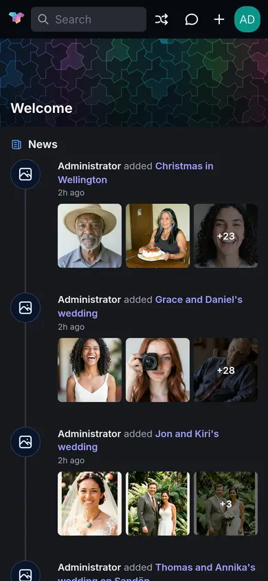
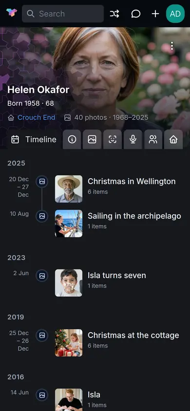

# EiN on a phone

This page covers what is different when you use EiN on a phone or a tablet: the menu behind the EiN
mark, the gestures in grids and in the viewer, uploading from the phone, backing it up by itself,
reporting where it is, the EiN app for Android, putting EiN on your home screen and sharing pictures to it from other apps. It is for everyone in the family who opens EiN away from a computer. The grids, the
viewer and the uploads are the [Archive](../archive/index.md)'s, and the sections on them apply once
it is installed.

## Open EiN on your phone

Open the same address you use on a computer, for example `http://ein.local:8080`, in your phone's
browser, and sign in as you would on a computer (see [Sign in](interface.md#sign-in)). It is the
same EiN, with the same account, pictures and permissions; only the layout changes to fit the
screen.

The phone keeps a few choices of its own, separate from your computer's: whether the menu shows
icons or names, whether it is shown, and how many pictures a grid puts in a row. They are kept in
the phone's browser, not in your account.

## What changes on a small screen

What you get depends on the width of the browser window, and on whether the screen is a touch
screen.

| Screen                                                          | Layout                                                                                                                                                         |
| --------------------------------------------------------------- | -------------------------------------------------------------------------------------------------------------------------------------------------------------- |
| Narrower than 768 pixels: most phones held upright              | The phone layout this page describes.                                                                                                                          |
| 768 to 991 pixels: tablets, and some large phones held sideways | The computer's layout, with the sidebar beside the page and the terminal button. The chat's side drawer covers the page, and the browser's **Back** closes it. |
| 992 pixels and wider                                            | The computer's layout, with the side drawer beside the page.                                                                                                   |

On any touch screen, whatever its width, the Archive's viewer uses its touch layout and pressing
and holding a picture selects it. So a tablet has the computer's frame with the phone's viewer.
A page's filter box, such as an album's, waits for a tap there too: on a computer it has the
keyboard as soon as the page opens, but on a phone or tablet that would raise the on-screen keyboard
over the page.

In the phone layout:

- **The top bar** shows the EiN mark without the name, the search box (it reads **Search**), then
  the buttons the modules add, such as the Archive's **Random album**, the assistant's **Chat** and
  the plus of the **Create** menu, and your picture. Its buttons are
  larger, to suit a finger. The **Uploads** button appears there while files are going up.
- **The menu is hidden** until you ask for it: see [Open the menu](#open-the-menu).
- **There is no terminal button.** When the connection drops, a red crossed-out plug stands in the
  top bar while EiN reconnects, and **Offline** once it cannot be reached; see
  [Without a connection](#without-a-connection).
- **The search box** opens its list across the whole width of the screen, above the keyboard, and
  the keyboard's search key does what <kbd>Enter</kbd> does. [Search and the finder](search.md)
  covers what it finds.
- **Dialogs fill the screen**, with their buttons in a bar across the foot. Fields use larger text,
  so the phone does not zoom in while you type. A question that only asks you to confirm stays a
  small box. The phone's **Back** closes a dialog.
- **The chat**, with the assistant installed, opens as a dialog over the whole screen instead of in
  the side drawer; see [Chatting with the assistant](../assistant/chat.md).
- **The create and account menus** are wider, with taller rows.

### Page headers on a phone

- **Actions** such as **Upload**, **Share** and **Edit** fold into ⋮ at the header's top right,
  with the page's other actions.
- **Tabs with icons** show only their icons, and the tab you are on keeps its name. On a person's
  page, which the Archive adds, the icons stand for **Info**, **Media**, **Faces**, **Heard in**,
  **Family** and **Homes**.
- **Choices** such as **Show** and **Sort** become a button that shows the chosen option's icon;
  on some pages, such as **Year**, several fold into one button.
- **Scrolled down**, the header goes away, and the page's filter box and choices float at the foot
  of the screen beside **Back to top**. An empty filter box folds to a magnifier: tap it to type,
  and it takes the whole row while you type.

## Open the menu

On a phone the EiN mark at the left of the top bar is the menu button; there is no separate menu
icon. It does not go to Home, as it does on a computer: **Home** is the first entry in the menu.

The menu has two forms:

- **A column of icons** at the left of the screen, which is what you get at first. Tap the mark to
  show it; the page moves over to make room. Tap an icon to go to its page; the column stays until
  you tap the mark again.
- **The full list with names**, under the headings **Explore**, **Browse** and **System**. Tap the
  button at the foot of the icon column (**Show labels**) to switch to it. It opens over the page,
  and closes when you choose a page; tap the mark to open it again. The button at its foot
  (**Collapse to icons**) switches back to the column of icons.

You can also swipe: a one-finger swipe to the right across the page or the menu brings the menu
out, and a swipe to the left puts it away. The swipe has to be mostly sideways and quick, and it
does nothing:

- in the viewer or anything else shown full screen, where a sideways swipe moves between pictures;
- in a dialog, such as the chat;
- on something that moves sideways itself: the map, the time rail at the right of a long grid, a
  story, a slider, a text field, or a row that scrolls sideways.

A swipe that starts at the very edge of the screen may be taken by the phone as its own Back
gesture, so start a little way in. The phone remembers which form of the menu you chose, and
whether the icon column is shown. [Finding your way around](interface.md#the-sidebar) lists what
is in the menu.

## Pinch, press and tap in a grid

With the Archive installed, a grid of pictures, such as an album or the **Media** page, works by
touch like this:

| To                           | Do this                                                                                                            |
| ---------------------------- | ------------------------------------------------------------------------------------------------------------------ |
| Open a picture in the viewer | Tap it.                                                                                                            |
| Show fewer, larger pictures  | Spread two fingers apart on the grid, then lift them. Each pinch takes away one picture per row, down to 2.        |
| Show more, smaller pictures  | Pinch two fingers together, then lift them. Each pinch adds one picture per row, up to 5.                          |
| Start selecting              | Press and hold a picture for a moment. It is ticked, and the phone gives a short buzz where its browser allows it. |
| Add or take away a picture   | Once anything is selected, tap it.                                                                                 |
| Select a whole day           | Tap the date in the day's heading.                                                                                 |
| Move through a long grid     | Drag the time rail at the right edge, which appears once the grid holds more than 120 pictures.                    |

A phone's grid starts with 2 pictures in a row, and keeps the number you pinch to in this browser.
Pinching works where pictures keep their own shapes, such as an album or the **Media** page in its
**Default** layout. The **Days** and **Months** layouts of the Media page have square tiles, three
and five across on a phone, and do not change with a pinch; see [Media, Year and labels](../archive/media.md).
Where the grid is 640 pixels wide or more, as on most tablets, it fills its rows by height
instead, and a pinch does not change it.

Moving your finger while you hold cancels the press, so scrolling a grid never selects a picture.
Once something is selected, the bar at the foot of the screen shows how many, for example **3
selected**, with all its buttons in one **Actions** menu and **×** to clear the selection.
[Albums](../archive/albums.md#select-pictures) covers selecting, and
[The selection bar](../archive/albums.md#the-selection-bar) what each action does.

A video in a grid plays a short silent preview when it scrolls into view, as there is no pointer
to rest on it.

## The viewer on a phone

With the Archive installed, its viewer takes a touch layout on any touch screen, and in any browser
window narrower than 768 pixels. Swipe sideways between files, up for the details, and down to put
them away or, with them closed, to close the viewer: the touch layout has no close button.
[On a phone or tablet](../archive/viewer.md#on-a-phone-or-tablet) covers its layout and gestures,
and [Watch the memories story](../archive/home.md#watch-the-memories-story) the story that
**On this day** plays on Home, which works by touch too.

## Upload from your phone

With the Archive installed, bring the photos and videos on your phone into your staging area with
**Import media**:

1. Tap the plus in the top bar, then **Import media**. The dialog fills the screen.
2. Under **Into which category?**, pick where the files go. The **Inbox** is chosen at first. To
   keep a phone's pictures together, make a category for it first; see
   [Make a category](../archive/staging.md#make-a-category).
3. Tap **Choose files**. Your phone's own picker opens, with your photo library, the camera or your
   files, depending on the phone.
4. Pick the files, then tap the button that counts them, for example **Upload 24**.

The category opens on its **Files** tab, and the **Uploads** ring in the top bar shows how far the
upload is. [Getting your photos in](../archive/importing.md#import-media) covers the dialog in full, and
[Sorting in staging](../archive/staging.md) what to do with the files once they are in.

**Upload** also sits under ⋮ on an album you may change, on the **Media** page and on a staging
category. Its picker is your phone's own, as in **Import media**: your photo library, the camera, so
you can take a picture and upload it in one go, and your files, such as a GPX track or a GEDCOM
family tree. An album's **Upload** puts the files straight into that album; the Media page's puts
them into your Inbox. **Choose a folder** and **Upload a folder** need a browser that can pick a
folder, which a phone's browser may not offer.

> [!WARNING]
> An upload runs in the open page. Keep EiN on screen until the upload has finished: a phone may
> pause a browser that is in the background or behind a locked screen, and closing or reloading the
> page stops the files not sent yet. The files already sent stay. A file is sent in pieces, so when
> the connection drops, or the phone moves from Wi-Fi to mobile data, it goes on where it stopped
> once the connection is back.

For a whole camera roll, thousands of files, copying from a computer is steadier than uploading
from the page, and the EiN app can keep sending the new ones by itself; see [Back up your phone automatically](#back-up-your-phone-automatically). The **Import media** dialog itself suggests copying over SFTP for more than about
10,000 files; see [Copy files in over SFTP](../archive/importing.md#copy-files-in-over-sftp).

On the Media page, **Search with a picture** can take a photo with the camera and find what looks
like it; see [Search with a picture](../archive/search.md#search-with-a-picture).

## Back up your phone automatically

With the Archive installed, the [EiN app](#the-ein-app) on an Android phone sends every new photo
and video into your staging area by itself, the way Google Photos backs up a phone, at home or away.
It needs no password and no address of its own: it sends as you, to the EiN it is paired with.

1. **Install the app and pair it**; see [The EiN app](#the-ein-app).
2. **Open App** under **System** in the app's menu. **Photo backup** is at its foot.
3. **Choose where the photos go**, under **Back up into**: a staging category of yours, or **New
   category:** with the phone's name, which makes a [category](../archive/staging.md#categories)
   called after the phone. On the **Staging** page in the app, every category's **Info** tab has
   **Back up this phone here**, which does the same and turns the backup on.
4. **Turn Back up photos and videos on.** The phone asks whether the app may see your photos and
   videos: choose **Allow all**. With **Allow limited access** the app sees, and sends, only the
   ones you pick. Where a photo was taken is asked for with them; without it the phone takes the place
   out of every photo the app reads.
5. **Choose the folders.** **Camera** is chosen at first. Tick others the phone lists, such as
   **Screenshots** or **WhatsApp Images**, to send theirs too; each shows how many photos and videos
   it holds.
6. **Choose when it sends.** **Only on Wi-Fi** is on at first, to spare mobile data; **Only while
   charging** waits for the charger as well.

What the backup then does:

- **It sends what is new soon after.** A photo you take is sent within a few minutes, once the
  conditions you chose are met. It also looks for anything missed every hour, and **Back up now**
  looks at once.
- **It sends only what EiN lacks.** Before sending, it asks EiN which of the photos you already
  have, anywhere you can see them, your staging area included, and sends only the others. Photos you
  filed into albums are not sent again, nor is a camera roll you uploaded another way.
- **A file goes in pieces.** When the connection drops, or the phone moves from Wi-Fi to mobile data,
  a long video goes on where it stopped, now or at the next backup.
- **Names, times and places are kept.** A photo arrives under the name the phone gave it, with its
  own time, and with where it was taken.
- **Nothing is ever deleted**, on EiN when you delete a photo on the phone, or on the phone once it
  is sent. A photo you edit on the phone is sent again as a new photo.
- **A notification** shows what is being sent while a backup runs. The **App** page shows the same,
  how many photos are sent and how many are still to go, when the last backup was, and why it
  stopped if it did.

The first backup sends every photo in the chosen folders that EiN does not have, which can take
hours for a full camera roll: leave the phone on Wi-Fi and charging. The photos arrive in the
category as an upload does: they are prepared, frozen and grouped, and wait in **Sort** until you
file them; see [Sorting in staging](../archive/staging.md).

### With another backup app

A phone without the EiN app can send its photos with an app that copies a folder one way to EiN's
[WebDAV](webdav.md) address, which needs EiN at an address that begins with `https://`. The steps
below use FolderSync, which is free, with ads, on Google Play; another app that copies a folder one
way to a WebDAV server, and never deletes there, can do the same. The names of its settings differ
between versions; what each is for is said with it.

1. **Make a category for the phone.** On the Staging page choose **New category** in the header,
   call it after the phone, for example `Helen's phone`, and choose **Create**; see
   [Make a category](../archive/staging.md#make-a-category). Its **Info** tab shows the address and
   the folder to give the app, each with a button that copies it.
2. **Add an account in the app.** In FolderSync, add a **WebDAV** account with EiN's address and
   `/dav` after it, for example `https://ein.wrenfield.example/dav`, and your EiN username and
   password.
3. **Add a folder pair** from the phone to EiN, one way:
   - the phone's folder: the camera's, `/DCIM/Camera`, not all of `/DCIM`, which also holds the
     thumbnails the phone makes;
   - EiN's folder: the category's, for example `/home/helen/staging/files/helens-phone`;
   - the direction: to EiN only (in FolderSync, **To right folder**, with the phone's folder on the
     left).
4. **Choose the pair's settings:**

   | Setting                                  | Choose      | Why                                                                                                                                                   |
   | ---------------------------------------- | ----------- | ----------------------------------------------------------------------------------------------------------------------------------------------------- |
   | **Only resync source files if modified** | On          | A photo you file into an album, or discard, leaves the category's folder. Without this the app sends it again, because EiN's folder no longer has it. |
   | **Sync deletions**                       | Off         | Deleting a photo on the phone leaves EiN's copy alone.                                                                                                |
   | **Move files to target**                 | Off         | The photos stay on the phone.                                                                                                                         |
   | **Overwrite old files**                  | Off         | A photo EiN has is [frozen](webdav.md#photos-you-send-are-frozen) and is not written over.                                                            |
   | **Use temp-file scheme**                 | Off         | EiN keeps nothing of a photo whose sending broke off, so the app gains nothing by it.                                                                 |
   | Hidden files                             | Leave out   | The phone keeps the pictures you delete for a while as hidden `.trashed-…` files.                                                                     |
   | **Instant sync**                         | On          | A new photo is sent soon after you take it. A schedule as well catches what the phone held back.                                                      |
   | Wi-Fi only                               | As you like | To spare mobile data, let the app send only on Wi-Fi, or only while the phone charges.                                                                |

5. **Send once by hand.** The first time, the app sends every photo the folder holds, which can be
   thousands: start it on Wi-Fi with the phone charging, and let Android run the app in the
   background, without battery optimisation, so it is not stopped half-way.

The photos then arrive in the category as the app's do. Photos
you already have in the library arrive as exact copies and wait on the category's **Duplicates**
tab, where you take them away in one go; see [Duplicates](../archive/duplicates.md). A photo you
edit on the phone after it was sent is refused while the old one is still in the category, as it is
frozen; once you have filed or discarded the old one, the app sends the edited one as a new
photo.

## Report where your phone is

The [EiN app](#the-ein-app) on an Android phone adds where the phone is to its device's track as it
moves, at home or away, the way [Traccar Client](devices.md#report-from-a-phone) does, but with no
second app and no key of its own: it reports as you, to the EiN it is paired with. The track is the
phone's `position`, which a device of the class `phone` reporting its position has (**Reports by**:
its position; see [A phone or a GPS tracker](devices.md#a-phone-or-a-gps-tracker)).

1. **Install the app and pair it**; see [The EiN app](#the-ein-app).
2. **Open App** under **System** in the app's menu. **Position reports** is below the photo backup.
3. **Turn Report this phone's position on.** The app first says why it needs the position all the
   time; choose **Continue**. The phone then asks whether the app may know where it is: choose
   **While using the app**, with **Precise** on, and allow its **Physical activity**. Then it opens
   the page in the phone's settings where you choose **Allow all the time**. Without it the reports
   go on once you close the app, but stop when the phone restarts.
4. **Choose Precise position** for a better track. It uses the phone's GPS, and the battery with it;
   without it the phone mostly places itself by the Wi-Fi and the cell towers around it, which spares
   the battery but gives a coarser track.

What the reports then do:

- **They follow the phone as it moves.** A position is taken every 15 seconds at most, and only
  once the phone has gone 20 m further, so a walk gives fewer positions than a drive.
- **They pause while the phone lies still**, as its motion sensors tell, and take a position only
  now and then until it moves again.
- **A position more than about 100 m off is left out**, as a guess from the cell towers is.
- **Nothing is lost offline.** The phone keeps the positions and sends them together, about a
  minute after it takes them, or once it has a connection again.
- **The battery and what the phone is doing go along**, as Traccar Client sends them: its charge,
  whether it charges, and whether it is still, walking, cycling or in a vehicle, which the device
  keeps as its `battery`, `charging` and `activity`
  ([Core's tracker driver](../concepts/devices.md#cores-tracker-driver)).
- **A notification** stays while the reports are on, saying whether the app follows the phone or
  pauses: Android shows one for as long as an app may know where the phone is in the background.
- **They go on after the phone restarts**, when the app may know the position all the time.

The **App** page shows what the phone was last doing, when the last position was taken and how far
off it may be, when positions last reached EiN, how many wait to be sent, and why they were not when
they were not; **Send now** sends the waiting ones at once. Unpairing the app stops the reports and
forgets the positions not yet sent.

In the app, an EiN page that asks where the phone is, such as the button that takes this device's
position beside a place in an automation, is told once the app may know it.

## The EiN app

On an Android phone, the EiN app shows EiN in an app of its own, and can
[back up the phone's photos](#back-up-your-phone-automatically) and
[report where it is](#report-where-your-phone-is) by itself. It is the same EiN, with the same
pages and your account, but the app keeps no password: it is paired with your EiN for this one
phone, signs in as you by itself, and stays signed in until the phone is unpaired. It needs
Android 10 or newer, and EiN at an address that begins with `https://`: the app reaches EiN over
HTTPS only, so EiN must be behind an HTTPS proxy, as [Put EiN behind HTTPS](../admin/network.md#put-ein-behind-https)
explains.

Install it from its [releases on GitHub](https://github.com/einhq/android/releases): open the newest
release on the phone, download its `.apk` file and open it, and allow your browser to install apps
when the phone asks. It is not on Google Play yet.

To pair it with your password, on the phone alone:

1. Open the EiN app and choose **Sign in with a password**.
2. Type your EiN's address, such as `ein.wrenfield.example` (the app adds `https://`), your
   username or e-mail address, and your password, and choose **Sign in**.
3. The app is paired as this phone and opens EiN, signed in as you. The first time, EiN asks
   **Which phone is this?**: one of the phones you may change, or **A new phone**, named as the
   phone is in its settings. Signing in again from the same app later finds the same phone by
   itself.

The password is sent to EiN once, to pair the phone, and is not kept on the phone. Only members of
the `devices` group add a new phone this way; anyone else picks one they have been given, or asks
for one to be added.

Or pair it with a QR code, with EiN open on a computer:

1. In EiN on a computer, open **Devices** and the phone's page, or add the phone with **Create** →
   **Device** as a device of the class `phone`. Open it at the `https://` address the phone
   reaches EiN at, such as `https://ein.wrenfield.example`: the app refuses a code made at an
   `http://` address.
2. On its **Info** tab, under **EiN app**, choose **Pair the app**. A QR code appears.
3. On the phone, open the EiN app and choose **Scan QR code**, or scan the code with the phone's
   camera. The app opens EiN, signed in as you.

[Pair the EiN app](devices.md#pair-the-ein-app) says what the pairing lets the app do, and how to
take it away from a lost phone.

In the app:

- the phone's Back goes back through EiN's pages, and closes the viewer and a dialog as the
  browser's Back does;
- a link to another site opens in the phone's browser;
- choosing files to upload offers the phone's camera beside its files;
- **EiN** is in the phone's **Share** menu, to [share pictures to EiN](#share-pictures-to-ein) from
  the gallery or another app;
- a download is saved in the phone's **Downloads**;
- **App**, in the account menu under your picture, shows the EiN and the phone the app is paired with, the
  account it signs in as and the app's version, and has **Unpair**, after which the app asks to be
  paired again; below them are the phone's [photo backup](#back-up-your-phone-automatically) and
  [position reports](#report-where-your-phone-is);
- the account menu has no **Logout**, since the app would sign in again by itself: unpair it
  instead.

The app goes to the address it signed in at, or the QR code was made for, and over `https://` only,
so nothing it sends crosses the network unencrypted. Away from home it reaches EiN only if that
address works there too.

What the app reads, where it sends it and what Google's services on the phone see is in
[The EiN app's privacy policy](app-privacy.md).

## Put EiN on your home screen

You can add EiN to your phone's home screen, where it looks and opens like an app:

- its icon is the EiN mark, named **EiN** under it;
- it opens on **Home**, using the whole screen, without the browser's address bar and buttons;
- the phone's status bar and the screen shown while it starts are in EiN's dark colour.

Most browsers, Chrome on Android among them, install it as an app only over HTTPS: an address that
begins with `https://`. EiN on its own serves plain HTTP, on port
8080, so your administrator first has to put it behind an HTTPS proxy; see
[Ports, HTTPS and remote access](../admin/network.md). Over plain `http://`, a phone may only add a
bookmark that opens in the browser.

To add it:

- **iPhone or iPad, in Safari:** open EiN, tap the share button, then **Add to Home Screen**, then
  **Add**.
- **Android, in Chrome:** open EiN, open the browser's ⋮ menu, choose **Add to Home screen** or
  **Install app**, and confirm.

The names of these menu items differ between phones and browser versions. EiN itself has no install
button and never asks to be installed.

Opened from the home screen, EiN has no address bar and, on an iPhone, no Back button: use the menu
to move between pages, swipe down to close the viewer, and the **×** to close a dialog. On an
iPhone the home-screen EiN may keep a sign-in of its own, separate from Safari's, and ask you to
sign in once more.

## Share pictures to EiN

On an Android phone with [the EiN app](#the-ein-app), or with EiN on its home screen, added from
Chrome as [above](#put-ein-on-your-home-screen), **EiN** is offered in the phone's **Share** menu.
Pictures, videos and recordings shared to it from the gallery or another app go into your staging
area, as **Import media** puts them there:

1. In the gallery, select the pictures and tap **Share**, then **EiN**.
2. EiN opens on **Import media** with the files chosen; sign in first if it asks, or, in an app
   not paired yet, pair it first. The line under the buttons counts them, for example "3 files,
   12.4 MB".
3. The Inbox is chosen. Pick another category if they belong there, then choose **Upload 3**.

The category opens on its **Files** tab while the files upload, as after any
[Import media](../archive/importing.md#import-media). **Cancel** drops them. Sharing to EiN needs the
[Archive](../archive/index.md); without it, EiN says nothing takes the files.

Without the app, **EiN** is in the Share menu only where the browser offers it to a web app on the
home screen: Chrome and the browsers built on it, on Android. Safari on an iPhone or iPad does not;
use **Upload** there.

## Without a connection

On a train or abroad, EiN still opens and shows what you looked at recently, as it was then. It
reads, and changes nothing: what you would change waits until you have a connection again, and
EiN does not keep it for you meanwhile.

- **What opens.** The pages you opened while connected, with their lists, documents and the
  pictures you saw, up to a limit; the oldest go first once it is reached. Videos and sound are
  not saved, nor anything you never opened on this device. A page you never opened says it was
  not saved.
- **How old it is.** The top bar says **Offline**, and on a page saved on the device how long ago,
  **Offline · saved 3 h ago** (on a phone just **3 h ago**). Choose it for the date and time, and
  for **Try again**.
- **Opening EiN.** From the home screen or the address, EiN opens without a connection too, once
  it has been opened with one. This needs an `https://` address: over plain `http://` EiN shows
  what you opened only while the page stays open. With nothing saved on the device yet, EiN says
  **EiN is out of reach** instead.
- **Getting back.** EiN tries to reach your EiN every couple of seconds by itself. Once it answers,
  the page you are on offers **Reload** to show what it holds now; other pages come fresh as you
  open them.
- **Signing out** removes what was saved on the device, and so does someone else signing in on it:
  nobody finds another account's pages there. In the EiN app, **Unpair** removes it.

The EiN app shows the same pages without a connection, while it keeps your photo backup and
position reports waiting on the phone until it has one; see [The EiN app](#the-ein-app).

## What a phone does not have

- **The terminal.** There is no terminal button on a phone. With a keyboard connected to it,
  <kbd>Alt</kbd>+<kbd>T</kbd> still opens it; see [The terminal](../shell/terminal.md).
- **Keyboard shortcuts**, unless a keyboard is connected. **Shortcuts** in the account menu still
  lists them.
- **Edit faces** in the Archive's viewer while the phone is held upright; turn it sideways to draw face boxes.
- **Keys and the column beside the stream in the Archive's staging Sort tab**, and selecting several groups
  there; see [Sorting in staging](../archive/staging.md#on-a-phone).

## When something goes differently

| What you see                                                                                                        | Why                                                                                                                                                                                                    | What to do                                                                                                                                                                                                                                                                                                     |
| ------------------------------------------------------------------------------------------------------------------- | ------------------------------------------------------------------------------------------------------------------------------------------------------------------------------------------------------ | -------------------------------------------------------------------------------------------------------------------------------------------------------------------------------------------------------------------------------------------------------------------------------------------------------------- |
| The address does not open on the phone                                                                              | The phone is not on the network EiN is on, or it does not understand a name ending in `.local`.                                                                                                        | Join the same network, or use the address with the machine's IP number that your administrator gives you. Away from home, see [Ports, HTTPS and remote access](../admin/network.md).                                                                                                                           |
| No **Add to Home Screen** or **Install app**, or EiN opens with the browser's address bar from the home screen      | EiN is reached over plain `http://`.                                                                                                                                                                   | Ask your administrator for an `https://` address.                                                                                                                                                                                                                                                              |
| Swiping does not bring the menu out                                                                                 | The swipe was too slow or too slanted, began at the screen's edge, or landed on the map, a slider, a field or a row that scrolls sideways.                                                             | Tap the EiN mark instead.                                                                                                                                                                                                                                                                                      |
| Pinching does not change the grid                                                                                   | The grid has square tiles (**Days** or **Months**), or the screen is wide enough for the grid to fill its rows by itself.                                                                              | Choose the **Default** layout on the Media page.                                                                                                                                                                                                                                                               |
| The upload stopped                                                                                                  | The phone paused the browser, or the page was closed or reloaded.                                                                                                                                      | If **Uploads** in the top bar lists failed files, choose **Retry failed**. After a reload the list is gone: choose the files that did not arrive and upload them again. An exact copy of a file already sent is recognised in staging; see [Duplicates](../archive/duplicates.md).                             |
| The backup app cannot connect, or asks for an `https://` address                                                    | EiN is reached over plain `http://`, which such apps refuse for WebDAV.                                                                                                                                | Ask your administrator for an `https://` address; see [Ports, HTTPS and remote access](../admin/network.md#put-ein-behind-https).                                                                                                                                                                              |
| Photos you filed into albums are sent again                                                                         | The app sends whatever EiN's folder lacks.                                                                                                                                                             | Turn **Only resync source files if modified** on, and discard the copies on the category's **Duplicates** tab.                                                                                                                                                                                                 |
| The backup app reports `403 Forbidden` for a photo                                                                  | A photo of that name is already in the category, and frozen: an edited photo, or one sent again.                                                                                                       | File or discard the one in the category; the app sends the other next time.                                                                                                                                                                                                                                    |
| A long video is never sent, stopping after about a minute                                                           | The HTTPS proxy in front of EiN ends requests that take longer than it allows.                                                                                                                         | Ask your administrator; see [Ports, HTTPS and remote access](../admin/network.md#what-ein-needs-from-the-proxy).                                                                                                                                                                                               |
| You cannot find **Upload**, **Share** or **Edit**                                                                   | On a phone they are under ⋮ at the top right of the header.                                                                                                                                            | Tap ⋮.                                                                                                                                                                                                                                                                                                         |
| **Photo backup** says **The app may not see your photos**                                                           | The phone was told not to let the app see them.                                                                                                                                                        | Choose **Allow access**. Once you have said no twice the phone no longer asks, and the button opens the app's page in the phone's settings instead: there, under **Permissions**, set **Photos and videos** to **Allow all**.                                                                                  |
| Backed-up photos have no place on the map                                                                           | The app may not read where photos were taken, so the phone took the place out.                                                                                                                         | On the **App** page, choose **Allow** where it says so. The photos already sent stay without a place; set it on them in EiN.                                                                                                                                                                                   |
| **Photo backup** says **Waiting for Wi-Fi** or **Waiting until the phone charges**                                  | **Only on Wi-Fi** or **Only while charging** is on.                                                                                                                                                    | Wait, or turn the condition off on the **App** page.                                                                                                                                                                                                                                                           |
| **Photo backup** says EiN would not take files into the category                                                    | The category was removed, or is not yours to write in.                                                                                                                                                 | Choose another under **Back up into**.                                                                                                                                                                                                                                                                         |
| **Position reports** says **The app may not know where the phone is**, or the reports stop after the phone restarts | The phone was told not to let the app know its position, or only while the app is in use.                                                                                                              | Choose **Allow location** or **Allow all the time** on the **App** page. Once you have said no twice the phone no longer asks, and the button opens the app's page in the phone's settings instead: there, under **Permissions**, set **Location** to **Allow all the time** with **Use precise location** on. |
| **Position reports** says the phone's position is too rough to report                                               | The phone gives the app only its approximate position.                                                                                                                                                 | Choose **Allow precise location**, or turn **Use precise location** on in the app's **Location** permission.                                                                                                                                                                                                   |
| **Position reports** says EiN refused the positions                                                                 | The phone was unpaired, or its device has no `position` track: it does not report its position.                                                                                                        | Pair the app again, or make the phone a device that reports its position; see [A phone or a GPS tracker](devices.md#a-phone-or-a-gps-tracker). The positions wait on the phone meanwhile.                                                                                                                      |
| **EiN is out of reach**, with nothing else on the page                                                              | There is no connection to your EiN, and nothing was saved on this device yet.                                                                                                                          | Wait for a connection: the page opens EiN by itself once it answers. See [Without a connection](#without-a-connection).                                                                                                                                                                                        |
| **This page is not on this device**                                                                                 | There is no connection, and the page was never opened on this device while there was.                                                                                                                  | Open it once you have a connection again.                                                                                                                                                                                                                                                                      |
| The EiN app says **EiN does not answer**                                                                            | The phone cannot reach the address it was paired with: it is away from home, or EiN is down. Without a connection the app opens what it saved instead, once EiN has been opened in it over `https://`. | Join the network EiN is on and choose **Try again**. Away from home, see [Ports, HTTPS and remote access](../admin/network.md); without a connection, see [Without a connection](#without-a-connection).                                                                                                       |
| The EiN app says it reaches EiN over https:// only                                                                  | The address typed, or the one the QR code was made at, begins with `http://`.                                                                                                                          | Use EiN's `https://` address, and make the QR code with EiN opened at it. If EiN has none, ask your administrator; see [Put EiN behind HTTPS](../admin/network.md#put-ein-behind-https).                                                                                                                       |
| The EiN app says **EiN refused this phone**                                                                         | The phone was unpaired, or paired again with another code.                                                                                                                                             | Choose **Pair again**, and scan a new code from the phone's **Info** tab.                                                                                                                                                                                                                                      |
| You cannot find the viewer's close button                                                                           | The touch layout has none.                                                                                                                                                                             | Swipe down on the picture, or use the phone's Back.                                                                                                                                                                                                                                                            |

## Related pages

- [Finding your way around](interface.md): the top bar, the menu and how pages, dialogs and full
  screen open and close.
- [Viewing photos, videos and recordings](../archive/viewer.md): the viewer, its details and its gestures.
- [Getting your photos in](../archive/importing.md): every way files get into EiN.
- [WebDAV](webdav.md): the address a backup app sends to, and what it can do there.
- [Albums](../archive/albums.md): selecting pictures and the selection bar.
- [Ports, HTTPS and remote access](../admin/network.md): HTTPS and reaching EiN from outside the
  home, for administrators.
