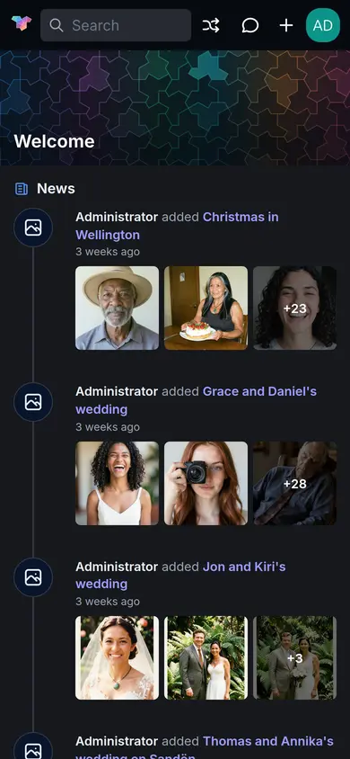
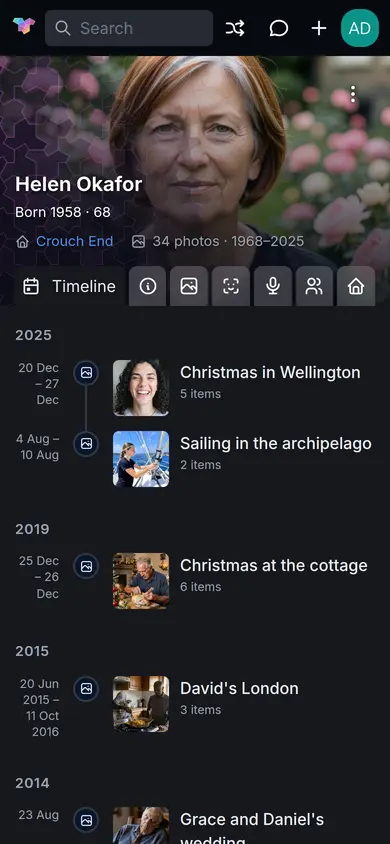

# EiN on a phone

This page covers what is different when you use EiN on a phone or a tablet: the menu behind the EiN
mark, the gestures in grids and in the viewer, uploading from the phone, and putting EiN on your
home screen. It is for everyone in the family who opens EiN away from a computer.

## Open EiN on your phone

Open the same address you use on a computer, for example `http://ein.local:8080`, in your phone's
browser, and sign in as you would on a computer (see [Sign in](interface.md#sign-in)). It is the
same EiN, with the same account, pictures and permissions; only the layout changes to fit the
screen.

The phone keeps a few choices of its own, separate from your computer's: whether the menu shows
icons or names, whether it is shown, and how many pictures a grid puts in a row. They are kept in
the phone's browser, not in your account.

## What changes on a small screen

What you get depends on the width of the browser window, and on whether the screen is a touch
screen.

| Screen                                                          | Layout                                                                                                                                                         |
| --------------------------------------------------------------- | -------------------------------------------------------------------------------------------------------------------------------------------------------------- |
| Narrower than 768 pixels: most phones held upright              | The phone layout this page describes.                                                                                                                          |
| 768 to 991 pixels: tablets, and some large phones held sideways | The computer's layout, with the sidebar beside the page and the terminal button. The chat's side drawer covers the page, and the browser's **Back** closes it. |
| 992 pixels and wider                                            | The computer's layout, with the side drawer beside the page.                                                                                                   |

On any touch screen, whatever its width, the viewer uses its touch layout and pressing and holding
a picture selects it. So a tablet has the computer's frame with the phone's viewer.

In the phone layout:

- **The top bar** shows the EiN mark without the name, the search box (it reads **Search**), then
  **Random album**, **Chat**, the plus of the **Create** menu and your picture. Its buttons are
  larger, to suit a finger. The **Uploads** button appears there while files are going up.
- **The menu is hidden** until you ask for it: see [Open the menu](#open-the-menu).
- **There is no terminal button**, and no **Disconnected** badge when the connection drops.
- **The search box** opens its list across the whole width of the screen, above the keyboard, and
  the keyboard's search key does what <kbd>Enter</kbd> does. [Search and the finder](search.md)
  covers what it finds.
- **Dialogs fill the screen**, with their buttons in a bar across the foot. Fields use larger text,
  so the phone does not zoom in while you type. A question that only asks you to confirm stays a
  small box. The phone's **Back** closes a dialog.
- **The chat** opens as a dialog over the whole screen instead of in the side drawer; see
  [Chatting with the assistant](assistant.md).
- **The create and account menus** are wider, with taller rows.

### Page headers on a phone

- **Actions** such as **Upload**, **Share** and **Edit** fold into ⋮ at the header's top right,
  with the page's other actions.
- **Tabs with icons** show only their icons, and the tab you are on keeps its name. On a person's
  page the icons stand for **Info**, **Media**, **Faces**, **Heard in**, **Family** and **Homes**.
- **Choices** such as **Show** and **Sort** become a button that shows the chosen option's icon;
  on some pages, such as **Year**, several fold into one button.
- **Scrolled down**, the header goes away, and the page's filter box and choices float at the foot
  of the screen beside **Back to top**. An empty filter box folds to a magnifier: tap it to type,
  and it takes the whole row while you type.

## Open the menu

On a phone the EiN mark at the left of the top bar is the menu button; there is no separate menu
icon. It does not go to Home, as it does on a computer: **Home** is the first entry in the menu.

The menu has two forms:

- **A column of icons** at the left of the screen, which is what you get at first. Tap the mark to
  show it; the page moves over to make room. Tap an icon to go to its page; the column stays until
  you tap the mark again.
- **The full list with names**, under the headings **Explore**, **Browse** and **System**. Tap the
  button at the foot of the icon column (**Show labels**) to switch to it. It opens over the page,
  and closes when you choose a page; tap the mark to open it again. The button at its foot
  (**Collapse to icons**) switches back to the column of icons.

You can also swipe: a one-finger swipe to the right across the page or the menu brings the menu
out, and a swipe to the left puts it away. The swipe has to be mostly sideways and quick, and it
does nothing:

- in the viewer or anything else shown full screen, where a sideways swipe moves between pictures;
- in a dialog, such as the chat;
- on something that moves sideways itself: the map, the time rail at the right of a long grid, a
  story, a slider, a text field, or a row that scrolls sideways.

A swipe that starts at the very edge of the screen may be taken by the phone as its own Back
gesture, so start a little way in. The phone remembers which form of the menu you chose, and
whether the icon column is shown. [Finding your way around](interface.md#the-sidebar) lists what
is in the menu.

## Pinch, press and tap in a grid

A grid of pictures, such as an album or the **Media** page, works by touch like this:

| To                           | Do this                                                                                                            |
| ---------------------------- | ------------------------------------------------------------------------------------------------------------------ |
| Open a picture in the viewer | Tap it.                                                                                                            |
| Show fewer, larger pictures  | Spread two fingers apart on the grid, then lift them. Each pinch takes away one picture per row, down to 2.        |
| Show more, smaller pictures  | Pinch two fingers together, then lift them. Each pinch adds one picture per row, up to 5.                          |
| Start selecting              | Press and hold a picture for a moment. It is ticked, and the phone gives a short buzz where its browser allows it. |
| Add or take away a picture   | Once anything is selected, tap it.                                                                                 |
| Select a whole day           | Tap the date in the day's heading.                                                                                 |
| Move through a long grid     | Drag the time rail at the right edge, which appears once the grid holds more than 120 pictures.                    |

A phone's grid starts with 2 pictures in a row, and keeps the number you pinch to in this browser.
Pinching works where pictures keep their own shapes, such as an album or the **Media** page in its
**Default** layout. The **Days** and **Months** layouts of the Media page have square tiles, three
and five across on a phone, and do not change with a pinch; see [Media, Year and labels](media.md).
On a wider screen, such as most tablets held sideways, the grid fills its rows by height instead,
and a pinch does not change it.

Moving your finger while you hold cancels the press, so scrolling a grid never selects a picture.
Once something is selected, the bar at the foot of the screen shows how many, for example **3
selected**, with all its buttons in one **Actions** menu and **×** to clear the selection.
[Albums](albums.md#select-pictures) covers selecting, and
[The selection bar](albums.md#the-selection-bar) what each action does.

A video in a grid plays a short silent preview when it scrolls into view, as there is no pointer
to rest on it.

## The viewer on a phone

The viewer takes its touch layout on any touch screen, and in any browser window narrower than 768
pixels.

- The date sits in a pill at the top of the picture, and the bar under it keeps the position in the
  list and the place.
- ⋮ at the top right holds **Favourite**, **Start slideshow**, the rows of the **More** menu and
  **Chat**.
- There is no close button: swipe down on the picture, or use the phone's Back.
- The details are a sheet you pull up over the lower half of the screen. Held sideways, they open
  as a panel at the right instead, with **Show details** beside ⋮.

| Gesture                                | What it does                                                                               |
| -------------------------------------- | ------------------------------------------------------------------------------------------ |
| Swipe left / right                     | Next / previous file. The picture follows your finger; a quick flick turns it.             |
| Swipe up                               | Pull up the details                                                                        |
| Swipe down                             | Put the details away; with the details closed, close the viewer                            |
| Pinch, or double-tap                   | Zoom a photo                                                                               |
| Drag with one finger on a zoomed photo | Look around it                                                                             |
| Tap a face                             | Open the person's page, or name someone not yet named; pin the faces in ⋮ to see the boxes |

Turning the phone sideways makes the viewer fullscreen, and turning it upright again leaves
fullscreen; an iPhone gives web pages no fullscreen, so there the viewer stays as it is. **Edit
faces** is not offered on a phone. [Viewing photos, videos and recordings](viewer.md#on-a-phone-or-tablet)
covers the viewer in full.

The story that **On this day** plays works by touch too: tap the left third of the screen to go
back, anywhere else to go on, and press and hold to pause until you let go. See
[Home, memories and statistics](home.md).

## Upload from your phone

Bring the photos and videos on your phone into your staging area with **Import media**:

1. Tap the plus in the top bar, then **Import media**. The dialog fills the screen.
2. Under **Into which category?**, pick where the files go. The **Inbox** is chosen at first. To
   keep a phone's pictures together, choose **New category** and, under **What it holds**,
   **Phone**; see [The kinds of category](staging.md#the-kinds-of-category).
3. Tap **Choose files**. Your phone's own picker opens, with your photo library, the camera or your
   files, depending on the phone.
4. Pick the files, then tap the button that counts them, for example **Upload 24**.

The category opens on its **Files** tab, and the **Uploads** ring in the top bar shows how far the
upload is. [Getting your photos in](importing.md#import-media) covers the dialog in full, and
[Sorting in staging](staging.md) what to do with the files once they are in.

**Upload** also sits under ⋮ on an album you may change, on the **Media** page and on a staging
category. On a phone its picker offers only photos, videos, recordings and GPX tracks, with the
camera among the choices, so you can take a picture and upload it in one go. An album's **Upload**
puts the files straight into that album; the Media page's puts them into your Inbox. To bring in a
PDF or another kind of file from a phone, use **Choose files** in **Import media**. **Choose a
folder** and **Upload a folder** need a browser that can pick a folder, which a phone's browser may
not offer.

> [!WARNING]
> An upload runs in the open page. Keep EiN on screen until the upload has finished: a phone may
> pause a browser that is in the background or behind a locked screen, and closing or reloading the
> page stops the files not sent yet. The files already sent stay.

For a whole camera roll, thousands of files, copying from a computer is steadier than uploading
from the phone. The **Import media** dialog itself suggests copying over SFTP for more than about
10,000 files; see [Copy files in over SFTP](importing.md#copy-files-in-over-sftp).

On the Media page, **Search with a picture** can take a photo with the camera and find what looks
like it; see [Search with a picture](search.md#search-with-a-picture).

## Put EiN on your home screen

You can add EiN to your phone's home screen, where it looks and opens like an app:

- its icon is the EiN mark, named **EiN** under it;
- it opens on **Home**, using the whole screen, without the browser's address bar and buttons;
- the phone's status bar and the screen shown while it starts are in EiN's dark colour.

This needs HTTPS: an address that begins with `https://`. EiN on its own serves plain HTTP, on port
8080, so your administrator first has to put it behind an HTTPS proxy; see
[Ports, HTTPS and remote access](../admin/network.md). Over plain `http://`, a phone may only add a
bookmark that opens in the browser.

To add it:

- **iPhone or iPad, in Safari:** open EiN, tap the share button, then **Add to Home Screen**, then
  **Add**.
- **Android, in Chrome:** open EiN, open the browser's ⋮ menu, choose **Add to Home screen** or
  **Install app**, and confirm.

The names of these menu items differ between phones and browser versions. EiN itself has no install
button and never asks to be installed.

Opened from the home screen, EiN has no address bar and, on an iPhone, no Back button: use the menu
to move between pages, swipe down to close the viewer, and the **×** to close a dialog. On an
iPhone the home-screen EiN may keep a sign-in of its own, separate from Safari's, and ask you to
sign in once more.

## No offline mode

EiN has no offline mode. Nothing is kept on the phone for use without a connection: every page,
picture and search comes from your EiN as you open it, so you need a connection to it, at home or
wherever your administrator has made it reachable.

When the connection drops while EiN is open, pages stop loading and EiN tries again every 2
seconds by itself. On a phone there is no **Disconnected** badge to tell you; EiN picks up again
by itself once the phone is back on the network.

## What a phone does not have

- **The terminal.** There is no terminal button on a phone. With a keyboard connected to it,
  <kbd>Alt</kbd>+<kbd>T</kbd> still opens it; see [The terminal](../shell/terminal.md).
- **Keyboard shortcuts**, unless a keyboard is connected. **Shortcuts** in the account menu still
  lists them.
- **Edit faces** in the viewer.
- **Keys and the column beside the stream in staging's Sort tab**, and selecting several groups
  there; see [Sorting in staging](staging.md#on-a-phone).

## When something goes differently

| What you see                                                                                                   | Why                                                                                                                                        | What to do                                                                                                                                                                                                                                                              |
| -------------------------------------------------------------------------------------------------------------- | ------------------------------------------------------------------------------------------------------------------------------------------ | ----------------------------------------------------------------------------------------------------------------------------------------------------------------------------------------------------------------------------------------------------------------------- |
| The address does not open on the phone                                                                         | The phone is not on the network EiN is on, or it does not understand a name ending in `.local`.                                            | Join the same network, or use the address with the machine's IP number that your administrator gives you. Away from home, see [Ports, HTTPS and remote access](../admin/network.md).                                                                                    |
| No **Add to Home Screen** or **Install app**, or EiN opens with the browser's address bar from the home screen | EiN is reached over plain `http://`.                                                                                                       | Ask your administrator for an `https://` address.                                                                                                                                                                                                                       |
| Swiping does not bring the menu out                                                                            | The swipe was too slow or too slanted, began at the screen's edge, or landed on the map, a slider, a field or a row that scrolls sideways. | Tap the EiN mark instead.                                                                                                                                                                                                                                               |
| Pinching does not change the grid                                                                              | The grid has square tiles (**Days** or **Months**), or the screen is wide enough for the grid to fill its rows by itself.                  | Choose the **Default** layout on the Media page.                                                                                                                                                                                                                        |
| The upload stopped                                                                                             | The phone paused the browser, or the page was closed or reloaded.                                                                          | If **Uploads** in the top bar lists failed files, choose **Retry failed**. After a reload the list is gone: choose the files that did not arrive and upload them again. An exact copy of a file already sent is recognised in staging; see [Duplicates](duplicates.md). |
| You cannot find **Upload**, **Share** or **Edit**                                                              | On a phone they are under ⋮ at the top right of the header.                                                                                | Tap ⋮.                                                                                                                                                                                                                                                                  |
| You cannot find the viewer's close button                                                                      | The touch layout has none.                                                                                                                 | Swipe down on the picture, or use the phone's Back.                                                                                                                                                                                                                     |

## Related pages

- [Finding your way around](interface.md): the top bar, the menu and how pages, dialogs and full
  screen open and close.
- [Viewing photos, videos and recordings](viewer.md): the viewer, its details and its gestures.
- [Getting your photos in](importing.md): every way files get into EiN.
- [Albums](albums.md): selecting pictures and the selection bar.
- [Ports, HTTPS and remote access](../admin/network.md): HTTPS and reaching EiN from outside the
  home, for administrators.
