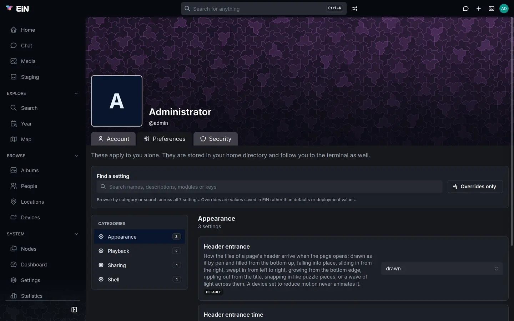
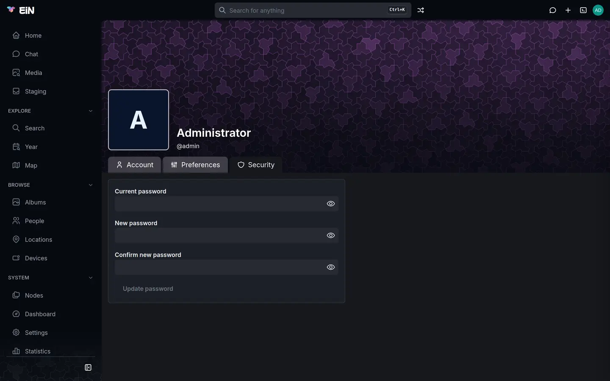

# Your profile, favourites and trash

This page covers the pages that belong to your account alone: your profile, where you change your
name, your preferences and your password; your favourites, which the
[Archive](../archive/index.md) gathers on a page of their own; and your trash, where what you
delete waits before it is removed for good. It is for everyone who has an account on EiN.

All three open from the account menu, **Favourites** once the Archive is installed. Choose your
picture at the right end of the top bar:


They need you to be signed in. A visitor who opens one of them is asked to sign in first, and lands
on the page afterwards. [Finding your way around](interface.md) describes the rest of the account
menu.

## Open your profile

Choose your picture, then **Profile**. The page's header shows your display name, your username
after an `@`, and the description you gave yourself. With the Archive, its picture is the cover
photo of the person your account is linked to; without one it shows the first letter of your name.

The profile has three tabs: **Account**, **Preferences** and **Security**. The tab you are on is in
the page's address, so `/profile?tab=preferences` opens your preferences and
`/profile?tab=security` the password form directly.

## Change your name and description

1. Choose your picture, then **Profile**. It opens on the **Account** tab.
2. In **Display name**, "Your name as it appears to others", type your name the way you want
   others to see it, for example `Helen Okafor`.
3. In **Description**, "A line about you, shown under your name", type a line about yourself, such
   as `Peggy's daughter, in Wellington`, or leave it empty.
4. Choose **Save changes**. **Saved** appears beside the button.

**Save changes** stays greyed out while **Display name** is empty: every account has a name.
Your picture's tooltip and the profile's header show the new name at once.

Three things about your account are not on this tab:

- **Your username**, the name after the `@`. Nobody can change it once the account exists, an
  administrator included.
- **Your e-mail address.** Only an administrator sets it, in your account under **Settings →
  Users**; see [Accounts and groups](../admin/accounts.md). When your account has one, you can type
  it instead of your username when you sign in. The profile does not show it; `user-info` in the
  terminal does, under [From the terminal](#from-the-terminal).
- **Your picture**, which with the Archive comes from the person your account is linked to, below.

> [!NOTE]
> Your display name, description and e-mail address are not private. Anyone who is signed in can
> read them, for example with `user-info` in the terminal.

### Your picture and the person you are

EiN has no way to upload a picture for an account. With the Archive installed, your picture is the
person in the archive that your account is linked to. Helen Okafor's account, for example, can be
linked to her page among the **People**, and then:

- your picture in the top bar and on your profile is her cover photo;
- the account menu has **Me** above **Favourites**, which opens her page;
- **News** on **Home** shows her picture beside the albums you add;
- an event or note you add to an album starts with her under **Written by**;
- staging uses her homes to tell a trip from days at home when it suggests albums; see
  [Sorting in staging](../archive/staging.md).

Without a link, your picture is an image of your username's first letters, which the browser
fetches from the outside service `ui-avatars.com`. Where the browser cannot reach the internet, the
first letter of your name shows instead.

There is no button to link an account to a person. An administrator makes the link in the terminal:
it is a softlink named `person` in the account's folder under `/etc/users`. For the account `helen`
and the person whose page is at `/people/Helen_Okafor`:

```bash
# in EiN's terminal, as the administrator
ln -s /archive/people/Helen_Okafor /etc/users/helen/person
```

Helen sees her picture and **Me** the next time her page loads. `rm /etc/users/helen/person` takes
the link away again; removing a link never removes the person it points at.

## Set your preferences

Choose your picture, then **Profile**, then the **Preferences** tab. It says: "These apply to you
alone. They are stored in your home directory and follow you to the terminal as well." Your
preferences belong to your account, so they follow you to every browser and device you sign in on.



The tab is laid out like the administrator's settings page:

- **Find a setting** searches names, descriptions, modules and keys, across every category.
- **Categories**, at the left, shows one category at a time. On a phone a **Category** list above
  the settings does the same.
- **Overrides only** shows only the settings you have changed; the button gives their number in
  brackets once there are some.
- A badge under each setting says where its value comes from: **Default** when nobody has changed
  it, **Your setting** when you have, and **From deployment** when the administrator gave everyone a
  starting value when setting up EiN. Your own value wins over the other two. A setting a module
  adds also carries the module's name, such as `archive`.

To change a setting:

1. Change the value in its control: pick from the list, type a number, or flip the switch between
   **On** and **Off**.
2. **Cancel** and **Save change** appear under the control. Choose **Save change**; **Cancel** puts
   the value back as it was.
3. The badge turns to **Your setting**.

To undo your choice later, choose **Restore inherited value** under a setting marked **Your
setting**. It removes your own value, and the setting falls back to the deployment's value or to
the default. If a save fails, the reason shows in a red box under the setting.

### The settings

| Category   | Setting                                  | Default   | What it changes                                                                                                                                                                                                                    |
| ---------- | ---------------------------------------- | --------- | ---------------------------------------------------------------------------------------------------------------------------------------------------------------------------------------------------------------------------------- |
| Appearance | **Header entrance**                      | `drawn`   | How the tiles of the coloured band at the top of a page arrive when the page opens; the choices are below. A device set to reduce motion never animates it.                                                                        |
| Appearance | **Header entrance time**                 | `450`     | How many milliseconds that entrance takes, from the first tile starting to the last one in place. `0` shows the header as it is, without an entrance.                                                                              |
| Appearance | **Header over a cover**                  | `split`   | How the tiles meet a page's cover photo, such as an album's or a person's: `split` gives the left of the header to the tiles, which dissolve into the photo along a slanted edge; `lines` lays only their outlines over the photo. |
| Playback   | **Seconds per slide**                    | `3`       | How long each photo is shown in a slideshow.                                                                                                                                                                                       |
| Playback   | **Ken Burns effect**                     | **On**    | Slowly pan and zoom each photo during a slideshow.                                                                                                                                                                                 |
| Sharing    | **How widely what you create is shared** | `default` | Where an album you create starts out; see below.                                                                                                                                                                                   |
| Shell      | **Shell history length**                 | `1000`    | How many commands the terminal remembers between sessions, in `~/.bash_history`.                                                                                                                                                   |

EiN itself gives the settings under Appearance, Sharing and Shell. The two under Playback come with
the archive module, and only an EiN with the archive has them. [Viewing photos, videos and recordings](../archive/viewer.md) shows a slideshow, and [the settings reference](../reference/settings.md)
lists each with its key, such as
[`CFG_USER_SLIDESHOW_SECONDS`](../reference/settings.md#cfg_user_slideshow_seconds).

The choices for **Header entrance**:

| Choice    | The tiles are                                     |
| --------- | ------------------------------------------------- |
| `drawn`   | drawn as if by pen, and filled from the bottom up |
| `falling` | falling into place                                |
| `sliding` | sliding in from the right                         |
| `sweep`   | swept in from left to right                       |
| `growing` | growing from the bottom edge                      |
| `ripple`  | rippling out from the title                       |
| `puzzle`  | snapping in like puzzle pieces                    |
| `wave`    | crossed by a wave of light                        |

### How widely what you create is shared

This preference decides how an album you create starts out: one made with **Create → Album**, with
**New album “…”** in **Add to an album**, or with **New album** in staging. It does not change albums
that exist already; to change who sees one of those, use its **Share** button. Albums come with the
Archive; without it, nothing you create follows this preference.

| Choice     | A new album starts out                                                                                                                                              |
| ---------- | ------------------------------------------------------------------------------------------------------------------------------------------------------------------- |
| `default`  | As the administrator's default sharing says, under **Settings → Permissions**. Unless the administrator has changed it, everyone with an account can see the album. |
| `private`  | Seen only by you.                                                                                                                                                   |
| `shared`   | Seen by the members of the default group the administrator chose. Unless the administrator has changed it, that group is everyone with an account.                  |
| `everyone` | Seen by everyone with an account, even where the administrator's default group is a smaller one.                                                                    |

None of them shows an album to visitors who are not signed in, unless you keep `default` and the
administrator's default sharing lets everyone else view; otherwise you grant that yourself in the
**Share** dialog. An administrator can see every album, whatever you choose. **New private album** in staging is always private, whatever you choose here.
[Sharing](sharing.md) explains the default sharing and the **Share** dialog.

### When a change takes effect

| Setting                                  | Takes effect                                                                                                          |
| ---------------------------------------- | --------------------------------------------------------------------------------------------------------------------- |
| Appearance and Playback                  | At once, in the browser tab where you saved it. Other open tabs, and your other devices, when their page loads again. |
| **How widely what you create is shared** | At once, for the next album you create.                                                                               |
| **Shell history length**                 | In the next terminal you open.                                                                                        |

### Your preferences in the terminal

EiN keeps your preferences in the file `.config` in your home folder, `/home/<your username>/.config`,
which only you can read. Every shell you open reads it, in the web terminal and over SSH, so a
preference is also a variable there:

```bash
# in EiN's terminal
echo $CFG_USER_SLIDESHOW_SECONDS
```

```text
5
```

It prints an empty line for a setting you have never changed: defaults are not written into the
file. A terminal that is open when you save a change reads it before its next command; only a
command that was already running keeps the old value.

The `config` command lists and changes your preferences:

```bash
# in EiN's terminal
config list --scope user                  # your preferences, and where each value comes from
config set CFG_USER_SLIDESHOW_SECONDS 5   # the same as Save change
config unset CFG_USER_SLIDESHOW_SECONDS   # the same as Restore inherited value
```

`config list --scope user` prints each setting and its value, followed by `(user)` for your own
value or `(environment)` for the deployment's; a default has no mark:

```text
CFG_USER_HEADER_ENTRANCE	drawn
CFG_USER_HEADER_ENTRANCE_TIME	450
CFG_USER_HEADER_COVER	split
CFG_USER_KEN_BURNS	true
CFG_USER_SLIDESHOW_SECONDS	5 (user)
CFG_USER_DEFAULT_SHARE	default
HISTSIZE	1000
```

`config set` answers `CFG_USER_SLIDESHOW_SECONDS = 5`, and `config unset` answers
`CFG_USER_SLIDESHOW_SECONDS reset to 3 (default)`. A value of the wrong kind is refused, for example
`config set: CFG_USER_SLIDESHOW_SECONDS: expected a number, got 'five'`.

The file holds one line per setting, such as `export CFG_USER_SLIDESHOW_SECONDS='5'`, and you can
edit it with `edit ~/.config`; nothing then checks the values you type. [Configuration](../admin/configuration.md)
explains how settings work for the whole installation, and [Configuration files](../reference/config-files.md)
lists the files.

## Change your password



1. Choose your picture, then **Profile**, then the **Security** tab.
2. In **Current password**, type the password you sign in with.
3. In **New password**, type the new one.
4. In **Confirm new password**, type the new one again. If the two differ, the field says "Does not
   match the new password".
5. Choose **Update password**. It can be chosen once all three fields are filled in and the two new
   ones match. **Password updated** appears beside it, and the fields empty.

The eye at the right of each field shows what you typed. EiN has no rules for passwords: it takes
any password that is not empty, so how strong yours is is up to you.

The new password is the one you sign in with from then on, in the browser and over SSH and SFTP. A
key you added for SSH keeps working; see [SSH and SFTP](../shell/ssh-sftp.md).

Changing your password does not sign out the browsers and terminals where you are signed in
already. If you change it because someone else may know it, ask an administrator to choose
**Disable sign-in** for your account and then **Enable sign-in**: that signs your account out
everywhere.

If the password is not changed, the reason shows in a red box above the fields:

| Message                                                  | What it means                                  | What to do                                                     |
| -------------------------------------------------------- | ---------------------------------------------- | -------------------------------------------------------------- |
| `user passwd: authentication failed`                     | **Current password** is not your password.     | Type it again. If you have forgotten it, see the next section. |
| `user passwd: no existing password found, contact admin` | Your account has no password to check against. | Ask an administrator to set one.                               |

### If you have forgotten your password

EiN sends no e-mail and has no link for a forgotten password. Ask an administrator to set a new one
for you: they do it in your account under **Settings → Users**, in its **Password** section, with
**Set password**. Your old password stops working at once. Sign in with the one they give you, then
change it on the **Security** tab to one that only you know.

An administrator cannot make you choose a new password at your next sign-in; EiN has no such
switch. An account that an administrator made without a password, and an account brought over from
an older archive by the importer, cannot sign in at all until an administrator sets a password for
it. [Accounts and groups](../admin/accounts.md) covers this from the administrator's side.

## Favourites

Your favourites are the pictures you have marked with a heart, from any album, gathered on one page.
Only someone signed in has favourites; visitors have none. The heart, the Favourites page and its
row in the account menu come with the [Archive](../archive/index.md); in any EiN, `star` in the
terminal marks a node as a favourite (see [From the terminal](#from-the-terminal)).

A favourite is a link to the picture where it lives, kept in the folder `stars` in your home
folder. Hearting a picture never copies or moves it, and taking it out of your favourites never
deletes it. [Links](../concepts/links.md) explains how one picture can be in many places.

### Heart a picture

- **In the viewer**, press the heart in the bar under the picture, whose tooltip says **Favourite
  (s)**, or press <kbd>s</kbd>. The heart fills in. On a phone it is **Favourite** in ⋮ at the top
  right.
- **In a grid**, such as an album or the **Media** page, select pictures and choose **Favourite** in
  the selection bar. EiN says, for example, **12 files added to favourites**, with **Undo**.

A small heart on a tile marks a picture in your favourites. A picture marked as a favourite in a
Google Photos export becomes one of your favourites when you import it; see
[Getting your photos in](../archive/importing.md).

### Open your favourites

Choose your picture, then **Favourites**. The page, "The pictures you have hearted", shows them in
day sections, the way an album shows its pictures. Click one to open it in the viewer, which then
steps through your favourites; **Start slideshow** there shows them all.

With nothing hearted yet, the page says **No favourites yet**, "Select pictures and choose
Favourite, or press the heart in the lightbox.", with a button **Open Media**.

### Take a picture out of your favourites

- In the viewer, press the filled heart, **Unfavourite (s)**, or press <kbd>s</kbd> again.
- In a grid, select pictures that are all favourites already. The selection bar's button reads
  **Unfavourite**; choose it, and EiN says, for example, **3 files taken out of favourites**, with
  **Undo**.

## The trash

When you delete something in the web interface, such as with the Archive a picture, an album or a
person, it goes to your trash first. You can restore it from there for 30 days, unless your
administrator chose another number; the few ways of deleting that skip the trash are listed below.
Only you see your trash, apart from an administrator, who can see everyone's.

### What goes to the trash

Every row but the last is on the Archive's pages; `trash put` works in any EiN.

| What you do                                                       | What goes                                                                                                    |
| ----------------------------------------------------------------- | ------------------------------------------------------------------------------------------------------------ |
| **Delete** in the selection bar                                   | The selected pictures that live where you are; see [Albums](../archive/albums.md#delete-or-remove-pictures). |
| **Move to trash** under ⋮ on an album, person, location or device | That album, person, location or device, with everything that lives in it.                                    |
| **Delete** in **Edit event**                                      | That event or note.                                                                                          |
| **Discard** in staging                                            | The files, kept together as one entry; see [Sorting in staging](../archive/staging.md).                      |
| Removing copies in staging's **Duplicates**                       | The copies, kept together as one entry; see [Duplicates](../archive/duplicates.md).                          |
| `trash put` in the terminal                                       | What you name, if you may change it.                                                                         |

Each of these in the browser says what it did in a message at the foot of the screen, with **Undo**. **Undo** is
the quickest way back; the Trash page is for later.

What you delete goes to _your_ trash, also when it belongs to someone else who lets you change it.
If a picture disappears from an album of yours, the person who deleted it has it in their trash.

While something is in the trash, it is gone for everyone: from search, `ls` and every other list,
and with the Archive from albums and the map. It keeps what EiN worked out about it, such as faces
and a transcript, and comes back with all of it when you restore it.

### What is deleted for good at once

> [!WARNING]
> These do not use the trash. What they delete is gone at once, with no **Undo**:
>
> - **Delete** in the **Nodes** explorer, which runs `rm`;
> - `rm` in the terminal;
> - deleting a file over SFTP, which takes its thumbnails and faces with it; see
>   [SSH and SFTP](../shell/ssh-sftp.md);
> - **Delete for good** and **Empty trash** on the Trash page.
>
> To delete something in the terminal that you may want back, use `trash put` instead of `rm`.

### Restore something from the trash

1. Choose your picture, then **Trash**.
2. The list shows what you deleted, newest first. Each row is named by the place it came from, such
   as `/archive/albums/Sailing in the archipelago/IMG_0412.jpg`. Things deleted together, such as a
   group discarded in staging, are one row with a name and a count, such as
   `Discarded from Inbox: “Boat trip” · 86 items`.
3. Select a row. The pane beside the list, or under it on a phone, shows its name, **From** where it
   came, when it was **Deleted**, and a preview. Hold <kbd>Ctrl</kbd> (<kbd>⌘</kbd> on a Mac) while
   you click to add a row to the selection, or <kbd>Shift</kbd> to select a range.
4. Choose **Restore**, or **Restore 3** with three rows selected. EiN says **Restored to** and the
   path, or how many it restored.

A restored thing goes back where it came from, and the links to it work again: a restored picture is
back in the albums it was added to, and in your favourites if it was one. If something else has
taken its name there in the meantime, it comes back beside it with a number, such as
`IMG_0412 (2).jpg`.

A row that holds several things opens with <kbd>Enter</kbd>, or the arrow at its left. In a row of
things deleted together, you can select one of them and restore it alone. Something inside a
deleted album or folder cannot come back without the rest: the pane says "Inside what was deleted;
restoring puts back all of it."

**Restore all**, in the bar at the top of the page, puts back everything in the trash at once,
without asking.

### Delete something for good

1. On the Trash page, select one or more rows.
2. Choose **Delete for good**, or press <kbd>Delete</kbd>.
3. The dialog **Delete for good?** says, for a single item: "This item and everything derived from it is
   removed for good. This cannot be undone." Choose **Delete for good**, or **Cancel**.

**Empty trash**, in the bar at the top, does the same for everything in the trash, and its dialog's
button reads **Empty trash**. "Everything derived from it" is what EiN made from a file: its
thumbnails, faces, transcript and the rest.

Something in the trash still takes up its space on disk, so removing it for good frees that space.

### How long things stay in the trash

Things stay for the number of days set by **Days in the trash**,
[`CFG_TRASH_RETENTION_DAYS`](../reference/settings.md#cfg_trash_retention_days): 30 unless the
administrator changed it, under **Settings → System**, in the category **Trash**. An empty Trash
page gives the number: **The trash is empty**, "What you delete waits here for 30 days, in case you
want it back."

The days count from when you deleted it; for things deleted together, from the last time something
was added to that row. EiN clears out what is older when it starts and every 12 hours after that,
so something can stay up to half a day past its time. Once it is cleared, nothing in EiN brings it
back: EiN has no backup of its own; see [Your data: backup, moving and removing](../admin/data.md).

### The trash in the terminal

The [`trash`](../reference/commands-core.md#trash) command works on the same trash as the page:

```bash
# in EiN's terminal
trash put "/archive/albums/Sailing in the archipelago/IMG_0412.jpg"
trash list
trash restore 01J9Z8Q4R7XKD3V5B2N6M0PA1C
trash empty --older-than 7
```

`trash list` prints one line per row: its id, when it was deleted and where it came from.

```text
01J9Z8Q4R7XKD3V5B2N6M0PA1C  2026-10-22T09:14:03.120Z  /archive/albums/Sailing in the archipelago/IMG_0412.jpg
```

`trash restore` takes that id and answers `Restored` and the path. `trash empty --older-than 7`
removes for good what was deleted more than 7 days ago; `trash empty` with no id and no
`--older-than` empties your whole trash, for good.

## From the terminal

Besides `config` and `trash` above, these commands do in the terminal what this page does in the
browser:

| Command                                                                                          | What it does                                                                                                                                                                       |
| ------------------------------------------------------------------------------------------------ | ---------------------------------------------------------------------------------------------------------------------------------------------------------------------------------- |
| [`user-info`](../reference/commands-core.md#user-info) `<username>`                              | Shows an account's display name, numbers, e-mail address and description.                                                                                                          |
| [`user-update`](../reference/commands-core.md#user-update) `<username> --name=… --description=…` | Changes your display name and description, as **Save changes** does.                                                                                                               |
| [`user-passwd`](../reference/commands-core.md#user-passwd) `<username> --old-password=…`         | Changes your password; it asks for the new one with `Password:`. A password typed on the command line can end up in your shell history, so the **Security** tab is the better way. |
| [`star`](../reference/commands-core.md#star) `<path>`, `star -d <path>`, `star list`             | Marks a node, such as a picture, as a favourite, takes the mark away, or lists your favourites.                                                                                    |

```bash
# in EiN's terminal
user-info helen
user-update helen --name='Helen Okafor' --description="Peggy's daughter, in Wellington"
star "/archive/albums/Sailing in the archipelago/IMG_0412.jpg"
```

```text
User: Helen Okafor
UID: 1003
GID: 1003
E-mail: helen@example.com
Description: Peggy's daughter, in Wellington
User 'helen' updated
Starred /archive/albums/Sailing in the archipelago/IMG_0412.jpg
```

## When something goes differently

| What you see                                                        | Why                                                                                                 | What to do                                                                                                             |
| ------------------------------------------------------------------- | --------------------------------------------------------------------------------------------------- | ---------------------------------------------------------------------------------------------------------------------- |
| There is no **Me** in the account menu, and your picture is letters | The Archive is not installed, or your account is not linked to a person in the archive.             | Ask an administrator to link it, as under [Your picture and the person you are](#your-picture-and-the-person-you-are). |
| **Update password** stays greyed out                                | A field is empty, or the two new passwords differ.                                                  | Fill in all three, and type the new password the same way twice.                                                       |
| A preference you saved does not show in another tab                 | That tab loaded your preferences before you saved.                                                  | Reload the tab.                                                                                                        |
| `echo $CFG_USER_…` prints an empty line                             | You never changed that setting: defaults are not written into the file.                             | `config list --scope user` shows every value, defaults included.                                                       |
| There is no heart in the viewer and no **Favourite** button         | You are not signed in. The viewer and the button come with the Archive.                             | Sign in.                                                                                                               |
| Something you deleted is not in your trash                          | Someone else deleted it, and it is in their trash; or it was deleted for good; or its days ran out. | Ask the person who deleted it. Nothing brings back what was deleted for good.                                          |
| Restoring fails with a message that ends in `is gone`               | The folder or album it came from is no longer there.                                                | Restore that album or folder first, if it is in the trash, then restore the picture.                                   |

## Related pages

- [Finding your way around](interface.md): the account menu, signing in and out, and admin mode.
- [Sharing](sharing.md): who sees what you create, the **Share** dialog and share links.
- [Viewing photos, videos and recordings](../archive/viewer.md): the heart and slideshows in the viewer.
- [Albums](../archive/albums.md): **Delete** and **Remove**, and moving an album to the trash.
- [Configuration](../admin/configuration.md): how settings work for the whole installation.
- [Settings](../reference/settings.md): every setting with its key and default.
- [Accounts and groups](../admin/accounts.md): passwords, e-mail addresses and accounts, for
  administrators.
