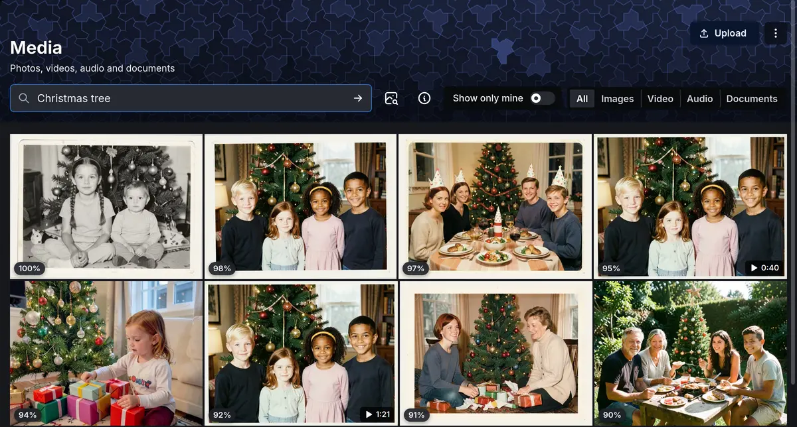
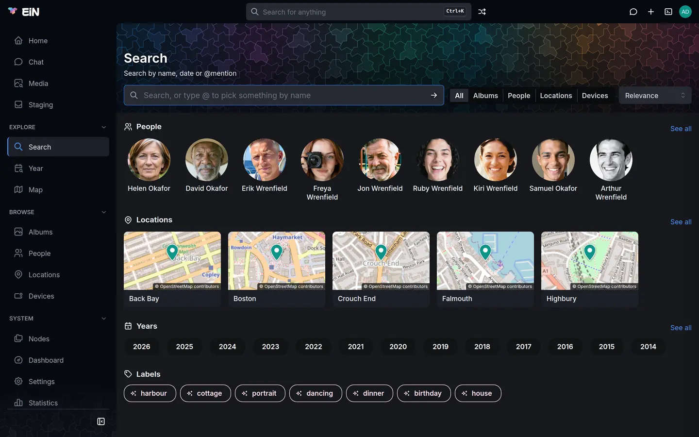

# Search and the finder

EiN gives you two ways to find something. The finder in the top bar takes you to a page, a person,
an album or a command in a few keystrokes; the **Search** and **Media** pages look through the
archive itself, down to what is in a picture and what is said in a recording. This page is for
everyone who uses EiN in a browser.

## The finder in the top bar

The box in the middle of the top bar, **Search for anything**, is the finder. Click it, or press
<kbd>Ctrl</kbd>+<kbd>K</kbd> (<kbd>⌘</kbd>+<kbd>K</kbd> on a Mac) wherever you are, and a list opens
under it. The list closes when you press <kbd>Esc</kbd>, click somewhere else or choose a row, and
choosing a row empties the box.

When something covers the box (a dialog, the viewer, or a page shown full screen), the same keys
open the finder as a dialog of its own, with the prompt **Search, or go to a page…**. <kbd>Esc</kbd>, or <kbd>Ctrl</kbd>+<kbd>K</kbd> again, closes it.

On a phone the box reads **Search**, the list takes the width of the screen, and the keyboard's
search key does what <kbd>Enter</kbd> does. [EiN on a phone](phone.md) covers the rest.

### Go somewhere with nothing typed

With the box empty, the list shows two groups:

- **Go to**: every page in your sidebar, with the sidebar section it is in beside it.
- **Do**: every button in the top bar, and every row of its menus named after its menu, such as
  **Chat**, **Random album**, **Create: Album**, **Create: Import media** and **Account:
  Favourites**.

Use the arrow keys to light a row and <kbd>Enter</kbd> to open it, or click it. While nothing is
typed, <kbd>Enter</kbd> does nothing until an arrow key has lit a row.

### Type a name

As you type, the list changes to these groups, in this order:

| Group                                  | Rows                                                                                     | A row takes you to                                         |
| -------------------------------------- | ---------------------------------------------------------------------------------------- | ---------------------------------------------------------- |
| **Search**                             | `Search for "<your words>"` and `Pictures of "<your words>"`                             | The Search page or the Media page, searching for the words |
| **Go to** and **Do**                   | The pages and actions whose names hold your words                                        | That page or action                                        |
| **Albums, people, locations, devices** | Albums, people, locations and devices whose names match, with the kind of each beside it | Its page                                                   |

The first row is lit, so <kbd>Enter</kbd> opens the Search page for your words, and so does the
arrow button at the end of the box. To go straight to a person or an album, light its row with the
arrow keys or click it. In the Wrenfield demo, typing `peggy` offers Peggy Wrenfield, and typing
`christmas` offers albums such as Christmas 1975, Christmas 1998 and Christmas in Wellington.

While names are being looked up the list says **Looking…**; when nothing fits it says **Nothing
matches.**

> [!NOTE]
> Words you take to the Search or Media page from the finder are searched exactly as you typed
> them. To have a sentence read into people, places and years (see
> [Write what you are looking for](#write-what-you-are-looking-for)), press <kbd>Enter</kbd> once
> more in that page's own box.

### Find a command with `>`


1. Click the box or press <kbd>Ctrl</kbd>+<kbd>K</kbd>.
2. Type `>` followed by what the command should do, or part of its name, such as `>person`.
3. Up to six commands appear under **Commands**, each with its one-line description.
4. Choose one to open its entry in EiN's documentation (**Documentation** in the sidebar).

Choosing a command does not run it: you run commands in the [terminal](../shell/terminal.md). With
fewer than two letters after the `>`, the list says **Type what the command should do.**, and when
nothing fits, **No command matches.** The line at the foot of the list, **Type > to find a
command**, is there as a reminder.

When the assistant module and the media service are installed, the finder looks for commands by
what they are for, so a command can turn up even when its name and description use other words than
yours. Without them it matches your words against the commands' names and descriptions. The
[command reference](../reference/commands.md) lists every command.

## Two pages for searching

| Page       | Where you find it                                                            | What it finds                                                        |
| ---------- | ---------------------------------------------------------------------------- | -------------------------------------------------------------------- |
| **Search** | **Search** under Explore in the sidebar, or **Search for "…"** in the finder | Albums, people, locations and devices: the things pictures belong to |
| **Media**  | **Media** in the sidebar, or **Pictures of "…"** in the finder               | The photos, videos, audio recordings and documents themselves        |

Both pages have the same kind of search box. You can write a sentence, pick something exactly with
`@`, and see what the box understood as chips you can remove one by one. The address in the browser
holds the whole search, so a search can be linked, and the browser's Back and Forward step through
your searches.

Every search finds only what you are allowed to see; a visitor browsing without signing in finds
only what is shared with everyone ([Sharing](sharing.md)). Files still in your staging area are left
out until they are filed ([Sorting in staging](../archive/staging.md)).

## Find photos, videos, recordings and documents

The Media page shows everything as a feed, newest first, until you ask it something. Then it turns
into a search, with the best matches first in one grid.

1. Open **Media** in the sidebar.
2. Click the box, **Filter the media — “Anna sailing 2011”, or type @ to pick someone**, and type
   what you are looking for, for example `Christmas tree`.
3. Press <kbd>Enter</kbd>, or click the arrow at the end of the box.
4. The results take the place of the feed, the closest first. Each tile shows a match percentage,
   and a video its length.
5. To see one kind only, choose it under **Show**: **All**, **Images**, **Video**, **Audio** or
   **Documents**.
6. Click a tile to open it in the [viewer](../archive/viewer.md).

To go back to the feed, empty the box, press <kbd>Enter</kbd> and remove any chips with their ×.



### What your words are compared with

Each search looks in several places at once and puts the results together:

| What is searched                                                                  | How                                                      | Try it in the Wrenfield demo                                                                                         |
| --------------------------------------------------------------------------------- | -------------------------------------------------------- | -------------------------------------------------------------------------------------------------------------------- |
| What a photo shows, and what a video shows in its frames                          | By meaning; nothing needs a label or a description first | `Christmas tree`, `harbour`                                                                                          |
| Text in pictures: printed and handwritten letters, postcards, recipe cards, signs | By meaning and by its exact words                        | `the cottage is ours` finds Peggy's postcard from Cornwall in 1968; `self-raising flour` finds her recipe for scones |
| What is said in videos and recordings                                             | By meaning and by its exact words                        | `the knife's gone blunt` finds Arthur carving the goose at Christmas 1998                                            |
| Documents: PDF, Word (`.docx`), OpenDocument (`.odt`) and plain text              | By what their text is about                              | `Christmas letter` finds the family newsletter from 2019                                                             |
| Descriptions someone wrote                                                        | By meaning                                               |                                                                                                                      |
| File names                                                                        | By the name                                              | `DSC_0215`, `IMG_0525`                                                                                               |

A match in something said opens the video or recording at the moment the words are said, not at the
start. A name said once in an hour of tape is found by its words. Documents have no preview in EiN
and show as plain tiles; [Supported files](../archive/file-types.md) lists which files EiN reads text from.

### Match percentages

When words or a picture rank the results, each tile shows a percentage. The best match is always
100%, and every other result shows how it compares with that best one. The number tells you how a
result ranks within this search; it is not a measure of how sure EiN is, and the same picture can
show a different number in another search.

### Show only your own files

**Show only mine** (only when you are signed in) limits the page, both the feed and a search, to
the files you added yourself. EiN remembers the choice in this browser, not in your account. The
Media page's other controls, its layouts and label pills, are covered in
[Media, Year and labels](../archive/media.md#the-media-page).

## Write what you are looking for

You can type a whole sentence. When you press <kbd>Enter</kbd>, the box turns what it understands
into chips, each with its own × to remove it, and keeps the remaining words as the description it
searches for by meaning. It reads in two passes.

**Years and kinds**, at once, in English and Swedish:

- A year, such as `1968`. Before or after one: `before 1980` or `until 1980`, `after 2010` or
  `since 2010`, and the Swedish `före`, `innan`, `efter` and `sedan`. Two years make a span:
  `1990 1999`. Years from 1800 to next year are read.
- A kind: `photos`, `pictures`, `images`, `videos`, `films`, `movies`, `clips`, `recordings`,
  `audio` or `documents`, and Swedish words such as `bilder`, `foton`, `filmer`, `ljud`,
  `inspelningar` and `dokument`. On the Media page a kind sets **Show**; on the Search page,
  `albums`, `people` and `locations` do.

**People, places and words that describe the picture**, a moment later, when your EiN has a
language model (the assistant module sets one up). A small spinner in the box shows that it is
reading. The search already runs on the first pass meanwhile, and runs again when the model has
found more.

- A name that belongs to one person becomes that person. A name several people share becomes a chip
  ending in `…`, meaning every person whose name contains it.
- A place becomes one of your [locations](../archive/places.md), or, for a country or a city that is not one,
  an **Area** chip covering it.
- A word for a relative, such as `mother` or `husband`, is not read as a person: the yellow note
  names it, and it is searched as words. Name the person instead.

Some examples on the Media page of the Wrenfield demo:

- `videos 1998` sets **Show** to **Video** and adds the chip `1998`, leaving the box empty: every
  video from 1998.
- `Peggy 1968` adds `1968` at once. With a language model, `Peggy` then becomes `@Peggy Wrenfield`,
  and the box is left empty: every picture of Peggy from 1968.
- `Peggy at the cottage at Malpas in 1968` gives the same two chips and `@The cottage at Malpas`,
  so only the pictures that have all three are left.
- `Christmas 1975` adds `1975` and looks through that year's pictures for what looks like Christmas.

Without a language model, only years and kinds are read, and the rest is searched as words
describing the picture. A name that matched nobody is searched as words too, and a yellow note says
so: **No person or location filter matched … — searched those words as description instead.** The
Search page puts it as **No person or location matched … — searched as plain text instead.** Close
the note with its ×.

> [!TIP]
> Write a place the way it is named in EiN, or pick it with `@`. A word that is only part of a
> location's name, such as `cottage` alone, is not taken as that location; the model may then look
> it up as an area on the map instead. The [Interpreted filter](#see-what-the-box-understood) shows
> what happened.

A second search adds to the chips already there rather than replacing them. To widen a search,
remove a chip; to start again, remove them all.

### The chips

| Chip                                           | What it means                                                                 |
| ---------------------------------------------- | ----------------------------------------------------------------------------- |
| `@Peggy Wrenfield`                             | One person, location or device, picked with `@` or understood from your words |
| `@Okafor…`                                     | Every person whose name contains these words                                  |
| `Area`                                         | An area on the map, such as a country or a city                               |
| `1968`, `1990–1999`, `from 2010`, `up to 1980` | A year, a span of years, or a limit                                           |
| `#harbour`                                     | A label                                                                       |
| `@Christmas 1998`                              | An album: only what is in it (Media page)                                     |
| `Looks like harbour`                           | Pictures that look like the pictures carrying that label                      |
| `Similar`, with a small picture                | Pictures that look like that picture                                          |

### See what the box understood

Beside the box, the **Interpreted filter** button (an ⓘ icon) opens an account of what is being
searched. It appears once there is something to explain, and not on a phone.

| Row                                 | What it shows                                    |
| ----------------------------------- | ------------------------------------------------ |
| **Description (q)**                 | The words searched for by meaning, or `none`     |
| **Looks like (like)**               | The picture searched with, in place of words     |
| **Names (subject-name, AND words)** | Partial names, and the people each one matched   |
| **Exact (subject)**                 | The people, locations and devices picked exactly |
| **Area**                            | An area on the map                               |
| **Date (from/to)**                  | The year or years                                |
| **Labels (tag)**                    | The labels                                       |
| **Album/directory**                 | The album searched in                            |

On the Search page it adds a line saying that people, locations, dates and devices are what a
picture has, so an album matches when it holds a picture that does.

Open it when a search brings back something unexpected. A word you meant as a description may have
been taken as a place, or the other way round; remove that chip and search again.

### Pick something exactly with `@`

1. Type `@` and the start of a name. A list opens with the matching people, locations, labels and
   devices (on the Media page, albums too), each with its kind beside it. The list matches the
   start of each word of a name, in order, and lets you skip words: `@peg wren` finds Peggy
   Wrenfield.
2. Pick one with the arrow keys and <kbd>Enter</kbd> or <kbd>Tab</kbd>, or click it. The box
   writes `@Peggy Wrenfield`.
3. Add more words or picks, and press <kbd>Enter</kbd>. Each pick becomes a chip.

<kbd>Esc</kbd> closes the list without picking. An `@` word you type without picking from the list
stays in the box as ordinary words, and the yellow note mentions it. The Year page and the Map have
boxes of their own that take `@` for a person, a location or a label; see
[Media, Year and labels](../archive/media.md#narrow-the-year-to-a-person-a-place-or-a-label) and
[Locations and the map](../archive/places.md).

## Search with a picture

When words fail you, search with a picture instead: an old print you are holding, or a place you
are standing in.

1. On the Media page, click the button beside the box, **Search with a picture**.
2. Choose a picture on your device, or on a phone take one with the camera.
3. The page shows the pictures that look most like it, nearest first, and the box shows the chip
   **Similar** with a small copy of your picture.

Chips and **Show** narrow the answer the same way they narrow words. Typing words and pressing
<kbd>Enter</kbd> replaces the picture with your words.

The picture goes to your EiN and nowhere else, turned upright and made smaller first. EiN keeps it
in `/tmp`, never adds it to the archive, and removes it after 24 hours (the **Hours in /tmp**
setting, [`CFG_TMP_RETENTION_HOURS`](../reference/settings.md#cfg_tmp_retention_hours)). If it
cannot be sent, a red message says `the picture could not be sent`, followed by the HTTP status.

To find pictures like one that is already in the archive, open it in the [viewer](../archive/viewer.md). Its
[details panel](../archive/viewer.md#the-details-panel) shows **Similar**, a strip of the nearest pictures, and
**Show all** opens the same search on the Media page.

## Narrow by label

Above the results, a row of label pills shows the labels the results carry, each with a count.
Click one to add it to the search as a chip, such as `#harbour`. A label that every result carries
is left out, as it would narrow nothing.

A label shown anywhere else in EiN, on a picture or an album, opens the Search page for that label
when you click it. When you are signed in, a search for exactly one label also offers the pictures
that look like that label but do not carry it yet;
[Media, Year and labels](../archive/media.md#let-ein-suggest-where-a-label-belongs) explains how to label them
and teach EiN what the label means.

## Find albums, people, locations and devices

The Search page finds the things pictures belong to. Its header reads **Search** and **Search by
name, date or @mention**.

1. Open **Search** in the sidebar.
2. Type in the box, **Search, or type @ to pick something by name**, and press <kbd>Enter</kbd>.
3. The results appear as cards, 60 at a time, with more as you scroll. A card shows the name, a
   cover picture and the kind, and for an album its dates and how many files it holds. Click a card
   to open its page.
4. Narrow the results with **Show**: **All**, **Albums**, **People**, **Locations** or **Devices**.
5. Order them with **Sort**: **Relevance** (the default), **Name (A-Z)**, **Newest first** or
   **Oldest first**.

What each kind is found by:

| Kind      | Found by                                        | Try it in the Wrenfield demo                                                                                                     |
| --------- | ----------------------------------------------- | -------------------------------------------------------------------------------------------------------------------------------- |
| Albums    | Name, description, and what their pictures show | `album christmas` sets **Show** to **Albums** and finds the Christmas albums, such as Christmas 1975 and Christmas in Wellington |
| People    | Name; every word must match the same person     | `helen okafor`                                                                                                                   |
| Locations | Name                                            | `falmouth`                                                                                                                       |
| Devices   | Name, make, model or serial number              | `lumix` finds Peggy's Lumix                                                                                                      |

A person, location, year, device or label in the search narrows albums by their pictures:
`@Peggy Wrenfield 1968` finds the albums holding a picture of Peggy taken in 1968. A label matches an album that carries it or holds a picture that does. When nothing is
found, the page says **No results found**.

### Start from recent searches, people, places and years



Before you type, the Search page shows:

- **Recent searches**: your last eight searches on this page. Click one to run it again, its ×
  (**Forget …**) to drop it, or **Clear** to drop them all. They are kept in this browser, not in
  your account, so another computer or phone has a list of its own.
- **People**: the people in the most pictures.
- **Locations**: up to 16 locations that have a place on the map, as small maps, those placed from
  the most geotagged pictures first.
- **Years**: every year with something in it, each opening that year on the
  [Year page](../archive/media.md#the-year-page).
- **Labels**: every label, the most used first, then suggested labels marked with a sparkle: words
  that at least five pictures look like although nothing carries them yet. Pointing at one shows
  **A suggested label: N pictures look like it, and nothing carries it yet**.

**See all** beside People, Locations and Years opens the **People**, **Locations** or **Year**
page. A section with nothing to show is left out.

### Share or keep a search

The address in your browser holds the whole search: the words, the chips, **Show** and **Sort**.
Copy it to send a search to someone in the family, or to come back to it later. Whoever opens the
link sees only what they are allowed to see. To keep a search in your sidebar, see
[Your sidebar and top bar](customizing.md).

The assistant can search for you too: ask it in [Chat](../assistant/chat.md), and an answer that comes from
a search offers **Show in search** to open it on the Search or Media page.

## What needs the media service and a language model

EiN's media service reads every picture, recording and document as it arrives, and turns your words
into something it can compare with them when you search. A language model reads names out of a
sentence. Your administrator installs both; see [The media service](../ems/index.md) and
[The language model](../assistant/language-model.md).

| What you do                                                                                                               | Needs                                                         |
| ------------------------------------------------------------------------------------------------------------------------- | ------------------------------------------------------------- |
| Finding pages, actions, albums, people, locations and devices in the finder                                               | EiN alone                                                     |
| Finding files, albums, people, locations and devices by name; `@` picks; labels; years and kinds read from a sentence     | EiN alone                                                     |
| Finding pictures by what they show; text in pictures and speech by meaning; documents; albums by what their pictures show | The media service, answering when you search                  |
| Searching with a picture you choose                                                                                       | The media service, answering when you search                  |
| Finding text in pictures and speech by their exact words                                                                  | The media service to have read them once; not when you search |
| Finding commands by what they are for                                                                                     | The assistant module and the media service                    |
| Reading people, places and descriptive words from a sentence, and `me` or `my mother`                                     | A language model                                              |

A file is found by what it shows or says only once the media service has looked at it: a picture
added a few minutes ago may not turn up by meaning yet. Your administrator's
[Dashboard](../admin/monitoring.md) reads **Catching up** while that work goes on.

If your administrator chose a hosted provider for the language model, the words you type into a
search box are sent to that provider to be read. A place in your words that is none of your
locations is looked up on OpenStreetMap's address service, Nominatim, to find its area.

### When the media service is not answering

On the Media page a yellow note appears above the results:

> **Incomplete answer**
>
> The content match did not answer in time, so these are filename matches only. Try again in a
> moment.

More lines under it can name other parts that did not answer, such as the picture match. The results
come only from what EiN can match without the media service, such as file names. A search with a
picture finds nothing, and its line in the note says why.

1. Wait a moment and press <kbd>Enter</kbd> in the box again. The media service may be busy or
   starting.
2. If the note keeps coming back, tell your administrator. Anyone signed in can check first: **About EiN**,
   in the menu under your picture, shows the **Media service** tile as `Not answering` while it is
   down. Your administrator finds more on the Dashboard's **Media service** tab, and
   [The media service](../ems/index.md) covers what to do.

Elsewhere you see no note, only less:

- The Search page still finds albums, people, locations and devices by name, but not albums by what
  their pictures show.
- The finder finds commands by their words only.

When the language model is slow or away, you see no error either: the search keeps the years and
kinds it read and searches the rest of your sentence as words.

## Search from the terminal

The `search` command answers the same questions as the two pages, in EiN's
[terminal](../shell/terminal.md):

```bash
# in EiN's terminal
search "Christmas tree" --kind photo
search --subject-name person:peggy --from 1968 --to 1968
```

The first finds photos by what they show; the second lists everything with a person whose name
contains Peggy, taken in 1968. Its options are in the
[command reference](../reference/commands-core.md#search), and
[Commands by task](../shell/commands.md) lists the archive's other search commands.
