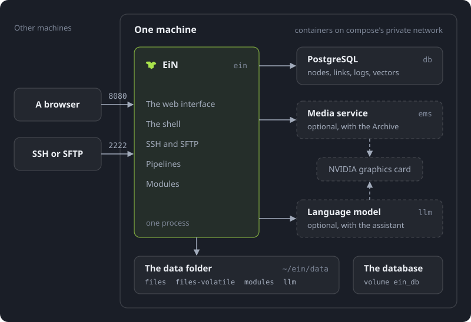

# EiN documentation

These pages explain how to install EiN, use it day to day, look after it and build on it. This one says what EiN is and where to start, whoever you are.

EiN (_Everything is a Node_) is a system you host yourself, on your own Linux machine (x86-64). Everything it keeps is a node in one tree: photos and albums, people and places, accounts, logs, queues, even its own commands, each with an owner and permissions as a file has. The web interface, a bash-compatible shell in the browser or over SSH, and SFTP all work on that one tree, as you and under the same permissions. Modules decide what EiN is for, and bring the pipelines that do the work each change starts. The first is the Archive, for a family's photos, videos, recordings and letters: as files come in, its pipelines make thumbnails, find faces, read text, transcribe speech and prepare everything for search. The assistant module adds a chat that answers your questions by running EiN's commands for you.

On your machine EiN runs as a few containers under podman or Docker. EiN itself serves the web interface on port 8080 and SSH and SFTP on port 2222 by default, and keeps every node in a PostgreSQL database beside it and the files themselves in a data folder. Two more services are optional: the media service, which does the work on pictures, video and sound and which the Archive needs, and a language model for the assistant. A graphics card makes both faster, but nothing needs one. [How EiN works](start/how-ein-works.md) explains the whole model in one page.

## Where to start

- **You want to try EiN.** [Install EiN](start/install.md) puts it on a Linux machine with one command, and [First steps](start/first-steps.md) takes you from the first sign-in to a family using it.
- **You use EiN day to day.** [Finding your way around](guide/interface.md) shows the web interface. [Getting your photos in](guide/importing.md), [Albums](guide/albums.md), [Search and the finder](guide/search.md) and [Sharing](guide/sharing.md) cover what you do most.
- **You run EiN for others.** [Installing in detail](admin/install.md) explains every part of the installation, [Configuration](admin/configuration.md) and [Modules](admin/modules.md) how to change what it does, [Health and the dashboard](admin/monitoring.md) how to tell that it is keeping up, and [Troubleshooting](admin/troubleshooting.md) what to do when something is wrong.
- **You work in the shell.** [The terminal](shell/terminal.md) opens EiN's shell in the browser, and [SSH and SFTP](shell/ssh-sftp.md) connects to it from your own computer.
- **You build modules.** [Writing a module](develop/modules.md) shows a module's folder, what each part becomes and how EiN finds it.

## How the documentation is organised

The sidebar groups the pages in sections:

| Section               | What it holds                                                                                                                                          |
| --------------------- | ------------------------------------------------------------------------------------------------------------------------------------------------------ |
| **Getting started**   | What EiN is, installing it, and setting it up for a family.                                                                                            |
| **Using EiN**         | The web interface, page by page, for everyone with an account.                                                                                         |
| **The shell and SSH** | The terminal, the shell language, the commands by task, the editor, SSH and SFTP, and reaching other machines from EiN.                                |
| **Administration**    | Installing, configuring, watching and maintaining EiN, for the person who looks after it.                                                              |
| **Concepts**          | Nodes, the tree, links, files and pipelines, in depth.                                                                                                 |
| **Reference**         | Every command, setting, environment variable and node type; the configuration files, keyboard shortcuts, the web interface's addresses and a glossary. |
| **Developing**        | Writing a module, teaching the assistant, and building EiN from source.                                                                                |

The [Commands](reference/commands.md), [Settings](reference/settings.md), [Environment variables](reference/environment.md) and [Node types](reference/node-types.md) pages are written from what a running EiN with all its modules says about itself; an installation with fewer modules has fewer of them. Words EiN uses in its own way, such as node, softlink or staging, are in the [Glossary](reference/glossary.md).

Every installation also carries its own documentation: **Documentation**, under **System** in EiN's sidebar. Its guide pages fill in their examples with the host name you reached EiN at, the SSH port EiN listens on and your user name. Its reference (**Commands**, **Settings**, **Environment**, **Node types** and **Modules**) is read from that installation as you open it: the commands on your PATH, each setting with its current value, the modules installed there. In the shell, `<command> --help` describes a command.

> [!NOTE]
> EiN is a work in progress. Nothing is released yet: the installer builds EiN from its newest source, and these pages describe the main branch of that source. Where they and the documentation inside your installation differ, the one inside describes what you run.
