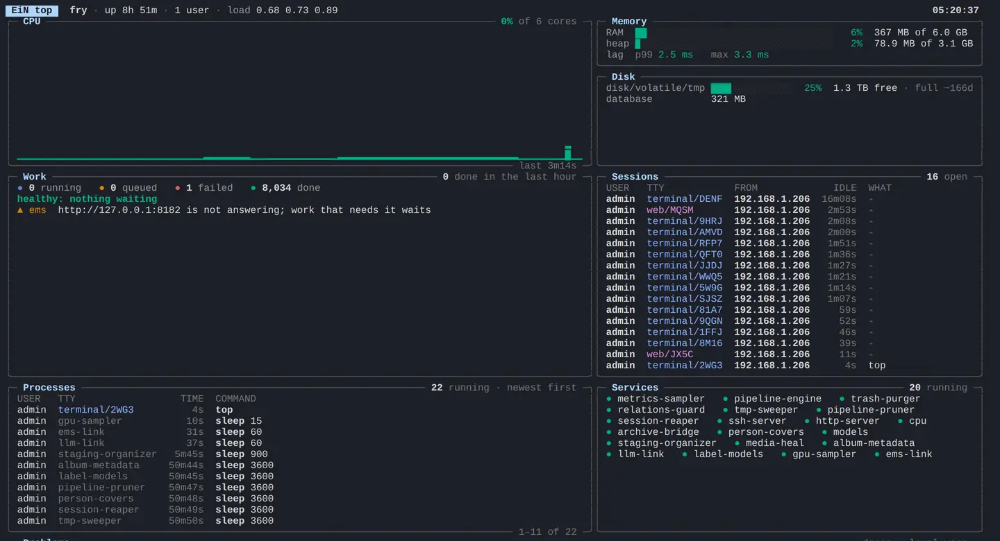

# The terminal

The terminal is a command line inside EiN's web interface: a shell that works on the same tree of
albums, people and files that the pages show, with the same commands and the same permissions. This
page is for anyone who signs in and wants to use it: how to open it, work in tabs, move around with
the keyboard, find earlier commands, get help, and find the command you need.

## Open the terminal

1. Sign in. Visitors browsing without an account have no terminal.
2. Choose the terminal button in the top bar (tooltip **Toggle Terminal (Alt+T)**), or press
   <kbd>Alt</kbd>+<kbd>T</kbd> wherever you are.

The terminal drops down from the top of the window over the page, half the window high, with the
cursor ready at the prompt. Try a first command:

```bash
# in EiN's terminal
ls /archive
```

```text
albums  devices  locations  people  tags  tracks
```

To hide it again, press <kbd>Alt</kbd>+<kbd>T</kbd>, choose the chevron at the right end of the tab
bar (**Hide terminal (Alt+T)**), or click anywhere outside it. Hiding the terminal does not stop it:
the shells keep running, a command you started goes on, and the terminal is as you left it when you
open it again.

On a phone-sized screen the top bar has no terminal button; <kbd>Alt</kbd>+<kbd>T</kbd> still works
with a keyboard attached. From your own computer you can also reach the same shell over SSH (see
[Use the same shell over SSH](#use-the-same-shell-over-ssh)).

Administrators have one more way in: in the **Nodes** explorer, right-click a folder and choose
**Open terminal here**. EiN opens a new tab and types `cd` to that folder for you.


### Read the prompt

The prompt says who you are and where you are:

```text
helen@:~$
```

- `helen` is your username, in green, or in red for an administrator.
- Between `@` and `:` stands the host name, which is empty unless you set one, for example with
  `export HOSTNAME=ein` in your `~/.bashrc`.
- `~` is the folder you are in. `~` stands for your home folder, `/home/helen`; elsewhere you see the
  path, such as `/archive/albums/christmas-2019`.
- `$` becomes `#` when the shell acts as an administrator.

Folders and files are nodes of EiN's tree: paths start at `/`, `..` is the folder above, and `cd`
moves you around. [The tree](../concepts/tree.md) shows what lies where.

## Work in several tabs

The tab bar runs along the foot of the terminal. Each tab is a shell of its own, with its own current
folder, its own variables and whatever is running in it; switching tabs does not stop the others.

- **Add a tab**: choose **+** (**New session (Alt+N)**) or press <kbd>Alt</kbd>+<kbd>N</kbd>. The
  first tab is called **Session 1**, the next **Session 2**, and so on. If the terminal is hidden,
  <kbd>Alt</kbd>+<kbd>N</kbd> adds the tab without showing it.
- **Know which is which**: once a tab's shell has reported its folder, the tab shows that path
  instead of its name, such as `/home/helen` or `/archive/albums/christmas-2019`.
- **Switch**: click a tab, or press <kbd>Alt</kbd>+<kbd>←</kbd> and <kbd>Alt</kbd>+<kbd>→</kbd>.
- **Close a tab**: choose its **×**, or press <kbd>Alt</kbd>+<kbd>W</kbd> while you are typing in it.
  Closing a tab ends its shell and everything running in it. The last tab has no **×** and cannot be
  closed.
- **End a shell from inside**: type `exit`, or press <kbd>Ctrl</kbd>+<kbd>D</kbd> on an empty line.
  The tab goes away; if it was the only one, a fresh shell takes its place.

## Make the terminal taller or shorter

The terminal starts at half the window's height.

- **Maximize (Alt+M)**, the button at the right of the tab bar, makes it fill the window. Pressed
  again, as **Restore (Alt+M)**, it returns to half the window.
- <kbd>Alt</kbd>+<kbd>↓</kbd> makes it a tenth of the window taller, <kbd>Alt</kbd>+<kbd>↑</kbd> a
  tenth shorter, between a tenth and the whole window.

The browser remembers the height for the next time, on that computer and in that browser.

## The terminal's own keys

The **?** button at the right of the tab bar (**Terminal shortcuts**) lists the keys of the terminal
itself. They work whether you are typing in the terminal or not, and only with <kbd>Alt</kbd> alone,
without <kbd>Ctrl</kbd>, <kbd>Shift</kbd> or <kbd>⌘</kbd>:

| Keys                        | In the **?** list | What happens                                              |
| --------------------------- | ----------------- | --------------------------------------------------------- |
| <kbd>Alt</kbd>+<kbd>T</kbd> | Toggle terminal   | Shows or hides the terminal                               |
| <kbd>Alt</kbd>+<kbd>N</kbd> | New tab           | Adds a tab with a new shell                               |
| <kbd>Alt</kbd>+<kbd>W</kbd> | Close tab         | Closes the tab you are typing in; never the last one      |
| <kbd>Alt</kbd>+<kbd>M</kbd> | Maximize          | Fills the window, or returns to half the window           |
| <kbd>Alt</kbd>+<kbd>←</kbd> | Previous tab      | Moves to the tab on the left, from the first to the last  |
| <kbd>Alt</kbd>+<kbd>→</kbd> | Next tab          | Moves to the tab on the right, from the last to the first |
| <kbd>Alt</kbd>+<kbd>↑</kbd> | Shrink height     | A tenth of the window shorter                             |
| <kbd>Alt</kbd>+<kbd>↓</kbd> | Grow height       | A tenth of the window taller                              |

The **Keyboard shortcuts** dialog that <kbd>?</kbd> opens anywhere in EiN lists only the first two,
under **Anywhere**. [Keyboard shortcuts](../reference/shortcuts.md) has every key in EiN.

> [!NOTE]
> On a Mac, ⌥ with a letter types a character of its own (⌥T types †), while the terminal looks for
> the letter itself, so ⌥T, ⌥N, ⌥W and ⌥M may not reach it. The top-bar button and the buttons in
> the tab bar do the same. ⌥ with the arrow keys is not affected.

## Come back to a running shell

Reload the page, or lose the connection for a moment, and the terminal comes back as you left it:
the same tabs, open or hidden as before, and in each tab the same shell, in the same folder, with up
to 1000 lines of what scrolled past drawn again. A command that was running carries on while the
page is away.

- **How long EiN waits.** EiN keeps a shell without a page for five minutes. The administrator sets
  this with **Terminal reconnect grace**
  ([`CFG_TERMINAL_RECONNECT_GRACE_SEC`](../reference/settings.md#cfg_terminal_reconnect_grace_sec),
  `300` seconds; `0` ends a shell as soon as its page goes). After that the shell ends, with
  whatever runs in it, and the tab starts a fresh one when you come back. To keep a long job going
  after you leave, see [The shell language](bash.md).
- **One browser tab, one set of terminals.** The tabs belong to the browser tab they were opened
  in. EiN in a second browser tab gets terminals of its own, starting again at **Session 1**, and
  closing a browser tab leaves its shells to end after the five minutes.
- **Signing out** ends every terminal of that sign-in and starts the tabs over, so the next person
  who signs in on that browser finds none of your shells.
- **When EiN restarts**, for example for an update, every shell ends. The tabs stay, and each
  starts a fresh shell once EiN answers again.
- **While the connection is down**, the top bar shows a red **Disconnected** badge. The terminal
  reconnects by itself; there is nothing to press.

Your command history is kept through all of this (see
[Find an earlier command](#find-an-earlier-command)).

## Upload files by dropping them

Drag files from your computer onto the terminal and let go. EiN uploads them into the folder the
tab is in, the path the tab shows. The **Uploads** button in the top bar follows them, as for any
upload, and a file whose name is taken in that folder is stored under a numbered name beside it.

Where you drop decides what happens next. To have the archive take new pictures in, go to a staging
category or an album first:

```bash
# in EiN's terminal
cd ~/staging/files/inbox
```

Then drop the files. [Getting your photos in](../guide/importing.md) explains staging, albums and
what happens after an upload. You need permission to write in the folder; an upload into a folder
you may only read fails and is listed under **Uploads**.

## Show a picture with cat

`cat` on a picture or a video draws it right in the terminal, 20 lines tall:

```bash
# in EiN's terminal
cd /archive/albums/christmas-2019 && cat 20191225_155434.jpg
```

- `cat -s` draws it half as tall, `cat -l` twice as tall.
- `export MEDIA_LINES=30` changes the height for the rest of the session (see
  [Environment variables](../reference/environment.md#options-you-set)).
- A video plays at once, with its controls under it. A recording gets a player two lines tall and
  starts playing.
- A text file is printed with colours for its language, such as JSON, YAML, bash or Markdown.

Only the terminal in the browser draws pictures. Over SSH, `cat` prints marker lines starting
`__IMG:` instead.

> [!NOTE]
> A picture whose path holds a space, such as one in `/archive/albums/Summer 2020`, is not drawn:
> the terminal shows its `__IMG:` lines instead. Open it in the web interface.

## Edit the command line

The line you type is edited with the keys of bash on Linux, in its default (emacs) mode. The ones
used most:

| Keys                                                                                         | What they do                                                                  |
| -------------------------------------------------------------------------------------------- | ----------------------------------------------------------------------------- |
| <kbd>Tab</kbd>                                                                               | Complete what you are typing (see [Let Tab complete](#let-tab-complete))      |
| <kbd>↑</kbd> <kbd>↓</kbd>                                                                    | The previous and the next command from your history                           |
| <kbd>Ctrl</kbd>+<kbd>R</kbd>                                                                 | Search your history as you type                                               |
| <kbd>Home</kbd> <kbd>End</kbd>, or <kbd>Ctrl</kbd>+<kbd>A</kbd> <kbd>Ctrl</kbd>+<kbd>E</kbd> | Start and end of the line                                                     |
| <kbd>Ctrl</kbd>+<kbd>←</kbd> <kbd>Ctrl</kbd>+<kbd>→</kbd>                                    | A word left or right                                                          |
| <kbd>Ctrl</kbd>+<kbd>K</kbd> / <kbd>Ctrl</kbd>+<kbd>U</kbd>                                  | Cut from the cursor to the end / to the start of the line                     |
| <kbd>Ctrl</kbd>+<kbd>Y</kbd>                                                                 | Paste what you cut last                                                       |
| <kbd>Alt</kbd>+<kbd>.</kbd>                                                                  | Insert the last word of the previous command (not with ⌥ on a Mac)            |
| <kbd>Ctrl</kbd>+<kbd>C</kbd>                                                                 | At the prompt: drop the line (`^C` is printed). While a command runs: stop it |
| <kbd>Ctrl</kbd>+<kbd>D</kbd>                                                                 | On an empty line: end the shell and its tab                                   |
| <kbd>Ctrl</kbd>+<kbd>L</kbd>                                                                 | Clear the screen, as the command `clear` does                                 |

Some keys mean something else in the browser:

- <kbd>Alt</kbd>+<kbd>←</kbd>, <kbd>Alt</kbd>+<kbd>→</kbd>, <kbd>Alt</kbd>+<kbd>↑</kbd> and
  <kbd>Alt</kbd>+<kbd>↓</kbd> are the terminal's own keys for tabs and height; move by word with
  <kbd>Ctrl</kbd>+<kbd>←</kbd> and <kbd>Ctrl</kbd>+<kbd>→</kbd>.
- <kbd>Ctrl</kbd>+<kbd>R</kbd> searches your history instead of reloading the page. To reload,
  press <kbd>F5</kbd>.
- The browser keeps some keys for itself before the terminal sees them. In most browsers
  <kbd>Ctrl</kbd>+<kbd>W</kbd> closes the browser tab rather than cutting a word; use
  <kbd>Alt</kbd>+<kbd>W</kbd> to close a terminal tab.

<kbd>Ctrl</kbd>+<kbd>Z</kbd> does not pause a running command. Start a long one in the background
with `&` instead; [The shell language](bash.md) covers jobs.

## Find an earlier command

Press <kbd>↑</kbd> to step back through the commands you ran, <kbd>↓</kbd> to step forward again.

To find one by a word in it, press <kbd>Ctrl</kbd>+<kbd>R</kbd> and type part of it. The prompt
turns into the search and shows the newest command that matches:

```text
(reverse-i-search)`peg': person-info /archive/people/Peggy_Wrenfield
```

- <kbd>Ctrl</kbd>+<kbd>R</kbd> again finds the next older match.
- <kbd>Enter</kbd> runs the command found.
- <kbd>Esc</kbd> leaves it on the line for you to change first.
- <kbd>Ctrl</kbd>+<kbd>G</kbd> gives up and brings back what you had typed.

bash's history commands work too: `history` lists what you ran, `!!` runs the last command again,
`!42` runs number 42 of the list, and `^old^new` runs the last command with `old` replaced by
`new`.

What EiN keeps:

- Your history is the file `~/.bash_history`. Every terminal tab and every SSH login of yours adds
  to it as each command runs, so a command typed in one tab can be found from another.
- A command typed with a space in front, or the same as the one before it, is not kept.
- It keeps the last 1000 commands. Change this under **Profile → Preferences**, **Shell history
  length** ([`HISTSIZE`](../reference/settings.md#histsize)); a tab you open afterwards uses the new
  length. [Your profile, favourites and trash](../guide/profile.md) shows where.
- Commands the web pages run for you, and commands sent with `ssh host 'command'`, are not kept.

## Let Tab complete

Press <kbd>Tab</kbd> while you type a command name, a path, an option, a user or a group. When only
one thing fits, EiN fills it in, with `/` after a folder and a space after anything else, and quotes
it if it holds spaces. When several fit, it fills in as much as they share; press <kbd>Tab</kbd>
again to list them all.

| You type                            | <kbd>Tab</kbd> gives                          |
| ----------------------------------- | --------------------------------------------- |
| `cd /archive/al`                    | `cd /archive/albums/`                         |
| `person-info /archive/people/Peg`   | `person-info /archive/people/Peggy_Wrenfield` |
| `search --ki`                       | `search --kind=`, ready for the value         |
| `user-info he`                      | `user-info helen`                             |
| `pipeline`, a space, <kbd>Tab</kbd> twice | the list of `pipeline`'s subcommands          |

Completion reads each command's own description of its arguments and options, so it knows a
command's options without being told. A command of a family, such as `pipeline status`, is
completed as two words. Scripts of your own can take part; see [The shell language](bash.md).

## Get help on a command

Put `--help` (or `-h`) straight after a command's name. The command does not run; it says how to
use it instead:

```bash
# in EiN's terminal
onthisday --help
```

```text
Usage: onthisday [OPTIONS] <day>

What the archive has from a calendar day (MM-DD, default today) in earlier years, from every onthisday-* command on PATH

Arguments:
  <day>    day as MM-DD (default today, UTC)

Options:
  --limit <number>  entries returned across all providers (default 8)
  -h, --help        Show this help message

Returns:
  the entries of every onthisday-* provider, newest year first: the year, what, the node it is about, which provider, and the route that draws it.

Examples:
  onthisday
  onthisday 06-21 --limit 20
```

- **A family of commands**, such as `config`, `docs`, `group`, `mod`, `pipeline`, `pool`,
  `service` and `user`, lists its members with `--help`: `service --help`. Each member answers for
  itself: `service status --help`. The two words are another way of typing the member's name:
  `service status` runs `service-status`.
- **bash's own commands**, such as `cd`, `export` and `history`, are described by `help`:
  `help cd`.
- **`-h` first always means help**, even for a command whose own `-h` means something else: `du -h`
  shows the help of `du`. Put another option first, as in `du -sh`.

There is no `man` and no pager. Long output scrolls past; scroll back with the mouse wheel or the
scrollbar.

The same descriptions are in **Documentation** in the sidebar, under **Commands**, for every
command installed on your EiN, and on this site in the [command reference](../reference/commands.md).

## Find the command you need

When you know what you want done but not which command does it, ask by what it does.

**In the finder.** Press <kbd>Ctrl</kbd>+<kbd>K</kbd> (<kbd>⌘</kbd>+<kbd>K</kbd> on a Mac) and type
`>` followed by what the command should do, or part of its name. Up to six commands appear under
**Commands**; choosing one opens its description in **Documentation**. It does not run the command:
you run it in the terminal. [Search and the finder](../guide/search.md#find-a-command-with-) has the
details.


**In the terminal.** `docs find` lists the best commands, best first, each with a score, its name and
its description:

```bash
# in EiN's terminal
docs find restart a service
```

With the assistant module installed there is also `assistant-commands find`, which adds whether
each command only reads or also changes something, and `assistant-commands judge` tells you which a
whole command line would do:

```bash
# in EiN's terminal
assistant-commands find 'list running services'
assistant-commands judge 'service restart pipeline-pruner'
```

How well this works depends on what is installed:

| Installed                                  | How commands are found                                                                                  |
| ------------------------------------------ | ------------------------------------------------------------------------------------------------------- |
| Core alone                                 | Your words are matched against the commands' names and descriptions; a word in the name counts double   |
| The assistant module                       | The assistant answers for `docs find` and the finder, and still matches words                           |
| The assistant module and the media service | Commands are found by meaning, so one can turn up even when its description uses other words than yours |

The settings behind this are **Command finder**
([`CFG_COMMAND_FINDER`](../reference/settings.md#cfg_command_finder)) and **Text embedder**
([`CFG_TEXT_EMBEDDER`](../reference/settings.md#cfg_text_embedder)); the assistant module and the
media service set them when they are installed.

## Use the same shell over SSH

The terminal is one of several doors into the same shell. From your own computer you can log in
over SSH with your EiN username and password, on port 2222 unless your administrator chose another:

```bash
# on your own computer
ssh -p 2222 helen@ein.local
```

You get the same shell as in a terminal tab: the same prompt, your history, your `~/.bashrc`, Tab
completion and the same keys. Two things belong to the browser alone: pictures drawn by `cat`, and
dropping files to upload them. Over SSH, copy files with SFTP or `scp` instead.


The web pages run these same commands for you, and so does the assistant, always as the person
signed in. A command you may not run in the terminal is refused through every other door too.
[SSH and SFTP](ssh-sftp.md) covers keys, running one command at a time, and copying files.

## Commands worth knowing

Commands marked _archive_ come with the archive module and exist only where it is installed.
[Commands by task](commands.md) has many more, grouped by what you want to do.

| Command                                                                              | What it does                                                                                |
| ------------------------------------------------------------------------------------ | ------------------------------------------------------------------------------------------- |
| [`ls`](../reference/commands-core.md#ls)                                             | Lists what is in a folder; `ls -l` with details                                             |
| `cd`                                                                                 | Moves into a folder; `cd` alone goes home, `cd -` back to where you were                    |
| [`cat`](../reference/commands-core.md#cat)                                           | Prints a text file, or draws a picture                                                      |
| [`edit`](../reference/commands-core.md#edit)                                         | Edits a text file in the terminal; see [The editor](editor.md)                              |
| [`cp`](../reference/commands-core.md#cp)                                             | Copies; `cp -r` for a folder and what is in it                                              |
| [`mv`](../reference/commands-core.md#mv)                                             | Moves or renames, and keeps the links to what it moves pointing at the new place            |
| [`rm`](../reference/commands-core.md#rm)                                             | Deletes for good; `rm -r` for anything that has children, a processed photo included        |
| [`trash`](../reference/commands-core.md#trash)                                       | `trash put <path>` moves into your trash, from which you can restore it                     |
| [`mkdir`](../reference/commands-core.md#mkdir)                                       | Makes a folder; `mkdir -p` makes the folders above it too                                   |
| [`mkfile`](../reference/commands-core.md#mkfile)                                     | Makes an empty text file, what `touch` does elsewhere                                       |
| [`du`](../reference/commands-core.md#du)                                             | Adds up sizes; `du -chs *` gives readable sizes and a total                                 |
| [`find`](../reference/commands-core.md#find)                                         | Finds nodes under a path, as GNU find does: `find /archive/people -maxdepth 1 -type person` |
| [`search`](../reference/commands-core.md#search)                                     | Searches the archive's content: `search christmas --kind photo`                             |
| [`stat`](../reference/commands-core.md#stat)                                         | Shows a node's details: type, owner, times                                                  |
| [`ln`](../reference/commands-core.md#ln)                                             | `ln -s` makes a softlink, one thing in a second place                                       |
| [`news`](../reference/commands-core.md#news)                                         | What has been added lately, newest first                                                    |
| [`events`](../reference/commands-core.md#events)                                     | What falls on the days around today, such as birthdays and anniversaries                    |
| [`onthisday`](../reference/commands-core.md#onthisday)                               | What the archive has from this day in earlier years                                         |
| [`timeline`](../reference/commands-archive.md#timeline)                              | _archive_: albums, life events, birthdays and tracks, newest first                          |
| [`person-info`](../reference/commands-archive.md#person-info)                        | _archive_: a person's details, relations, homes and events                                  |
| [`top`](../reference/commands-core.md#top)                                           | Watches the system live; <kbd>q</kbd> quits                                                 |
| [`ps`](../reference/commands-core.md#ps), [`who`](../reference/commands-core.md#who) | What is running now, and who is connected; your own, or everyone's for an administrator     |
| [`health`](../reference/commands-core.md#health)                                     | One line on how the system is doing, and the checks behind it                               |
| [`docs`](../reference/commands-core.md#docs)                                         | `docs find <words>` finds a command by what it does                                         |
| `whoami`                                                                             | Prints your username                                                                        |

> [!WARNING]
> `rm` deletes at once and for good: it does not use the trash, and nothing brings the node back.
> Use `trash put` for anything you may want again; it then shows under **Trash** in your account
> menu (see [Your profile, favourites and trash](../guide/profile.md)).

`top` fills the terminal with what EiN is doing and keeps it up to date. Press <kbd>Alt</kbd>+<kbd>M</kbd>
first to give it the whole window. [Health and the dashboard](../admin/monitoring.md) explains what
it shows and all its keys.



Steps that belong together can be joined with `&&`, and paths with spaces go in quotes, as in bash:

```bash
# in EiN's terminal
cd "/archive/albums/Summer 2020" && ls -l
```

[The shell language](bash.md) covers what else bash syntax can do in EiN, and how it differs from
bash on Linux.

## If something goes differently

**There is no terminal button.** You are not signed in, or the window is phone-sized. Sign in; on a
small screen press <kbd>Alt</kbd>+<kbd>T</kbd> with a keyboard, or use SSH from a computer.

**The terminal closed while I was clicking on the page.** A click outside the terminal hides it. Its
shells keep running; press <kbd>Alt</kbd>+<kbd>T</kbd> to bring it back.

**The top bar says Disconnected.** EiN cannot be reached from the browser just now. The terminal
reconnects by itself and finds its shell again if the connection is back within five minutes.

**The screen was cleared and a fresh prompt waits.** The shell ended: you were away longer than five
minutes, EiN restarted, or you signed out. Your history is still there; <kbd>↑</kbd> and
<kbd>Ctrl</kbd>+<kbd>R</kbd> find your commands.

**`error: command 'albm' not found`.** No command of that name is on your path. Check the spelling
with <kbd>Tab</kbd>, or look for it with `docs find`. Commands such as `timeline` and `person-info`
exist only where their module is installed.

**`service-restart: permission denied: only an administrator may run it`.** The command is for
administrators. Through every door it is refused the same way; ask your administrator.

**`du -h` shows help instead of sizes.** `-h` straight after a command's name always asks for help.
Write `du -sh` or `du -ch`.

**`cat` prints lines starting `__IMG:` instead of the picture.** You are connected over SSH, or the
picture's path holds a space. Open the picture in the web interface.

**Dropped files landed in the wrong folder.** They go into the folder the tab is in, the path on the
tab. `cd` to where they belong and drop them again, or move them with `mv`.

**The browser tab closed when I pressed Ctrl+W.** The browser keeps that key for itself. Open EiN
again: you get new terminals, and the old shells end after five minutes.

## Related pages

- [The shell language](bash.md): the bash syntax EiN understands, scripts, jobs and `JSON_OUTPUT=1`.
- [Commands by task](commands.md): which command does what, grouped by task.
- [The editor](editor.md): `edit` and its keys.
- [SSH and SFTP](ssh-sftp.md): the same shell from your own computer, and copying files.
- [Commands](../reference/commands.md): every command, with all its options.
- [Keyboard shortcuts](../reference/shortcuts.md): every key in EiN.
