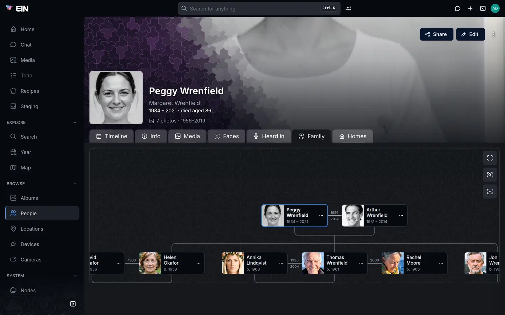

# Try the demo

The demo at <https://demo.einhq.eu> is an EiN on the internet that anyone can look around without
installing anything. It has [the Archive](../archive/index.md) installed and holds the archive of the
Wrenfields, a family that does not exist: their photos, home videos, recordings, letters and travels
over four generations. This page says what you can do there, what happens to it every night, and
which of its pictures and voices are real and which are generated.

## Look around without signing in

Open <https://demo.einhq.eu> and EiN takes you straight to **Home**, as a visitor: you need no
account, and nothing asks who you are. From the sidebar you can open every page a reader has:

- **Media**, **Year** and **Map**, the family's photos, videos, recordings and documents by date and
  by place. Open one to see who is in it, where and when it was taken, the text read from a letter
  or the words spoken in a recording.
- **Albums**, **People**, **Locations** and **Cameras**, and a person's family tree on their page.
- **Search**, in your own words, such as `sailing` or `wedding`, and the finder (<kbd>Ctrl</kbd>+<kbd>K</kbd>).
- **Statistics**, and **Documentation**, these pages as EiN shows them offline.

[Finding your way around](../guide/interface.md) shows the Web UI page by page, and the
[Archive's pages](../archive/index.md) what each of its pages does.

A visitor reads and changes nothing: uploading, editing, sharing, the terminal and the settings ask
you to sign in, and the demo has no public account. The demo is updated now and then, not with every
change to EiN, so it may be a little behind what these pages describe. The assistant is not installed, so
there is no **Chat**. To try those parts, [install EiN](install.md) on your own machine; the same
pages are there, with your own family in them.

> [!NOTE]
> One account besides the administrator's, `reviewer`, is there for Google Play, whose reviewers sign
> in with it to check the EiN app. Its password is given to them alone.

## Every night it starts again

Every night at 03:30 Central European Time (02:30 in the UK) the demo is put back as it was: its
database and its files are replaced by a copy kept for the purpose, and the accounts get their
passwords back. Whatever was changed during the day is gone, and every visitor finds the same
archive. For a few minutes while that happens, the demo does not answer.

## The Wrenfields, an invented family

Nobody in the demo exists, and nothing in it comes from a real family's archive. The Wrenfields are
about twenty people over four generations, from grandparents married in the 1950s to children born
in the 2010s: a home in London, a cottage in Cornwall, a branch of the family in Wellington, a trip
to Boston and a sailing holiday in the Stockholm archipelago. Their story, who married whom, who was
born when and who was where, was written for the demo, and every picture, recording and document of
the family follows it, so that EiN has a real job to do: recognise the same person at 8 and at 60,
tie a voice to a name, place a photo on a trip.

The places are real, and so is the map, © OpenStreetMap contributors. No home points at a real
house: each is an area a few hundred metres across, centred on a park or a street.

## What is real and what is generated

The archive mixes real material, none of it showing a person, with material made for it:

| What                                                                                                                              | Where it comes from                                                                                                                                                                                                                                                            |
| --------------------------------------------------------------------------------------------------------------------------------- | ------------------------------------------------------------------------------------------------------------------------------------------------------------------------------------------------------------------------------------------------------------------------------ |
| Photos without people: streets, landscapes, boats, food                                                                           | **Real.** Freely licensed photos from [Wikimedia Commons](https://commons.wikimedia.org) and camera RAW samples from [raw.pixls.us](https://raw.pixls.us), each kept with the camera details it was taken with. Any photo with a face in it, even a passer-by's, was left out. |
| The family's faces at every age, and every picture with them in it: the old prints and slides, their weddings, holidays and homes | **Generated**, whole, settings included, by an open image model (FLUX.2 [klein]), each person from portraits generated for them first.                                                                                                                                         |
| The family's voices, in the recordings and the home videos                                                                        | **Generated** by open text-to-speech models (Kokoro-82M in English, Chatterbox Multilingual in Swedish), from voices that belong to no real person.                                                                                                                            |
| The home videos                                                                                                                   | **Generated**: the people in them animated, talking and listening, by an open video model (StableAvatar) from a generated first frame of each and the recording's generated voices.                                                                                            |
| Letters, cards and other documents, and the GPS tracks of the trips                                                               | **Written** for the demo, from the story.                                                                                                                                                                                                                                      |

Every generated file says so inside itself, as the IPTC standard marks a picture made by a trained
model (`Iptc4xmpExt:DigitalSourceType` is `trainedAlgorithmicMedia`), so any program that reads it
can tell. Sound behind a voice, a room or a street, is generated or freely licensed in the same way.

The real photos are the work of the people who took them and keep their own licences: Creative
Commons CC0, the public domain, or a CC BY licence, which asks for the author to be named. Each one is
credited, with its author, its licence and a link to where it was published, in
[ATTRIBUTION.md](https://github.com/einhq/einhq.github.io/blob/main/ATTRIBUTION.md). Everything
written or generated for the demo is dedicated to the public domain (CC0 1.0).

## Where to go next

- [How EiN works](how-ein-works.md) explains what you saw in the demo: nodes, the tree and the
  pipelines that found the faces and read the letters.
- [Install EiN](install.md) puts EiN on your own Linux machine with one command.
- [The Archive](../archive/index.md) covers the pages of the demo one by one.
