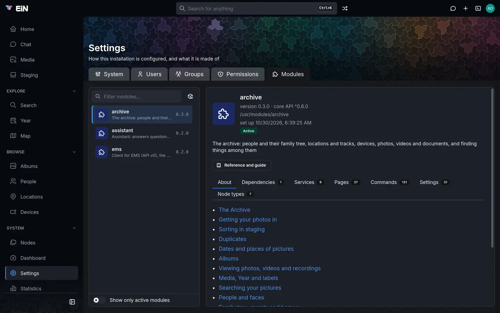
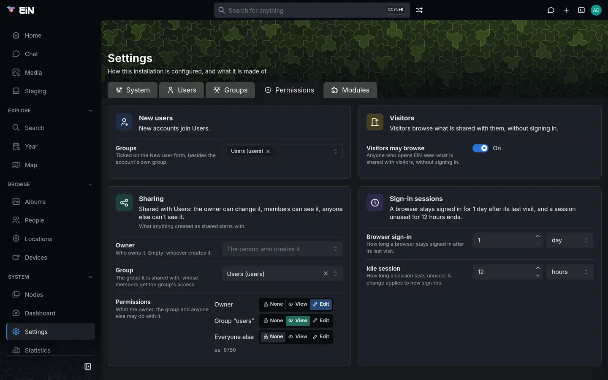
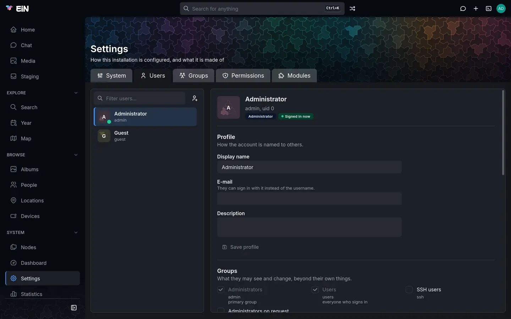

# First steps

This page is for the administrator who has just [installed EiN](install.md) and is setting it up
for a family. It goes from the first sign-in to the family using it, one short step at a time, and
links each step to the page that covers it in full. The steps hold for any EiN, whichever modules
it has; each module's own pages take over from there.

Take the steps in order. Some of them depend on an earlier one: the sharing defaults in step 4, for
example, apply to what is created after you set them, so set them before the family starts adding
things.

1. [Sign in and change the admin password](#sign-in-and-change-the-admin-password)
2. [Check the dashboard](#check-the-dashboard)
3. [Install the modules you want](#install-the-modules-you-want)
4. [Decide who sees what](#decide-who-sees-what)
5. [Create accounts for the family](#create-accounts-for-the-family)
6. [Try the terminal](#try-the-terminal)
7. [Start with the modules](#start-with-the-modules)
8. [Let the family sign in](#let-the-family-sign-in)
9. [Keep EiN running](#keep-ein-running)

Commands on this page are written for podman. With Docker, write `docker compose` where the page
says `podman compose`.

## Sign in and change the admin password

At its end the install printed the address and the administrator's password:

```text
EiN is up at http://ein.local:8080/
Sign in as admin with the password 5e0c9a2f71b3d846 and change it, then delete the line INITIAL_ADMIN_PASSWORD from /home/anna/ein/.env.
```

1. Open the address in a browser. If your computer cannot find that name, use the machine's IP
   address instead, such as `http://192.168.1.20:8080/`.
2. Enter `admin` under **Username or e-mail**, the printed password under **Password**, and choose
   **Sign in**. EiN opens on Home, titled **Welcome**.
3. Open the account menu under your picture at the top right, choose **Profile**, then the
   **Security** tab.
4. Fill in **Current password**, **New password** and **Confirm new password**, and choose
   **Update password**. EiN answers **Password updated**.

[Install EiN](install.md#change-the-admin-password-straight-away) shows the form.

You can change it in EiN's terminal instead. Open the terminal with the top bar's terminal button
or <kbd>Alt</kbd>+<kbd>T</kbd>, and run:

```bash
# in EiN's terminal
user passwd admin
```

It asks for the new password after `Password:`. The [reference](../reference/commands-core.md#user-passwd)
lists its options.

If the install's output is gone, the password is still in `~/ein/.env`, as
`INITIAL_ADMIN_PASSWORD`, and every later run of `./setup.sh` prints it again at its end:

```bash
# on the machine EiN runs on, in ~/ein
grep INITIAL_ADMIN_PASSWORD .env
```

Once you have changed the password, delete that line from `.env`: the old password stays readable
there for anyone who can read the file, and changing the line does not change the password, which
EiN takes from it only at its first start.

> [!WARNING]
> Once you have changed it, nothing else keeps the admin password, and EiN sends no e-mail, so there is no "forgot password".
> Keep the new one in a password manager. If it is lost, only someone who can act as the
> administrator can set a new one. Step 5 shows how to give a second person that right.

## Check the dashboard

Choose **Dashboard** under **System** in the sidebar. Only administrators have it. The page,
**System dashboard**, shows a badge above its title for how things stand:

| Badge              | What it means                                                            | What to do                                                                                             |
| ------------------ | ------------------------------------------------------------------------ | ------------------------------------------------------------------------------------------------------ |
| **Healthy**        | Nothing is waiting to be done.                                           | Nothing.                                                                                               |
| **Catching up**    | Work is waiting, and some was done in the last hour, as after an import. | Wait. It turns to **Healthy** when the work is done.                                                   |
| **Stuck**          | Work is waiting, and none was done in the last hour.                     | Look at the **Work** tab, and read [Health and the dashboard](../admin/monitoring.md).                 |
| **Needs a person** | A check failed.                                                          | Read the failed check on the **Overview** tab, and see [Troubleshooting](../admin/troubleshooting.md). |


For the first minute after EiN starts, the dashboard may show **warming up** while it takes its
first readings.

Below the badges, the **Overview** tab lists every check that is not fine. Warnings do not stop
**Healthy**, and two are expected on an install without the optional parts:

- with the archive but without the media service, `ems` says
  `http://ems:8181 is not answering; work that needs it waits`;
- with the assistant but without a language model, `llm` says
  `http://llm:8190 is not answering; the chat cannot answer until it does`.

With the parts installed, the same warnings show for a while after a start, as the media service
loads its models and the language model downloads its own the first time; they clear by
themselves. Step 3 says how to add either part.

## Install the modules you want

What EiN is for comes from its modules. Without any, the sidebar holds only **Home**, **Search**
and the pages under **System**. These modules are published:

| Module      | What it adds                                                                                                                                                                                                     | What it needs                                              |
| ----------- | ---------------------------------------------------------------------------------------------------------------------------------------------------------------------------------------------------------------- | ---------------------------------------------------------- |
| `archive`   | **Media**, **Staging**, **Year**, **Map**, **Albums**, **People**, **Locations** and **Devices** in the sidebar, and **Import media**, **Album**, **Person**, **Location** and **Device** in the **Create** menu | the `ems` module, installed with it, and the media service |
| `assistant` | **Chat**, in the sidebar and as a top-bar button                                                                                                                                                                 | a language model, your own or a hosted one                 |
| `ems`       | the client for the media service, and the **Media service** tab on the dashboard                                                                                                                                 | the media service                                          |

A fourth module, the [Importer](../importer/index.md), moves one particular older archive into EiN;
it is not published.

If you installed with the **EiN Archive** command from einhq.eu, the three are installed already. Open
**Settings → Modules**, choose each module, and check that its panel says **Active**, not
**Not set up** or **Setup failed**.

To install a module:

1. Open **Settings → Modules**.
2. Choose the **Published modules** button beside the filter.
3. Choose **Install** beside the module. EiN installs the modules it needs as well, and says
   so: "Installed, with ems".
4. The module's pages appear in the sidebar without a reload.



In EiN's terminal, [`mod install`](../reference/commands-core.md#mod-install) does the same:

```bash
# in EiN's terminal
mod install archive
```

The archive's photos, videos and recordings need the **media service**, a separate container that
reads dates and places, makes the previews, and finds faces, text and speech. Installing the module
does not install the service. If you left it out at the install, add it on the machine:

```bash
# on the machine EiN runs on
~/ein/setup.sh --ems
```

It builds the media service's image, about 30 GB, on the machine, and starts EiN again. Without
it, uploads arrive but wait in staging as **being prepared**. The assistant needs a language
model the same way: `~/ein/setup.sh --llm` runs one on this machine, and a hosted provider is set
in `~/ein/.env`. [Modules](../admin/modules.md), [The media service](../ems/index.md) and
[The language model](../assistant/language-model.md) have the details.

## Decide who sees what

**Settings**, under **System** in the sidebar, is where you set up EiN. Its tabs are **System**,
with every system setting by category, **Users**, **Groups**, **Permissions** and **Modules**.
Each setting says what it does and which module brought it, and is saved on its own with
**Save change**. [Configuration](../admin/configuration.md) explains the page and the same settings
in the terminal. Start with who sees what.

Open **Settings → Permissions**. Its four cards each say in a sentence what their settings come to.



**Visitors.** **Visitors may browse** is **Off** on a new install, and the setting itself advises
keeping it off for a family's own archive. Off, anyone who has not signed in is asked to sign in.
A share link still opens what it was made for (see [Sharing](../guide/sharing.md)). Turn it on only
for an archive meant to be public. The setting is [`CFG_GUEST_BROWSING`](../reference/settings.md#cfg_guest_browsing).

**Sharing** sets what anything created as shared starts with. With the Archive installed, that is
an album made with **Create → Album**, and a group filed from staging into a new album; the rest of
this step speaks of albums for that reason. Its rows:

| Row             | New install                                                                | What it decides                                          |
| --------------- | -------------------------------------------------------------------------- | -------------------------------------------------------- |
| **Owner**       | empty: whoever creates it                                                  | who owns what is created                                 |
| **Group**       | Users, which is everyone with an account                                   | the group it is shared with                              |
| **Permissions** | **Owner** Edit, **Group “users”** View, **Everyone else** None (`as 0750`) | what the owner, the group and anyone else may do with it |

So on a new install the card reads: "Shared with Users: the owner can change it, members can see
it, anyone else can't see it." Some common choices:

| You want                                                                    | Set                                                                          |
| --------------------------------------------------------------------------- | ---------------------------------------------------------------------------- |
| Everyone with an account sees every album, and only its owner changes it    | nothing: the defaults do this                                                |
| The family adds to and changes each other's albums                          | **Group “users”** to **Edit**                                                |
| Some accounts are not family, such as friends you share a single album with | a family group as **Group** (see step 5), with **Everyone else** at **None** |

Each row is saved on its own with **Save change**. A change applies to what is created afterwards;
albums that exist keep their sharing, which you change with **Share**, as
[Sharing](../guide/sharing.md) shows. Each person can
also narrow what they create, under **Profile → Preferences → How widely what you create is
shared**.

**Sign-in sessions.** A browser stays signed in for **1 day** after its last visit
(**Browser sign-in**), and a session unused for **12 hours** ends (**Idle session**). Lengthen both
if the family should stay signed in longer on their own devices.

[Sharing](../guide/sharing.md) and [Permissions in depth](../admin/permissions.md) explain what each
choice does.

## Create accounts for the family

Give each person an account of their own. With the Archive installed, what they upload waits in
their own staging area, which only they see, until they file it into an album.

1. Open **Settings → Users** and choose the **New user** button beside the filter.
2. Type the person's **Name**, such as Helen Okafor. **Username** is suggested from it (`helen`).
   It is lower case and cannot be changed later.
3. **E-mail** is optional: with one, they can sign in with it instead of the username. EiN sends
   no e-mail to it.
4. Type a **Password** and **Repeat** it. You can leave both empty and set the password later, but
   they cannot sign in until you do.
5. Under **Groups**, **Users** is ticked and greyed: everyone who signs in belongs to it. Tick any
   other group the person should be in.
6. Choose **Create user**. EiN says "Created helen." and opens the account.



If everyone with an account is family, the **Users** group already covers them, and you need no
other group. If some accounts are not family, make a group for the family:

1. Open **Settings → Groups** and choose the **New group** button beside the filter.
2. Type a **Name**, such as `family` (it cannot be changed later), a **Title**, such as Family, and
   tick the **Members**.
3. Choose **Create group**.
4. On **Settings → Permissions**, choose the group as **Group** on the **Sharing** card, and add it
   under **Groups** on the **New users** card, so the New user form ticks it for each new account.

Group changes reach a person the next time they sign in.

> [!TIP]
> Tick **Administrators on request** for a second person you trust, or for an everyday account of
> your own. They can then choose **Administer…** in the account menu and enter their own password
> again to act as the administrator, until they sign out or choose **Leave admin mode**. Such a
> person can also set a new admin password if it is lost. Ticking **Administrators** does not do
> this: it is only the administrator account's own group.

When someone forgets their password, open their account in **Settings → Users**, type a
**New password** and **Repeat** it under **Password**, and choose **Set password**.
[Accounts and groups](../admin/accounts.md) covers the rest: disabling and deleting accounts,
groups, and the commands.

## Try the terminal

Everything the pages do, and more, can be done with commands in EiN's terminal, a shell that works
on the same tree as the pages, as the person signed in. Open it with the top bar's terminal button,
or with <kbd>Alt</kbd>+<kbd>T</kbd> wherever you are, and try a first command:

```bash
# in EiN's terminal
health
```

It says in one line how EiN is doing, the same verdict as the dashboard's badge, and lists the
checks behind it. `--help` after a command's name says how to use it, and `docs find` followed by
what you want done finds the command that does it. Press <kbd>Alt</kbd>+<kbd>T</kbd> again to hide
the terminal; what runs in it goes on.

[The terminal](../shell/terminal.md) shows the rest, and [SSH and SFTP](../shell/ssh-sftp.md) how
to reach the same shell from your own computer.

## Start with the modules

What comes next depends on the modules you installed in step 3:

- **The Archive.** [The Archive](../archive/index.md) takes it from here: importing the first
  photos, sorting them in staging into albums, and sharing an album, with or without an account.
- **The Assistant.** [The Assistant](../assistant/index.md) says what it needs, what it adds, and
  where to start chatting.

## Let the family sign in

Give each person:

- the address you opened in step 1, such as `http://ein.local:8080/`, or the machine's IP address
  if their device cannot find the name;
- their username, or the e-mail address you gave the account, and their password.

They sign in on the sign-in page with **Username or e-mail**, **Password** and **Sign in**. Ask
them to change their password at once, under **Profile → Security**.
[Finding your way around](../guide/interface.md) is a good page to send them, with the overview of
each module you installed, such as [The Archive](../archive/index.md).

EiN answers on your home network. Reaching it from elsewhere takes an HTTPS proxy of your own in
front of it; [Ports, HTTPS and remote access](../admin/network.md) explains what EiN needs from
one.

On a phone, EiN runs in the browser; there is no app to install from a store. The page fits the
screen: the EiN mark at the top left opens the menu. From the browser's menu, a phone can add EiN
to its home screen, where it opens full screen, like an app, when EiN is served over HTTPS. EiN
does not work offline. [EiN on a phone](../guide/phone.md) shows what differs.

## Keep EiN running

**Look at the dashboard now and then.** EiN sends no alerts, by e-mail or otherwise: what goes
wrong shows on the dashboard and in the logs. Its **Storage** card shows how much room each part
of the data folder has left, and says "full in ~N days" in red when a part fills within two weeks.
EiN does not stop work for you when the disk fills.

**Update** by running the installer again:

```bash
# on the machine EiN runs on
curl -fsSL https://einhq.eu/install.sh | bash
```

It updates `~/ein`, then fetches the newest code of EiN and its services, builds it and starts it
again, keeping your options in `~/ein/.env`, your data and the installed modules. `~/ein/setup.sh`
alone does the same, `~/ein` included, without checking the machine. There are no releases: an update
takes the newest code, and there is no going back to the previous one. Modules are updated
separately, with **Update** in **Settings → Modules → Published modules**.
[Updating](../admin/updating.md) explains what an update touches.

**After the machine restarts**, check that EiN came back. The installer makes EiN start at boot
where it can: under podman it enables `podman-restart.service`, and lingering for your user, and
with Docker it checks that Docker's own service is enabled. Where it cannot, its output ends with
"EiN does not start again when the machine does until this has run:" and the commands to run,
such as `sudo loginctl enable-linger` and your username. Until they have run, start EiN yourself
after a reboot:

```bash
# on the machine EiN runs on, in ~/ein
podman compose ps
podman compose up -d
```

**Back up.** EiN has no backup command; you copy its data yourself, with your own tools. A backup
needs three things, taken together:

- `~/ein/.env`, which holds your options and the passwords made at the install, and nothing else
  keeps them;
- the data folder, `~/ein/data` unless you chose another at the install, and above all its
  `files` folder, which holds your originals;
- the database, which is the container engine's volume `ein_db` (or the folder you gave
  `--db-dir`), not part of the data folder.

> [!NOTE]
> The database holds every name, album, person and setting, and the `files` folder holds the
> files themselves, stored by an id rather than by name. Neither is any use without the other, so
> copy them at the same time, and back up before each update.

[Your data: backup, moving and removing](../admin/data.md) gives a procedure, and
[Troubleshooting](../admin/troubleshooting.md) helps when something goes differently.
