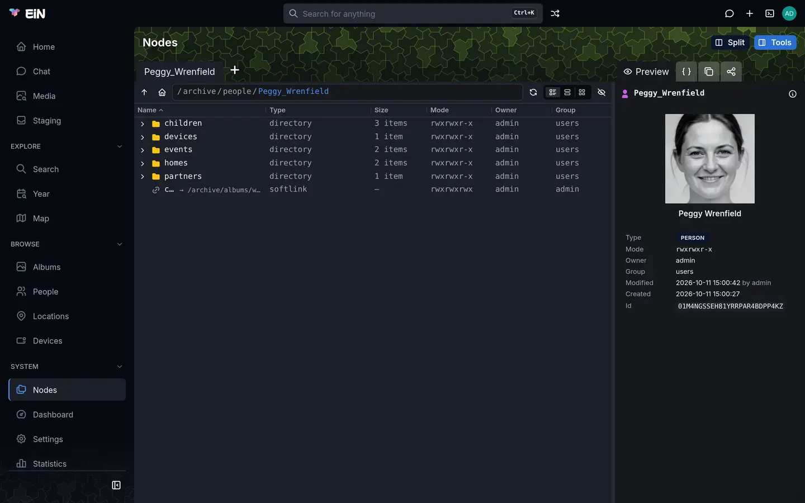
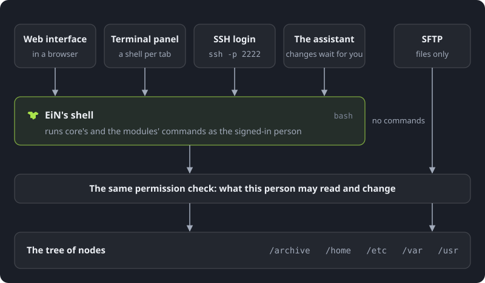
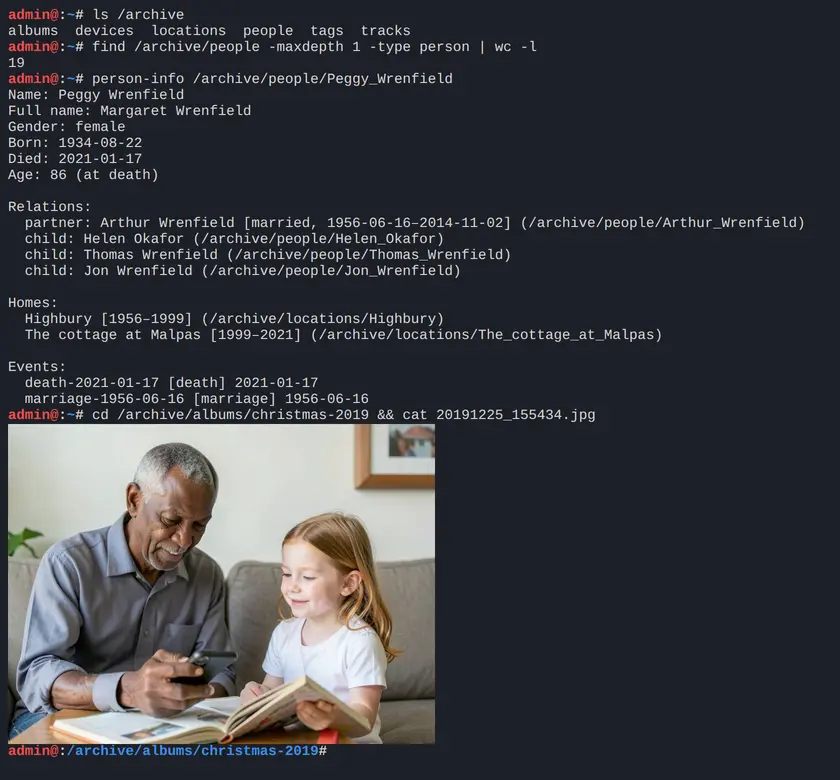

# How EiN works

This page explains the few ideas EiN is built on: one tree of nodes, one set of commands that works
on it from every door, pipelines that act on every change, and modules that decide what it is for.
Read it first, whether you are going to use EiN, run it or build on it.

## Everything is a node

EiN keeps everything in one tree, the way a computer keeps files in folders. A photo is a node, and
so are the album that holds it, a person in the family tree, a place on the map, an account, the
system log, a queue of work waiting to be done, each of EiN's own commands and the file that holds
the system's settings. Each has a path from `/`, as a file does:

| What                                       | Path                                                 | Type       |
| ------------------------------------------ | ---------------------------------------------------- | ---------- |
| A photo                                    | `/archive/albums/christmas-2019/20191225_155434.jpg` | `file`     |
| The album it is in                         | `/archive/albums/christmas-2019`                     | `album`    |
| A person                                   | `/archive/people/Peggy_Wrenfield`                    | `person`   |
| A place she lived                          | `/archive/locations/Highbury`                        | `location` |
| An account                                 | `/etc/users/admin`                                   | `user`     |
| The group everyone who signs in belongs to | `/etc/groups/users`                                  | `group`    |
| The system's settings                      | `/etc/config`                                        | `file`     |
| The system log                             | `/var/logs/system`                                   | `log`      |
| The pipeline engine's queue                | `/var/queues/pipeline-engine`                        | `queue`    |
| A command                                  | `/usr/bin/ls`                                        | `command`  |

A node has a type, a name in its folder, an owner, a group and permission bits, and the attributes
its type needs: a photo's name, size, checksum and the time it was taken; a person's names and
dates. Some types hold content as well: a file its bytes, a log its lines, a queue its messages.

Any node can have children, a file included. A photo keeps what EiN works out about it beneath
itself: its EXIF in `metadata/exif`, its thumbnails in `thumbnails/`, the faces found on it in
`regions/`. Delete the photo and they go with it.



The type decides what a node is and how EiN treats it. Core has 17 types of its own, and modules add
theirs, such as the archive's `album`, `person` and `location`. [Nodes and node types](../concepts/nodes.md)
describes a node part by part, and [Node types](../reference/node-types.md) lists every type.

The top of the tree is divided by what each part is for. [The tree](../concepts/tree.md) has every
standard path.

| Folder         | What it holds                                                                                                                     |
| -------------- | --------------------------------------------------------------------------------------------------------------------------------- |
| `/archive`     | What the archive is for: albums, people, locations, devices and labels                                                            |
| `/home/<you>`  | Your own space: your settings, shell history, favourites and trash, and with the Archive the uploads waiting for you to sort them |
| `/etc`         | Accounts and groups, settings, and the services EiN runs                                                                          |
| `/var`         | What the system writes as it runs: logs, sessions, queues, pools and pipeline runs                                                |
| `/usr`         | Commands, modules and the built-in guide                                                                                          |
| `/dev`, `/tmp` | Event channels and scratch space                                                                                                  |

## Owners and permissions, as with files

Every node has an owner, a group and permission bits that say who may read it, change it, and go
into it or run it, written the way `chmod` writes them: `0750`, or `rwxr-x---`. A node may also give
access to more users or groups through an access list. A node belongs to whoever made it and
takes its group from the folder it is made in. The administrator passes every check.

Two things work differently from a computer's files:

- **What you may not read is not listed at all**: not in a folder, not in search, not on the map,
  not in `ls`. Two people can see the same album differently, and an album can look emptier to you
  than to its owner.
- **You do not need the numbers.** **Share**, on an album, a picture, a person, a location or a device, sets the same
  permissions in words: who can see it, who can change it, and links that open it without an
  account.

Someone who has not signed in is the guest. The guest can sign in or open a share link and nothing
more, unless an administrator turns on **Visitors may browse**, and the guest never changes
anything. [Sharing](../guide/sharing.md) shows the dialog, and [Permissions in depth](../admin/permissions.md)
has the exact rules.

## Links put one thing in many places

A **softlink** is a node that points at another node by its path; opening it opens what it points
at. EiN uses softlinks wherever one thing belongs in several places:

- an album's cover is a link to one of its pictures;
- a picture added to an album from somewhere else is a link to where it lives;
- a label is a folder under `/archive/tags/` holding a link to everything that carries it;
- your favourites are links in `/home/<you>/stars`;
- how two people are related is a pair of links, one on each person;
- being in a group is a link under `/etc/groups/<group>/users/`.

Moving or renaming a node re-points every softlink to it, so an album can change its name without
losing its cover or its labels. A **hard link** is the other kind: the same node under a second name
in another folder, as on Unix. [Links](../concepts/links.md) covers both, and what deleting and the
trash do to them.

## One set of commands behind every door

EiN has a shell: bash syntax, run inside EiN, where the files and folders are the nodes of the
tree. Core brings more than 200 commands, and each module adds its own. Every way in runs these
commands as you, except SFTP, which moves files and nothing else:

| Door               | How you get there                                                                          | What happens                                                                                      |
| ------------------ | ------------------------------------------------------------------------------------------ | ------------------------------------------------------------------------------------------------- |
| The web interface  | A browser at `http://ein.local:8080`                                                       | Each page runs commands as you and shows what they answer                                         |
| The terminal panel | The terminal button in the top bar, or <kbd>Alt</kbd>+<kbd>T</kbd>, once you are signed in | A shell of your own in each tab                                                                   |
| SSH                | `ssh -p 2222 helen@ein.local` from your own computer, with your EiN username and password  | The same shell, or one command at a time                                                          |
| SFTP               | `sftp -P 2222 helen@ein.local`, sshfs, or a file manager that speaks SFTP                  | Files and folders without a shell, with the same permissions                                      |
| The assistant      | **Chat** in the sidebar, with the assistant module                                         | It runs commands as tools, as you; one that would change something waits for you to press **Run** |



The web interface is no exception. Each page gets what it shows by running commands over one
connection to the server, as you, with `JSON_OUTPUT=1` so that they answer in JSON; renaming a
folder on the Nodes page runs `mv`. Only the bytes of files, uploaded or downloaded, take a way of
their own, through the same permission check. You can run the same commands yourself:

```bash
# in EiN's terminal
ls /archive/albums
JSON_OUTPUT=1 ls -l /archive/albums | jq '.[].name'
```

Because every door acts as the same person under the same check, the rules are the same everywhere.
What you cannot see in the browser you cannot see in the shell, over SFTP or through the assistant
either, and a command only an administrator may run is refused to anyone else whichever door they
use.



[The terminal](../shell/terminal.md), [SSH and SFTP](../shell/ssh-sftp.md) and
[Chatting with the assistant](../guide/assistant.md) describe each door, and
[Commands](../reference/commands.md) lists every command.

## Changes start pipelines

Every change to the tree, a node made, changed, moved or deleted, is announced as an event once it
is saved. **Pipelines** act on these events: a pipeline is a definition of the change it waits for
and the steps, each a command, that it then runs on the node that changed. A module brings its
pipelines with it. Core brings none, so without a module EiN keeps what you give it and works
nothing out.

With the Archive installed, uploading a photo sets off a chain:

1. The Archive notices the uploaded photo, video or recording and announces it.
2. `media-ingest` reads the file's metadata, such as the camera, the time it was taken and where,
   through the media service.
3. Its result starts the rest, each a pipeline of its own: thumbnails and display sizes, video and
   audio the browser can play, the faces on it, a picture vector for searching by meaning, text read
   from the picture, a transcript of what is said in a video or recording, a fingerprint that finds
   copies, the address of its GPS position, and a link to the location that contains it.
4. What these write are changes too, and they start what depends on them, such as matching the
   faces to the people they show.

Work waits in queues and pools, which are nodes like everything else, so nothing is lost when EiN
restarts, and a node that changes ten times while it waits is worked on once. When the media service is busy or
down, its steps wait for it rather than fail. Work that fails anyway is tried again after an hour,
six hours and a day, and then marked as needing a person; a file that no decoder can open is not
tried again.

The **Dashboard**, an administrator's page, sums all this up in one word: **Healthy**,
**Catching up**, **Stuck** or **Needs a person**. After a large upload it reads Catching up for a
while, which is expected. [Changes and pipelines](../concepts/pipelines.md) follows a change from
event to finished work, [Processing and pipelines](../admin/processing.md) is the administrator's
side, and [Health and the dashboard](../admin/monitoring.md) explains the four words.

## Modules decide what EiN is for

Core is the tree, the shell and its commands, the pipeline engine, accounts and sharing, and the
frame of the web interface. On its own, its sidebar holds **Home**, **Search**, **Settings**,
**Statistics** and **Documentation**, and for an administrator **Nodes** and **Dashboard**.
Everything else comes from modules.

A module is a folder with a manifest, `mod.json`, kept in a repository of its own. What it adds is
what its folders hold: commands, services that run in the background, pipelines, pages and sidebar
entries, settings, node types and its own documentation. It also joins core features by the names
of its commands: every command whose name starts with `search-` is asked when you search.

The published modules are in the einhq organisation on GitHub, each named `module-<name>`:

| Module      | What it is for                                                                                                                                                                                         | What it needs                                                    |
| ----------- | ------------------------------------------------------------------------------------------------------------------------------------------------------------------------------------------------------ | ---------------------------------------------------------------- |
| `archive`   | The Archive: albums of photos, videos, recordings and documents, people and their family tree, locations, devices and the tracks they recorded, and staging, where uploads wait to be sorted           | The `ems` module, installed along with it, and the media service |
| `assistant` | The chat that answers questions about EiN by running its commands for you                                                                                                                              | A language model                                                 |
| `ems`       | EiN's side of the media service: the client the Archive calls it through, the media service's health and graphics card readings on the Dashboard, and the text vectors that search by meaning compares | The media service                                                |

A fourth module, `importer`, moves one particular older archive into EiN. It is not published and
is not a general importer; photos from anywhere else come in through staging, as
[Getting your photos in](../guide/importing.md) describes.

An administrator installs, updates and removes modules on **Settings → Modules**, with
`mod install`, or with the installer's `--module` option. [Modules](../admin/modules.md) explains all
three.

## What runs beside EiN

EiN itself is one process: the web interface, the shell, SSH and SFTP, the pipelines and the
modules' services all run in it. The installer sets it up on one machine with podman or Docker and
compose, each part in a container of its own: EiN, PostgreSQL and, if you choose them, the media
service and the language model.


| Container | What it is                                                                                                                                                                                                                                                                                                                                             | When you need it                                                       |
| --------- | ------------------------------------------------------------------------------------------------------------------------------------------------------------------------------------------------------------------------------------------------------------------------------------------------------------------------------------------------------ | ---------------------------------------------------------------------- |
| `ein`     | EiN itself, the only container with ports open to other machines                                                                                                                                                                                                                                                                                       | Always                                                                 |
| `db`      | PostgreSQL 18 with TimescaleDB, pgvector and PostGIS. It holds every node, link and permission, the logs, the vectors that search by meaning compares, the shapes on the map and GPS tracks.                                                                                                                                                           | Always                                                                 |
| `ems`     | The media service: every media tool and model, for thumbnails and video renditions, faces, voices, text in pictures, transcripts, search vectors and fingerprints. It keeps no data of its own and knows nothing of the tree: it reads the files EiN stores and answers EiN. It uses an NVIDIA graphics card when there is one, and the CPU otherwise. | With the Archive: the installer's `--ems`                              |
| `llm`     | The language model the assistant asks: Qwen3.5-4B in llama.cpp, on the graphics card or the CPU. A hosted provider with an OpenAI-compatible API can take its place.                                                                                                                                                                                   | With the assistant: the installer's `--llm`, unless you use a provider |

Only EiN is reachable from other machines: port 8080 for the web interface and 2222 for SSH and
SFTP. The database, the media service and the language model answer only EiN, on the network
compose makes for them.

Your files are on the machine's disk, in the data folder (`~/ein/data` unless you chose another):
the originals in `files`, the thumbnails and renditions EiN makes from them in `files-volatile`. The
database is the container engine's volume `ein_db`. The two belong together, as
[Files and storage](../concepts/files.md) and [Your data](../admin/data.md) explain.

Without the media service, EiN still takes in, keeps and shares what you upload, but the files you add get
no metadata, thumbnails, faces or transcripts: that work waits until the media service answers.
Without a language model, everything except the chat works, though the search box then reads what
you type by its own rules alone, without picking out the people and places you name.
[The media service](../admin/media-service.md)
and [The language model](../admin/language-model.md) say more about each.

## Where to read on

- [Install EiN](install.md) puts EiN on a machine of your own, and [First steps](first-steps.md)
  takes you from the first sign-in to a family using it.
- [Finding your way around](../guide/interface.md) is a tour of the web interface.
- The Concepts pages take each idea above further: [Nodes and node types](../concepts/nodes.md),
  [The tree](../concepts/tree.md), [Links](../concepts/links.md),
  [Files and storage](../concepts/files.md) and [Changes and pipelines](../concepts/pipelines.md).
- [The terminal](../shell/terminal.md) is the place to start with the shell.
- [Writing a module](../develop/modules.md) is for building a module of your own.
- [Glossary](../reference/glossary.md) defines the words these pages use.
